# Part A — Classical ML from scratch

> **Status:** complete (A1–A4) · **Constraint:** numpy only, no sklearn
> **Numbers:** seeds 0–2, reference seed 0 · raw values in [`data/a-metrics.json`](data/a-metrics.json)
> **Reproduce:** `ladder run A1` … `A4`, or `uv run python tools/writeup_figures.py A`

Four algorithms, written from the loss function up, on synthetic data generated
by [`mlladder.datasets`](../../src/mlladder/datasets.py) — also numpy-only, for
the same reason the rungs are.

The through-line: **every one of these methods is a squared-error or log-loss
objective plus a search strategy, and what separates them is how they spend
variance.** Gradient descent spends it on step noise, a deep tree on splits, a
forest averages it away, boosting trades it against bias one shrunken step at a
time. That is the frame the later parts inherit — a transformer is a different
function class, not a different bargain.

---

## A1 — Linear & logistic regression by gradient descent

**Question.** Linear regression has a closed form. So what does gradient
descent actually cost you, and how does the *batch schedule* — full batch,
mini-batch, single sample — change the answer?

**What I built.** One optimizer, two losses. For a linear score `Xw + b`:
squared error gives the gradient `2Xᵀ(Xw + b − y)/n`, and the logistic link with
log-loss gives `Xᵀ(σ(Xw + b) − y)/n`. The two models differ by a sigmoid and a
logarithm; the loop that drives them is identical. Three details worth keeping:

- **The bias is a separate parameter**, not a column of ones. That keeps the L2
  penalty off the intercept, which is what you almost always want — a penalized
  intercept drags predictions toward zero rather than toward the data's level.
  The test asserts it: ridge halves `‖w‖` while the intercept stays at 5.0.
- **The sigmoid is branch-split by sign** (`1/(1+e⁻ˣ)` for x ≥ 0, `eˣ/(1+eˣ)`
  otherwise), so `exp` never sees a large positive argument. At ±800 the naive
  form overflows; this one returns 0 and 1.
- **The closed form is solved on centred data**: `w = (XᵀX + λnI)⁻¹Xᵀ(y − ȳ)`,
  `b = ȳ − x̄ᵀw`, via `np.linalg.solve` rather than an explicit inverse.

**Results** (test RMSE and distance to the true weights, seeds 0–2):

| schedule | test RMSE (seed 0) | ‖w − w\*‖ median | with constant step |
| --- | --- | --- | --- |
| full batch | 0.3031 | 0.023 | 0.023 |
| mini-batch (32) | 0.3109 | 0.051 | **0.214** |
| SGD (1) | 0.3070 | 0.037 | **0.499** |
| normal equation | 0.3031 | 0.023 | — |

Full-batch descent reproduces the closed-form solution to four decimals
(`weight_error` 0.01794 against the normal equation's 0.01794 on seed 0 — the
same number, not a coincidence: same objective, one is just slower about it).

**What surprised me.** The noisy schedules *do not converge at all* with a
constant step size. With `--no-decay`, mini-batch lands at ‖w − w\*‖ 0.10–0.21
and SGD at 0.43–0.62 across seeds, against 0.018–0.046 for full batch — and the
loss curve goes flat-but-jittery rather than descending. This is the stochastic
variance floor: the gradient estimate has variance that does not shrink as you
approach the optimum, so the iterate performs a random walk in a ball whose
radius is set by the step size. Decaying the step (`lr/(1 + decay·epoch)`, a
Robbins–Monro schedule) shrinks the ball to a point, and all three schedules
land together. I had expected mini-batch to simply converge *faster* per epoch,
since it takes 15× more updates per epoch; instead the comparison is only meaningful once
the step schedule is part of the setup.

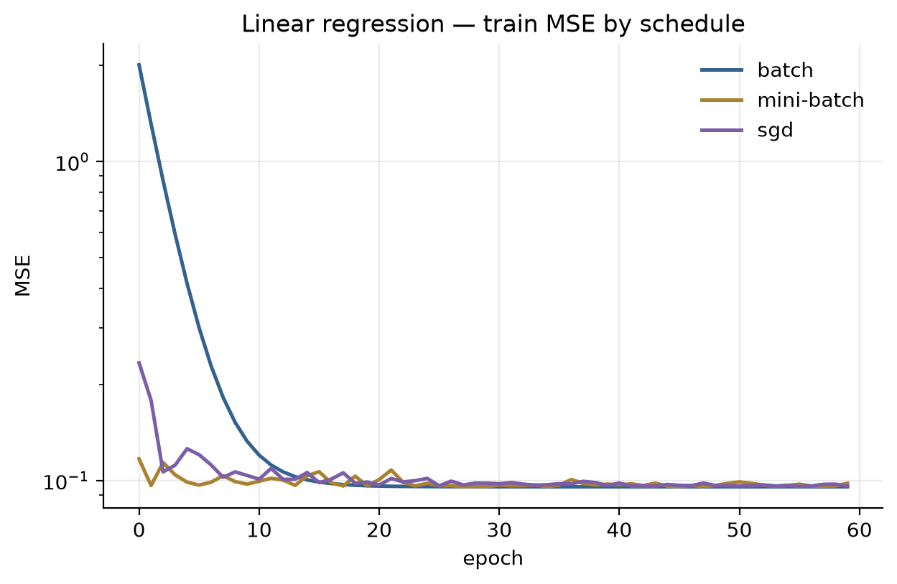
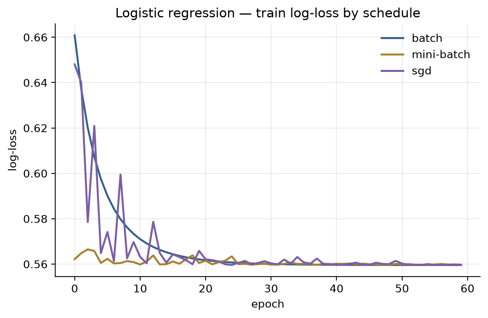
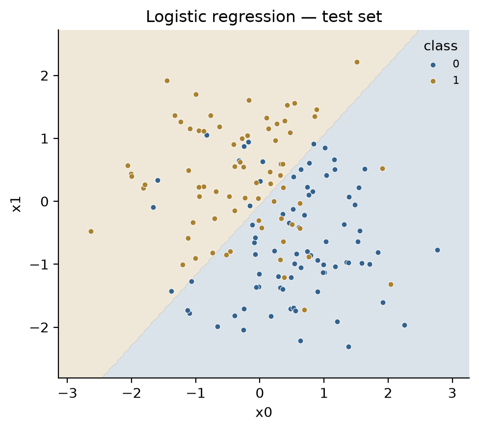

**Open threads.** Momentum and adaptive steps are exactly the B5 bake-off.
Logistic regression has a Newton step (IRLS) that converges in a handful of
iterations — worth implementing to see second-order information pay off before
it shows up as the Newton leaf values in A4's comparison against XGBoost.
Multiclass softmax is a small extension of the same loop.

**Reading:** ESL ch. 3–4; CS229 notes 1 (supervised learning, GLMs).

---

## A2 — Decision tree and random forest

**Question.** Trees are the one model here with no continuous parameters at
all — how much does the split *criterion* matter, and how much is really about
depth? And does bagging buy back what depth costs?

**What I built.** One `DecisionTree` covering both tasks: Gini and entropy for
classification, variance reduction for regression. Once you can score a
candidate partition, the search is identical — which is why A4 can embed this
class as its weak learner instead of reimplementing one.

The split search is the part worth getting right. The naive version re-scans the
data per threshold, which is O(n²) per feature per node. Instead: sort the
feature once, form cumulative class counts (or cumulative sums of y and y² for
regression), and score **every** candidate threshold in one vectorized pass —
`left_counts = cumsum[candidates]`, `right = total − left`. Candidates are
restricted to positions where the sorted value actually changes and both sides
clear `min_samples_leaf`. The forest adds bootstrap resampling plus a
`sqrt(features)` subset per split, and scores itself out-of-bag: each sample is
predicted by the ~37% of trees that never saw it.

**Results** (spirals, 3 classes, `noise=0.7` — deliberately hard):

| model | test accuracy (seed 0) | median (seeds 0–2) |
| --- | --- | --- |
| tree, depth 12, Gini | 0.760 | 0.760 |
| tree, depth 12, entropy | 0.780 | 0.787 |
| tree at its best depth | 0.847 (depth 5) | depth 3–8 |
| forest, 80 trees | 0.887 | 0.860 |
| forest out-of-bag estimate | 0.836 | 0.851 |

`forest − tree` is **+0.073 median (+0.007 to +0.107)**. Bagging reliably helps;
*how much* it helps is itself seed-dependent, which is the honest version of the
claim.

**What surprised me.** Two things. First, Gini versus entropy is a coin flip
(0.76 vs 0.78 on seed 0, and they swap on other seeds) — the criterion is nearly
irrelevant next to depth, which swings accuracy by 8 points. Textbooks say this;
seeing the two curves lie on top of each other is different. Second, the
out-of-bag estimate is *pessimistic*, not just noisy: 0.836 against a 0.887 test
score. That is structural — an OOB prediction is an average over a third of the
forest, so it measures a smaller ensemble than the one you ship. It is a usable
model-selection signal precisely because the bias is consistent.

The depth sweep is the clean bias-variance picture: train accuracy climbs to
0.938 and stops (the tree runs out of splits), while test peaks at depth 5 and
falls back, opening a 17-point gap.

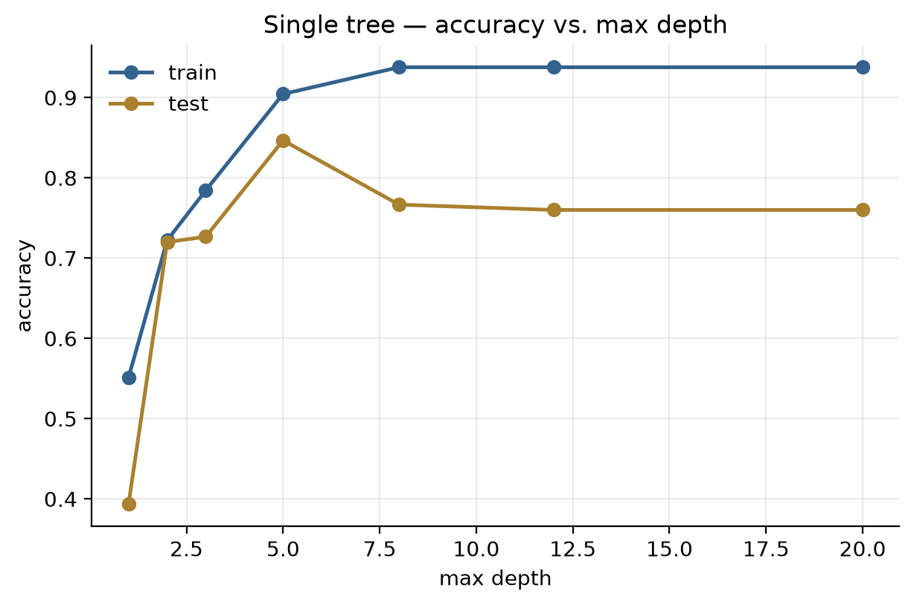
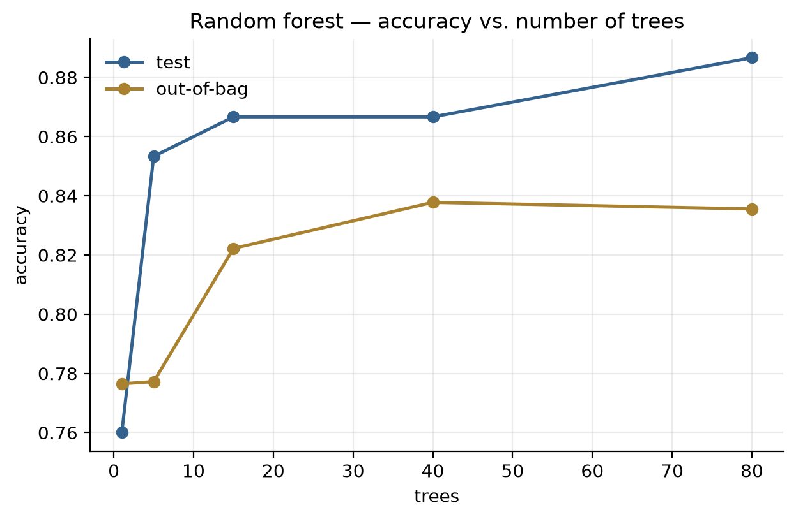
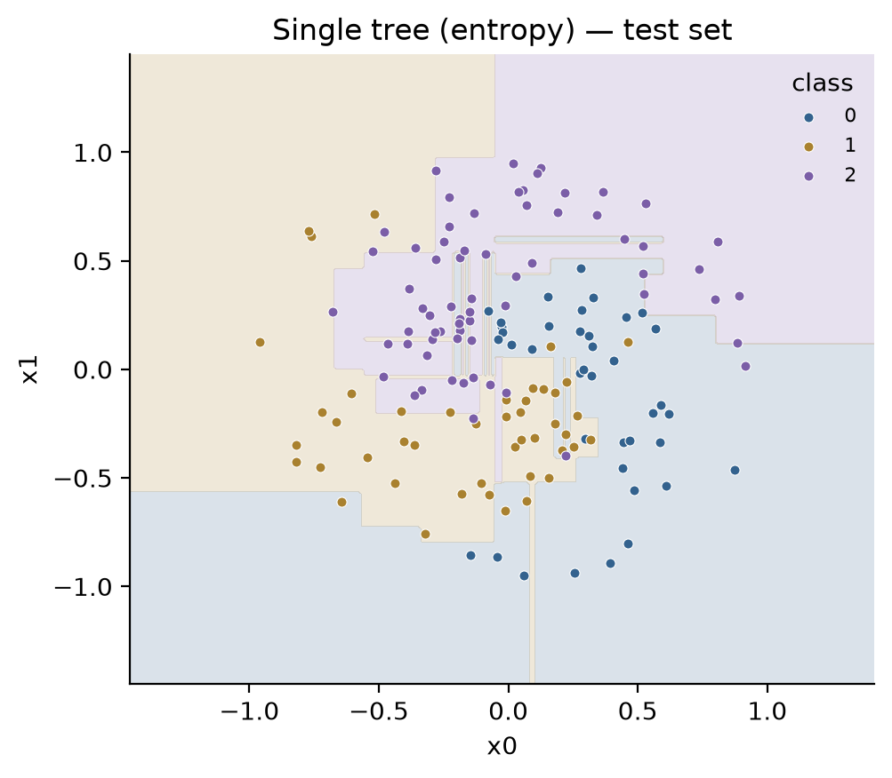
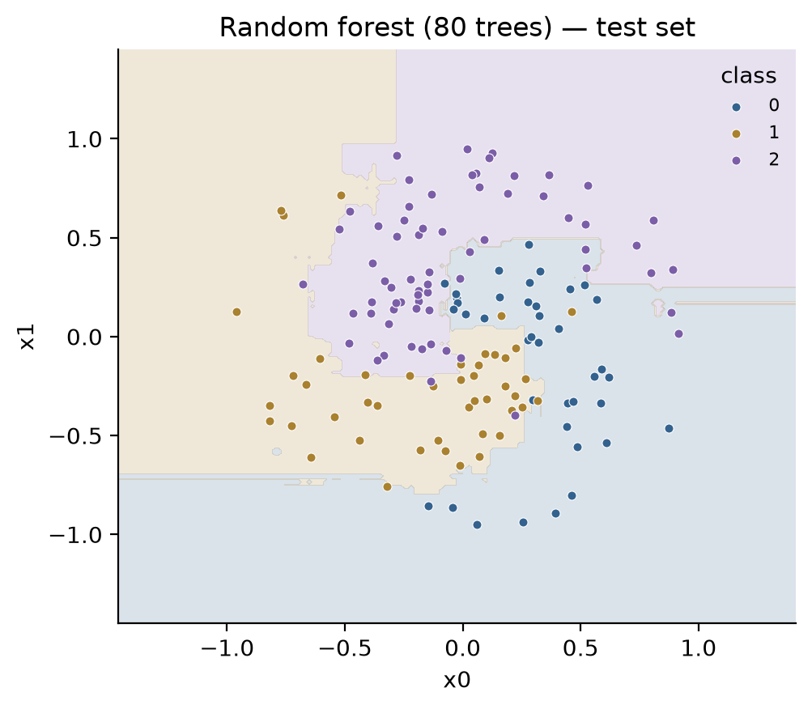

The two boundary plots are the whole argument in one pair of images: the single
tree carves the plane into confident rectangles that chase individual noisy
points; the forest's averaged boundary is visibly smoother and follows the
spiral arms.

**Open threads.** Cost-complexity pruning (the principled alternative to a depth
cap). Extremely randomized trees — random thresholds instead of best ones — to
test how much of the forest's gain is decorrelation rather than fitting. And the
known bias of impurity-gain importances toward high-cardinality features, which
A4's importance plot quietly depends on.

**Reading:** [Random Forests](https://link.springer.com/article/10.1023/A:1010933404324)
(Breiman 2001); ESL ch. 9, 15.

---

## A3 — k-means and PCA on one dataset

**Question.** Both are unsupervised, both minimize squared reconstruction
error, and both are usually taught apart. Run them on the same cloud: what does
each actually recover?

**What I built.** k-means with k-means++ seeding (each new centre drawn with
probability proportional to squared distance from the nearest existing one),
Lloyd iterations to a relative tolerance, and `n_init` restarts keeping the
lowest inertia — Lloyd only finds a local optimum, so the seeding decides which
one. An emptied cluster is re-seeded at the worst-fit point rather than dropped.
PCA via the SVD of the centred matrix (better conditioned than an eigen-
decomposition of the covariance, and the singular values give explained variance
directly), with a sign convention so components are reproducible.

The comparison that makes the pairing worth it: **both replace each point by a
least-squares approximation — k-means with one of k point masses, PCA with a
projection onto a k-dimensional affine subspace.** Same budget parameter, two
answers. (PCA is in fact the continuous relaxation of the k-means indicator
problem, which is why the ordering below is not an accident.)

**Results** (4 gaussian blobs in 8-D, standardized):

| k | k-means reconstruction error | PCA reconstruction error | ARI vs true labels |
| --- | --- | --- | --- |
| 2 | 5.69 | 3.29 | +0.495 |
| 3 | 4.00 | 1.75 | +0.713 |
| 4 | 2.41 | 0.93 | **+1.000** |
| 6 | 2.11 | 0.27 | +0.827 |

ARI peaks exactly at the true k on every seed, and reaches 1.000 — a perfect
partition. Clustering the 2-D PCA projection instead of the raw 8-D features
costs almost nothing (ARI 0.960 on seed 0, 0.991 median) for a 4× dimension
reduction.

**What surprised me.** Purity climbs monotonically with k — 1.000 at k=4, and
still 1.000 at k=8 — while ARI falls away from the true k. A metric that a
singleton clustering maxes out is not a clustering metric; the unit test pins
exactly that (purity 1.0, ARI 0.0 for one-point-per-cluster). I knew the
formula, but watching purity confidently reward the wrong answer is what makes
it stick. The reconstruction comparison also came out more lopsided than
expected: at every budget PCA wins by roughly 2.5×, which is the price of
insisting on *hard* assignments.

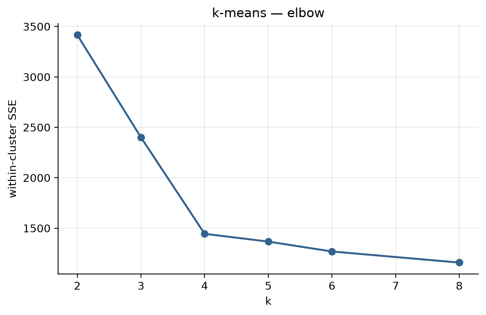
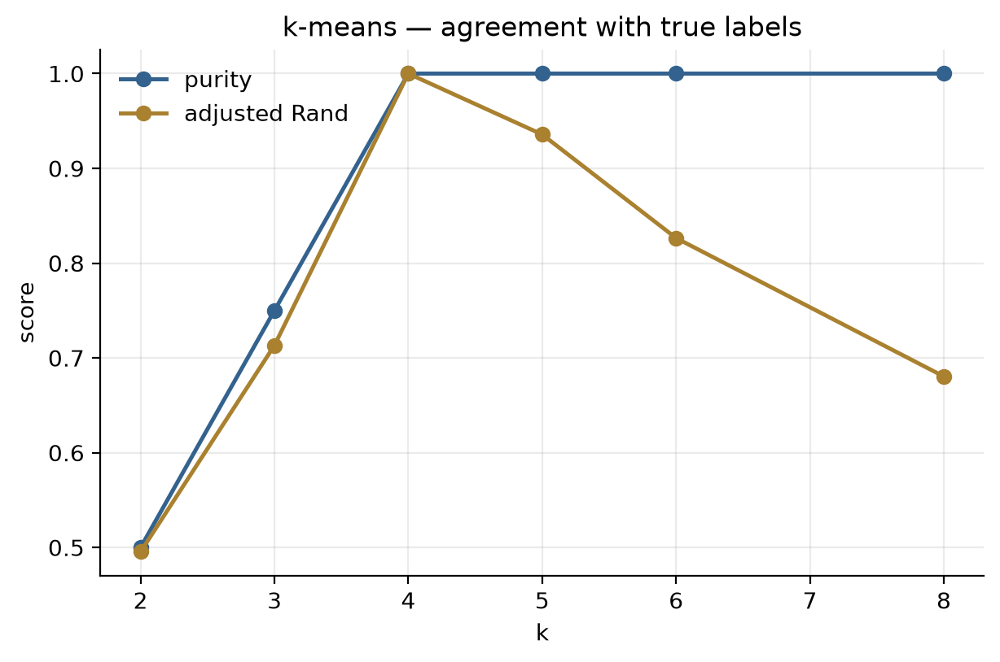
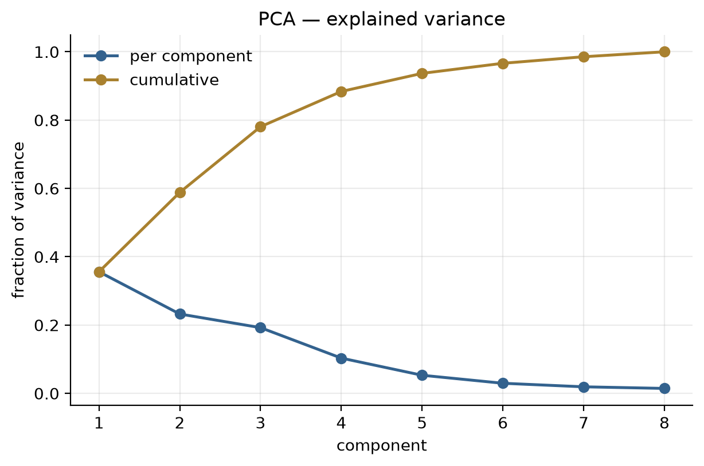
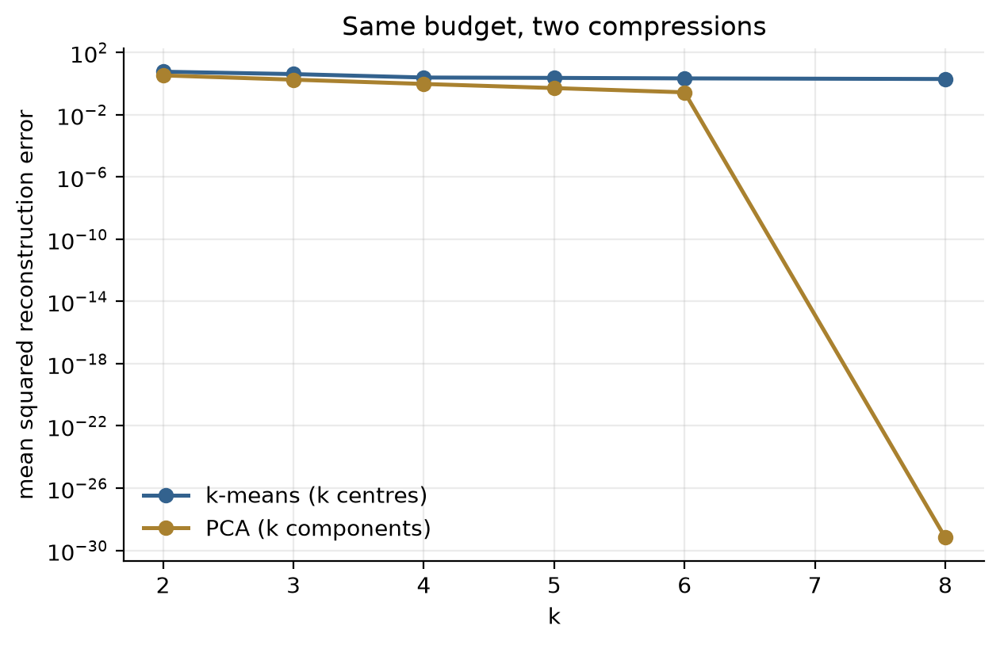
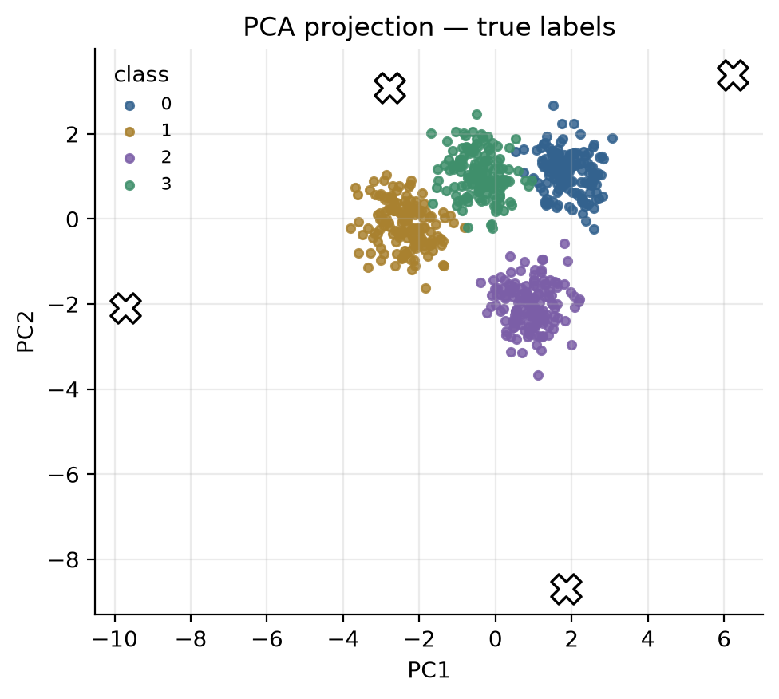
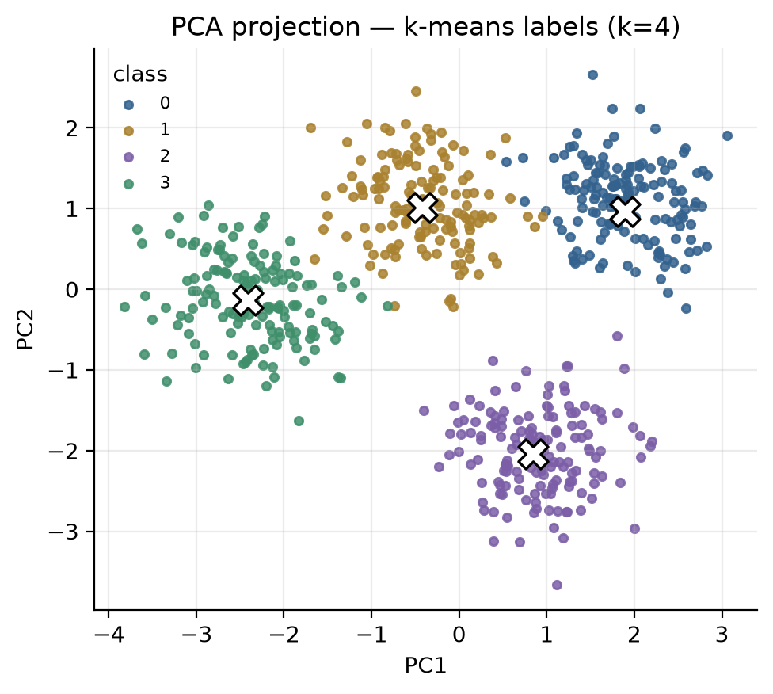

**Open threads.** Gaussian mixtures by EM — the soft-assignment version, where
the responsibility replaces the hard label. Kernel PCA, which is the bridge to
the representation-learning rungs in part D. And choosing k honestly (silhouette,
gap statistic) rather than by peeking at the labels as I do here.

**Reading:** ESL ch. 14; MML book ch. 10 (PCA derived three ways).

---

## A4 — Gradient boosting, benchmarked against XGBoost

**Question.** How close does a from-scratch booster get to the library everyone
actually uses, given the same hyper-parameters — and where exactly does the
difference come from?

**What I built.** Squared-loss gradient boosting over A2's regression tree:
start from the mean, fit each tree to the negative gradient (for squared loss,
just the residual), take a shrunken step `ν·h(x)`. `subsample < 1` turns it into
stochastic gradient boosting. `staged_rmse` replays the ensemble prediction
round by round, which is what makes the early-stopping picture visible.

The benchmark runs XGBoost at matched depth, learning rate and rounds, with
`reg_lambda=0` and `tree_method="exact"` to line the two up as closely as the
APIs allow. It goes through the **native Booster API**, not `XGBRegressor` —
the sklearn wrapper imports sklearn, and this part bans it. (That was not a
guess; `XGBRegressor` raised `ImportError: sklearn needs to be installed`.)

**Results** (Friedman #1, 800 samples, 10 features of which 5 carry signal):

| model | test RMSE (seed 0) | median (seeds 0–2) |
| --- | --- | --- |
| tree, depth 3 | 3.457 | 3.327 |
| tree, depth 10 | 3.138 | — |
| random forest, 60 trees | 2.333 | 2.333 |
| **ours, 150 rounds** | **1.482** | **1.588** |
| ours + subsample 0.8 | 1.461 | 1.492 |
| **XGBoost, 150 rounds** | **1.452** | **1.595** |

**What surprised me — and a claim I had to retract.** On seed 0, XGBoost wins
by 2% and it is tempting to write "we land within 2% of the library". Across
seeds 0–2 the gap is **−0.008 median, range −0.031 to +0.030**: our
implementation is ahead on two of three seeds. There is no measurable accuracy
difference at this scale; what the library actually buys is **9–15× faster
fits** (0.75s vs 0.07s). Histogram binning, Newton leaf values and C++ are speed
and scale, not accuracy on 800×10. This is the single most useful thing part A
taught me, and it is a methodological lesson rather than an algorithmic one: my
first writeup of this rung stated a seed-0 artifact as a finding. The multi-seed
metrics file exists because of it.

The learning-rate sweep is the clearest picture of shrinkage in the whole part:
`lr=0.03` is still improving at round 150 (under-trained), `lr=0.1` converges
cleanly, `lr=0.3` bottoms out around round 55 and then *degrades*, and `lr=1.0`
never gets there at all. Small steps and more rounds beat big steps, and the
"best" round is a function of the rate.

Pooled split-gain importance puts 74–79% of the gain on x0–x4 — exactly the
five features Friedman #1 gives signal to — which is a nice end-to-end check
that the tree, the boosting loop and the importance accounting all agree.

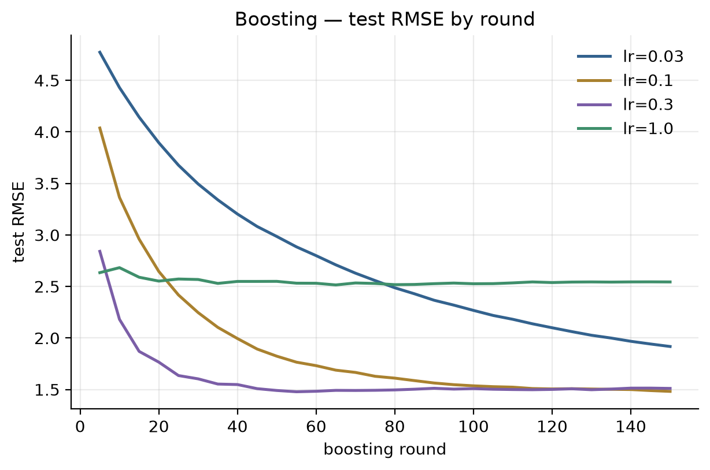
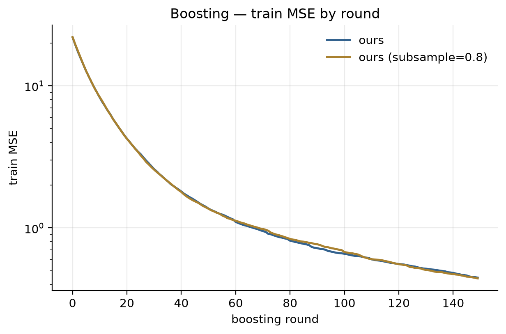
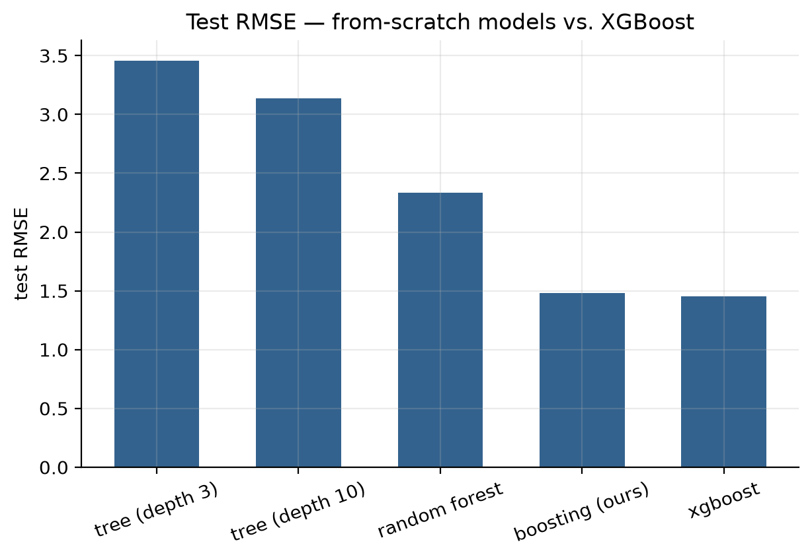
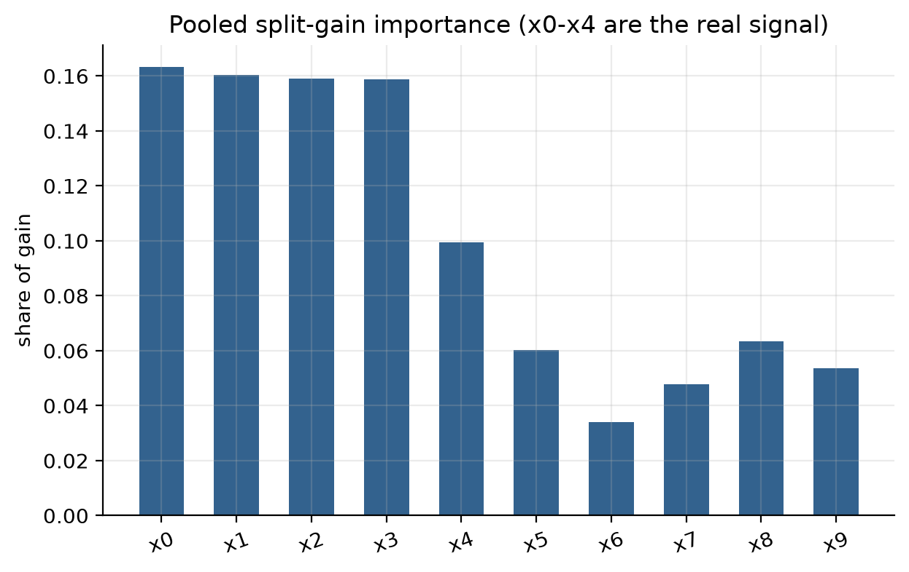

**Open threads.** Second-order (Newton) leaf values — `−Σg/Σh` instead of the
mean residual — which is the actual algorithmic difference with XGBoost rather
than an engineering one. Early stopping on a validation fold instead of a fixed
round count. A log-loss objective, so the same loop does classification. And
histogram binning, to see where the 10× goes.

**Reading:** [XGBoost](https://arxiv.org/abs/1603.02754) (Chen & Guestrin);
ESL ch. 10 (boosting as forward stagewise additive modelling).

---

## What part A settled

1. **One objective, many search strategies.** Least squares appears four times
   here — in A1's normal equation, A2's variance-reduction splits, A3's inertia
   and reconstruction error, and A4's residual fitting. The interesting
   differences are in the *search*, not the loss.
2. **Single-seed numbers lie.** The XGBoost gap changed sign across three seeds.
   Every headline number in this writeup now comes with a range, and
   `tools/writeup_figures.py` regenerates them.
3. **Variance is the whole game at this scale.** Depth, learning rate and batch
   size are all variance dials, and the two cures — averaging (bagging,
   restarts) and shrinkage (small steps, step decay, small `ν`) — recur in every
   rung.
4. **Reuse proves the abstraction.** A4 imports A2's tree with
   `criterion="mse"`. If the tree had been written only to be run rather than
   embedded, that would not have worked, and the boosting rung would have become
   a second tree implementation to keep in sync.

**Cost of the part:** ~1800 lines including tests and the dataset generators,
29 tests, and a full run of all four rungs in about 21 seconds — small enough to rerun on every
change, which is the property that made the multi-seed check cheap enough to
adopt.

---

*Figures regenerate with `uv run python tools/writeup_figures.py A`; the numbers
they are quoted against live in [`data/a-metrics.json`](data/a-metrics.json).
The [part README](../../parts/a_classical/README.md) is the short version of
this document.*
