# Part B — Deep learning foundations

> **Status:** complete (B1–B5) · **Constraint:** CPU only, subsets of the real datasets
> **Numbers:** seeds 0–2, reference seed 0 · raw values in [`data/b-metrics.json`](data/b-metrics.json)
> **Reproduce:** `ladder run B1` … `B5` (needs `uv sync --extra torch`), or `uv run python tools/writeup_figures.py B`

Part A was four algorithms with four different search strategies. Part B is one
algorithm — reverse-mode automatic differentiation on a composition of
functions — applied five times, and the rungs are really about everything
*around* it: how much the chain rule costs (B1), whether a framework computes
what you derived (B2), what normalization and noise each buy (B3), why depth
stops helping (B4), and which optimizer survives a badly chosen step size (B5).

The through-line: **every improvement in this part is a fix to optimization,
not to expressiveness.** BatchNorm, residual connections and Adam all leave the
function class untouched — a plain deep net can represent everything a ResNet
can — and each one exists because gradient descent could not otherwise find the
good parameters. The bargain from part A is the same, one level up: the enemy
is not what the model can express but what the optimizer can reach.

Notation: $a^{(l)}$ is the activation of layer $l$, $z^{(l)} = a^{(l-1)}W^{(l)} + b^{(l)}$
the pre-activation, $\phi$ the nonlinearity, $\delta^{(l)} = \partial L/\partial z^{(l)}$,
and $g_t = \nabla_\theta L$ the gradient at step $t$.

---

## B1 — A scalar autodiff engine

**Question.** Backpropagation is the chain rule plus bookkeeping. What exactly
is the bookkeeping, and what does doing it one number at a time cost?

### The idea

Training a neural network means adjusting thousands (or billions) of numbers
to make a loss smaller, and for that you need the **gradient**: for every
parameter, how much the loss would change if you nudged it. Writing those
derivatives by hand is hopeless for anything big. **Automatic differentiation**
gets them mechanically.

The trick is to record every arithmetic operation as it happens, building a
graph whose nodes are intermediate values. Each operation only needs to know
its own *local* derivative (the derivative of $a \cdot b$ with respect to $a$ is
$b$, of $\tanh z$ is $1 - \tanh^2 z$, and so on). The chain rule then assembles
the global gradient by walking the graph **backwards** from the loss, which is
where the name *backpropagation* comes from.

This rung builds that engine one scalar at a time: every number in the
network is its own graph node. That is the clearest possible version, and
also the slowest, which is the other thing it measures.

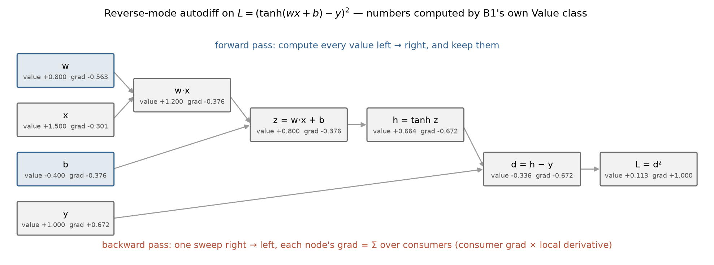

*Every box is one `Value`. The forward pass fills in each value from left to
right. The backward pass starts from $\partial L/\partial L = 1$ and moves right to
left. Each node's gradient is the sum, over the nodes that consumed it, of that
consumer's gradient times the local derivative. $w$ and $b$ are the parameters
we would update. The numbers were produced by the rung's own engine.*

### The math

**Reverse mode is the chain rule in reverse topological order.** Take a DAG
whose nodes are intermediate values and whose edges are elementary operations,
with a single scalar output $L$. For a node $v$ with consumers $u_1,\dots,u_k$,
the multivariable chain rule gives

$$\frac{\partial L}{\partial v} = \sum_{i=1}^{k} \frac{\partial L}{\partial u_i}\,\frac{\partial u_i}{\partial v}.$$

Two consequences fall straight out of that sum, and they are the whole
implementation. First, gradients must **accumulate** rather than assign — a node
used twice contributes along both paths, which is why `x * x` only gets
$2x$ right if `+=` is used. Second, $\partial L/\partial u_i$ must already be
final before $v$ is processed, which is exactly the definition of reverse
topological order.

**Why reverse and not forward.** Forward mode propagates $\partial v/\partial x_j$
for one input $x_j$ in a single pass: cost $O(N)$ per input, so $O(nN)$ for $n$
parameters. Reverse mode propagates $\partial L/\partial v$ for one *output* in a
single pass: $O(N)$ for **all** $n$ parameters at once. With $n \sim 10^9$ and one
scalar loss, that asymmetry is the reason deep learning is affordable at all;
the price is memory, since every intermediate value must be kept for the
backward pass.

**The finite-difference check has a floor.** A central difference expands as

$$\frac{f(x+h) - f(x-h)}{2h} = f'(x) + \frac{h^2}{6}f'''(x) + O(h^4),$$

so truncation error falls as $h^2$ while floating-point cancellation grows as
$\varepsilon/h$. Balancing them puts the optimum at $h \approx \varepsilon^{1/3}$
($\sim 6\times10^{-6}$ in double precision) with a best-case relative error around
$\varepsilon^{2/3} \approx 4\times10^{-11}$. Agreement much tighter than that would
mean the check is not actually independent; agreement much looser means a bug.

### What we measure, and why

- **Maximum relative gradient error against finite differences.** A finite
  difference estimates a derivative by actually nudging a parameter and
  re-evaluating the loss. It needs no chain rule at all, so it is an
  independent check. Agreement to about $10^{-8}$ means the engine is right; a
  bug (a wrong sign, a missed accumulation) shows up at $10^{-1}$.
- **Graph nodes per forward pass** — how much bookkeeping one evaluation
  creates, which is the memory cost of reverse mode.
- **Training time against the same network in numpy**, where the "graph" is a
  handful of matrix multiplies. The ratio is the price of doing the chain rule
  one number at a time, and the reason real frameworks work on whole tensors.
- **Test accuracy** — only to confirm both versions learned the same thing.

### What I built

A `Value` node holding data, an accumulated gradient, and a
closure that pushes gradient to its inputs; `backward()` does an **iterative**
DFS for the topological order — a recursive one dies on a chain of a few
thousand nodes, which a test pins by building exactly that. On top: `Neuron`,
`Layer`, `MLP`, a numerically sane BCE, and `NumpyMLP` — the same architecture
vectorized — as the control for the cost measurement.

### Results

*Setup: moons, 120 samples, MLP [2, 8, 8, 1] = 105 parameters.*

| quantity | seed 0 | median (seeds 0–2) | range |
| --- | --- | --- | --- |
| max relative gradient error vs central differences | 9.4e-09 | 1.9e-08 | 9.4e-09 – 1.4e-07 |
| graph nodes for one full-batch forward | 18,380 | 18,370 | 18,360 – 18,380 |
| scalar-engine training time (60 epochs) | 17.5s | 18.1s | 17.5 – 18.5s |
| same network in numpy | 0.0054s | 0.0052s | 0.0050 – 0.0054s |
| slowdown | 3,259x | **3,555x** | 3,259 – 3,628x |

Both implementations reach the same test accuracy, which is the point: the
scalar engine is *correct* and useless, and the vectorized one is the same
mathematics with the loops pushed into BLAS.

### What surprised me

The gradient error — 1.9e-08 median, and as high as
1.4e-07 on one seed — sits three to four orders of magnitude above the
$\varepsilon^{2/3}$ floor, and it *moves with the seed*. That is the summation:
the loss is a sum over 90 samples, so the finite difference measures a quantity
whose own accumulation error already exceeds a single term's, and how much
depends on the particular weights. The check is still decisive — a wrong sign or
a missing accumulation shows up at $10^{-1}$, not $10^{-8}$ — but the floor is
set by the *problem*, not by the arithmetic, and quoting one seed's 9.4e-09 as
"the" precision would have been quoting noise.

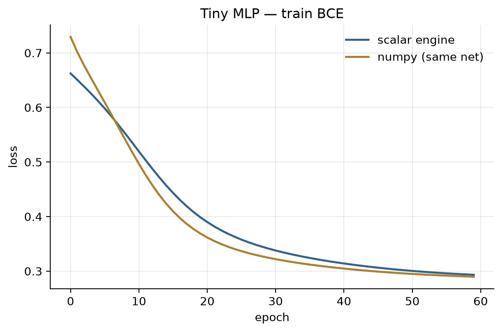
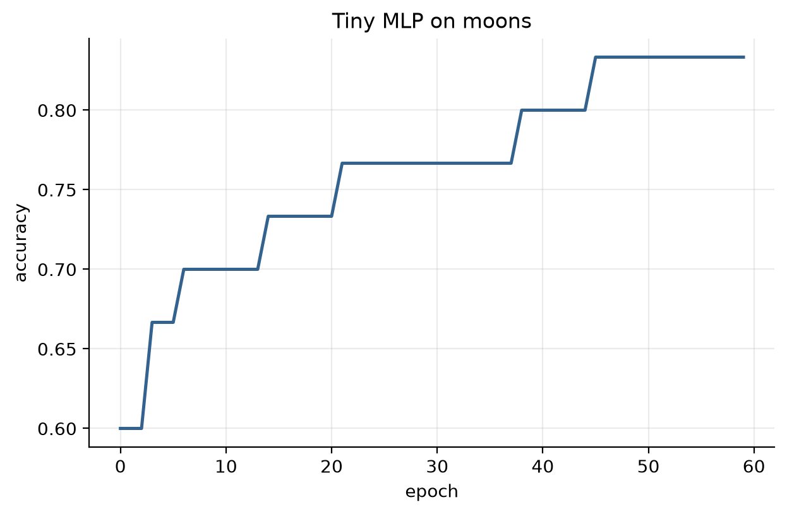
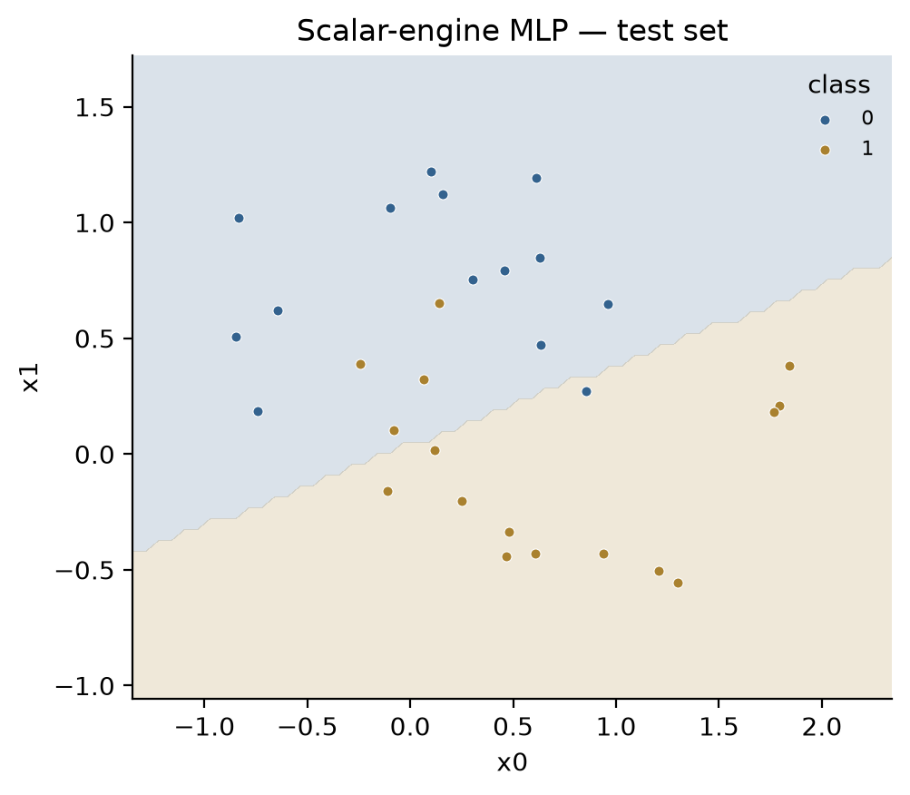

### Open threads

Checkpointing — recomputing activations instead of storing
them — is the memory/compute trade the O(N) memory cost invites. Forward-mode
for Jacobian-vector products, which is what you want for Hessian-vector products
and hence second-order methods. And a tape-based (rather than closure-based)
engine, which is closer to what real frameworks do.

### Further reading

[micrograd](https://github.com/karpathy/micrograd);
Goodfellow et al. ch. 6.5; Baydin et al., *Automatic Differentiation in Machine
Learning: a Survey*.

---

## B2 — Matrix backprop against autograd

**Question.** Does the hand-derived gradient equal what a framework computes —
not approximately, but to floating-point?

### The idea

A **multilayer perceptron (MLP)** is a stack of layers, each doing the same two
things: multiply its input by a weight matrix (plus a bias), then apply a simple
nonlinearity, here ReLU, $\max(0, z)$. Without the nonlinearity the whole stack
would collapse into one matrix. With it, the network can bend the input space
into shapes a linear model cannot.

For MNIST digits the input is 784 pixel intensities and the output is 10
scores, one per digit, turned into probabilities by **softmax**. The loss is
**cross-entropy**: minus the log of the probability given to the correct digit.

Backpropagation for this network is three matrix equations (derived below),
and this rung implements them by hand in numpy. It then asks whether PyTorch,
started from the same weights and fed the same batches, computes the same
gradients.

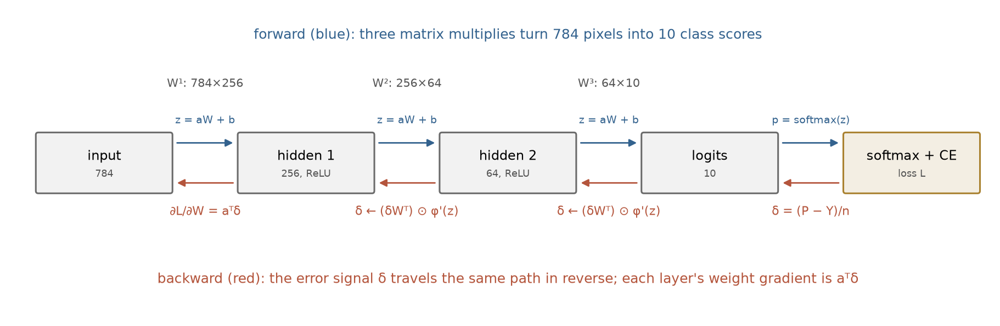

*Forward (blue): the image passes through three matrix multiplies to become ten
class scores. Backward (red): the error signal $\delta$ starts as "predicted
probabilities minus the one-hot truth" and flows back through the transposes of
the same matrices. Each layer's weight gradient is its input transposed times
the $\delta$ arriving from above.*

### The math

**Forward, one layer:** $z^{(l)} = a^{(l-1)}W^{(l)} + b^{(l)}$, $a^{(l)} = \phi(z^{(l)})$.

**The fused softmax/cross-entropy gradient.** With $p = \mathrm{softmax}(z)$ and
$L = -\log p_y$,

$$\frac{\partial L}{\partial z_k} = p_k - \mathbf{1}[k = y] \quad\Longrightarrow\quad \delta^{(L)} = \frac{P - Y}{n},$$

where $Y$ is one-hot. The softmax Jacobian and the logarithm cancel exactly,
which is why every framework fuses these two into one op: computing them
separately is both slower and less stable.

**The backward recursion.** Differentiating the forward equations,

$$\delta^{(l)} = \left(\delta^{(l+1)} W^{(l+1)\top}\right) \odot \phi'\!\left(z^{(l)}\right), \qquad \frac{\partial L}{\partial W^{(l)}} = a^{(l-1)\top}\delta^{(l)}, \qquad \frac{\partial L}{\partial b^{(l)}} = \mathbf{1}^\top \delta^{(l)} .$$

For ReLU, $\phi'(z) = \mathbf{1}[z > 0]$ (any subgradient will do at 0). That is the
entire algorithm — three lines, one matrix multiply each, and the transposes are
where the bugs live.

**He initialization follows from variance propagation.** If $W_{ij}$ are iid with
variance $\sigma_w^2$ and $a^{(l-1)}$ has variance $\sigma_a^2$, then
$\mathrm{Var}(z^{(l)}) = n_{\text{in}}\sigma_w^2\sigma_a^2$. ReLU zeroes half the
distribution, halving the variance it passes on, so keeping activations
stationary across depth needs $\sigma_w^2 = 2/n_{\text{in}}$ — otherwise the
forward signal decays or explodes geometrically in the number of layers.

**Stability.** Softmax is computed on $z - \max_k z_k$: the shift leaves the
result unchanged and bounds $\exp$ from above by 1.

### What we measure, and why

- **Worst gradient difference, any tensor**, manual against PyTorch. This
  is the whole test: two implementations of the same math should agree to
  floating-point rounding (about $10^{-7}$ in float32), and a transposed matrix
  or a missing term would show up as a difference of order 1.
- **Relative to the gradient scale** — the same difference divided by the
  gradient's typical size, so it can be compared with float32's precision.
- **Test accuracy**, manual and PyTorch — should be identical to the fourth
  decimal place if the gradients are.
- **Training time** — whether the framework's generality costs anything at this
  size (it does).
- **First-layer filters** (figure) — each hidden unit's 784 weights drawn as
  a 28×28 image, which shows what pixel patterns the network learned to detect.

### What I built

`ManualMLP` with the three equations above, and a torch
`Sequential` **initialized from the same weights** — torch stores `Linear`
weights transposed, which is the one place the comparison could quietly fail.
Both then train on identical batch orders, so any divergence is arithmetic
rather than luck.

### Results

*Setup: MNIST subset, 20k train / 5k test, 784-256-64-10.*

| quantity | seed 0 | median (seeds 0–2) |
| --- | --- | --- |
| worst gradient difference, any tensor | 3.0e-07 | 2.4e-07 |
| relative to the gradient scale | 1.7e-06 | 1.7e-06 |
| loss difference | 0.0 | 2.4e-07 |
| test accuracy, manual / torch | 0.9638 / 0.9636 | 0.9638 / 0.9636 |
| training time, manual / torch | 2.18s / 2.36s | 1.89s / 2.36s |

Float32 has $\varepsilon \approx 1.2\times10^{-7}$, and the batch sums 512 terms, so
a relative difference of $10^{-6}$ is exactly the expected accumulation — the
two implementations are performing the same arithmetic in a different order.

### What surprised me

The manual numpy implementation is *faster* than torch
at this size. Framework overhead — dispatch, autograd bookkeeping, tensor
allocation — is per-operation, and these operations are small enough that it
dominates the FLOPs. Torch wins as soon as the matrices are big enough, or the
device is not a CPU; below that crossover, the "slow" implementation is the one
with the abstraction.

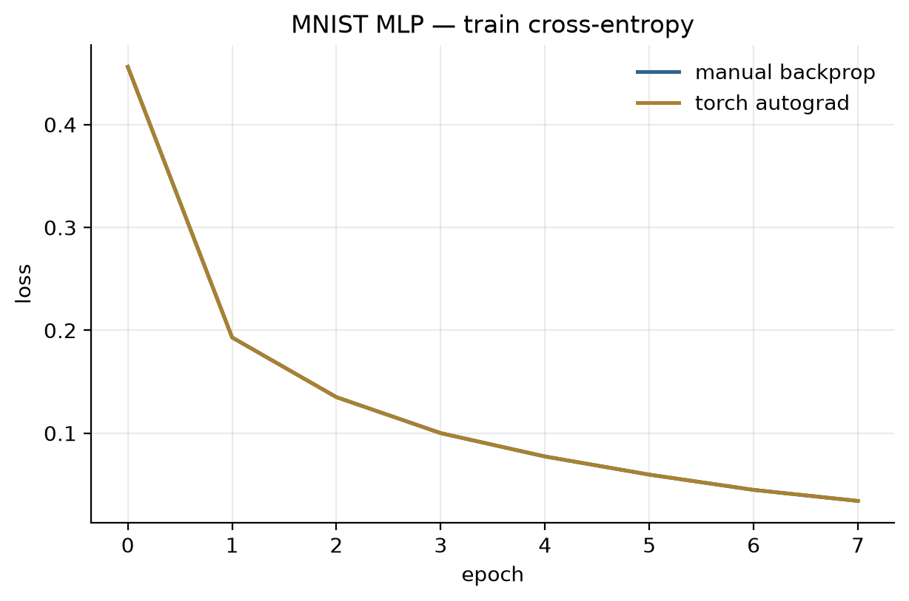
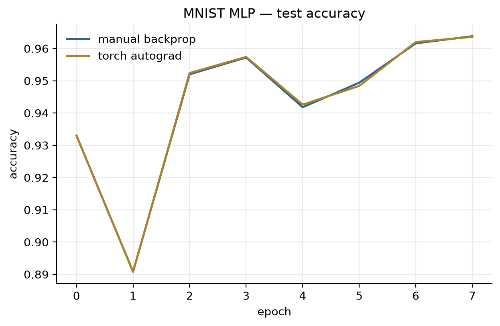
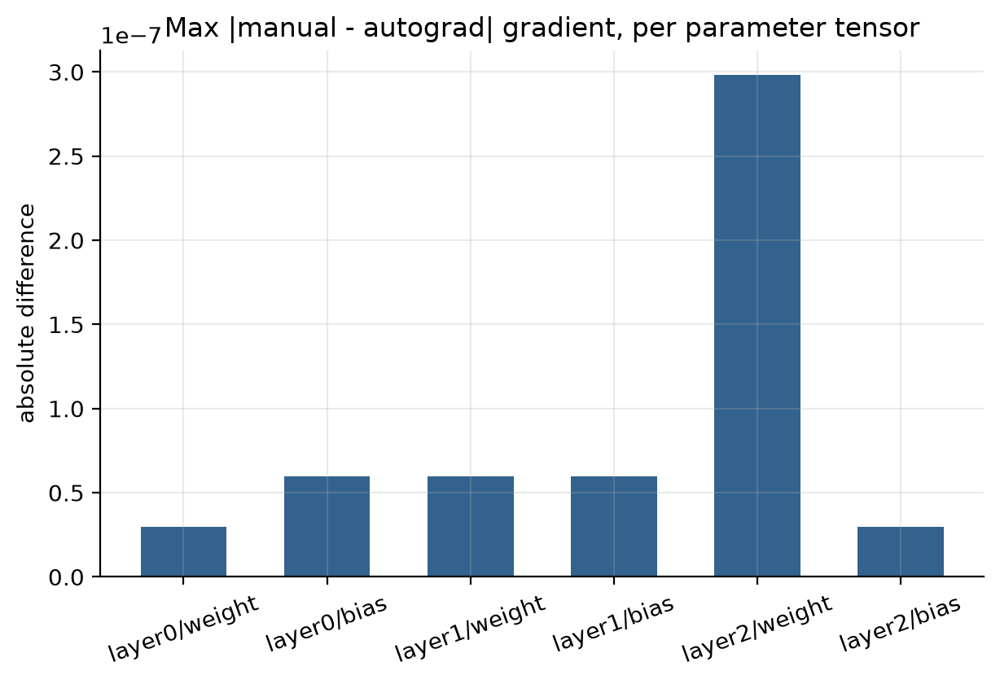
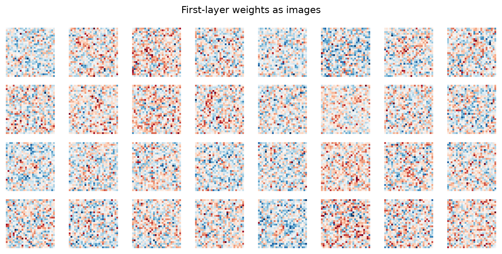

### Open threads

The same diff for convolution and batchnorm, where the
backward pass is genuinely hard to derive and correspondingly easy to get
wrong. And a `torch.autograd.gradcheck` pass, which does the finite-difference
check B1 does but in double precision.

### Further reading

[Efficient BackProp](http://yann.lecun.com/exdb/publis/pdf/lecun-98b.pdf)
(LeCun et al.); He et al., *Delving Deep into Rectifiers* (He initialization).

---

## B3 — What batchnorm and dropout each do

**Question.** Both are called regularizers. Are they?

### The idea

This rung adds two layers to a small **convolutional network (CNN)**. A
convolution slides a small filter (3×3 pixels here) over the image, so the same
few weights detect the same pattern wherever it appears. Stacking convolutions
and pooling builds up from edges to textures to object parts.

- **Batch normalization (BN)** takes each channel's activations across the
  current mini-batch, subtracts their mean and divides by their standard
  deviation, then lets the network re-learn a scale $\gamma$ and shift $\beta$.
  Every layer then sees inputs on a stable scale however the weights below
  have drifted.
- **Dropout** randomly switches off a fraction $p$ of units at every training
  step and scales up the survivors. The network cannot rely on any single unit,
  which pushes it towards redundant, more general features. At test time
  nothing is dropped.

Both are routinely called "regularizers" (things that reduce overfitting). The
rung's question is whether that is true of both, or whether one of them is
really doing something else.

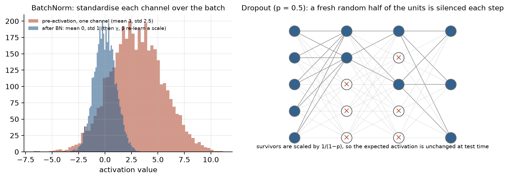

*Left: BN moves a channel's activation distribution to mean 0, standard deviation
1, whatever it was before. Right: dropout silences a random half of the hidden
units for one training step. The next step silences a different half.*

### The math

**Batch normalization** standardizes each channel over the batch and then
re-learns a scale and shift:

$$\hat{x}_i = \frac{x_i - \mu_B}{\sqrt{\sigma_B^2 + \epsilon}}, \qquad y_i = \gamma\hat{x}_i + \beta .$$

The subtlety is the backward pass: $\mu_B$ and $\sigma_B^2$ are *functions of the
batch*, so gradient flows through them too, giving

$$\frac{\partial L}{\partial x_i} = \frac{\gamma}{\sqrt{\sigma_B^2+\epsilon}}\left[\frac{\partial L}{\partial y_i} - \frac{1}{m}\sum_j \frac{\partial L}{\partial y_j} - \hat{x}_i\,\frac{1}{m}\sum_j \frac{\partial L}{\partial y_j}\hat{x}_j\right].$$

Read the bracket: BN **removes the mean of the incoming gradient and its
component along $\hat{x}$**. The update is projected orthogonal to the current
activation direction, which is a strong statement about conditioning and says
nothing about regularization.

**Scale invariance, and why the learning rate can be larger.** For $a > 0$,
$\mathrm{BN}(aWx) = \mathrm{BN}(Wx)$, so the loss does not depend on the scale of the
weights feeding a BN layer. Differentiating that invariance gives

$$\frac{\partial L}{\partial (aW)} = \frac{1}{a}\frac{\partial L}{\partial W},$$

so the gradient shrinks exactly as the weights grow — an automatic step-size
adaptation. A step that would be catastrophic for a plain network gets damped as
soon as it inflates the weights. (Ioffe & Szegedy explained BN by "internal
covariate shift"; Santurkar et al. showed that story does not hold up and that
the smoothing above is what matters.)

**Dropout**, in its inverted form, multiplies by a scaled Bernoulli mask:

$$y = \frac{m \odot x}{1-p}, \qquad m_j \sim \mathrm{Bernoulli}(1-p), \qquad \mathbb{E}[y] = x .$$

The expectation is preserved, so nothing needs changing at test time. For a
linear model the expected loss under dropout equals the clean loss plus a
penalty proportional to $\frac{p}{1-p}\sum_j \mathrm{Var}(x_j)\,w_j^2$ — a
data-dependent L2. That derivation is why dropout is genuinely a regularizer,
and BN's is not.

**A small corollary:** a convolution feeding a BN layer needs no bias, since BN
subtracts the batch mean and any constant cancels. The rung drops it, and a test
checks it stays dropped.

### What we measure, and why

- **Test accuracy** — the headline, on held-out CIFAR-10 images (chance is 0.10).
- **Generalization gap** = train accuracy − test accuracy. This is the metric
  that separates the two mechanisms. A *regularizer* should shrink the gap
  (less memorisation). An *optimization aid* raises train and test accuracy
  together and can even widen the gap. Looking at test accuracy alone could not
  tell them apart.
- **Accuracy at 10× the learning rate** — a stress test. The math predicts BN
  makes training tolerant of large steps, so push the step size until the plain
  network breaks and see whether BN survives.
- **Time per epoch** — what each layer costs.

### What I built

A four-conv network in two `conv-conv-pool` blocks, with BN
and dropout as flags, run as a 2x2 ablation with shared data, schedule and
seed — plus a learning-rate probe at 10x the base rate.

### Results

*Setup: CIFAR-10 subset, 5k train / 2k test, 8 epochs.*

| arm | test accuracy (seed 0) | median | generalization gap (median) |
| --- | --- | --- | --- |
| plain | 0.404 | 0.432 | +0.066 |
| batchnorm | **0.564** | **0.564** | +0.130 |
| dropout | 0.420 | 0.457 | **+0.062** |
| both | 0.510 | 0.509 | +0.056 |

BatchNorm is worth **+0.137 test accuracy at the median (+0.097 to +0.159)** and
it *doubles* the generalization gap, from 0.066 to 0.130. Dropout gains about
2.5 points and leaves the gap essentially where it was (0.062 vs 0.066 — the
narrowest of the four, but only just). So in this regime BN is unambiguously an
optimizer aid rather than a regularizer; dropout is a mild regularizer whose
effect is smaller than the seed spread on plain (0.405–0.447).

### What surprised me

The learning-rate probe was sharper than the ablation,
but less reliable than one seed suggested. At $\eta = 0.5$ the plain network
collapses to chance on **all three seeds** (0.094–0.098 — it learns nothing at
all). The batchnorm network reaches 0.187 on seed 0 and 0.147 at the median, but
on one seed it collapses too (0.094). The correct reading is therefore weaker
than "BN lets you train at 10x the learning rate": at 10x, BN turns certain
failure into *sometimes* learning. Scale invariance damps the step, it does not
license an arbitrary one.

Also worth noting: `both` is worse than `batchnorm` alone, because at an
8-epoch budget on 5k images the model is not overfitting enough for dropout's
noise to pay for the slower fitting it causes.

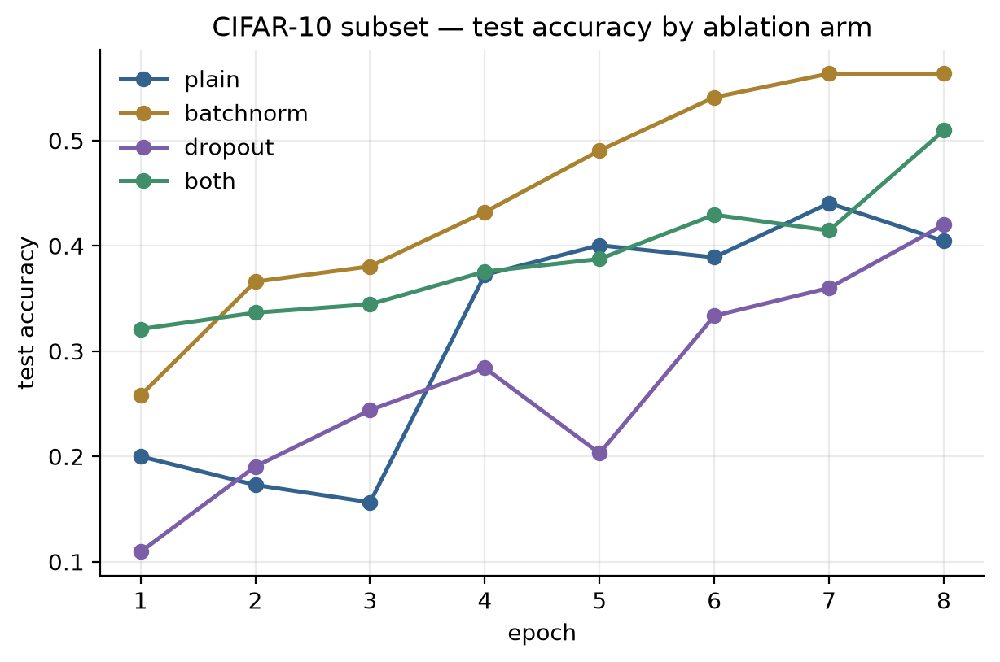
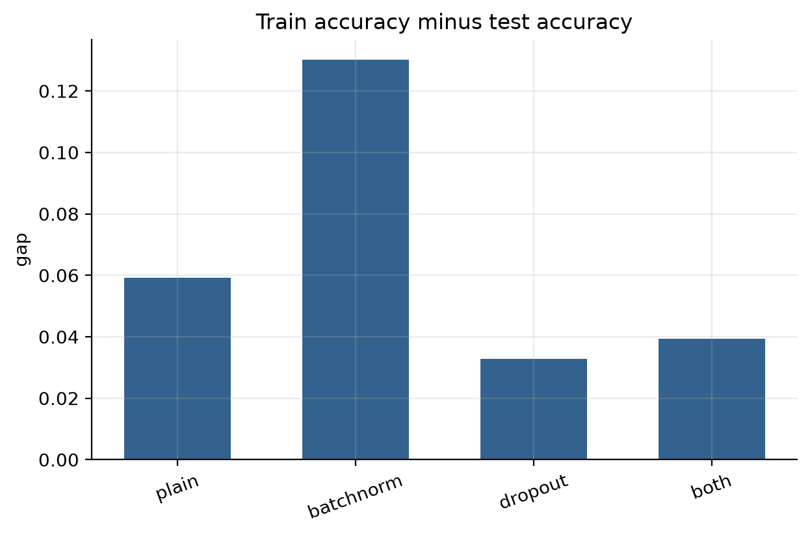
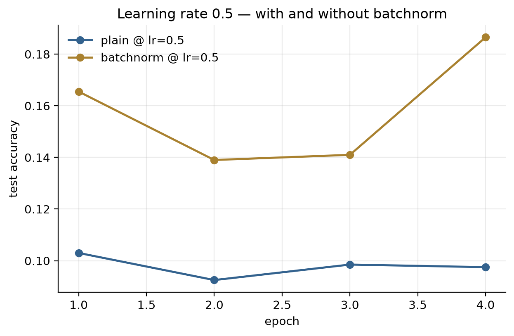
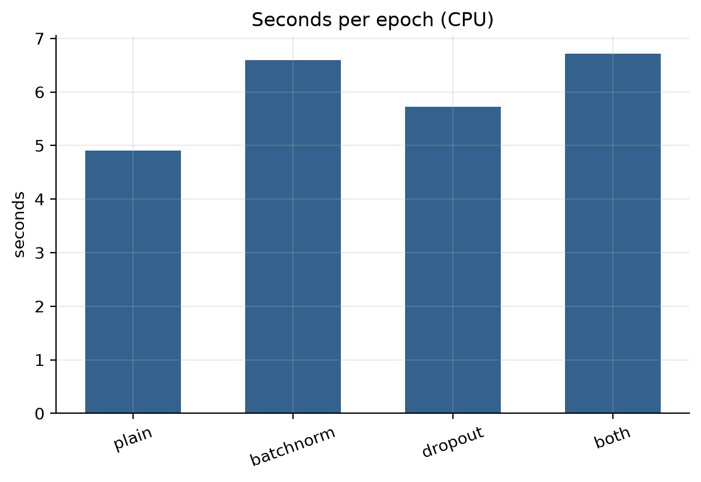

### Open threads

GroupNorm and LayerNorm, which drop the batch dependence that
makes BN awkward at small batch sizes and in sequence models — and which is why
part C's transformers use LayerNorm instead. BN's train/eval discrepancy
(running statistics) as a source of real bugs. And the same ablation at a budget
large enough to overfit properly, where dropout should overtake.

### Further reading

[Batch Normalization](https://arxiv.org/abs/1502.03167);
[Dropout](https://jmlr.org/papers/v15/srivastava14a.html);
Santurkar et al., *How Does Batch Normalization Help Optimization?*

---

## B4 — Residual blocks and the degradation problem

**Question.** Deeper networks can represent strictly more. Why do they train
worse?

### The idea

Deeper networks can represent everything a shallower one can and more, since
the extra layers could simply learn to pass their input through unchanged. In
practice, making a plain CNN deeper eventually makes it *worse*, and worse on
the training data too, so it is not overfitting. This is the **degradation
problem**.

A **residual block** changes one thing: instead of a layer computing a new
representation $F(x)$ from scratch, it computes a *correction* and adds it to
its input, $x + F(x)$. The input travels along a **skip connection** (the
"identity path") that has no weights on it. Two consequences:

1. Doing nothing is now easy: $F = 0$ passes the input through, so an extra
   block starts out harmless instead of having to learn the identity.
2. During backpropagation the gradient can flow straight down the skip path to
   early layers without being multiplied by every weight matrix on the way.

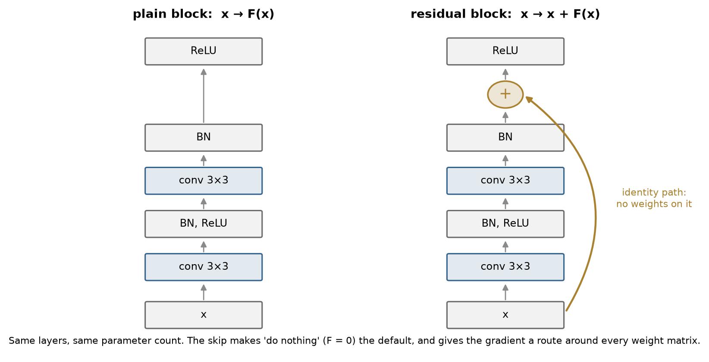

*The two blocks have identical layers and parameters; the residual one adds its
input back before the final ReLU. That one addition is the entire ResNet idea.*

### The math

**The degradation argument.** Let $\mathcal{N}_L$ be a network of $L$ layers and
$\mathcal{N}_{L+k}$ the same network with $k$ extra layers. There *exists* a
parameter setting for $\mathcal{N}_{L+k}$ that matches $\mathcal{N}_L$ exactly:
make the extra layers identity maps. So the deeper model's optimal training loss
can never be worse. When the deeper model nonetheless trains to a *higher*
training loss — which is what happens — the failure is in the optimizer, not the
hypothesis class. That is the observation the ResNet paper is built on, and it
is why the evidence to look for is train accuracy, not test.

**The fix is a reparameterization.** A plain block computes $x_{l+1} = F(x_l)$;
a residual block computes

$$x_{l+1} = x_l + F(x_l, W_l).$$

Unrolling gives an *additive* composition where the plain network has a
multiplicative one:

$$x_L = x_l + \sum_{i=l}^{L-1} F(x_i, W_i), \qquad \frac{\partial L}{\partial x_l} = \frac{\partial L}{\partial x_L}\left(1 + \frac{\partial}{\partial x_l}\sum_{i=l}^{L-1}F(x_i, W_i)\right).$$

The $1$ is a path from the loss to layer $l$ that passes through **no weight
matrix at all**. And "do nothing" is now the default: $F = 0$ gives the
identity, so adding depth starts from the shallower solution rather than having
to rediscover it.

### What we measure, and why

- **Training accuracy across depth** (2, 4 and 8 blocks) — the metric where
  degradation shows. If a deeper network fits its own training data *worse*,
  the optimizer failed, because a solution at least as good exists. Test
  accuracy mixes that with generalisation, which is why it is the secondary
  number here.
- **Residual − plain test accuracy** at each depth, over three seeds — the
  practical payoff, with its seed spread reported because it turned out to be
  large.
- **Gradient norm per layer, and the first/last ratio** — the standard story
  says gradients vanish in deep plain nets. Measuring the norm at every layer
  tests that story directly. The ratio of first-layer to last-layer gradient
  norm measures how *unevenly* learning signal is spread across depth.

### What I built

A block of two 3x3 convolutions with BN, a ReLU after the
addition, and an identity shortcut wherever the shape allows (a 1x1 projection
only where stride or channel count changes). The same stack with `residual=False`
is the plain baseline. Networks of 2, 4 and 8 blocks, each trained both ways;
plus a per-tensor gradient-norm measurement and a CIFAR-100 run.

### Results

*Setup: CIFAR-10 subset, 6k train / 2k test, 8 epochs, identical parameter counts within each depth.*

Train accuracy, medians over seeds 0–2 (the column where degradation shows):

| depth | plain train | residual train | plain test | residual test |
| --- | --- | --- | --- | --- |
| 2 | 0.478 | 0.462 | 0.437 | 0.428 |
| 4 | 0.540 | 0.565 | 0.470 | 0.513 |
| 8 | **0.453** | 0.545 | 0.419 | 0.477 |

There is the degradation: going from 4 blocks to 8, the plain network loses
**8.7 points of training accuracy** — on data it is fitting, at an identical
parameter count to its residual twin — while the residual network loses 2.0.
Depth stops paying for the plain stack and keeps paying, roughly, for the
residual one.

The test-accuracy gain is real but noisy: residual minus plain at depth 8 is
**+0.072 at the median**, and the range is **−0.016 to +0.091** — on one seed of
three the plain network finished ahead. The training-accuracy gap is the robust
signal; the test gap at this budget is not, and a single-seed writeup claiming
"+9 points" would have been overselling by a factor of the seed spread.

### What surprised me — and the textbook story that did not reproduce

I
expected to show vanishing gradients: small gradient norms at the early layers
of the plain net, healthy ones with skips. The measurement says otherwise. With
BatchNorm in every block, the plain network's first-tensor gradient norm is
*comparable to or larger than* the residual network's. What does change, in
every seed, is the **spread** of gradient magnitude across depth: the
first/last tensor norm ratio is 5.0–9.0 for plain (median 5.4) against 2.9–3.9
for residual (median 3.1). The two ranges do not overlap.

So the honest statement is: BatchNorm already solved the magnitude problem, and
residual connections solve a different one. He et al. say as much — they
explicitly rule out vanishing gradients as the cause of degradation, and
Balduzzi et al. later argued the real issue is that gradients in deep plain nets
become *decorrelated* ("shattered"), which a norm cannot see. My test now
asserts the ratio, not the magnitude, because that is the claim the data
supports.

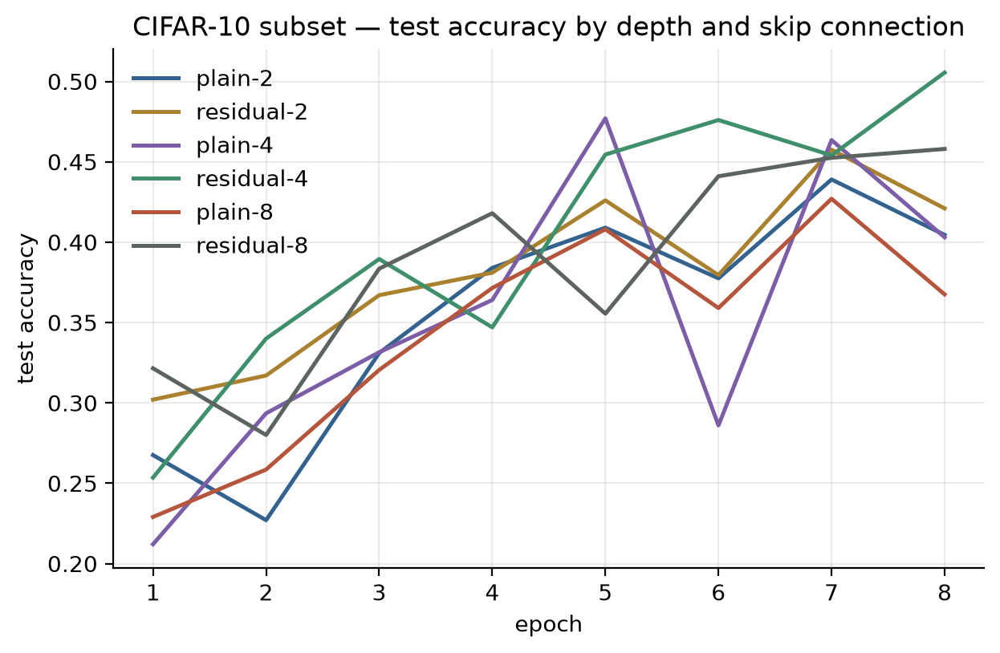
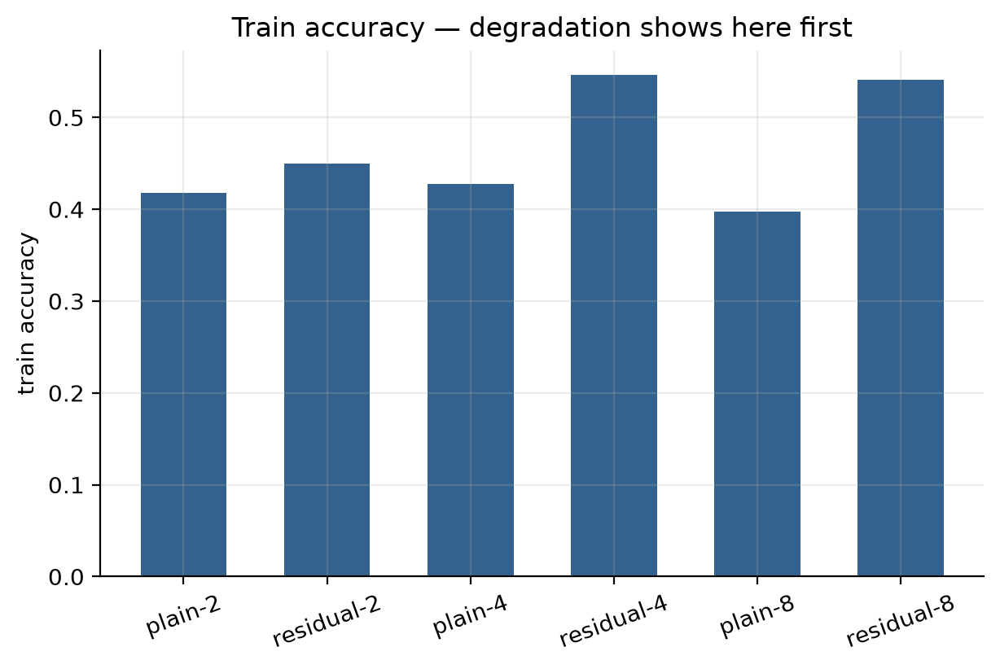
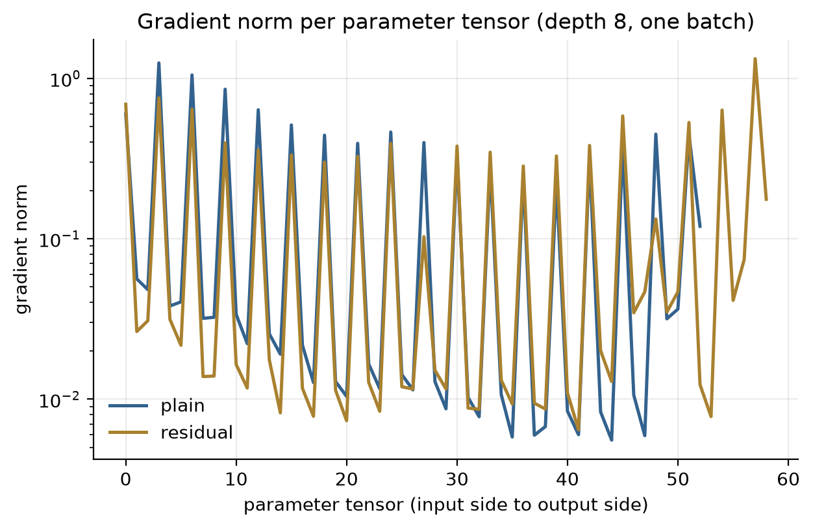
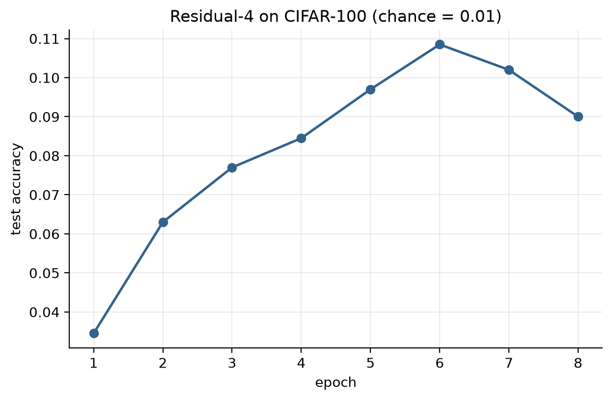

### Open threads

Pre-activation ordering (BN-ReLU-conv rather than
conv-BN-ReLU), which makes the identity path literally unobstructed. Measuring
gradient *correlation* across depth rather than norm, to test the shattered-
gradients account directly. And a plain net without BN, where the vanishing-
gradient story presumably does reproduce.

### Further reading

[Deep Residual Learning](https://arxiv.org/abs/1512.03385);
He et al., *Identity Mappings in Deep Residual Networks*; Balduzzi et al.,
*The Shattered Gradients Problem*.

---

## B5 — SGD, Adam, AdamW, and the learning rate

**Question.** Which optimizer actually wins — and is "wins" even the right
question?

### The idea

An **optimizer** decides how to turn a gradient into a parameter update. The
choices compared here differ in what they remember:

- **SGD** steps straight down the current gradient: $\theta \leftarrow \theta - \eta g$.
  Simple, but along a narrow valley the gradient points mostly across it, so SGD
  zig-zags between the walls while inching along the floor.
- **Momentum** keeps a running sum of past gradients (a "velocity"). Components
  that keep flipping sign (across the valley) cancel out, and components that
  agree (along the valley) build up speed.
- **Adam** also tracks the running average of each parameter's *squared*
  gradient and divides by its square root. Every parameter gets its own step
  size, so steep and flat directions both take sensibly sized steps and the
  overall scale of the loss stops mattering.
- **AdamW** is Adam with weight decay (shrinking weights towards zero) applied
  *separately* from the gradient scaling instead of mixed into it. That sounds
  like a refactor, and the math below shows it is not.

A **learning-rate schedule** (cosine here) shrinks the step over training, which
A1 showed is what removes the final jitter around the optimum.

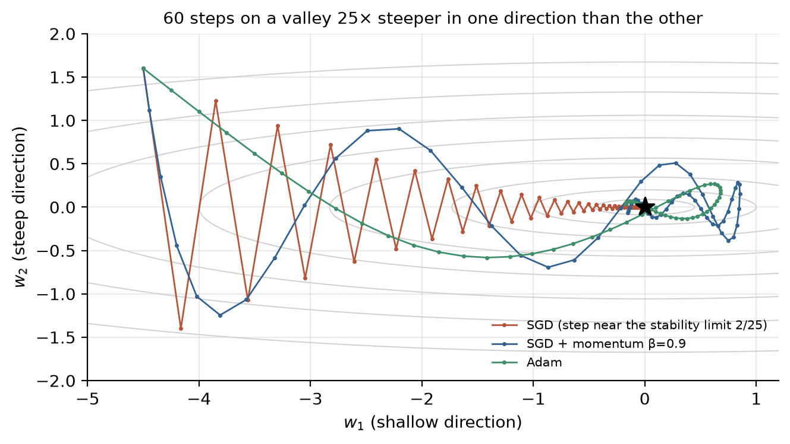

*A loss 25× steeper in one direction than the other. SGD (red) bounces across
the steep direction. Momentum (blue) takes a sweeping path that overshoots and
comes back. Adam (green) rescales both directions and heads almost straight in.
Real loss surfaces have millions of directions with wildly different
curvatures, which is why the difference matters.*

### The math

**SGD and momentum.** Plain SGD is $\theta_{t+1} = \theta_t - \eta g_t$. Heavy-ball
momentum accumulates

$$v_t = \beta v_{t-1} + g_t, \qquad \theta_{t+1} = \theta_t - \eta v_t .$$

For a constant gradient the velocity converges to $v_\infty = g/(1-\beta)$, so
momentum multiplies the effective step by $1/(1-\beta) = 10$ at $\beta = 0.9$ —
worth remembering when comparing learning rates between the two. Along
high-curvature directions the oscillating gradients cancel in the sum; along
low-curvature directions they accumulate. That is the whole mechanism.

**Adam** keeps exponential moving averages of the gradient and its square:

$$m_t = \beta_1 m_{t-1} + (1-\beta_1)g_t, \qquad v_t = \beta_2 v_{t-1} + (1-\beta_2)g_t^2,$$

$$\hat{m}_t = \frac{m_t}{1-\beta_1^t}, \qquad \hat{v}_t = \frac{v_t}{1-\beta_2^t}, \qquad \theta_{t+1} = \theta_t - \eta\,\frac{\hat{m}_t}{\sqrt{\hat{v}_t} + \epsilon}.$$

The bias corrections exist because $m_0 = v_0 = 0$ makes the raw averages
underestimate by exactly $(1-\beta^t)$ early on. The property that matters in
practice is **scale invariance**: replacing $g \to cg$ leaves
$\hat{m}/\sqrt{\hat{v}}$ unchanged, so the step size is set by $\eta$ and the
parameter scale rather than by the magnitude of the loss. A badly scaled loss
changes SGD's effective learning rate by orders of magnitude and leaves Adam's
alone — which predicts a wider usable $\eta$ band, and that is exactly what the
sweep measures.

**Why AdamW is not a refactor.** Classic L2 adds $\lambda\theta$ to the gradient,
so it flows through the same $1/\sqrt{\hat{v}}$ scaling as everything else:

$$\theta_{t+1} = \theta_t - \eta\frac{\hat{m}_t + \lambda\theta_t}{\sqrt{\hat{v}_t}+\epsilon} \qquad\text{(Adam + L2)},$$

$$\theta_{t+1} = \theta_t - \eta\left(\frac{\hat{m}_t}{\sqrt{\hat{v}_t}+\epsilon} + \lambda\theta_t\right) \qquad\text{(AdamW)} .$$

In the first, a parameter with a large gradient history gets a *smaller* decay —
the regularization strength varies per parameter according to something that has
nothing to do with regularization. In the second it is uniform. With SGD the two
forms coincide (there is no $\sqrt{\hat{v}}$), which is why nobody noticed for
years.

**Cosine annealing** takes $\eta_t = \eta_{\min} + \tfrac{1}{2}(\eta_{\max}-\eta_{\min})(1 + \cos(\pi t/T))$ —
a decaying step that, in the language of A1, collapses the stochastic variance
floor to a point.

### What we measure, and why

- **Test accuracy after a fixed budget**, each optimizer at its *own* tuned
  learning rate — the fair bake-off. Comparing at one shared rate would just
  measure whose default happens to match.
- **Accuracy across a learning-rate sweep** spanning five orders of magnitude.
  This measures **robustness**: how much you need to know in advance to get a
  good result. In practice that often matters more than the best-case number.
- **Final weight norm** $\lVert w\rVert$ — the direct evidence for the Adam-vs-AdamW
  argument, since the two differ precisely in how hard they shrink the weights.
- **Constant vs cosine schedule** — whether decaying the step recovers the
  accuracy lost to end-of-training jitter.

### What I built

Four optimizers, each at its own tuned learning rate (so the
bake-off is not rigged by a shared $\eta$), crossed with constant and cosine
schedules; then a learning-rate sweep across five orders of magnitude at a
shorter budget; then Adam against AdamW at the same $\lambda$, tracking the final
weight norm.

### Results

*Setup: FashionMNIST, 15k train / 5k test, MLP 784-256-128-10, 10 epochs.*

| optimizer | lr | constant (seed 0) | cosine (seed 0) | cosine median | final ‖w‖ |
| --- | --- | --- | --- | --- | --- |
| SGD | 0.1 | 0.808 | 0.855 | — | 13.0 |
| SGD + momentum | 0.05 | 0.854 | **0.874** | **0.874** | 16.3 |
| Adam (L2 λ=0.05) | 1e-3 | 0.789 | 0.802 | 0.799 | 3.9 |
| AdamW (λ=0.05) | 1e-3 | 0.868 | 0.871 | 0.867 | 16.6 |

Learning-rate sweep (3 epochs each), test accuracy:

| optimizer | 1e-4 | 1e-3 | 1e-2 | 1e-1 | 0.5 |
| --- | --- | --- | --- | --- | --- |
| SGD | 0.072 | 0.464 | 0.734 | 0.664 | 0.692 |
| SGD + momentum | 0.451 | 0.741 | 0.832 | **0.842** | 0.099 |
| Adam | 0.775 | 0.765 | 0.652 | 0.147 | 0.083 |
| AdamW | 0.808 | **0.843** | 0.829 | 0.721 | 0.170 |

### What surprised me

Three things, in increasing order of how much they
changed my mental model.

*SGD with momentum wins the bake-off.* Tuned, it beats AdamW — the folklore that
Adam converges to worse minima than well-tuned SGD reproduces even at this tiny
scale.

*But the sweep is the real result — and it broke the metric I had designed for
it.* I logged `usable_lrs`, the number of rates within 80% of that optimizer's
*own* best, expecting Adam-family to score higher. It comes back as 3 for every
optimizer on every seed: a relative band says nothing, because a bad optimizer
grades on its own bad curve. What the sweep actually shows is the *level* across
the band. AdamW clears 0.72 at four of five rates spanning three orders of
magnitude and tops out at 0.841; plain SGD never exceeds 0.737 anywhere in the
sweep and is at chance-plus at 1e-4. Adam's advantage is not where the optimum
is, it is how little you must already know to land near it — and measuring that
takes an absolute yardstick, not a self-relative one.

*Decoupling weight decay is worth 6.9 points* at identical $\lambda$ (+0.0686
median, range +0.064 to +0.069 — the tightest effect in the part). The weight
norms say why: Adam's coupled L2 drives $\lVert w\rVert$ to 24% of AdamW's, a 4x
over-shrinkage, because the decay was divided by $\sqrt{\hat{v}}$ along with the
gradient. (With $\lambda = 0.05$ this is a deliberately strong setting; at the
default $10^{-2}$ the gap is smaller but the same sign.)

And a callback to A1: SGD at a constant step *ends* at 0.813 (median) after
*peaking* at 0.843. It is bouncing around the optimum on the variance floor —
the same phenomenon, in the same repo, two parts apart. Cosine fixes it, worth
+0.020 for SGD+momentum and +0.004 for AdamW, which is what you would expect
when the optimizer already normalizes its own step.

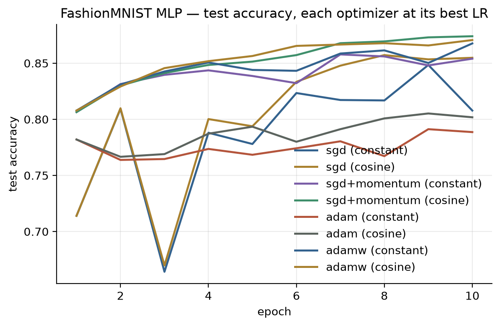
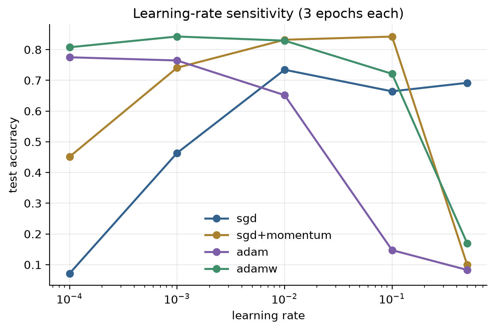
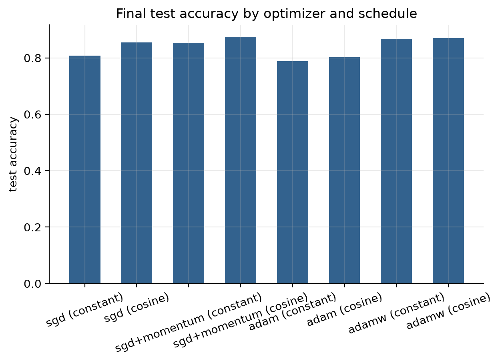
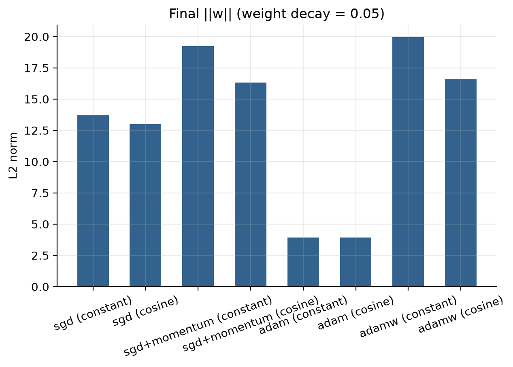

### Open threads

Warmup, which is what makes Adam work for transformers and
which part C will need. Lion and Shampoo, as the current arguments about whether
second-moment scaling is the right primitive at all. And the learning-rate/batch-
size scaling rule, which is a scaling-law question and therefore part G's.

### Further reading

[Adam](https://arxiv.org/abs/1412.6980);
[Decoupled Weight Decay Regularization](https://arxiv.org/abs/1711.05101) (AdamW);
[SGDR](https://arxiv.org/abs/1608.03983) (cosine schedules).

---

## What part B settled

1. **One algorithm, five applications.** Reverse-mode AD is the only piece of
   machinery in this part. Everything else — normalization, skips, adaptive
   steps — exists to make the gradients it produces *usable*, not to change what
   the network can express.
2. **Every improvement here is an optimization fix.** BatchNorm conditions the
   update (and the scale-invariance derivation predicts the large-LR result),
   residual blocks reparameterize so that depth starts from identity, Adam
   normalizes away the gradient scale. The function class is untouched in all
   three cases.
3. **The textbook story failed once, and that was the most useful measurement.**
   "Residual connections fix vanishing gradients" does not survive contact with
   a plain net that has BatchNorm: its early-layer gradients are fine, and what
   the skips change is the spread across depth. The test asserts the spread now.
4. **Robustness beats optimality when you only get one run.** SGD+momentum wins
   the bake-off by 0.7 points at its tuned rate and never exceeds 0.737 across
   the sweep, where AdamW reaches 0.841. On a real problem the learning rate is
   a guess, and the wider basin is worth more than the better bottom — the
   honest case for Adam-family defaults.
6. **Three of five headline claims needed a seed range to state honestly.** The
   BN learning-rate probe collapses on one seed, the depth-8 residual gain flips
   sign on one seed, and B1's gradient-check precision moves by an order of
   magnitude. What survived every seed: the degradation in B4's training column,
   the gradient-spread ratio, and AdamW's decoupled-decay gain.
5. **Part A's variance floor came back.** Constant-step SGD peaked 4 points
   above where it finished. The fix was the same one: decay the step.

**Cost of the part:** ~2,000 lines including tests, 25 test cases, and a full
run of all five rungs in about 12 minutes on four CPU cores (B4 alone is 6 of
them) — 35x part A, and the reason every rung here takes a `--train-samples`
flag.

---

*Figures regenerate with `uv run python tools/writeup_figures.py B`; the numbers
they are quoted against live in [`data/b-metrics.json`](data/b-metrics.json).
The [part README](../../parts/b_deep_learning/README.md) is the short version of
this document.*
