# Part C — Sequence models & attention

> **Status:** complete (C1–C5) · **Constraint:** subsets and short budgets; C1/C3 share every setting so they can be compared
> **Numbers:** seeds 0–2, reference seed 0 · raw values in [`data/c-metrics.json`](data/c-metrics.json)
> **Reproduce:** `ladder run C1` … `C4` (needs `uv sync --extra torch`), or `uv run python tools/writeup_figures.py C`
> **Hardware:** this part's sweep ran on a Colab T4 — C4 is ~25 min/seed on four CPU cores against ~35 s on the GPU

Part B's models all see their whole input at once. Part C's have to decide what
to *carry*: a recurrent cell squeezes the past into a fixed state, attention
keeps everything and learns where to look, and a ViT applies the second answer
to images. Four rungs, one question —

**where does the information have to travel, and what does the architecture
charge for the trip?** A vanilla RNN charges a multiplicative factor per step,
which is why its gradient dies. An LSTM buys an additive path, the same trick as
B4's residual connection, one year earlier and in time rather than depth.
Attention refuses to compress at all and pays quadratic cost instead. Every
result below is a price for distance.

Notation: $T$ is sequence length, $h_t$ the hidden state at step $t$,
$Q, K, V \in \mathbb{R}^{T\times d}$ the attention projections, and $d_k$ the
per-head width.

---

## C1 — Char-level RNN and LSTM

**Question.** The LSTM is supposed to remember further than a vanilla RNN. How
much further, and does the extra memory show up as a better language model?

### The idea

A **language model** predicts the next symbol from the ones before it. Trained
on characters of Shakespeare, it learns spelling, then words, then some
grammar, all from the single task "guess the next character".

A **recurrent neural network (RNN)** does this by reading one character at a
time and keeping a **hidden state** $h_t$, a vector that is supposed to
summarise everything read so far. Each step mixes the new character into the
state, $h_t = \tanh(W_x x_t + W_h h_{t-1} + b)$, and predicts the next character
from $h_t$. The same weights are reused at every step, so the model handles any
length of text.

The weakness is in that recurrence. Information from 50 characters ago has
been pushed through $W_h$ and $\tanh$ 50 times, and so has the gradient on its
way back, so long-range signals fade. The **LSTM** (long short-term memory)
adds a second state, the **cell** $c_t$, which is updated by *addition*:
**gates** (small learned valves with outputs between 0 and 1) decide how much
of the old cell to keep (forget gate), how much new content to write (input
gate), and how much to expose as output (output gate).

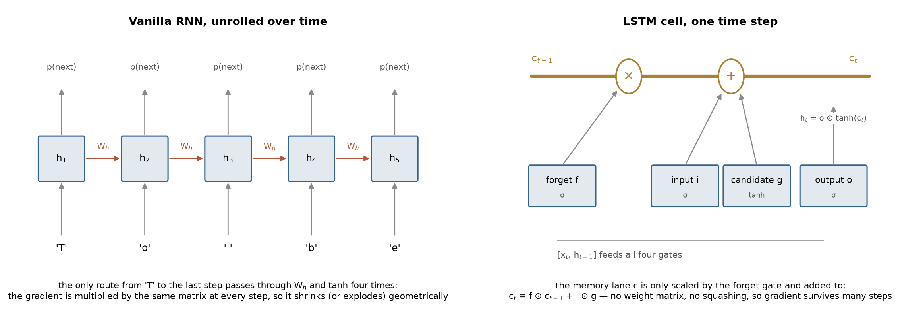

*Left: in a vanilla RNN, the only path from an early character to a late
prediction runs through the same matrix at every step. Right: the LSTM's cell
state (gold line) runs straight through each step and is only multiplied by
the forget gate and added to. When the forget gate is near 1, information and
gradient both pass through almost unchanged.*

### The math

**Why the vanilla gradient dies.** With $h_t = \tanh(W_x x_t + W_h h_{t-1} + b)$,
backpropagation through time multiplies one Jacobian per step:

$$\frac{\partial h_T}{\partial h_t} = \prod_{i=t+1}^{T} \frac{\partial h_i}{\partial h_{i-1}} = \prod_{i=t+1}^{T} \operatorname{diag}\!\left(1 - h_i^2\right) W_h^{\top}.$$

Taking norms, $\lVert\partial h_T/\partial h_t\rVert \le (\gamma\lVert W_h\rVert)^{T-t}$
where $\gamma = \max_i \lVert\operatorname{diag}(1-h_i^2)\rVert \le 1$ for $\tanh$.
The bound is **geometric in the distance**: if $\gamma\lVert W_h\rVert < 1$ the
gradient vanishes exponentially, and if it exceeds 1 the gradient explodes
instead. There is no setting of $W_h$ that keeps a long-range signal alive
without risking the other failure — which is the whole problem, and why the
rungs clip gradients.

**What the LSTM changes.** The cell state's recurrence is additive:

$$c_t = f_t \odot c_{t-1} + i_t \odot g_t \quad\Longrightarrow\quad \frac{\partial c_t}{\partial c_{t-1}} = \operatorname{diag}(f_t).$$

The product over steps becomes $\prod_i \operatorname{diag}(f_i)$ — no weight
matrix, no saturating derivative, just the forget gates. A gate near 1 passes
gradient through essentially unchanged, and the network *learns* which of them to
open. That is why the forget-gate bias is initialized to 1: start by remembering.

**Measuring it.** The rung differentiates a scalar that depends only on the final
state and reports $\lVert\partial L_T/\partial x_t\rVert$ against distance, then
defines the **effective horizon** as the largest distance at which that norm is
still above $10^{-6}$ of its value at the final position.

### What we measure, and why

- **Bits per character** on held-out text — the average number of bits the
  model would need to encode each next character, i.e. cross-entropy in base 2.
  Lower is better. A model that knew nothing would need $\log_2 65 \approx 6$
  bits (65 distinct characters). Good small models get near 2. It is the
  standard metric because it rewards being confidently right and punishes being
  confidently wrong.
- **Gradient reach**: the size of $\partial L/\partial x_t$ as a function of how
  far back $x_t$ is, and the **effective horizon**, the furthest distance at
  which the gradient is still above a millionth of its final value. This
  measures the thing the LSTM was designed to fix directly, whatever the loss
  says.
- **Recall-probe accuracy** — a synthetic task (predict the *first* symbol after
  reading $n$ filler symbols) where only long-range memory helps. It isolates
  memory from everything else a language model uses. Chance is 1/8.

### Results

*Setup: tiny Shakespeare, 250k characters, 64-character context, 500 steps; medians over seeds 0–2.*

| model | parameters | bits/char | horizon | gradient at 63 steps back |
| --- | --- | --- | --- | --- |
| vanilla RNN | 98k | 2.366 | 27 | 1.4e-11 |
| vanilla RNN (width-matched) | 343k | **2.263** | 27 | 6.1e-11 |
| LSTM | 320k | 2.334 | **63** | 9.4e-03 |

The horizon gap is the cleanest measurement in the part: 63 against 27 on every
seed, and about **$10^{9}$ times more gradient** at 63 steps back.

### What surprised me

*The LSTM loses the language-modelling comparison.* At a
matched parameter budget the width-matched vanilla RNN is 0.07 bits/char better,
consistently across seeds (2.261–2.274 against 2.319–2.336, non-overlapping). The
memory is real and does not pay, because next-character prediction in Shakespeare
at a 64-character context is dominated by short-range structure — spelling,
morphology, the line break after a speaker's name. Nothing in that needs to
reach 63 steps back, and the LSTM spends four gates' worth of parameters per unit
of state to buy reach the task does not use.

So the rung grew a second experiment: a **recall probe** where reach is the only
thing that matters. The label is the sequence's first symbol, every later
position is filler, and chance is 1/8:

| sequence length | vanilla RNN | LSTM |
| --- | --- | --- |
| 5 | 1.000 | 1.000 |
| 15 | 0.127 (chance) | **1.000** |
| 30 | 0.127 | 0.115 (chance) |
| 60 | 0.127 | 0.115 |

There it is, and also its limit: the LSTM solves 15-step recall where the RNN has
already collapsed to chance — about **3× the reach** — but at 30 steps it fails
too, at this budget (120 steps, hidden 64). The horizon measurement says gradient
*arrives* at 63 steps; the recall probe says arriving is not the same as learning
to use it. I would rather report that than quietly pick the length where the
LSTM still wins.

### Open threads

GRUs and longer context have since been run on a GPU, in
[Part C at scale](#part-c-at-scale-more-context-more-data-a-bigger-transformer):
on enwik8 the GRU is the best of the three recurrences at every context, and a
4.5M-parameter LSTM fails a copy task at 128 symbols. Still open: truncated BPTT
over a context longer than one window, which is how these models were actually
trained, and the recall probe with a proper budget sweep, to find where the
LSTM's 63-step gradient becomes 63-step learning.

### Further reading

[Long Short-Term Memory](https://www.bioinf.jku.at/publications/older/2604.pdf)
(Hochreiter & Schmidhuber); Pascanu et al., *On the difficulty of training
recurrent neural networks*; Karpathy, *The Unreasonable Effectiveness of RNNs*.

---

## C2 — Seq2seq with and without attention

**Question.** How much does forcing a whole source sentence through one
fixed-size vector actually cost?

### The idea

**Sequence-to-sequence (seq2seq)** models map one sequence to another, such as
a sentence to its translation, or here a date written any which way ("on the 3rd
of May, 1998") to its ISO form ("1998-05-03"). An **encoder** RNN reads the
input, and a **decoder** RNN writes the output one character at a time.

In the original design the encoder's *last* hidden state is the only thing
handed to the decoder: the entire input must be compressed into one fixed-size
vector, however long it is. **Attention** removes that bottleneck. At every
output step the decoder scores each encoder state for relevance, turns the
scores into weights that sum to 1 (softmax), and reads a weighted average. It
can look straight at "May" when writing the month, instead of hoping the month
survived compression.

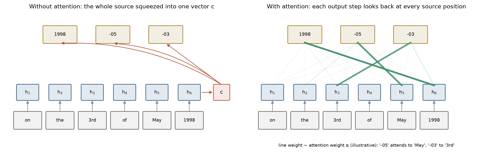

*Left: every output step depends on the one vector $c$. Right: each output step
draws on all source positions, weighted by learned relevance. The weights in
this sketch are illustrative. The real ones, learned by the rung, are plotted
under Results.*

### The math

**The bottleneck.** A classic encoder-decoder compresses the source to a single
vector $c = h_{T_s}$ and generates from it:

$$p(y_1,\dots,y_{T_t} \mid x) = \prod_{j} p\!\left(y_j \mid y_{<j},\, c\right).$$

Everything the decoder can ever know about the source must fit in $c$, whose size
is fixed while $T_s$ grows. With $d$-dimensional states the channel carries
$O(d)$ numbers regardless of input length — so the cost of the bottleneck should
grow with the amount of *information* in the source, not its padded length. (The
first version of this rung missed exactly that, swept padding, and found
nothing.)

**Attention removes the constraint.** Keep every encoder state and build a fresh
context per output step:

$$e_{ji} = \operatorname{score}(s_j, h_i), \qquad \alpha_{ji} = \frac{\exp e_{ji}}{\sum_{i'} \exp e_{ji'}}, \qquad c_j = \sum_i \alpha_{ji} h_i .$$

This rung uses Luong's dot product, $\operatorname{score}(s, h) = s^\top h$
(Bahdanau's additive $v^\top\tanh(W[s;h])$ is the other standard choice). The
context is now a *convex combination of all source states*, so no fixed budget
limits what reaches the decoder; the price is $O(T_s T_t)$ scores instead of
$O(T_t)$, and it is the same price the transformer pays in C3.

Padding must be masked **before** the softmax, by setting those logits to
$-\infty$: masking afterwards would leave the remaining weights un-normalized.

**Why this task.** Every output character of an ISO date is a copy of some input
span, so the correct alignment is known in advance and the attention map can be
*scored* — the fraction of output characters whose attention peak sits on a
matching input character — rather than admired.

### What we measure, and why

- **Exact-match accuracy** — the fraction of dates converted with every
  character right. This is the metric that matters for the task, since a date
  with one wrong digit is simply wrong.
- **Character-level accuracy** — fraction of individual characters right. It is
  reported *alongside* exact match because the gap between the two is
  informative: it shows a model producing well-formed but wrong answers.
- **Both, against source length** — the bottleneck argument predicts the fixed
  vector fails as the input grows, so length is the variable to sweep.
- **Alignment score** — for the attention model, the fraction of output
  characters whose strongest attention lands on the input characters they were
  copied from. The date task has a known correct alignment, so the attention map
  can be *graded* instead of just admired.

### Results

*Setup: date normalization, filler words around the date, medians over seeds 0–2.*

| filler | source length | bottleneck exact | attention exact | bottleneck char-level |
| --- | --- | --- | --- | --- |
| none | 18 | 0.997 | 1.000 | 0.999 |
| 10 words | 101 | 0.326 | 1.000 | 0.899 |
| 24 words | 193 | **0.005** | **1.000** | 0.710 |

The attention model is perfect at every length; the bottleneck model falls off a
cliff. Alignment score 0.729 median — high, and *not* 1.0 by construction, since
the month digits must come from a month *name* and count as misses.

### What surprised me

The gap between the two accuracy measures. At 193
characters the bottleneck model still gets **71% of characters** right while
getting **0.5% of dates** right. It has learned the *shape* of the answer — four
digits, dash, two digits, dash, two digits, roughly the right ranges — and lost
the content. That is the most honest picture of what a too-small channel does:
not noise, but confident, well-formed, wrong output. Character accuracy would
have made this look like a mild degradation; exact match shows it is total.

### Open threads

Bahdanau's additive score, which has an extra parameter matrix
and is claimed to matter for longer sources. Coverage penalties, the standard fix
for attention that revisits one position and drops another. And beam search
instead of greedy decoding, which should matter most exactly where the bottleneck
model is uncertain.

### Further reading

[Neural Machine Translation by Jointly Learning to Align and
Translate](https://arxiv.org/abs/1409.0473) (Bahdanau et al.);
[Effective Approaches to Attention-based NMT](https://arxiv.org/abs/1508.04025) (Luong et al.);
[Sequence to Sequence Learning](https://arxiv.org/abs/1409.3215) (Sutskever et al.).

---

## C3 — A transformer from scratch

**Question.** Does the implementation actually respect causality — and how much
of a transformer's ability is the positional encoding?

### The idea

The **transformer** drops recurrence entirely. Every position looks at every
other position directly through **self-attention**, so there is no chain of
steps for information to fade along.

Each token's vector is projected three ways: a **query** ("what am I looking
for?"), a **key** ("what do I contain?") and a **value** ("what do I pass on if
chosen?"). A token's new representation is the average of all values, weighted
by how well its query matches each key. **Multi-head** attention runs several
of these in parallel with different projections, so one head can track syntax
while another tracks, say, the previous character. Between attention layers, a
per-token **MLP** processes what was gathered. **Residual connections** (B4)
and **LayerNorm** keep the stack trainable.

Two details make it a *language model*:

- the **causal mask** stops a position from attending to later positions, so
  the model cannot cheat by reading the answer;
- a **positional encoding** is added to each token, because attention by itself
  is order-blind: it treats its input as a set, not a sequence.

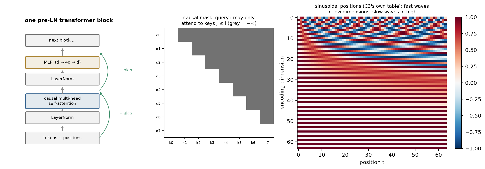

*Left: one block, as C3 builds it. Middle: the causal mask, where each query
row may only see keys at or before it. Right: C3's actual sinusoidal encoding.
Each dimension oscillates at its own frequency, so every position gets a unique
pattern, and "k steps back" is the same rotation wherever you are.*

### The math

**Scaled dot-product attention**, and why the scale is there:

$$\operatorname{Attention}(Q, K, V) = \operatorname{softmax}\!\left(\frac{QK^\top}{\sqrt{d_k}} + M\right)V .$$

If the entries of $q$ and $k$ are independent with zero mean and unit variance,
then $q^\top k = \sum_{i=1}^{d_k} q_i k_i$ has variance $d_k$. Without the
$1/\sqrt{d_k}$, logits grow like $\sqrt{d_k}$, the softmax saturates toward a
one-hot distribution, and its Jacobian $\operatorname{diag}(p) - pp^\top$ goes to
zero — attention stops learning precisely when the model is made wider. Dividing
by $\sqrt{d_k}$ holds the logit variance at 1 regardless of head width.

**The causal mask** is $M_{ij} = -\infty$ for $j > i$ and 0 otherwise, applied
*before* the softmax so the forbidden positions get exactly zero weight rather
than a small one. This is trivially easy to get subtly wrong — off by one, or
masked after the softmax — and a model that leaks a single future position still
trains beautifully while being worthless. The rung therefore checks it: perturb
the last token, and no earlier logit may move.

**Positional encoding, and what happens without it.** Self-attention is
*permutation-equivariant*: for a permutation matrix $P$,

$$\operatorname{Attention}(PQ, PK, PV) = P\operatorname{Attention}(Q, K, V),$$

so a transformer with no positional information cannot distinguish "abc" from
"cba" — with a causal mask it degenerates to a function of the *multiset* of
preceding characters. The sinusoidal encoding

$$PE_{(t, 2i)} = \sin\!\left(\frac{t}{10000^{2i/d}}\right), \qquad PE_{(t,2i+1)} = \cos\!\left(\frac{t}{10000^{2i/d}}\right)$$

fixes this with a useful extra property: for a fixed offset $k$, the pair
$(\sin\omega t, \cos\omega t)$ maps to $(\sin\omega(t+k), \cos\omega(t+k))$ by a
rotation that depends on $k$ but **not** on $t$, so "$k$ steps back" is a linear
operation the attention can express uniformly across the sequence.

**Pre-LN blocks.** The rung normalizes inside the residual branch,
$x \mapsto x + f(\mathrm{LN}(x))$, rather than the 2017 paper's
$x \mapsto \mathrm{LN}(x + f(x))$. Post-LN puts a normalization on the skip path
itself and needs learning-rate warmup to train at all; pre-LN keeps the identity
path clean — B4's argument again.

### What we measure, and why

- **Bits per character**, on the same text, split, windows and budget as C1,
  so the RNN, LSTM and transformer numbers are directly comparable.
- **The positional ablation** — the same model with learned, sinusoidal and *no*
  positional encoding. The theory says removing it should hurt badly, and
  measuring by how much turns the equivariance argument into a number.
- **The causal check** — perturb the last input token and confirm no earlier
  output moves, plus the attention weight above the diagonal. Both must be
  exactly 0. A leak here would make every other number meaningless, and a leaky
  model still trains beautifully, which is why it is tested rather than trusted.
- **Parameter count** for every arm, because "transformer vs LSTM" is only a
  fair question at matched size.

### Results

*Setup: same corpus, split, eval windows, steps, batch and context as C1; medians over seeds 0–2.*

| variant | parameters | bits/char |
| --- | --- | --- |
| learned positions | 1.82M | **2.309** |
| sinusoidal positions | 1.80M | 2.349 |
| **no positional encoding** | 1.80M | **2.641** |
| learned positions, at C1's budget | 242k | 2.508 |

Removing position costs **0.304 bits/char** (range 0.265–0.348) — the largest
ablation in the part, and exactly what the equivariance argument predicts.
Learned beats sinusoidal by 0.040 at this scale. The causal check returns
**exactly 0.0** on every seed, for both the logit perturbation and the attention
mass above the diagonal.

### What surprised me — and the result I cannot explain away

Line up C1 and C3,
which share every training setting:

| model | parameters | bits/char |
| --- | --- | --- |
| vanilla RNN (wide) | 343k | **2.263** |
| transformer, learned PE | 1.82M | 2.309 |
| LSTM | 320k | 2.334 |
| transformer at C1's budget | 242k | 2.508 |

**The wide vanilla RNN beats every transformer arm, using 5× fewer parameters
than the best of them**, and the parameter-matched transformer is the worst model
in the comparison. That is not the story anyone expects in 2026, and it is not a
claim that transformers are worse — it is a claim about this regime: 500 steps,
64 characters of context, 250k characters of training text, and *no warmup* for
the transformer, which B5 showed is the one thing Adam-family optimizers are
picky about at the start of training. Transformers are built to exploit long
context and large data, and this rung deliberately gives them neither. The honest
summary is that I measured a regime where the inductive bias of recurrence is
worth more than the flexibility of attention, and that regime is small.

### Open threads

Warmup and longer context, the two runs this section
called obvious, have been done in
[Part C at scale](#part-c-at-scale-more-context-more-data-a-bigger-transformer).
Warmup changed nothing (2.310 → 2.312). Longer context did *not* make the
recurrent models lose at a 49M-token budget, where the transformer was using
the long context but was too under-trained to profit. At four times the budget
it did: the 25M transformer beats the GRU at 1024 bytes by 0.175 bits, and its
1024-byte model beats its 256-byte one. Still open: RoPE
instead of additive encodings. And KV caching,
which is the difference between a sampler that is $O(T)$ per token and one that
is $O(T^2)$.

### Further reading

[Attention Is All You Need](https://arxiv.org/abs/1706.03762);
[The Annotated Transformer](https://nlp.seas.harvard.edu/annotated-transformer/);
Xiong et al., *On Layer Normalization in the Transformer Architecture* (pre-LN vs post-LN).

---

## C4 — Fine-tuning a small ViT

**Question.** A ViT is C3's block applied to image patches. Without a CNN's
built-in priors, how much does it depend on pretraining?

### The idea

A **Vision Transformer (ViT)** is C3's transformer pointed at images. An image
is cut into a grid of small patches (16×16 pixels in the pretrained model), each
patch is flattened and linearly projected into a token, and the sequence of
patch tokens goes through a standard transformer encoder. A special extra
**[CLS] token** gathers information from all patches, and a linear layer on its
output gives the class.

Unlike a CNN (B3), a ViT has no built-in assumption that nearby pixels belong
together or that a cat in the corner is still a cat. It has to *learn* those
facts from data, which makes it data-hungry. The standard remedy is
**pretraining** on a huge dataset (ImageNet here), then reusing the model:

- **linear probe** — freeze the pretrained network and train only a new final
  layer. This asks whether the pretrained features already separate the new
  classes.
- **fine-tuning** — keep training the whole network on the new task, gently,
  with a small learning rate.

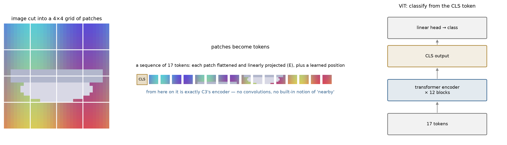

*The image becomes a 16-token sentence plus a [CLS] token. From there on the
model is identical to a text transformer. The classification is read off the
[CLS] token's final state.*

### The math

**Patchification is the only image-specific step.** An image
$x \in \mathbb{R}^{H\times W\times C}$ is cut into $N = HW/P^2$ patches of side
$P$, each flattened and projected:

$$z_0 = \left[x_{\text{cls}};\, x^1_p E;\, x^2_p E;\, \dots;\, x^N_p E\right] + E_{\text{pos}}, \qquad E \in \mathbb{R}^{P^2C \times d}.$$

After that it is C3's encoder verbatim. At $224^2$ with $P=16$ that is $N=196$
tokens, and attention's $O(N^2)$ cost is why input resolution is expensive here
in a way it is not for a CNN.

**What the architecture does not assume.** A convolution hard-codes locality
(a unit sees a small neighbourhood) and translation equivariance
($f(\text{shift}(x)) = \text{shift}(f(x))$). Self-attention assumes neither:
every patch can attend to every other from layer 1, and position enters only
through $E_{\text{pos}}$, which is *learned*. That is more expressive and
strictly less constrained — so with little data the ViT must learn from examples
what a CNN gets for free, which is the standard explanation for ViTs being
data-hungry and the thing this rung measures.

**Probe versus fine-tune** ask different questions. A linear probe on frozen
features asks *are the pretrained representations already linearly separable for
this task?* — it optimizes $\min_W \sum_i \ell(W\phi(x_i), y_i)$ with $\phi$
fixed, a convex problem in $W$. Fine-tuning asks *can the representation itself
be improved?*, at 7000× the trainable parameters and the risk of destroying
pretrained features with too large a step (hence the much smaller learning rate).

### What we measure, and why

- **Test accuracy** on the four held-out classes (chance 0.25), for three arms:
  from scratch, linear probe, full fine-tune. The differences between arms are
  the point. *Probe − scratch* measures what pretraining contributed.
  *Fine-tune − probe* measures what adapting the features adds on top.
- **Trainable parameters** per arm — the probe trains 772 numbers and the
  fine-tune 5.5 million. That ratio is what makes the probe result striking.
- **Wall-clock seconds** on the T4 — the practical cost of each arm.
- **Confusion matrix** — which classes get mixed up (cars and trucks, as it turns
  out), which accuracy alone hides.

### Results

*Setup: ViT-Tiny, 4-class CIFAR subset — plane/car/ship/truck — 1500 train images, 2 epochs, medians over seeds 0–2.*

| arm | test accuracy | trainable parameters | seconds (T4) |
| --- | --- | --- | --- |
| from scratch | 0.420 | 5.53M | 12.8 |
| linear probe | 0.866 | **772** | 5.5 |
| full fine-tune | **0.955** | 5.53M | 12.8 |

Pretraining is worth **+0.452** (probe over scratch, range 0.421–0.458);
fine-tuning adds a further **+0.090** over the probe (range 0.073–0.100).

### What surprised me

Not the ordering — the *ratio*. The linear probe trains
**772 parameters**, four classes' worth of weights on a 192-dimensional feature,
and lands within 9 points of a full fine-tune of 5.5 million. Essentially all of
the task-relevant work was already done by ImageNet pretraining; the fine-tune is
polishing. And the from-scratch arm at 0.420 is barely above the 0.25 chance of
four classes — 1500 images is simply not enough to teach a transformer what an
edge is.

### Open threads

Freezing progressively more blocks, to find where "probe" turns
into "fine-tune". Data augmentation, which is how the ViT paper's own
from-scratch results were rescued. DINO or MAE features instead of supervised
ImageNet ones — that comparison is part D's business.

### Further reading

[An Image is Worth 16x16 Words](https://arxiv.org/abs/2010.11929) (ViT);
Steiner et al., *How to train your ViT*; [timm](https://github.com/huggingface/pytorch-image-models).

---

## C5 — What changed since C3, and what it cost

**Question.** C3's transformer is eight years old as a design. Every production
decoder since has changed the attention layer. What are those changes actually
buying, in a quantity that can be computed rather than argued about?

### The idea

When a trained language model **generates** text, it produces one token at a
time, and each new token attends over everything before it. Recomputing every
earlier token's keys and values at every step would be wasteful, so they are
stored: the **KV cache**. It grows by one entry per token per layer, and every
new token has to read all of it. At long context, *memory*, not arithmetic,
becomes the limit: how many bytes the cache takes, and how fast they can be
read.

Every major decoder design since C3 has changed attention to shrink one factor
of that cache:

- **Grouped-query attention (GQA)** — many query heads share a few key/value
  heads. Fewer K/V heads, proportionally smaller cache.
- **Sliding-window attention** — each layer only attends to the last $W$
  tokens, so its cache stops growing at $W$.
- **Multi-head latent attention (MLA)** — cache one compressed low-rank vector
  per token instead of full per-head keys and values, and expand it on the fly.
- **Linear attention / delta rule** — replace the cache with a fixed-size
  state matrix, updated at each token. This is an RNN again (C1), with a much
  larger state and a smarter update rule.

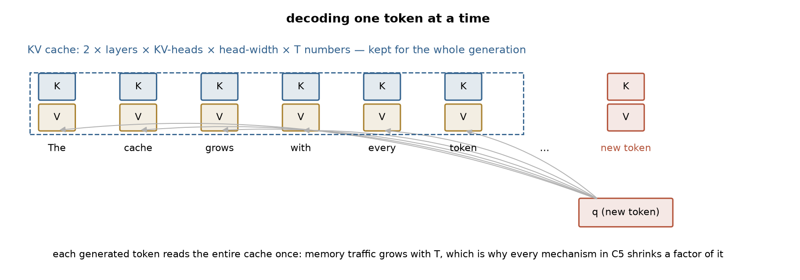

*The new token's query must read every cached key and value. The cache's size
is layers × KV heads × head width × context length, and each mechanism above
removes or caps one of those factors.*

This rung trains nothing. It reads the published configurations of real
models and computes, exactly, what each design stores.

### The math

**The bill attention pays is not the quadratic term.** At generation time a
decoder emits one token at a time, and each new token attends over everything
already produced — so every past key and value must be *retained* and re-read.
The cache for a multi-head stack is

$$M_{\text{KV}} = 2 \, b \, L \, H \, d_h \, T,$$

bytes for $L$ layers, $H$ heads of width $d_h$, context $T$ and $b$ bytes per
element. It grows linearly with context and is read in full per token, which
makes decode memory-bound: the arithmetic is trivial next to the bandwidth.
Four families of change attack one factor each.

**Grouped-query attention** shrinks $H$ to $H_{kv}$ in that formula and nowhere
else — queries keep their full head count, so the model's capacity to *ask*
different questions is untouched while the memory of answers is shared.

**Sliding-window attention** replaces $T$ with $\min(T, W)$, making a layer's
cache constant past the window. Reach is not lost, it is relocated: stacking $L$
such layers gives a receptive field of $L \cdot W$ through composition, the same
trick a CNN uses for its effective field.

**Multi-head latent attention** stops caching per-head keys and values at all.
DeepSeek-V2 projects them into one shared low-rank latent $c_{KV}$ of rank $r$,
plus a small decoupled rotary key that must stay outside the compression because
RoPE does not commute with the down-projection:

$$M_{\text{MLA}} = b \, L \, (r + d_{\text{rope}}) \, T.$$

The head count has left the expression entirely.

**A delta rule leaves the cache paradigm.** Gated DeltaNet keeps a fixed-size
matrix $S \in \mathbb{R}^{H_v \times d_k \times d_v}$ updated by an
outer-product rule, plus a short causal convolution window. Its size is chosen
by the architect, not by how much text has been read — so the state is
**constant in $T$**. That is C1's bargain exactly: compress the past into a
fixed state. What changed is not the bargain but the budget, and the update
rule that fills it.

### What we measure, and why

- **Decode state in MiB at a given context length** (1k to 256k tokens, fp16)
  — everything the model must keep in memory to generate the next token. It is
  the quantity that decides whether a long context fits on a GPU at all, and at
  long context it can exceed the model's own weights.
- **Shrink factor per mechanism**, each measured against *its own model with
  that one mechanism removed*. Comparing two different models would credit a
  mechanism with differences that come from ten other design choices.
- **Crossover context** — for the fixed-state design, the context length at
  which its constant state becomes cheaper than a growing cache.
- **Parameter counts checked against published figures** — validation that the
  accounting code reads configs correctly before its other numbers are trusted.

### What I built

No training. Five configurations — C3's own, measured from
this repo, and four published ones recorded with their hub ids — reduced to
layer lists and evaluated for decode state against context. Each mechanism is
also ablated **against its own config with that mechanism removed**, rather than
against a different model, so the number attributed to it is not really a
difference in ten other things. The accounting lives in
`src/mlladder/archspec.py` and is shared with H6.

### Results

*Setup: decode state in MiB, fp16.*

| decoder | layers | 1k | 16k | 64k | 256k |
| --- | --- | --- | --- | --- | --- |
| C3 (this repo) | 4 full | 3.0 | 48 | 192 | 768 |
| Qwen3-8B | 36 full (GQA 32:8) | 144 | 2,304 | 9,216 | 36,864 |
| Mistral-7B | 32 sliding (W=4096) | 128 | **512** | **512** | **512** |
| DeepSeek-V2-Lite | 27 MLA (r=512) | 30 | 486 | 1,944 | 7,776 |
| Qwen3-Next-80B-A3B | 36 linear + 12 full | 62 | 422 | 1,574 | 6,182 |

Each mechanism against its own config without it, at 64k tokens:

| mechanism | cache shrink |
| --- | --- |
| GQA (32 query heads over 8 KV) | **4.0×** |
| sliding window 4096 | **16.0×** |
| MLA (rank 512 + 64 rope) | **10.7×** |
| delta rule (vs its own all-attention twin) | **3.9×** |

### What surprised me

Three things.

*The numbers are enormous and they are not about parameters.* Qwen3-8B carries
**9.2 GiB of KV cache at 64k tokens** — larger than the 8B model's own weights
in fp16. The thing that stops a decoder serving long contexts is usually not its
size; it is the cache the context creates, and no amount of quantizing weights
touches it.

*Mistral's window is the bluntest instrument and the biggest win.* A cache that
simply stops growing beats every clever compression asymptotically: 512 MiB at
64k and still 512 MiB at 256k, while MLA's 10.7× compression is still growing
linearly underneath it. And the reach is not obviously sacrificed — 32 layers at
a 4096 window compose to a 131,072-token receptive field. The cost is that the
reach is *indirect*, mediated through depth, which is exactly the compromise C1's
recurrence made and lost on. Whether it loses here is not something state
accounting can answer.

*C1's answer came back, and the crossover is early.* The delta-rule state is
1.05 MiB per linear layer, so Qwen3-Next carries **38 MiB before reading a single
token** — strictly worse than any cache at short context. It pays that back
against its own all-attention twin from **537 tokens** onward. I had expected a
constant-state design to need a very long context to justify itself; at these
dimensions it needs about two paragraphs. The tempting comparison — the hybrid
against Qwen3-8B, which crosses at 322 tokens — is the one to avoid, because it
credits the delta rule with savings that are really Qwen3-Next's much more
aggressive GQA (2 KV heads against 8).

**A check worth having.** DeepSeek publishes V2-Lite at 15.7B total and 2.4B
activated. The accounting here computes 15.8B (**0.6% off**) and, excluding the
embedding and output head that DeepSeek's transformer-only figure omits, 2.32B
(**3.2% off**). H6's independent check against TrOCR agreed to 1.3%. Two
validations on models with known answers is what makes the other numbers in
these tables worth reading.

### Open threads

Gemma 4's ring-buffered sliding KV, which sizes the buffer at
window + prefill chunk rather than the full context and is implemented in the
accompanying fork — the natural next arm. Decode throughput *has* been measured for four
real decoders (below), but not against these predictions: that needs cache bytes
divided by the card's bandwidth, compared with tokens/s at several context
lengths, and the runs below used one short prompt each. And quality: none of this says whether a 512 MiB
windowed cache answers questions as well as a 9 GiB full one, which is the
question that decides anything.

### Further reading

[GQA](https://arxiv.org/abs/2305.13245);
[Mistral 7B](https://arxiv.org/abs/2310.06825) for sliding windows;
[DeepSeek-V2](https://arxiv.org/abs/2405.04434) for MLA;
[RoFormer](https://arxiv.org/abs/2104.09864);
and candle's `qwen3_5.rs`, `deepseek2.rs` and `gemma4/` for the implementations.

---

## Part C at scale: more context, more data, a bigger transformer

C1 and C3 compared recurrence and attention at 64 characters of context,
250k characters of text and 500 steps, and the wide vanilla RNN won. C3 said
why that was not the end of the story and listed the runs that would settle it:
warmup for the transformer, and longer context "where the recurrent models must
lose". C1 listed GRUs. Those runs are here, on a Kaggle T4, driven by
[`tools/gpu/c_context_scaling.py`](../../tools/gpu/c_context_scaling.py). Raw
values are in [`data/c-gpu.json`](data/c-gpu.json). Every number is a median over
seeds 0–2.

### The idea

Three questions, three experiments:

1. **Was C3's loss just the missing warmup?** Rerun C1/C3's exact regime (same
   corpus slice, context, batch, steps, peak learning rate, the hand-written C1
   cells and the C3 transformer), with and without linear warmup plus cosine
   decay.
2. **Does attention win once there is context worth attending to?** Train on
   **enwik8**, the standard byte-level benchmark: the first 100 MB of an English
   Wikipedia dump, markup included, with long-range structure (tags that open and
   close hundreds of bytes apart, repeated names, tables). Five models: a vanilla
   RNN, a GRU and an LSTM, each ~4.5M parameters, a transformer matched to them
   (~4M), and a **bigger transformer (~25M)**. Each is trained at 64, 256 and 1024
   bytes of context, on the **same 16,384 tokens per step** (so a longer
   context means fewer sequences per batch, not more data), for 3000 steps: 49M
   tokens, about half an epoch.
3. **Can each architecture remember at all?** A **copy task**: $n$ random
   symbols, then the same $n$ again. The second half is predictable only by
   looking exactly $n$ positions back, so accuracy there measures usable memory
   and nothing else.

The recurrences use cuDNN's `nn.RNN/GRU/LSTM` (the same equations as C1's cells,
which would take hours as a Python loop at 1024 steps). The transformer is C3's
own class with attention routed through PyTorch's fused kernel, checked against
C3's explicit softmax to $1.2\times10^{-7}$ before any training.

### What we measure, and why

- **Bits per byte** on 256 KiB of held-out enwik8: cross-entropy in base 2, the
  enwik8 convention (C1's bits per character, for bytes). For scale: Graves'
  2013 LSTM reached 1.67, later recurrent models about 1.25, and large
  transformers below 1.0.
- **Loss by position in the window** — the direct measure of *using* context.
  The prediction at position $t$ has $t$ bytes of history, so a model that
  exploits long context keeps improving as $t$ grows, and one that does not goes
  flat.
- **Copy-task accuracy on the repeated half** (chance $1/32$).
- **Training throughput** (tokens per second, fp16, T4) — what each design costs
  as context grows.

### Results

**1. Warmup does not rescue C3's transformer.**

| model | constant LR (C1/C3's setting) | warmup + cosine |
| --- | --- | --- |
| vanilla RNN, wide | 2.269 | **2.251** |
| LSTM | 2.319 | 2.448 |
| transformer | 2.310 | 2.312 |

C3's leading explanation for its result was wrong: with warmup the transformer
scores 2.312 against 2.310 without it. The wide RNN still wins, and cosine decay
*hurts* the LSTM by 0.13 bits. At 500 steps, a schedule that spends its second
half at a lower learning rate costs the slowest learner the most.

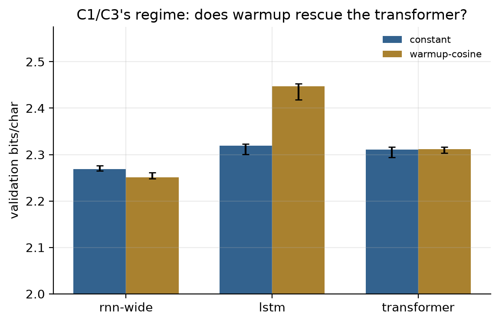

**2. Memory: the transformer copies 512 symbols back perfectly; the LSTM cannot copy 128.**

| $n$ | LSTM (4.5M) | transformer (4M) |
| --- | --- | --- |
| 32 | 0.903 | **1.000** |
| 128 | 0.031 (chance) | **1.000** |
| 512 | 0.031 (chance) | **0.999** |

This is the cleanest result in the section. A recurrent model has to squeeze
$n$ random symbols (5 bits each) through its fixed state and fails once that
state is too small. Attention simply looks back $n$ positions, whatever $n$ is.
C2's bottleneck, measured on the architecture that removed it.

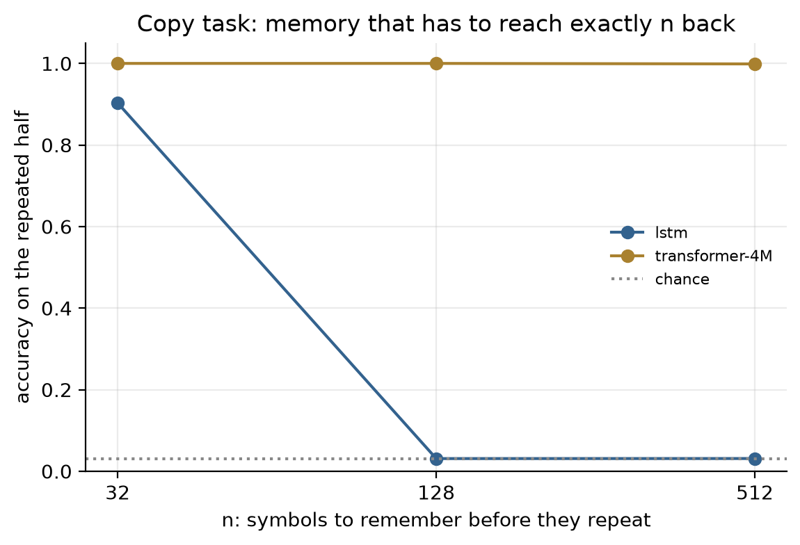

**3. enwik8: the bigger transformer is the best model, but more context did not help it at this budget.**

| context | RNN | GRU | LSTM | transformer 4M | **transformer 25M** |
| --- | --- | --- | --- | --- | --- |
| 64 | 1.854 | 1.795 | 1.883 | 1.837 | **1.718** |
| 256 | 1.791 | 1.701 | 1.838 | 1.863 | **1.668** |
| 1024 | 1.804 | **1.687** | 1.848 | 2.043 | 1.721 |

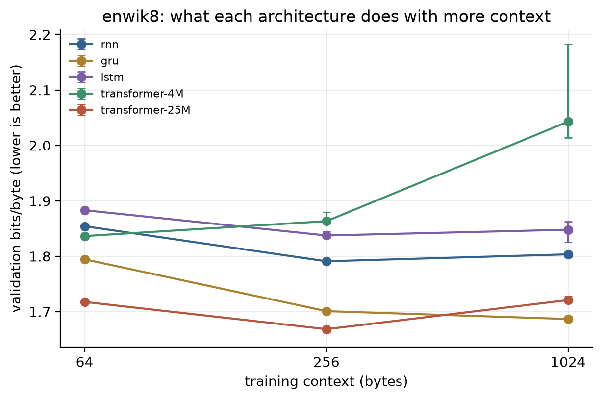

The 25M transformer posts the best number in the table, 1.668 at 256 bytes.
Among the size-matched ~4M models, however, the **GRU wins at every context**,
and the matched transformer gets *worse* as context grows, ending unstable at
1024 (seed range 2.01–2.18). So the promised crossover, "longer context, where
the recurrent models must lose", did not happen at this budget, and the bigger
transformer lost ground from 256 to 1024.

The loss-by-position curve says why, and it is not "attention cannot use the
context":

| trained at 1024 | positions 64–256 | 256–512 | 768–1024 |
| --- | --- | --- | --- |
| GRU | 1.675 | 1.687 | 1.666 |
| transformer 25M | 1.751 | 1.722 | **1.658** |
| *transformer 25M trained at 256, same positions* | *1.622* | — | — |

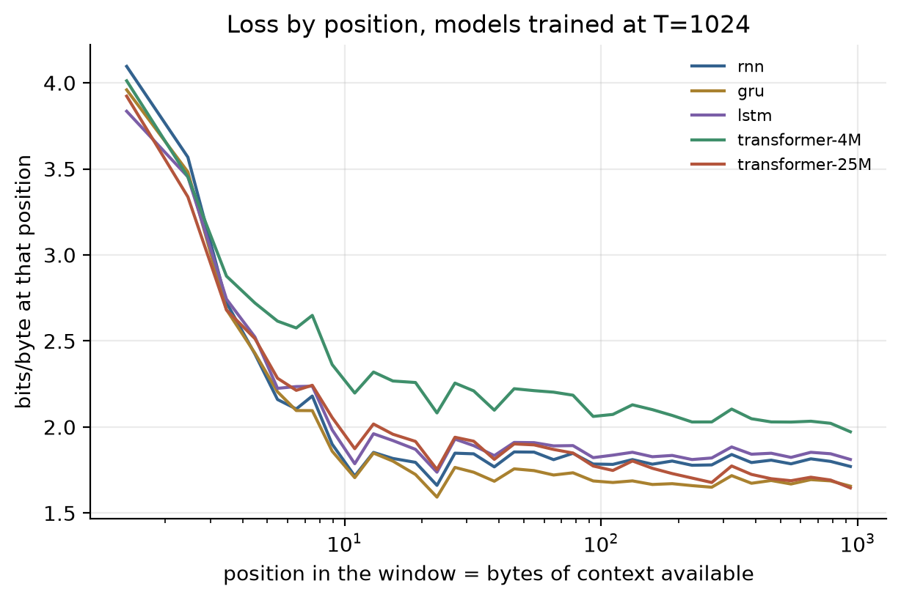

The GRU is **flat** from byte 64 to byte 1024: whatever it keeps in its state,
the extra 900 bytes add nothing. The transformer is the only model still
improving deep into the window (−0.093 bits from the early positions to the
late ones), so it *is* reading the long context. But the model trained at 1024
is worse than its 256-trained twin *at the same short positions* (1.751 against
1.622). At a fixed 16k tokens per step, a 1024-byte context means 16 sequences
per batch instead of 64, and 1024 learned positions to fit instead of 256, all
from 49M tokens, which is **two tokens per parameter** for the 25M model against
Chinchilla's ~20 (G1). The transformer is under-trained, and the longer context
makes that worse before it helps.

**Throughput.** At 64 bytes the recurrences are fastest (RNN 504k tokens/s
against the matched transformer's 348k). At 1024 the order flips: the matched
transformer trains at **254k tokens/s** against 182–202k for all three
recurrences, even with cuDNN, because a recurrence must walk its sequence one
step at a time while attention's quadratic cost is still cheap at this length.
The 25M transformer runs at 67–83k tokens/s throughout.

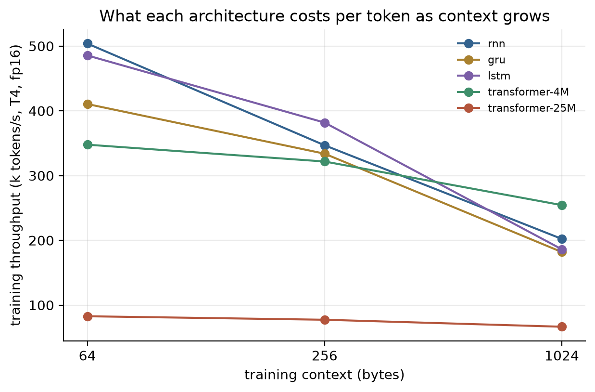

**4. Four times the budget: the transformer pulls away, and 1024 bytes now beat 256.**

The diagnosis above makes a prediction: give the two leading models more data
and the transformer should gain much more than the GRU, and its 1024-byte model
should overtake its 256-byte one. The rerun trains the GRU and the 25M
transformer at 256 and 1024 bytes for **12,000 steps instead of 3000**: 197M
tokens, about two epochs of the 90 MB training split, and 7.7 tokens per
parameter for the transformer. Everything else is unchanged: same tokens per
step, same schedule shape, same held-out bytes, seeds 0–2. Raw values are in
[`data/c-gpu-long.json`](data/c-gpu-long.json).

| model, context | 3000 steps (49M tokens) | 12,000 steps (197M tokens) | gain |
| --- | --- | --- | --- |
| GRU, 256 | 1.701 | 1.627 | −0.074 |
| GRU, 1024 | 1.687 | 1.598 | −0.089 |
| transformer 25M, 256 | 1.668 | 1.448 | −0.220 |
| transformer 25M, 1024 | 1.721 | **1.423** | **−0.298** |

Both predictions hold. The transformer gains three to four times as much as the
GRU from the same extra data. At 1024 bytes the GRU's 0.034-bit lead becomes a
**0.175-bit deficit**. The transformer's context curve also turns the right way
round: 1024 bytes now beat 256 (1.423 against 1.448; seed ranges 1.411–1.424 and
1.446–1.451 do not overlap). The largest gain in the table is at the longest
context, which is where the model had been most starved.

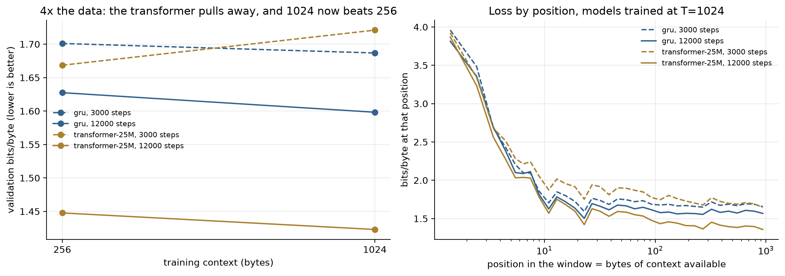

*Dashed: 3000 steps. Solid: 12,000. Left: final bits/byte. Right: loss by
position for the models trained at 1024. The GRU's solid curve drops but stays
flat after about 100 bytes, while the transformer's keeps falling to the end of
the window.*

Per position, trained at 1024:

| 12,000 steps | positions 64–256 | 256–512 | 768–1024 |
| --- | --- | --- | --- |
| GRU | 1.581 | 1.593 | 1.577 |
| transformer 25M | 1.439 | 1.409 | **1.368** |
| *transformer 25M trained at 256, same positions* | *1.397* | — | — |

The GRU is still flat: 1.581 at 64–256 bytes of history, 1.577 at 768–1024. The
extra data made it better everywhere and made it use distant context no more
than before. The transformer improves by 0.071 bits from the early positions to
the late ones, and its last 256 positions reach 1.368, better than anything the
256-byte model can do at any position (its best bin, 192–256, is 1.390).

The short-range cost has not fully gone. At positions 64–256 the 1024-byte model
still trails its 256-byte twin (1.439 against 1.397), though the gap shrank from
0.129 bits to 0.042. The 1024-byte model spends capacity, and fewer sequences
per step, on positions the 256-byte model never has to learn. It now recovers
more than that at the far end of the window. One effect in these averages is
not about memory. A window's score averages over all its positions, and the
first 64 (little history, about 1.7 bits) are a quarter of a 256-byte window but
a sixteenth of a 1024-byte one. That is most of why the GRU's 1024 score beats
its 256 score even though its curve is flat. The per-position table, not the
headline number, is what shows the transformer reading its context.

At 7.7 tokens per parameter the transformer is still under Chinchilla's ~20, and
its curve has not flattened, so this is not its ceiling. Cost: 55 minutes per
seed on the T4 for the transformer at 1024, against 18 for the GRU.

### What surprised me

C3 closed on a prediction ("longer context, where the recurrent models must
lose"), and at a realistic-looking budget it failed for the matched models. The
GRU beat a same-size transformer at 1024 bytes of context, on the benchmark
where transformers made their name, and the transformer's own curve went the
wrong way. Two things turned that from a contradiction into a diagnosis: the
per-position loss, which shows the transformer is the one model that *uses* the
long context, and the copy task, which shows its memory is not the problem. That
left budget, and the 4× run confirmed it. With four times the data the 25M
transformer beats the GRU at 1024 bytes by 0.175 bits, and 1024 bytes beat 256.
The lesson is about how to read a result. "More context did not help" at 49M
tokens was a statement about the budget, not the architecture, and the
per-position curve showed that before the longer run did.

### Open threads

A tokenised corpus, since byte-level modelling spends most of a small model's
capacity on spelling. RoPE instead of learned positions, which do not have to be
learned separately at every offset, and should shrink the short-range cost the
1024-byte model still pays. A learning-rate sweep for the matched transformer
at 1024, whose seed spread says the setting is on an edge. And the 4× budget for
the matched 4M transformer, which was only rerun for the 25M one.

---

## The decoders, actually run

C5's method is reading published configs and computing decode state from them.
That method has two failure modes it cannot detect from the inside: the
arithmetic can be wrong, and the *config* can fail to contain the thing you are
asking about. Loading the weights finds both.

Everything below ran on one Colab T4 (15.4 GB), which is the binding constraint
and the reason quantization is not an optional extra here. Raw values in
[`data/c-real-models.json`](data/c-real-models.json); the scripts are in
`tools/real_models/`.

| model | how it fit | resident | gen tok/s |
| --- | --- | --- | --- |
| DeepSeek-V2-Lite (15.7B) | bitsandbytes NF4, double-quantised scales | 9.62 GB | 4.44 |
| Gemma-4-E2B-it | bitsandbytes NF4 | 6.70 GB | 6.35 |
| Qwen3.6-27B | GGUF UD-IQ3_XXS, 3.06 bpw, fully offloaded | 12.0 GB | 10.2 |
| Qwen3.8-27B | GGUF UD-IQ3_XXS, 3.06 bpw, fully offloaded | 10.9 GB | 9.5 |

All four produce coherent text. Two things came out of it that the arithmetic
could not have.

**A parameter count read off a quantized model is not a parameter count.**
`sum(p.numel())` reports **8.06B** for DeepSeek-V2-Lite, a published 15.7B-parameter
model, because bitsandbytes packs two 4-bit weights into each byte. C5's
own count of 15.8B is right and the loaded model's `numel` is wrong by exactly
2x — which is the direction that would have been very easy to believe, since
"the config over-counts" is a more plausible-sounding story than "the tensor
told me half."

**Gemma-4-E2B-it runs one KV head for eight query heads.** That is multi-query
attention — the limit of the GQA lever, not a step along it. C5 prices GQA at
Qwen3-8B's 32:8, a 4x cache reduction; MQA at 8:1 is 8x, and the reason the
family stops there is that there is nothing left to share.

### Two generations, one architecture

The interesting result is a negative one. Asked to compare Qwen3.6 against
Qwen3.8, the size-matched pair is `Qwen3.6-27B` and `Qwen3.8-27B`. Their configs
were flattened and compared key by key:

**61 keys compared. One differs. It is `transformers_version` — the library that
wrote the file.**

Same 64 layers, same 5120 hidden, same 24 query heads over 4 KV heads, same
256-wide head, same 17408 intermediate, same 248320 vocabulary, same interleave
of 48 linear-attention layers with 16 full-attention ones at interval 4, same
single MTP layer. Both ship **55.56 GB** of bf16 weights — identical to the
hundredth of a gigabyte, so the parameter counts match too.

Whatever separates these two generations at 27B, it is weights, data or
post-training. It is not shape, and **no amount of reading configs will find
it** — which is exactly the boundary of what this rung can see, now measured
rather than assumed. C5 carries them as a single entry for that reason, with a
test that fails if a later edit splits them without an actual difference to
point at.

The runtime behaviour is consistent with that: 10.2 against 9.5 generated
tokens/s at the same quantization. I am *not* reporting that 0.7 as a
difference between the models, because the two GGUF files are 12.0 GB and
10.9 GB at the same nominal 3.06 bpw — the quantizer allocated bits differently
between them, so the arms are not matched. A throughput comparison across two
different quantizations of two models is a comparison of the quantizations.

One qualitative note, offered as an anecdote and not a result: at a 96-token
budget **neither model produced an answer**. Both are reasoning models, both
opened a thinking block, and both were still in it when the budget ran out —
3.6 with a numbered plan, 3.8 telegraphically. n=1 at temperature 0 on one
prompt is worth exactly what this paragraph claims for it, which is nothing
except that the budget was wrong for the model class.

**What did not run.** `Qwen3.8-Flash-Next` is 360 GB of weights. The 27B pair at
4-bit AWQ is 20.4 and 21.0 GB against a 15.4 GB card, which is why the 3-bit
GGUF route is what made them runnable at all — the quantization was not a
convenience, it was the difference between a measurement and a paragraph
explaining why there wasn't one.

### Through the candle fork

Part H's OCR model runs through the accompanying candle fork and
[matches transformers to sixteen digits](h-computer-vision.md#the-same-model-through-candle-and-what-two-implementations-agreeing-buys).
The decoders went less well, and the failures are specific enough to be useful.

**Gemma-4-E2B-it** needed two patches before it would load at all. The fork's
`TextModel` reads the decoder from `model.*`; a multimodal checkpoint keeps the
same decoder at `model.language_model.*` beside its vision and audio towers, so
text-only loading died at `model.embed_tokens.weight`. And the example hardcodes
bf16 on GPU, which needs sm_80. With a nested-prefix constructor and a `--dtype`
flag it loads and generates at **25.7 tok/s** — and emits the word "thought"
repeated to the token limit.

That is worth one control before blaming anyone. Transformers at **f16**, same
model, same card, same prompt and chat template, answers correctly at 9.63
tok/s — so it is not f16 precision. And the prefix patch is behaviour-preserving:
the constructor's other uses of the unprefixed builder are `dtype()` and
`device()`, and the one root-level weight (`lm_head`) is never reached because
this config sets `tie_word_embeddings: true`.

I concluded from that that the fork's `gemma4` f16 path was wrong on sm_75.
**That conclusion was wrong, and the answer was already written down in the
repository I had not read yet.** The catalog's `candle-llm-safetensors`
executor carries this comment:

> Some checkpoints ship a tokenizer.json without a BOS post-processor
> (e.g. gemma-4-e2b-it) — gemma-family models degenerate into token
> copy-loops without it.

A copy-loop is exactly what I saw, on exactly that checkpoint. I had reached for
"the kernels are wrong on this card" when the available explanation was a
missing token — and the thing that distinguishes them is that one of them was
already diagnosed by someone who had run the model more than twice.

With the same BOS prepend added to the example, on the same binary, the same
card, the same f16 and the same chat template:

> Grouped-query attention reduces KV cache size by grouping queries, which
> allows the model to share key and value states across multiple queries. This
> sharing significantly reduces the total number of unique key and value vectors
> that need to be stored in the cache for a given sequence length.

5.89 tok/s with the template, 24.55 on a bare prompt. **"thought" repeated to the
token limit before the prepend, a correct answer after** — a controlled pair
where the only difference is one token, which is what it takes to tell a missing
BOS from a broken kernel. The f16 accusation is withdrawn.

Two of the three patches Gemma-4 needed, incidentally, are things `qwen3_5.rs`
already does for itself in the same fork: it detects the
`model.language_model` prefix rather than assuming `model.`, and it already has
load-time quantization. `gemma4` is the sibling that fell behind.

**DeepSeek-V2-Lite** needed the quantization the example did not have. It is
now wired: a load-time `Proj` (a plain `Linear` or a `QMatMul`) threaded through
attention, the MLP, the 64 MoE experts and `lm_head`, behind
`DeepSeekV2::new_with_quant` and a `--quant` flag. One detail the model forces:
k-quants need the reduction dimension to be a multiple of 256, and DeepSeek's
dense `down_proj` reduces over 10944 while each expert's reduces over 1408.
Neither qualifies. Both are multiples of 32, so those layers take the 32-wide
block format of the same bit width (Q4_0 when Q4_K was asked for) rather than
failing or silently producing a broken tensor.

**It ran on the third attempt.** The first two, on Colab, lost the GPU during the
31.4 GB download. The first Kaggle run downloaded and built, then ran out of GPU
memory partway through loading: each float weight was read onto the GPU, copied
back to the CPU and quantized there, and the staging copies filled the 15 GB
card before the 9 GB quantized model was assembled. Reading each weight straight
onto the CPU fixed it:

| DeepSeek-V2-Lite on a T4 | load | GPU memory | gen tok/s |
| --- | --- | --- | --- |
| candle fork, q4k at load, f16 activations | 528–539 s | 8.97 GB peak | **10.5–15.1** |
| transformers, bitsandbytes NF4 | 189.8 s | 9.62 GB footprint | 4.44 |

Both answer coherently. Asked for the three laws of thermodynamics, the candle
run lists all three correctly and then starts a new heading. Asked why
grouped-query attention shrinks the KV cache, it gives a wrong reason ("it only
needs to store the keys for the first few tokens") and then loops on "2.2.2".
This is the base model decoded greedily with no repetition penalty, so neither
is a runtime defect. Two caveats on the table. The memory figures are measured
differently: candle's is the `nvidia-smi` peak, CUDA context included, while
transformers' is the model's own footprint. candle's rate is timed over the
whole generation, prompt pass included, and differs between the two prompts.
Candle generates 2.4–3.4 times faster; the likely reason is GGML's fused
quantized matrix-vector kernels against bitsandbytes dequantizing NF4 for each
matmul, but that was not profiled. It loads 2.8 times slower, because it
quantizes 15.7B weights on the CPU in one thread while bitsandbytes quantizes on
the GPU.

Through transformers the same model also ran pre-quantized from the hub
(`slowfastai/DeepSeek-V2-Lite-bnb-4bit`), and that comparison is useful too:

| | load | resident | gen tok/s |
| --- | --- | --- | --- |
| quantize the f16 weights at load | 189.8s | 9.62 GB | 4.44 |
| download it already quantized | **119.1s** | 9.62 GB | 4.49 |

Same footprint, same throughput, 70 seconds sooner. **Pre-quantizing buys load
time and nothing else** — which is worth knowing before treating an
ahead-of-time quantized checkpoint as a performance decision rather than a
convenience one.

**Qwen3.6/3.8** had `qwen3_5.rs` in `candle-transformers` and no binary to
invoke it, so that binary is now written: `--quant q8_0..q2k`, `--dtype`, and
Qwen's chat template. **`Qwen/Qwen3.5-4B` at q4k answers correctly through it at
26.79 tok/s**, which verifies the example and the quantization path together.

Getting there needed one fact about the catalogue. Checking all 465 models under
the Qwen org: **the Qwen3.6 generation ships no small checkpoint** — 27B and
35B-A3B, and their FP8 twins, and nothing else. Qwen3.5 ships 0.8B, 2B, 4B, 9B,
27B and up. So there is no official small Qwen3.6 to verify against, and the
27B's 55.6 GB will not fit a 50-minute session alongside a from-scratch build.

The nearest small thing is a community REAP-pruned derivative of 35B-A3B,
`inference-optimization/Qwen3.6-8B-A1.6B`. It loads and generates — and emits
multilingual token soup at 5.23 tok/s. Qwen3.5-4B through **the same binary, the
same flags and the same quantization** answers correctly, so the failure belongs
to the pruned derivative, not to the example. Which is the whole reason to run a
control before concluding anything: without it, "my new example produces
garbage" would have been the obvious reading, and it would have been wrong —
the same mistake I made with Gemma's missing BOS, caught this time.

---

## What part C settled

1. **Every architecture here is a different answer to "how does information
   travel?"** Recurrence carries it in a state and pays multiplicatively per
   step; gating buys an additive path; attention refuses to compress and pays
   $O(T^2)$. The measurements line up with the algebra: the RNN's geometric
   Jacobian product shows up as a 27-step horizon, the LSTM's product of forget
   gates as 63, and attention's convex combination as a bottleneck-vs-attention
   gap that grows from 0.003 to 0.98 as the source gets longer.
2. **Reach is not the same as use.** The LSTM's gradient arrives 63 steps back
   and it still cannot solve 30-step recall at this budget, and its extra memory
   *loses* to a wide vanilla RNN on the actual language-modelling task. An
   architecture's capability and what a training run extracts from it are
   different quantities.
3. **The famous architecture lost, and the regime is why.** A 343k-parameter
   vanilla RNN beat a 1.8M-parameter transformer on 250k characters at 64 tokens
   of context with no warmup. Nothing about that contradicts the literature; it
   locates the boundary of it, which is more useful than a fourth reproduction of
   a result everyone already believes.
4. **Two metrics on the same run told opposite stories.** C2's bottleneck model
   keeps 71% character accuracy while getting 0.5% of dates right. Choosing the
   metric that matches the task's actual failure mode did more work here than any
   modelling decision.
5. **A seed does not pin a number, and which numbers it fails to pin is
   informative.** Across three full sweeps — one on CPU, two on separate T4
   sessions — C1, C3 and C4 reproduced their medians *exactly* (bits/char,
   horizons, accuracies, the causal-leak zero). C2's bottleneck exact-match did
   not: 0.363, 0.349 and 0.326 at 101 characters, 0.012, 0.017 and 0.005 at 193.
   Seeding does not make cuDNN's backward deterministic, and the bottleneck arm
   sits exactly at the edge of failing, where an all-or-nothing metric over ten
   characters amplifies any tiny difference in weights. Its character accuracy,
   measuring the same runs, moved by only ~0.015. So the metric that made the
   failure legible is also the least stable one — both facts follow from it being
   a threshold measure near a threshold. The conclusion (the bottleneck collapses
   while attention does not) is unaffected on every run; the third decimal place
   is fiction. Figures and metrics here therefore come from one sweep on one
   device, and `--check` should be run on that device.

6. **The design C1 lost with came back, and the ladder is why I noticed.** C5's
   delta-rule stack is C1's bargain — compress the past into a fixed state —
   with a larger budget and a better update rule, and it pays for itself from
   537 tokens of context. Reading Qwen3-Next's config as "a linear-attention
   hybrid" says nothing; reading it as "C1, with the compression problem solved
   differently" is only available because this part built C1 first.

**Cost of the part:** ~2,300 lines including tests, 27 test cases, and a full
three-seed sweep in about 8 minutes on a T4 (C1 67s, C2 25s, C3 33s, C4 35s per
seed; C5 is arithmetic) — the first part where the CPU-only path stopped being
comfortable.

---

*Figures regenerate with `uv run python tools/writeup_figures.py C`; the numbers
they are quoted against live in [`data/c-metrics.json`](data/c-metrics.json).
The [part README](../../parts/c_sequence_attention/README.md) is the short
version of this document.*
