# Part C — Sequence models & attention

> **Status:** complete (C1–C5) · **Constraint:** subsets and short budgets; C1/C3 share every setting so they can be compared
> **Numbers:** seeds 0–2, reference seed 0 · raw values in [`data/c-metrics.json`](data/c-metrics.json)
> **Reproduce:** `ladder run C1` … `C4` (needs `uv sync --extra torch`), or `uv run python tools/writeup_figures.py C`
> **Hardware:** this part's sweep ran on a Colab T4 — C4 is ~25 min/seed on four CPU cores against ~35 s on the GPU

Part B's models all see their whole input at once. Part C's have to decide what
to *carry*: a recurrent cell squeezes the past into a fixed state, attention
keeps everything and learns where to look, and a ViT applies the second answer
to images. Four rungs, one question —

**where does the information have to travel, and what does the architecture
charge for the trip?** A vanilla RNN charges a multiplicative factor per step,
which is why its gradient dies. An LSTM buys an additive path, the same trick as
B4's residual connection, one year earlier and in time rather than depth.
Attention refuses to compress at all and pays quadratic cost instead. Every
result below is a price for distance.

Notation: $T$ is sequence length, $h_t$ the hidden state at step $t$,
$Q, K, V \in \mathbb{R}^{T\times d}$ the attention projections, and $d_k$ the
per-head width.

---

## C1 — Char-level RNN and LSTM

**Question.** The LSTM is supposed to remember further than a vanilla RNN. How
much further, and does the extra memory show up as a better language model?

### The math

**Why the vanilla gradient dies.** With $h_t = \tanh(W_x x_t + W_h h_{t-1} + b)$,
backpropagation through time multiplies one Jacobian per step:

$$\frac{\partial h_T}{\partial h_t} = \prod_{i=t+1}^{T} \frac{\partial h_i}{\partial h_{i-1}} = \prod_{i=t+1}^{T} \operatorname{diag}\!\left(1 - h_i^2\right) W_h^{\top}.$$

Taking norms, $\lVert\partial h_T/\partial h_t\rVert \le (\gamma\lVert W_h\rVert)^{T-t}$
where $\gamma = \max_i \lVert\operatorname{diag}(1-h_i^2)\rVert \le 1$ for $\tanh$.
The bound is **geometric in the distance**: if $\gamma\lVert W_h\rVert < 1$ the
gradient vanishes exponentially, and if it exceeds 1 the gradient explodes
instead. There is no setting of $W_h$ that keeps a long-range signal alive
without risking the other failure — which is the whole problem, and why the
rungs clip gradients.

**What the LSTM changes.** The cell state's recurrence is additive:

$$c_t = f_t \odot c_{t-1} + i_t \odot g_t \quad\Longrightarrow\quad \frac{\partial c_t}{\partial c_{t-1}} = \operatorname{diag}(f_t).$$

The product over steps becomes $\prod_i \operatorname{diag}(f_i)$ — no weight
matrix, no saturating derivative, just the forget gates. A gate near 1 passes
gradient through essentially unchanged, and the network *learns* which of them to
open. That is why the forget-gate bias is initialized to 1: start by remembering.

**Measuring it.** The rung differentiates a scalar that depends only on the final
state and reports $\lVert\partial L_T/\partial x_t\rVert$ against distance, then
defines the **effective horizon** as the largest distance at which that norm is
still above $10^{-6}$ of its value at the final position.

**Results** (tiny Shakespeare, 250k characters, 64-character context, 500 steps;
medians over seeds 0–2):

| model | parameters | bits/char | horizon | gradient at 63 steps back |
| --- | --- | --- | --- | --- |
| vanilla RNN | 98k | 2.366 | 27 | 1.4e-11 |
| vanilla RNN (width-matched) | 343k | **2.263** | 27 | 6.1e-11 |
| LSTM | 320k | 2.334 | **63** | 9.4e-03 |

The horizon gap is the cleanest measurement in the part: 63 against 27 on every
seed, and about **$10^{9}$ times more gradient** at 63 steps back.

**What surprised me.** *The LSTM loses the language-modelling comparison.* At a
matched parameter budget the width-matched vanilla RNN is 0.07 bits/char better,
consistently across seeds (2.261–2.274 against 2.319–2.336, non-overlapping). The
memory is real and does not pay, because next-character prediction in Shakespeare
at a 64-character context is dominated by short-range structure — spelling,
morphology, the line break after a speaker's name. Nothing in that needs to
reach 63 steps back, and the LSTM spends four gates' worth of parameters per unit
of state to buy reach the task does not use.

So the rung grew a second experiment: a **recall probe** where reach is the only
thing that matters. The label is the sequence's first symbol, every later
position is filler, and chance is 1/8:

| sequence length | vanilla RNN | LSTM |
| --- | --- | --- |
| 5 | 1.000 | 1.000 |
| 15 | 0.127 (chance) | **1.000** |
| 30 | 0.127 | 0.115 (chance) |
| 60 | 0.127 | 0.115 |

There it is, and also its limit: the LSTM solves 15-step recall where the RNN has
already collapsed to chance — about **3× the reach** — but at 30 steps it fails
too, at this budget (120 steps, hidden 64). The horizon measurement says gradient
*arrives* at 63 steps; the recall probe says arriving is not the same as learning
to use it. I would rather report that than quietly pick the length where the
LSTM still wins.

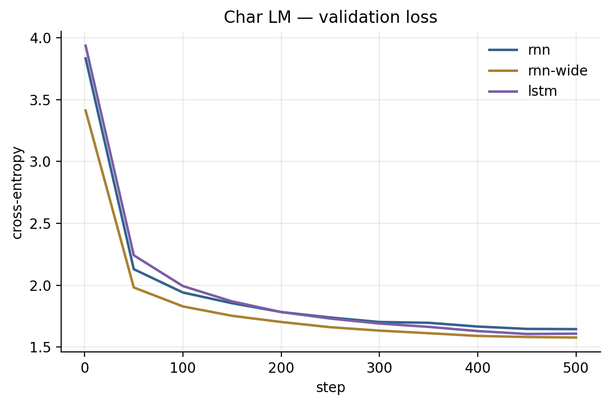
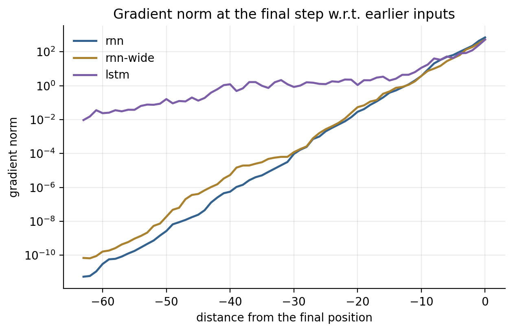
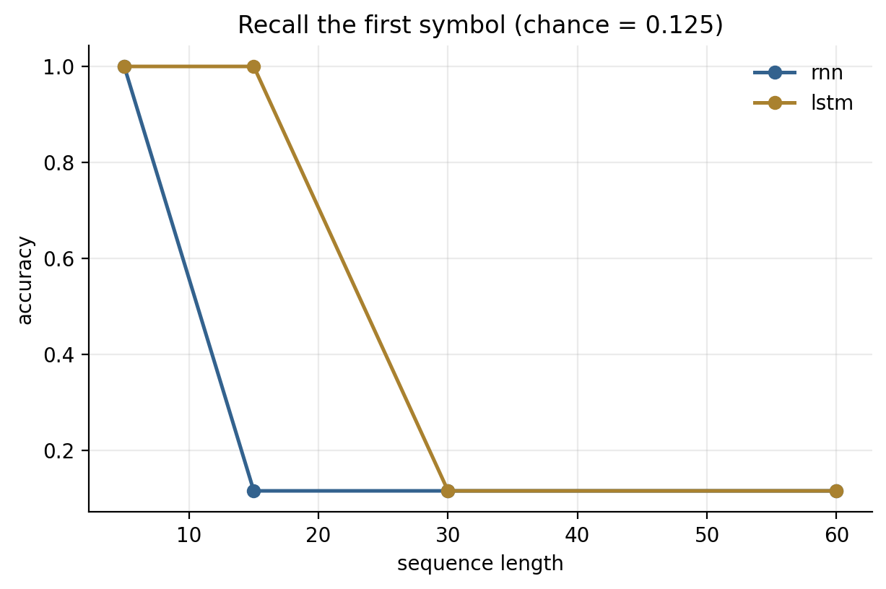
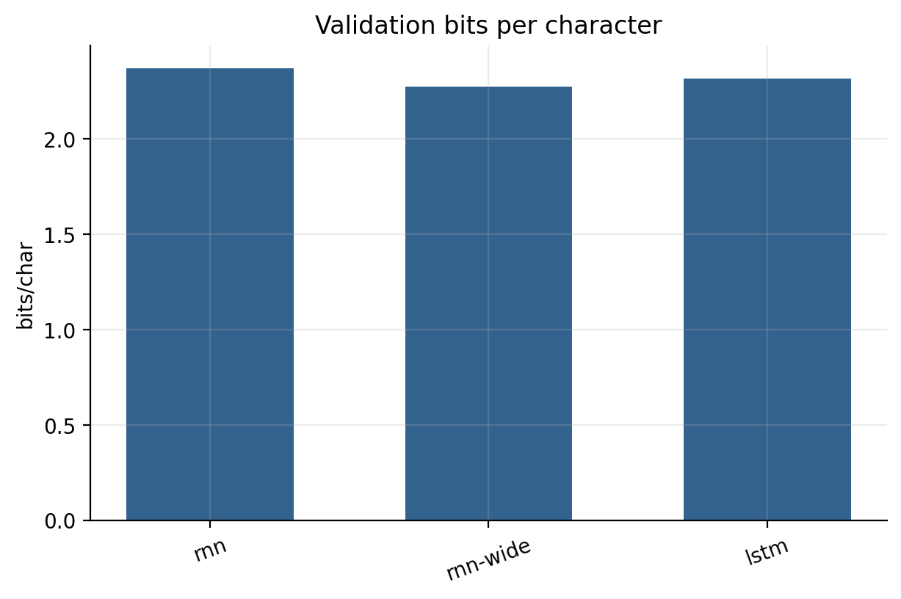

**Open threads.** GRUs, to see how much of the LSTM's benefit survives with one
gate fewer. Truncated BPTT over a longer context, which is how these models were
actually trained. And the recall probe with a proper budget sweep, to find where
the LSTM's 63-step gradient becomes 63-step learning.

**Reading:** [Long Short-Term Memory](https://www.bioinf.jku.at/publications/older/2604.pdf)
(Hochreiter & Schmidhuber); Pascanu et al., *On the difficulty of training
recurrent neural networks*; Karpathy, *The Unreasonable Effectiveness of RNNs*.

---

## C2 — Seq2seq with and without attention

**Question.** How much does forcing a whole source sentence through one
fixed-size vector actually cost?

### The math

**The bottleneck.** A classic encoder-decoder compresses the source to a single
vector $c = h_{T_s}$ and generates from it:

$$p(y_1,\dots,y_{T_t} \mid x) = \prod_{j} p\!\left(y_j \mid y_{<j},\, c\right).$$

Everything the decoder can ever know about the source must fit in $c$, whose size
is fixed while $T_s$ grows. With $d$-dimensional states the channel carries
$O(d)$ numbers regardless of input length — so the cost of the bottleneck should
grow with the amount of *information* in the source, not its padded length. (The
first version of this rung missed exactly that, swept padding, and found
nothing.)

**Attention removes the constraint.** Keep every encoder state and build a fresh
context per output step:

$$e_{ji} = \operatorname{score}(s_j, h_i), \qquad \alpha_{ji} = \frac{\exp e_{ji}}{\sum_{i'} \exp e_{ji'}}, \qquad c_j = \sum_i \alpha_{ji} h_i .$$

This rung uses Luong's dot product, $\operatorname{score}(s, h) = s^\top h$
(Bahdanau's additive $v^\top\tanh(W[s;h])$ is the other standard choice). The
context is now a *convex combination of all source states*, so no fixed budget
limits what reaches the decoder; the price is $O(T_s T_t)$ scores instead of
$O(T_t)$, and it is the same price the transformer pays in C3.

Padding must be masked **before** the softmax, by setting those logits to
$-\infty$: masking afterwards would leave the remaining weights un-normalized.

**Why this task.** Every output character of an ISO date is a copy of some input
span, so the correct alignment is known in advance and the attention map can be
*scored* — the fraction of output characters whose attention peak sits on a
matching input character — rather than admired.

**Results** (date normalization, filler words around the date, medians over
seeds 0–2):

| filler | source length | bottleneck exact | attention exact | bottleneck char-level |
| --- | --- | --- | --- | --- |
| none | 18 | 0.997 | 1.000 | 0.999 |
| 10 words | 101 | 0.326 | 1.000 | 0.899 |
| 24 words | 193 | **0.005** | **1.000** | 0.710 |

The attention model is perfect at every length; the bottleneck model falls off a
cliff. Alignment score 0.729 median — high, and *not* 1.0 by construction, since
the month digits must come from a month *name* and count as misses.

**What surprised me.** The gap between the two accuracy measures. At 193
characters the bottleneck model still gets **71% of characters** right while
getting **0.5% of dates** right. It has learned the *shape* of the answer — four
digits, dash, two digits, dash, two digits, roughly the right ranges — and lost
the content. That is the most honest picture of what a too-small channel does:
not noise, but confident, well-formed, wrong output. Character accuracy would
have made this look like a mild degradation; exact match shows it is total.

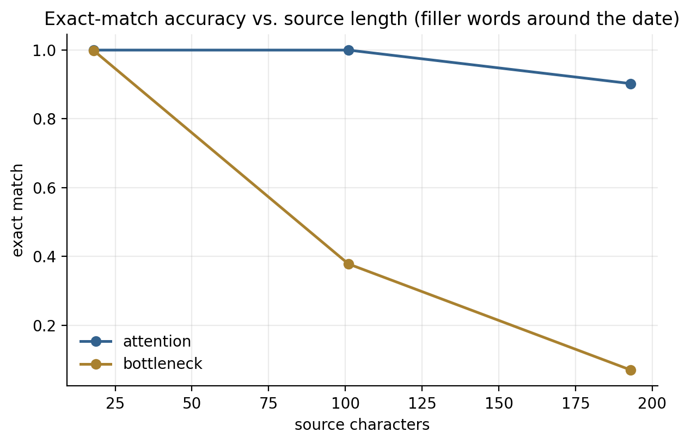
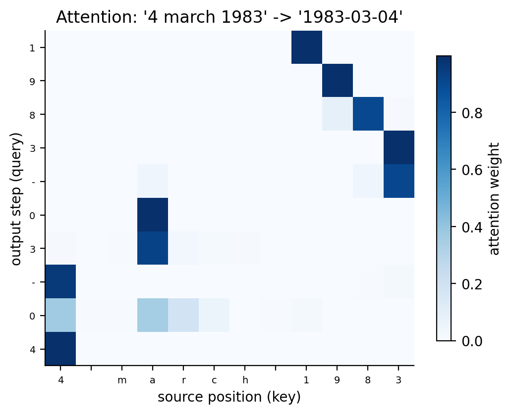
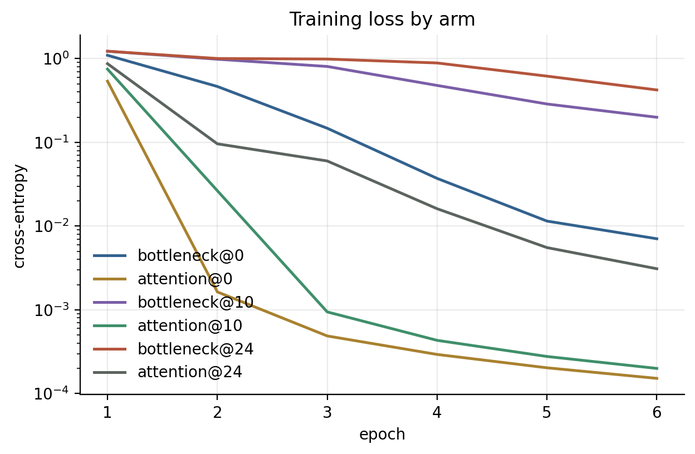

**Open threads.** Bahdanau's additive score, which has an extra parameter matrix
and is claimed to matter for longer sources. Coverage penalties, the standard fix
for attention that revisits one position and drops another. And beam search
instead of greedy decoding, which should matter most exactly where the bottleneck
model is uncertain.

**Reading:** [Neural Machine Translation by Jointly Learning to Align and
Translate](https://arxiv.org/abs/1409.0473) (Bahdanau et al.);
[Effective Approaches to Attention-based NMT](https://arxiv.org/abs/1508.04025) (Luong et al.);
[Sequence to Sequence Learning](https://arxiv.org/abs/1409.3215) (Sutskever et al.).

---

## C3 — A transformer from scratch

**Question.** Does the implementation actually respect causality — and how much
of a transformer's ability is the positional encoding?

### The math

**Scaled dot-product attention**, and why the scale is there:

$$\operatorname{Attention}(Q, K, V) = \operatorname{softmax}\!\left(\frac{QK^\top}{\sqrt{d_k}} + M\right)V .$$

If the entries of $q$ and $k$ are independent with zero mean and unit variance,
then $q^\top k = \sum_{i=1}^{d_k} q_i k_i$ has variance $d_k$. Without the
$1/\sqrt{d_k}$, logits grow like $\sqrt{d_k}$, the softmax saturates toward a
one-hot distribution, and its Jacobian $\operatorname{diag}(p) - pp^\top$ goes to
zero — attention stops learning precisely when the model is made wider. Dividing
by $\sqrt{d_k}$ holds the logit variance at 1 regardless of head width.

**The causal mask** is $M_{ij} = -\infty$ for $j > i$ and 0 otherwise, applied
*before* the softmax so the forbidden positions get exactly zero weight rather
than a small one. This is trivially easy to get subtly wrong — off by one, or
masked after the softmax — and a model that leaks a single future position still
trains beautifully while being worthless. The rung therefore checks it: perturb
the last token, and no earlier logit may move.

**Positional encoding, and what happens without it.** Self-attention is
*permutation-equivariant*: for a permutation matrix $P$,

$$\operatorname{Attention}(PQ, PK, PV) = P\operatorname{Attention}(Q, K, V),$$

so a transformer with no positional information cannot distinguish "abc" from
"cba" — with a causal mask it degenerates to a function of the *multiset* of
preceding characters. The sinusoidal encoding

$$PE_{(t, 2i)} = \sin\!\left(\frac{t}{10000^{2i/d}}\right), \qquad PE_{(t,2i+1)} = \cos\!\left(\frac{t}{10000^{2i/d}}\right)$$

fixes this with a useful extra property: for a fixed offset $k$, the pair
$(\sin\omega t, \cos\omega t)$ maps to $(\sin\omega(t+k), \cos\omega(t+k))$ by a
rotation that depends on $k$ but **not** on $t$, so "$k$ steps back" is a linear
operation the attention can express uniformly across the sequence.

**Pre-LN blocks.** The rung normalizes inside the residual branch,
$x \mapsto x + f(\mathrm{LN}(x))$, rather than the 2017 paper's
$x \mapsto \mathrm{LN}(x + f(x))$. Post-LN puts a normalization on the skip path
itself and needs learning-rate warmup to train at all; pre-LN keeps the identity
path clean — B4's argument again.

**Results** (same corpus, split, eval windows, steps, batch and context as C1;
medians over seeds 0–2):

| variant | parameters | bits/char |
| --- | --- | --- |
| learned positions | 1.82M | **2.309** |
| sinusoidal positions | 1.80M | 2.349 |
| **no positional encoding** | 1.80M | **2.641** |
| learned positions, at C1's budget | 242k | 2.508 |

Removing position costs **0.304 bits/char** (range 0.265–0.348) — the largest
ablation in the part, and exactly what the equivariance argument predicts.
Learned beats sinusoidal by 0.040 at this scale. The causal check returns
**exactly 0.0** on every seed, for both the logit perturbation and the attention
mass above the diagonal.

**What surprised me — and the result I cannot explain away.** Line up C1 and C3,
which share every training setting:

| model | parameters | bits/char |
| --- | --- | --- |
| vanilla RNN (wide) | 343k | **2.263** |
| transformer, learned PE | 1.82M | 2.309 |
| LSTM | 320k | 2.334 |
| transformer at C1's budget | 242k | 2.508 |

**The wide vanilla RNN beats every transformer arm, using 5× fewer parameters
than the best of them**, and the parameter-matched transformer is the worst model
in the comparison. That is not the story anyone expects in 2026, and it is not a
claim that transformers are worse — it is a claim about this regime: 500 steps,
64 characters of context, 250k characters of training text, and *no warmup* for
the transformer, which B5 showed is the one thing Adam-family optimizers are
picky about at the start of training. Transformers are built to exploit long
context and large data, and this rung deliberately gives them neither. The honest
summary is that I measured a regime where the inductive bias of recurrence is
worth more than the flexibility of attention, and that regime is small.

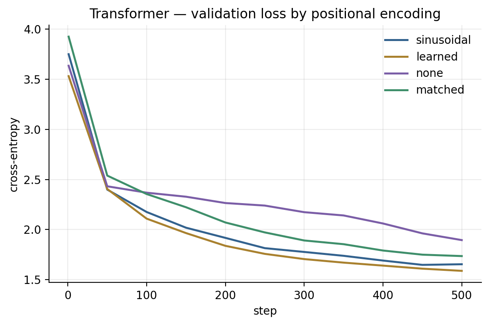
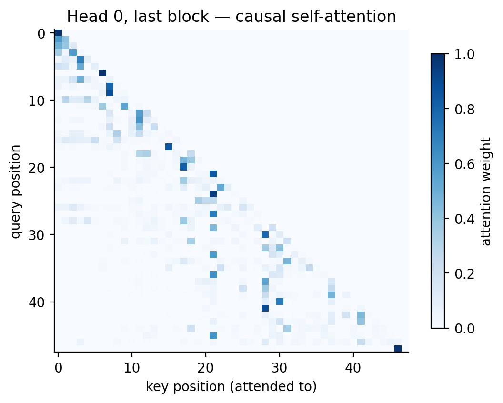
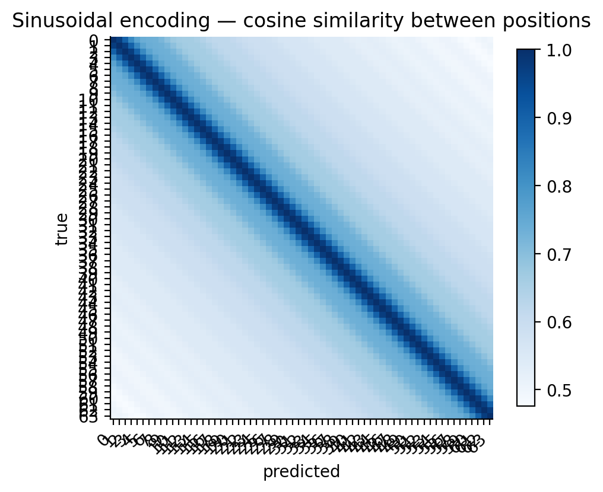
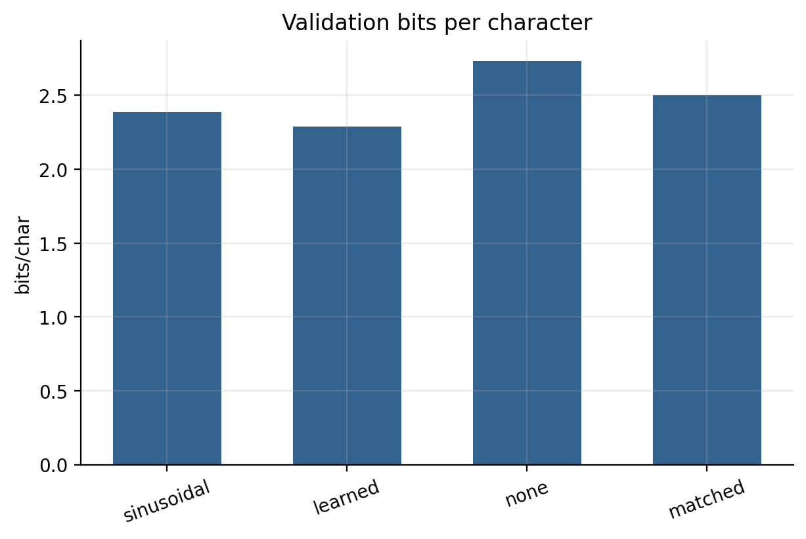

**Open threads.** Warmup plus a cosine schedule, which would make the comparison
above fair to the transformer — the obvious next run. Longer context, where the
recurrent models must lose. RoPE instead of additive encodings. And KV caching,
which is the difference between a sampler that is $O(T)$ per token and one that
is $O(T^2)$.

**Reading:** [Attention Is All You Need](https://arxiv.org/abs/1706.03762);
[The Annotated Transformer](https://nlp.seas.harvard.edu/annotated-transformer/);
Xiong et al., *On Layer Normalization in the Transformer Architecture* (pre-LN vs post-LN).

---

## C4 — Fine-tuning a small ViT

**Question.** A ViT is C3's block applied to image patches. Without a CNN's
built-in priors, how much does it depend on pretraining?

### The math

**Patchification is the only image-specific step.** An image
$x \in \mathbb{R}^{H\times W\times C}$ is cut into $N = HW/P^2$ patches of side
$P$, each flattened and projected:

$$z_0 = \left[x_{\text{cls}};\, x^1_p E;\, x^2_p E;\, \dots;\, x^N_p E\right] + E_{\text{pos}}, \qquad E \in \mathbb{R}^{P^2C \times d}.$$

After that it is C3's encoder verbatim. At $224^2$ with $P=16$ that is $N=196$
tokens, and attention's $O(N^2)$ cost is why input resolution is expensive here
in a way it is not for a CNN.

**What the architecture does not assume.** A convolution hard-codes locality
(a unit sees a small neighbourhood) and translation equivariance
($f(\text{shift}(x)) = \text{shift}(f(x))$). Self-attention assumes neither:
every patch can attend to every other from layer 1, and position enters only
through $E_{\text{pos}}$, which is *learned*. That is more expressive and
strictly less constrained — so with little data the ViT must learn from examples
what a CNN gets for free, which is the standard explanation for ViTs being
data-hungry and the thing this rung measures.

**Probe versus fine-tune** ask different questions. A linear probe on frozen
features asks *are the pretrained representations already linearly separable for
this task?* — it optimizes $\min_W \sum_i \ell(W\phi(x_i), y_i)$ with $\phi$
fixed, a convex problem in $W$. Fine-tuning asks *can the representation itself
be improved?*, at 7000× the trainable parameters and the risk of destroying
pretrained features with too large a step (hence the much smaller learning rate).

**Results** (ViT-Tiny, 4-class CIFAR subset — plane/car/ship/truck — 1500 train
images, 2 epochs, medians over seeds 0–2):

| arm | test accuracy | trainable parameters | seconds (T4) |
| --- | --- | --- | --- |
| from scratch | 0.420 | 5.53M | 12.8 |
| linear probe | 0.866 | **772** | 5.5 |
| full fine-tune | **0.955** | 5.53M | 12.8 |

Pretraining is worth **+0.452** (probe over scratch, range 0.421–0.458);
fine-tuning adds a further **+0.090** over the probe (range 0.073–0.100).

**What surprised me.** Not the ordering — the *ratio*. The linear probe trains
**772 parameters**, four classes' worth of weights on a 192-dimensional feature,
and lands within 9 points of a full fine-tune of 5.5 million. Essentially all of
the task-relevant work was already done by ImageNet pretraining; the fine-tune is
polishing. And the from-scratch arm at 0.420 is barely above the 0.25 chance of
four classes — 1500 images is simply not enough to teach a transformer what an
edge is.

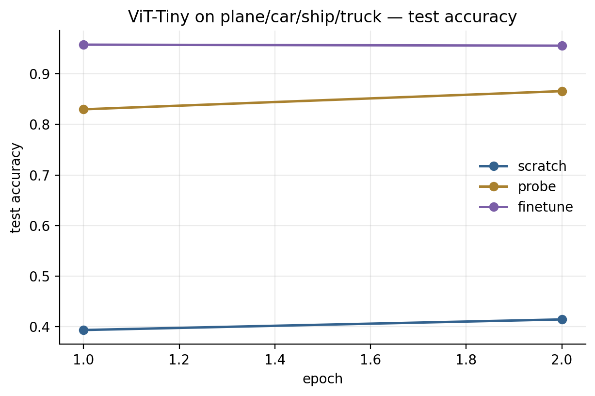
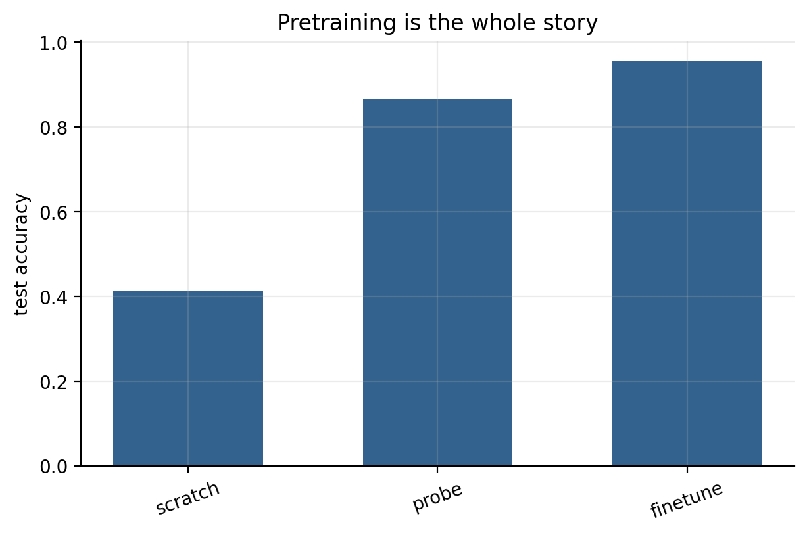
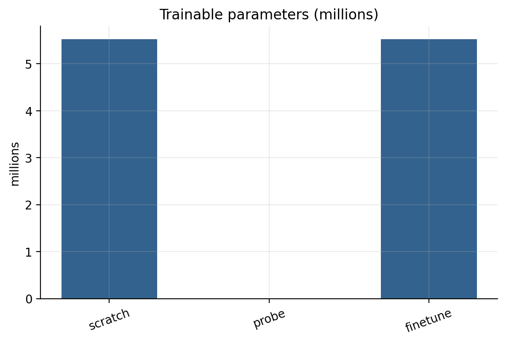
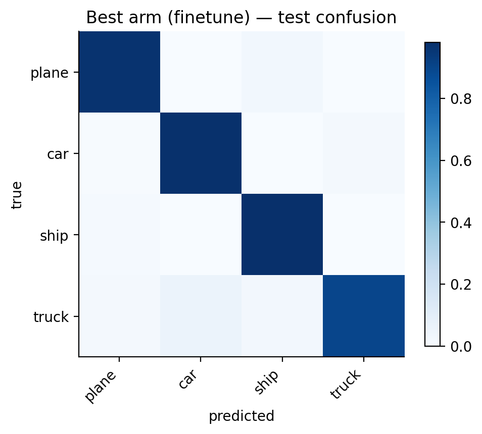

**Open threads.** Freezing progressively more blocks, to find where "probe" turns
into "fine-tune". Data augmentation, which is how the ViT paper's own
from-scratch results were rescued. DINO or MAE features instead of supervised
ImageNet ones — that comparison is part D's business.

**Reading:** [An Image is Worth 16x16 Words](https://arxiv.org/abs/2010.11929) (ViT);
Steiner et al., *How to train your ViT*; [timm](https://github.com/huggingface/pytorch-image-models).

---

## C5 — What changed since C3, and what it cost

**Question.** C3's transformer is eight years old as a design. Every production
decoder since has changed the attention layer. What are those changes actually
buying, in a quantity that can be computed rather than argued about?

### The math

**The bill attention pays is not the quadratic term.** At generation time a
decoder emits one token at a time, and each new token attends over everything
already produced — so every past key and value must be *retained* and re-read.
The cache for a multi-head stack is

$$M_{\text{KV}} = 2 \, b \, L \, H \, d_h \, T,$$

bytes for $L$ layers, $H$ heads of width $d_h$, context $T$ and $b$ bytes per
element. It grows linearly with context and is read in full per token, which
makes decode memory-bound: the arithmetic is trivial next to the bandwidth.
Four families of change attack one factor each.

**Grouped-query attention** shrinks $H$ to $H_{kv}$ in that formula and nowhere
else — queries keep their full head count, so the model's capacity to *ask*
different questions is untouched while the memory of answers is shared.

**Sliding-window attention** replaces $T$ with $\min(T, W)$, making a layer's
cache constant past the window. Reach is not lost, it is relocated: stacking $L$
such layers gives a receptive field of $L \cdot W$ through composition, the same
trick a CNN uses for its effective field.

**Multi-head latent attention** stops caching per-head keys and values at all.
DeepSeek-V2 projects them into one shared low-rank latent $c_{KV}$ of rank $r$,
plus a small decoupled rotary key that must stay outside the compression because
RoPE does not commute with the down-projection:

$$M_{\text{MLA}} = b \, L \, (r + d_{\text{rope}}) \, T.$$

The head count has left the expression entirely.

**A delta rule leaves the cache paradigm.** Gated DeltaNet keeps a fixed-size
matrix $S \in \mathbb{R}^{H_v \times d_k \times d_v}$ updated by an
outer-product rule, plus a short causal convolution window. Its size is chosen
by the architect, not by how much text has been read — so the state is
**constant in $T$**. That is C1's bargain exactly: compress the past into a
fixed state. What changed is not the bargain but the budget, and the update
rule that fills it.

**What I built.** No training. Five configurations — C3's own, measured from
this repo, and four published ones recorded with their hub ids — reduced to
layer lists and evaluated for decode state against context. Each mechanism is
also ablated **against its own config with that mechanism removed**, rather than
against a different model, so the number attributed to it is not really a
difference in ten other things. The accounting lives in
`src/mlladder/archspec.py` and is shared with H6.

**Results** (decode state in MiB, fp16):

| decoder | layers | 1k | 16k | 64k | 256k |
| --- | --- | --- | --- | --- | --- |
| C3 (this repo) | 4 full | 3.0 | 48 | 192 | 768 |
| Qwen3-8B | 36 full (GQA 32:8) | 144 | 2,304 | 9,216 | 36,864 |
| Mistral-7B | 32 sliding (W=4096) | 128 | **512** | **512** | **512** |
| DeepSeek-V2-Lite | 27 MLA (r=512) | 30 | 486 | 1,944 | 7,776 |
| Qwen3-Next-80B-A3B | 36 linear + 12 full | 62 | 422 | 1,574 | 6,182 |

Each mechanism against its own config without it, at 64k tokens:

| mechanism | cache shrink |
| --- | --- |
| GQA (32 query heads over 8 KV) | **4.0×** |
| sliding window 4096 | **16.0×** |
| MLA (rank 512 + 64 rope) | **10.7×** |
| delta rule (vs its own all-attention twin) | **3.9×** |

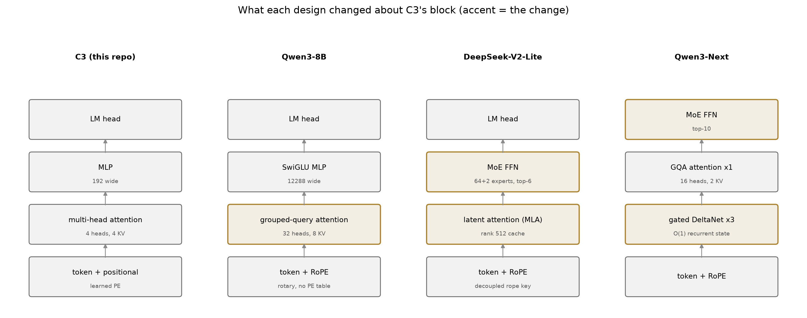
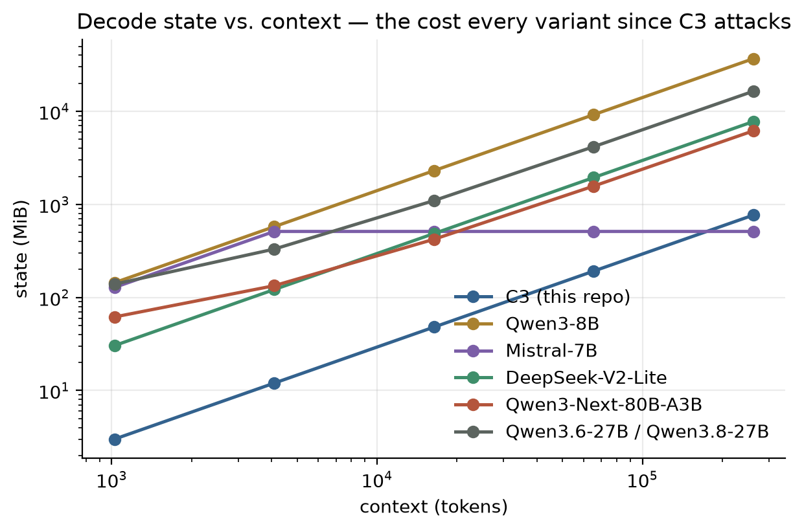
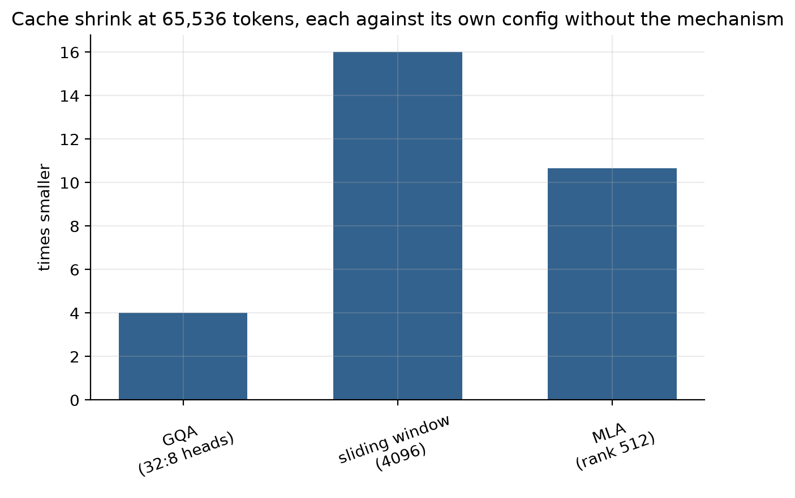
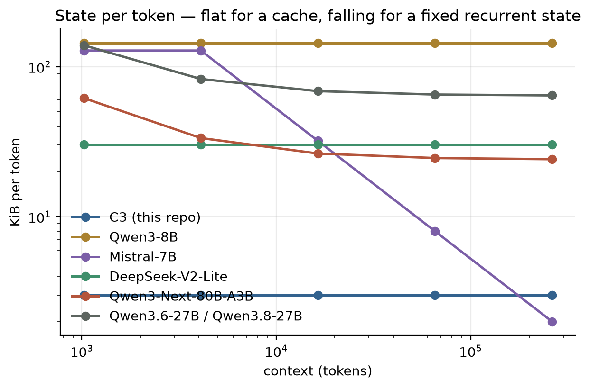

**What surprised me.** Three things.

*The numbers are enormous and they are not about parameters.* Qwen3-8B carries
**9.2 GiB of KV cache at 64k tokens** — larger than the 8B model's own weights
in fp16. The thing that stops a decoder serving long contexts is usually not its
size; it is the cache the context creates, and no amount of quantizing weights
touches it.

*Mistral's window is the bluntest instrument and the biggest win.* A cache that
simply stops growing beats every clever compression asymptotically: 512 MiB at
64k and still 512 MiB at 256k, while MLA's 10.7× compression is still growing
linearly underneath it. And the reach is not obviously sacrificed — 32 layers at
a 4096 window compose to a 131,072-token receptive field. The cost is that the
reach is *indirect*, mediated through depth, which is exactly the compromise C1's
recurrence made and lost on. Whether it loses here is not something state
accounting can answer.

*C1's answer came back, and the crossover is early.* The delta-rule state is
1.05 MiB per linear layer, so Qwen3-Next carries **38 MiB before reading a single
token** — strictly worse than any cache at short context. It pays that back
against its own all-attention twin from **537 tokens** onward. I had expected a
constant-state design to need a very long context to justify itself; at these
dimensions it needs about two paragraphs. The tempting comparison — the hybrid
against Qwen3-8B, which crosses at 322 tokens — is the one to avoid, because it
credits the delta rule with savings that are really Qwen3-Next's much more
aggressive GQA (2 KV heads against 8).

**A check worth having.** DeepSeek publishes V2-Lite at 15.7B total and 2.4B
activated. The accounting here computes 15.8B (**0.6% off**) and, excluding the
embedding and output head that DeepSeek's transformer-only figure omits, 2.32B
(**3.2% off**). H6's independent check against TrOCR agreed to 1.3%. Two
validations on models with known answers is what makes the other numbers in
these tables worth reading.

**Open threads.** Gemma 4's ring-buffered sliding KV, which sizes the buffer at
window + prefill chunk rather than the full context and is implemented in the
accompanying fork — the natural next arm. Actually *measuring* decode throughput
against these predictions, since memory-bound is a claim about bandwidth that a
byte count only implies. And quality: none of this says whether a 512 MiB
windowed cache answers questions as well as a 9 GiB full one, which is the
question that decides anything.

**Reading:** [GQA](https://arxiv.org/abs/2305.13245);
[Mistral 7B](https://arxiv.org/abs/2310.06825) for sliding windows;
[DeepSeek-V2](https://arxiv.org/abs/2405.04434) for MLA;
[RoFormer](https://arxiv.org/abs/2104.09864);
and candle's `qwen3_5.rs`, `deepseek2.rs` and `gemma4/` for the implementations.

---

## The decoders, actually run

C5's method is reading published configs and computing decode state from them.
That method has two failure modes it cannot detect from the inside: the
arithmetic can be wrong, and the *config* can fail to contain the thing you are
asking about. Loading the weights finds both.

Everything below ran on one Colab T4 (15.4 GB), which is the binding constraint
and the reason quantization is not an optional extra here. Raw values in
[`data/c-real-models.json`](data/c-real-models.json); the scripts are in
`tools/real_models/`.

| model | how it fit | resident | gen tok/s |
| --- | --- | --- | --- |
| DeepSeek-V2-Lite (15.7B) | bitsandbytes NF4, double-quantised scales | 9.62 GB | 4.44 |
| Gemma-4-E2B-it | bitsandbytes NF4 | 6.70 GB | 6.35 |
| Qwen3.6-27B | GGUF UD-IQ3_XXS, 3.06 bpw, fully offloaded | 12.0 GB | 10.2 |
| Qwen3.8-27B | GGUF UD-IQ3_XXS, 3.06 bpw, fully offloaded | 10.9 GB | 9.5 |

All four produce coherent text. Two things came out of it that the arithmetic
could not have.

**A parameter count read off a quantized model is not a parameter count.**
`sum(p.numel())` reports **8.06B** for DeepSeek-V2-Lite, a published 15.7B-parameter
model, because bitsandbytes packs two 4-bit weights into each byte. C5's
own count of 15.8B is right and the loaded model's `numel` is wrong by exactly
2x — which is the direction that would have been very easy to believe, since
"the config over-counts" is a more plausible-sounding story than "the tensor
told me half."

**Gemma-4-E2B-it runs one KV head for eight query heads.** That is multi-query
attention — the limit of the GQA lever, not a step along it. C5 prices GQA at
Qwen3-8B's 32:8, a 4x cache reduction; MQA at 8:1 is 8x, and the reason the
family stops there is that there is nothing left to share.

### Two generations, one architecture

The interesting result is a negative one. Asked to compare Qwen3.6 against
Qwen3.8, the size-matched pair is `Qwen3.6-27B` and `Qwen3.8-27B`. Their configs
were flattened and compared key by key:

**61 keys compared. One differs. It is `transformers_version` — the library that
wrote the file.**

Same 64 layers, same 5120 hidden, same 24 query heads over 4 KV heads, same
256-wide head, same 17408 intermediate, same 248320 vocabulary, same interleave
of 48 linear-attention layers with 16 full-attention ones at interval 4, same
single MTP layer. Both ship **55.56 GB** of bf16 weights — identical to the
hundredth of a gigabyte, so the parameter counts match too.

Whatever separates these two generations at 27B, it is weights, data or
post-training. It is not shape, and **no amount of reading configs will find
it** — which is exactly the boundary of what this rung can see, now measured
rather than assumed. C5 carries them as a single entry for that reason, with a
test that fails if a later edit splits them without an actual difference to
point at.

The runtime behaviour is consistent with that: 10.2 against 9.5 generated
tokens/s at the same quantization. I am *not* reporting that 0.7 as a
difference between the models, because the two GGUF files are 12.0 GB and
10.9 GB at the same nominal 3.06 bpw — the quantizer allocated bits differently
between them, so the arms are not matched. A throughput comparison across two
different quantizations of two models is a comparison of the quantizations.

One qualitative note, offered as an anecdote and not a result: at a 96-token
budget **neither model produced an answer**. Both are reasoning models, both
opened a thinking block, and both were still in it when the budget ran out —
3.6 with a numbered plan, 3.8 telegraphically. n=1 at temperature 0 on one
prompt is worth exactly what this paragraph claims for it, which is nothing
except that the budget was wrong for the model class.

**What did not run.** `Qwen3.8-Flash-Next` is 360 GB of weights. The 27B pair at
4-bit AWQ is 20.4 and 21.0 GB against a 15.4 GB card, which is why the 3-bit
GGUF route is what made them runnable at all — the quantization was not a
convenience, it was the difference between a measurement and a paragraph
explaining why there wasn't one.

### Through the candle fork

Part H's OCR model runs through the accompanying candle fork and
[matches transformers to sixteen digits](h-computer-vision.md#the-same-model-through-candle-and-what-two-implementations-agreeing-buys).
The decoders went less well, and the failures are specific enough to be useful.

**Gemma-4-E2B-it** needed two patches before it would load at all. The fork's
`TextModel` reads the decoder from `model.*`; a multimodal checkpoint keeps the
same decoder at `model.language_model.*` beside its vision and audio towers, so
text-only loading died at `model.embed_tokens.weight`. And the example hardcodes
bf16 on GPU, which needs sm_80. With a nested-prefix constructor and a `--dtype`
flag it loads and generates at **25.7 tok/s** — and emits the word "thought"
repeated to the token limit.

That is worth one control before blaming anyone. Transformers at **f16**, same
model, same card, same prompt and chat template, answers correctly at 9.63
tok/s. So it is not f16 precision. And the prefix patch is behaviour-preserving:
the constructor's other uses of the unprefixed builder are `dtype()` and
`device()`, and the one root-level weight (`lm_head`) is never reached because
this config sets `tie_word_embeddings: true`. The conclusion I can defend is
narrow and still useful: **the fork's `gemma4` f16 path produces wrong output on
sm_75, and its default bf16 cannot run there at all**, so Gemma-4 could not be
validated through the fork on this card.

**DeepSeek-V2-Lite** did not run through the fork for a plainer reason: the
`deepseekv2` example exposes no quantization flag, so it loads 31.4 GB of f16
weights against a 15.4 GB card. The machinery exists in the library —
`TextModel::new_with_quant` takes a `GgmlDType` — the example just does not wire
it up. **Qwen3.6/3.8** have `qwen3_5.rs` in `candle-transformers` but no example
binary, so there is nothing to invoke without writing one.

So of the five models, the fork ran one end to end, and that one it ran
*exactly* right.

---

## What part C settled

1. **Every architecture here is a different answer to "how does information
   travel?"** Recurrence carries it in a state and pays multiplicatively per
   step; gating buys an additive path; attention refuses to compress and pays
   $O(T^2)$. The measurements line up with the algebra: the RNN's geometric
   Jacobian product shows up as a 27-step horizon, the LSTM's product of forget
   gates as 63, and attention's convex combination as a bottleneck-vs-attention
   gap that grows from 0.003 to 0.98 as the source gets longer.
2. **Reach is not the same as use.** The LSTM's gradient arrives 63 steps back
   and it still cannot solve 30-step recall at this budget, and its extra memory
   *loses* to a wide vanilla RNN on the actual language-modelling task. An
   architecture's capability and what a training run extracts from it are
   different quantities.
3. **The famous architecture lost, and the regime is why.** A 343k-parameter
   vanilla RNN beat a 1.8M-parameter transformer on 250k characters at 64 tokens
   of context with no warmup. Nothing about that contradicts the literature; it
   locates the boundary of it, which is more useful than a fourth reproduction of
   a result everyone already believes.
4. **Two metrics on the same run told opposite stories.** C2's bottleneck model
   keeps 71% character accuracy while getting 0.5% of dates right. Choosing the
   metric that matches the task's actual failure mode did more work here than any
   modelling decision.
5. **A seed does not pin a number, and which numbers it fails to pin is
   informative.** Across three full sweeps — one on CPU, two on separate T4
   sessions — C1, C3 and C4 reproduced their medians *exactly* (bits/char,
   horizons, accuracies, the causal-leak zero). C2's bottleneck exact-match did
   not: 0.363, 0.349 and 0.326 at 101 characters, 0.012, 0.017 and 0.005 at 193.
   Seeding does not make cuDNN's backward deterministic, and the bottleneck arm
   sits exactly at the edge of failing, where an all-or-nothing metric over ten
   characters amplifies any tiny difference in weights. Its character accuracy,
   measuring the same runs, moved by only ~0.015. So the metric that made the
   failure legible is also the least stable one — both facts follow from it being
   a threshold measure near a threshold. The conclusion (the bottleneck collapses
   while attention does not) is unaffected on every run; the third decimal place
   is fiction. Figures and metrics here therefore come from one sweep on one
   device, and `--check` should be run on that device.

6. **The design C1 lost with came back, and the ladder is why I noticed.** C5's
   delta-rule stack is C1's bargain — compress the past into a fixed state —
   with a larger budget and a better update rule, and it pays for itself from
   537 tokens of context. Reading Qwen3-Next's config as "a linear-attention
   hybrid" says nothing; reading it as "C1, with the compression problem solved
   differently" is only available because this part built C1 first.

**Cost of the part:** ~2,300 lines including tests, 27 test cases, and a full
three-seed sweep in about 8 minutes on a T4 (C1 67s, C2 25s, C3 33s, C4 35s per
seed; C5 is arithmetic) — the first part where the CPU-only path stopped being
comfortable.

---

*Figures regenerate with `uv run python tools/writeup_figures.py C`; the numbers
they are quoted against live in [`data/c-metrics.json`](data/c-metrics.json).
The [part README](../../parts/c_sequence_attention/README.md) is the short
version of this document.*
