# Part D — Self-supervised & representation learning

> **Status:** complete (D1–D3) · **Constraint:** CIFAR-10 subsets, short budgets; every arm shares data, schedule and seed
> **Numbers:** seeds 0–2, reference seed 0 · raw values in [`data/d-metrics.json`](data/d-metrics.json)
> **Reproduce:** `ladder run D1` … `D3` (needs `uv sync --extra torch`), or `uv run python tools/writeup_figures.py D`
> **Hardware:** swept on a Colab T4

Every part so far learned from labels. Part D removes them and asks what is left
to learn from — and the answer is that **the supervision was always in the data;
the labels were just a convenient way to point at it.** Two methods point at it
differently: SimCLR declares that two augmented views of one image mean the same
thing, and MAE declares that a hidden patch should be predictable from its
neighbours. Both then get judged the same way, by whether a linear classifier
can read the result.

The rungs also stop being independent here. D1's encoder is B4's residual
network with the classifier taken off, D2's transformer block is C3's applied to
image patches, D1's feature plot is A3's PCA, and D3's probe is D1's. That is
the point of a ladder rather than a list.

Notation: $z$ are L2-normalized projections on the unit sphere, $\tau$ the
contrastive temperature, $m$ the mask ratio, and $\phi$ a frozen encoder whose
features a probe reads.

---

## D1 — SimCLR

**Question.** With no labels at all, how much of a useful representation falls
out of "these two crops are the same picture" — and what does that claim depend
on?

### The idea

**Self-supervised learning** trains a network without labels by inventing a
task whose answer is already in the data. **SimCLR**'s task: take an image, make
two randomly distorted copies of it (crop, flip, colour shift, grayscale), and
train the network so that the two copies map to nearby feature vectors, while
copies of *different* images map far apart. This is **contrastive learning**:
pull matching pairs together, push everything else away.

The pipeline has three parts:

1. an **augmentation** step that produces the two views;
2. an **encoder** (here B4's ResNet without its classifier) that turns an image
   into a feature vector $h$;
3. a small **projection head** that maps $h$ to the vector $z$ the loss is
   computed on. It is thrown away after training, and the encoder's $h$ is what
   gets used.

Nothing tells the network what a deer is. It learns whatever features make
"same image, different distortion" recognisable, and the hope is that these
coincide with the features a classifier needs.

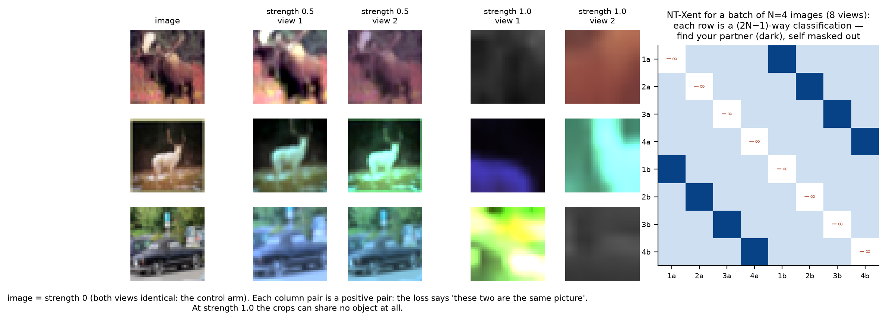

*Left: real outputs of this rung's own augmentation function on three CIFAR
images. At strength 0.5 each pair is clearly the same picture. At strength 1.0
the crops and colour jitter are aggressive enough that a pair can share no
visible object, yet the loss still insists they are "the same". Right: the
NT-Xent target for a batch of 4 images. Each of the 8 views must pick out its
partner (dark) among the other 7, and its similarity to itself is masked out.*

### The math

**NT-Xent is a $(2N-1)$-way classification problem.** For a batch of $N$ images,
each producing two views, the loss for the pair $(i, j)$ is

$$\ell_{i,j} = -\log\frac{\exp\!\left(\mathrm{sim}(z_i, z_j)/\tau\right)}{\sum_{k \neq i}\exp\!\left(\mathrm{sim}(z_i, z_k)/\tau\right)}, \qquad \mathrm{sim}(u,v) = u^\top v .$$

Read the denominator: it runs over *every other view in the batch*, so the
network is being asked "which of these $2N-1$ is your partner?" The $k \neq i$
is load-bearing — a view's similarity to itself is 1 by construction, and
leaving it in the denominator lets the model win by doing nothing.

**Why the batch size is a hyperparameter of the objective, not just of the
optimizer.** NT-Xent is InfoNCE, which bounds mutual information:

$$I(X_i; X_j) \;\ge\; \log K - \mathcal{L}_{\text{InfoNCE}},$$

with $K$ the number of candidates. The bound cannot exceed $\log K$, so a small
batch caps how much the objective can ever say — the reason the SimCLR paper
needed batches in the thousands and why this rung's numbers are modest.

**What the temperature does.** The gradient of $\ell_i$ with respect to a
negative $z_k$ is proportional to its softmax weight
$p_k \propto \exp(z_i^\top z_k/\tau)$. Small $\tau$ sharpens that distribution
onto the *hardest* negatives (the ones already closest); large $\tau$ spreads it
uniformly. So $\tau$ is not a scale factor — it chooses how much of the learning
signal comes from near-misses. Asymptotically the loss splits into an
**alignment** term (positives close) and a **uniformity** term (features spread
over the sphere), and $\tau$ sets their balance.

**Why the projection head is thrown away.** The loss forces *its output* to be
invariant to the augmentations — colour, crop, grayscale. Anything the
augmentation destroys is information the head must discard to score well. The
layer below it is under no such pressure, so it keeps colour and pose
information that a downstream task may want. Probing the encoder rather than the
projection is not a detail; it is the difference between reading the
representation and reading the objective.

**What augmentation strength really controls.** The positive pair *defines the
invariance being learned*. At strength 0 the two views are identical, the task is
solvable by any injective map, and nothing is learned about images at all — which
makes it the control arm this rung needs.

### What we measure, and why

- **Linear-probe accuracy** — freeze the encoder, train only a linear classifier
  on 4000 labelled images, and score it on 2000 test images (chance 0.10). This
  is the standard way to grade a representation. A linear classifier can only
  use what the features already make easy, so the score reflects the encoder
  and not the classifier.
- **The untrained-encoder control** — the same probe on a randomly initialised
  network. Random convolutional features are far from useless, and without
  this baseline all of their accuracy would be credited to SimCLR.
- **The no-augmentation control** (strength 0) — both views identical, so the
  contrastive task is trivial and teaches nothing about images. Whatever it
  gains over the untrained encoder is *not* contrastive learning.
- **Sweeps over temperature $\tau$ and augmentation strength** — the two knobs
  the math says define the objective.

### What I built

A ResNet encoder (B4's `build_network` with the classifier
removed), a two-layer projection head, and an augmentation pipeline written as
tensor ops rather than torchvision transforms so that the whole batch is
augmented on the GPU in one go — random resized crop, horizontal flip, colour
jitter, grayscale — with a single `strength` knob scaling all of them and
`strength=0` collapsing to the identity. NT-Xent is nine lines; the one that
matters is `similarity.fill_diagonal_(float("-inf"))`, and the positive targets
are `(arange(2N) + N) % 2N`, which pairs view $i$ with view $i+N$ in both
directions. Every arm is probed the same way: encoder frozen, a linear head
trained on 4000 labelled images, scored on 2000 test images.

### Results

*Setup: CIFAR-10, 8000 unlabelled images, 600 steps, batch 128; medians over seeds 0–2, ranges in brackets.*

| arm | probe accuracy |
| --- | --- |
| untrained encoder (control) | 0.256 [0.245, 0.263] |
| $\tau = 0.1$ | 0.359 [0.332, 0.360] |
| $\tau = 0.5$ | 0.339 [0.328, 0.347] |
| $\tau = 1.0$ | 0.318 [0.314, 0.319] |
| strength 0.0 (no augmentation) | 0.316 [0.303, 0.319] |
| strength 0.5 | **0.430** [0.406, 0.438] |
| strength 1.0 | 0.339 [0.328, 0.347] |

(The $\tau = 0.5$ and strength-1.0 rows are the same arm — the temperature sweep
runs at full strength and the strength sweep at $\tau = 0.5$ — so they share a
number by construction, not by coincidence.)

Temperature behaves as the algebra says: monotone in $1/\tau$ over the range
swept, hard negatives helping. Augmentation does not.

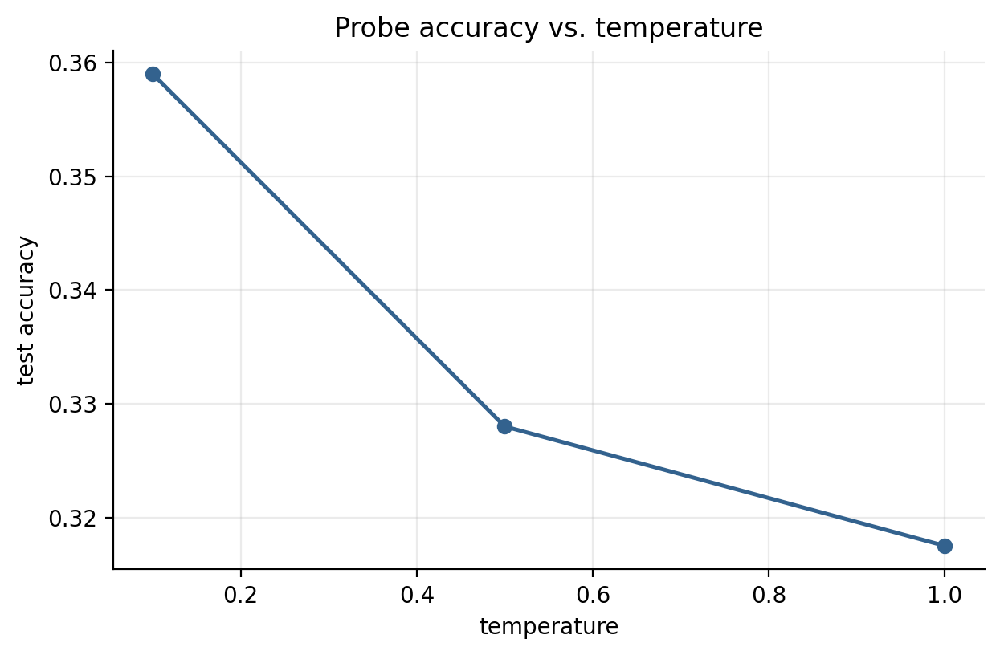
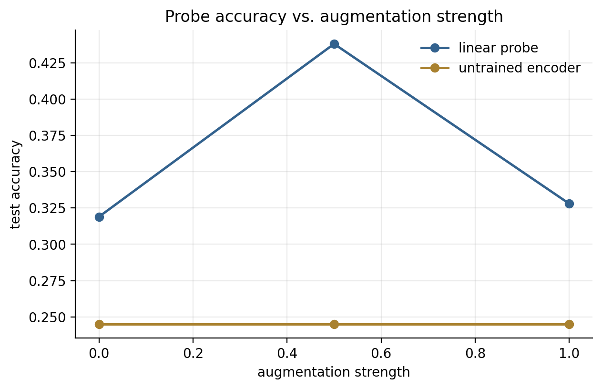
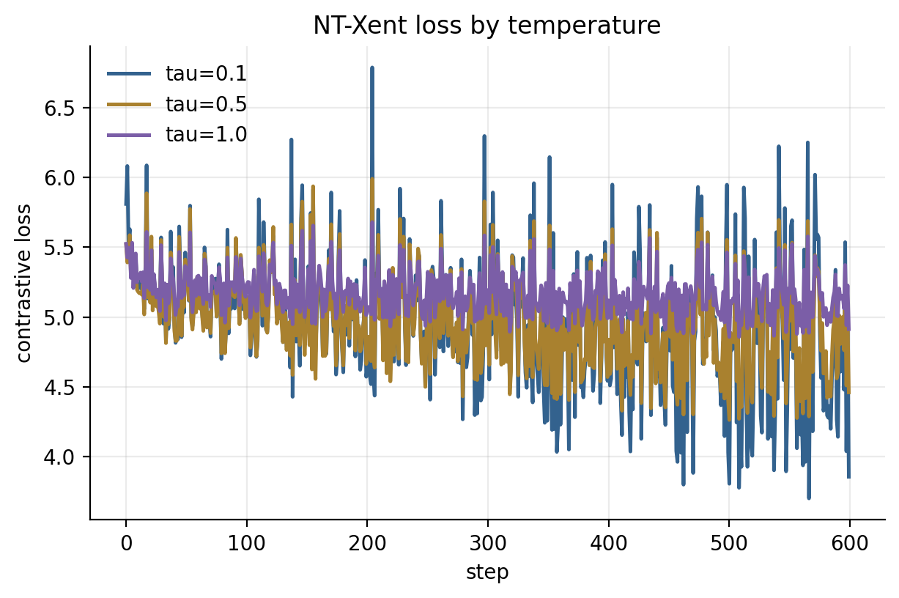
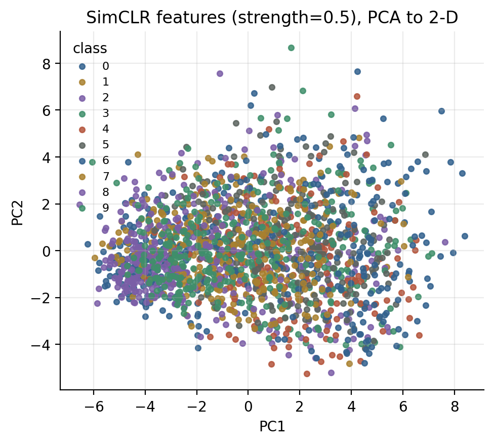

### What surprised me

Three things, and the last is a lesson about metrics
rather than about SimCLR.

*The augmentation curve is not monotonic.* The story everyone tells — stronger
augmentation means a harder pretext task means better features — predicts
0.0 < 0.5 < 1.0. What happened is 0.316, **0.430**, 0.339: the middle wins by
nine points over full strength, on every seed — `best/strength` is 0.5 on all
three, so unlike D2's mask ratio this optimum is stable, not a coin flip. The explanation is in the
definition of the objective rather than in any tuning detail. The positive pair
*is* the invariance being learned, so augmenting harder does not simply make the
task harder — it changes what the network is told to ignore. At full strength
the crops are aggressive enough that two views of one image frequently share no
object at all, and the only way to call them the same is to discard the object.
The loss still goes down; it is being minimized by throwing information away.
This is the "false positive" failure that BYOL and MoCo's momentum encoder were
partly designed around, and it is visible at this budget with three arms.

*The control arm carries most of the gain, except where it doesn't.* Strength
0.0 means both views are identical, so the positive pair is trivially
identifiable and nothing about images need be learned — yet it probes at 0.316
against the untrained encoder's 0.256. Compare it to the full-strength arm at
the same temperature (0.339) and the arithmetic is uncomfortable: of that arm's
+0.083 over an untrained network, **+0.060 is already there with no augmentation
at all**. Seventy-two percent of what looks like contrastive learning is what
happens to a random network when you push 8000 images through it under any
objective that keeps its features from collapsing. Only the strength-0.5 arm
escapes this — +0.168 over untrained, of which +0.119 is genuinely augmentation.
Without the control arm, both would have been reported as SimCLR's contribution
without distinction.

*And a metric I had to fix.* The rung's first version tracked its best encoder
only through the temperature loop, so it reported `best/probe_accuracy` = 0.359
while the strength sweep held 0.430 — a summary that quietly excluded half of
the experiment, and a PCA figure drawn from the wrong arm. `augmentation_gain`
was worse: defined as strongest-minus-weakest, it reported +0.031 for an effect
that is really +0.119 (best arm over the no-augmentation control), *because* the
curve is not monotonic. A difference between two endpoints is only a measure of
an effect if the effect is monotone, and the interesting result here is exactly
that it is not. Both are fixed; the numbers above are from the corrected run.

### Open threads

Batch size, which the InfoNCE bound says is a property of the
objective — $\log K$ at $N=128$ is 5.5 nats, and the SimCLR paper used 4096.
A finer strength grid to locate the optimum rather than bracket it. And the
obvious follow-up to the false-positive story: MoCo's queue, or BYOL, which drops
negatives altogether and so cannot be broken this way.

### Further reading

[SimCLR](https://arxiv.org/abs/2002.05709);
[MoCo](https://arxiv.org/abs/1911.05722);
Wang & Isola, *Understanding Contrastive Representation Learning through
Alignment and Uniformity on the Hypersphere*.

---

## D2 — Masked autoencoder

**Question.** SimCLR needs a hand-designed augmentation pipeline to say what
"the same image" means. MAE needs only a mask. How much should it hide?

### The idea

A **masked autoencoder (MAE)** learns by filling in blanks. Cut the image into
patches (as the ViT in C4 does), hide most of them at random, feed only the
visible patches to a transformer **encoder**, and ask a small **decoder** to
reconstruct the hidden patches' pixels. The error is measured only on the hidden
patches.

The design has one clever asymmetry. The encoder never sees the hidden patches,
not even as placeholders, so with 75% masked it processes only a quarter of the
image and trains much faster. The lightweight decoder receives the encoder's
output plus a shared "mask" token at each hidden position (with positional
encodings so it knows *where* each gap is). After pretraining the decoder is
discarded and the encoder is kept.

The **mask ratio** is the key knob. Hide a little and the gaps can be filled by
blurring the neighbours, which teaches nothing about objects. Hide most of the
image and the only way to reconstruct it is to recognise what is in it.

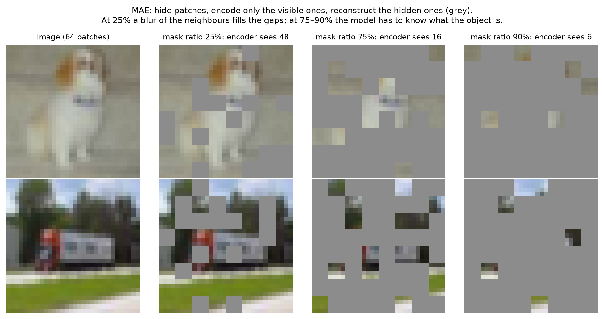

*Real CIFAR images masked by the rung's own `random_mask`. At 25% hidden (48
patches visible) the gaps are small and local. At 75% only 16 patches remain,
and at 90% only 6, and reconstruction becomes an exercise in guessing
content.*

### The math

**The objective is a denoising autoencoder with masking as the corruption.**
With $M$ the set of hidden patch indices,

$$\mathcal{L} = \frac{1}{|M|}\sum_{i \in M}\left\lVert \hat{x}_i - x_i\right\rVert^2 ,$$

computed on hidden patches *only*. Scoring the visible ones too would reward
copying the input, which a wide enough decoder does perfectly while learning
nothing.

**Why a high mask ratio, in one argument.** Natural images are spatially
redundant: a patch is well predicted by its neighbours. At low $m$ the
reconstruction is solvable by local interpolation — a smoothing filter would do
— and the encoder learns texture statistics. As $m$ grows, the nearest visible
patch moves further away, interpolation stops working, and the only remaining
route to a low loss is to infer *what the object is* and render the missing part
from that. The mask ratio is therefore a dial between a low-level task and a
semantic one, which is why the MAE paper's answer (75%) is so much higher than
BERT's 15%: language is far less redundant than pixels.

**The asymmetry is what makes it cheap.** The encoder runs on visible patches
only, so its sequence length is $(1-m)N$. Self-attention costs $O(L^2)$, so
masking 75% cuts the encoder's attention cost by roughly

$$\left(\frac{(1-m)N}{N}\right)^2 = (1 - 0.75)^2 = \frac{1}{16},$$

and the decoder — which does see all $N$ positions — is deliberately small and
thrown away afterwards. Hiding more of the image makes pretraining *faster*, not
slower, which is the opposite of the intuition and the reason the design won.

**Positions matter twice.** Mask tokens are identical by construction, so
without a positional encoding added before the decoder there is nothing to
distinguish "the missing patch in the corner" from "the missing patch in the
middle" — the model would be predicting an unordered bag of patches. C3's
permutation-equivariance argument, arriving in a second domain.

### What we measure, and why

- **Masked reconstruction MSE** — pixel error on hidden patches, the loss MAE
  trains on. It is reported to show that it is *not* a measure of feature
  quality: it rises steeply with the mask ratio because the task gets harder.
- **Linear-probe accuracy** — the same frozen-encoder protocol as D1, so the
  two methods are judged on identical terms. This is the number that says
  whether the features are useful.
- **Both, across mask ratios 0.25–0.9, over three seeds** — whether the
  published optimum (75%) shows up at this scale, and whether the difference is
  larger than the seed-to-seed spread.
- **Reconstructions** (figure) — what the decoder actually produces, to see
  what "low MSE" and "high MSE" look like.

### What I built

`patchify`/`unpatchify` as pure reshapes, and a ViT encoder
that is literally C3's transformer block — obtained with
`type(CharTransformer(...).blocks[0])` rather than a copy-paste, so the two
rungs cannot drift apart. The encoder sees only the visible patches: masking is
a `torch.gather` on the patch axis, the mask token is `scatter`ed back before
the decoder, and positional embeddings are added on both sides. The loss is

```python
(error.mean(dim=-1) * mask).sum() / mask.sum().clamp(min=1)
```

— a masked mean, with the `clamp` there because a degenerate mask of zero
patches would otherwise divide by zero rather than fail loudly. `represent()`
runs the encoder on *all* patches (no masking) and mean-pools, which is what the
probe and D3 consume.

### Results

*Setup: CIFAR-10, 8000 images, 4×4 patches → 64 tokens, 600 steps; medians over seeds 0–2.*

| mask ratio | final masked MSE | probe accuracy |
| --- | --- | --- |
| 0.25 | 0.268 | 0.349 [0.320, 0.350] |
| 0.50 | 0.343 | 0.351 [0.328, 0.356] |
| 0.75 | 0.480 | **0.356** [0.345, 0.362] |
| 0.90 | 0.676 | 0.345 [0.325, 0.350] |

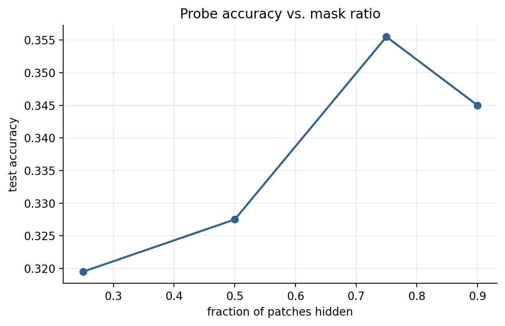
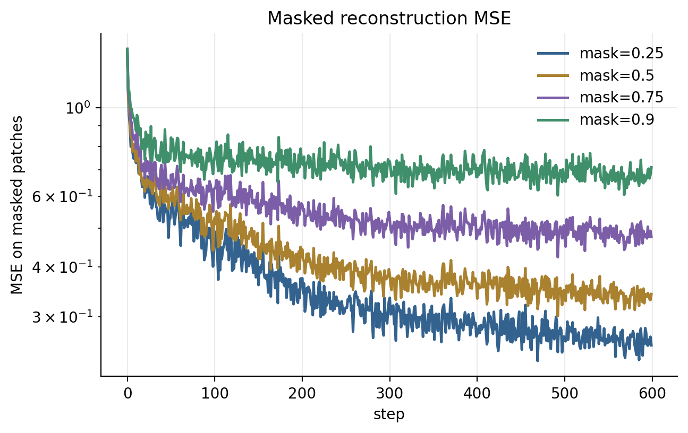
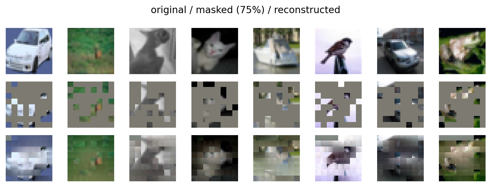

### What surprised me

How little the mask ratio mattered, and how easy it would
have been to claim otherwise. The median ranking reproduces the MAE paper's
answer exactly — 75% on top — but the whole sweep spans **0.7 percentage
points**, and the per-seed spread of a *single* arm is twice that. Run
`best/mask_ratio` across seeds and it comes out 0.75, 0.75, 0.5: the winner is
not stable, and a single-seed run of this rung would have let me write "75% is
best, as published" with a straight face. Three seeds turn that into the honest
claim, which is that at this budget the mask ratio does not decide anything
between 0.25 and 0.9.

The reconstruction loss, meanwhile, rises monotonically and steeply with the
mask ratio — 0.268 to 0.676, a factor of 2.5 — while probe accuracy stays flat.
That divergence is the point of the rung: **the pretext loss is not the quantity
you care about.** A model reconstructing 25% masking beautifully has learned
interpolation, and one reconstructing 90% masking badly has been forced to
guess at content. Comparing two self-supervised runs by their training loss
compares how hard their tasks were, not how good their features are.

The reconstruction figure makes the same point visually: at 75% the outputs are
blurry, low-frequency, plainly wrong in detail — and that model's features probe
best.

### Open threads

The published result needs scale to appear — ViT-Large, 800
epochs, full ImageNet — so the real thread is whether the flatness here is a
budget artefact or a small-data one, which a longer schedule at fixed data would
separate. Normalized-pixel targets (the paper's variant) are a two-line change.
And the asymmetry argument predicts wall-clock should *fall* as the mask ratio
rises; at 64 tokens attention is not the bottleneck, so this rung cannot see it.

### Further reading

[Masked Autoencoders Are Scalable Vision Learners](https://arxiv.org/abs/2111.06377);
[BERT](https://arxiv.org/abs/1810.04805) (the 15% that MAE argues against);
[ViT](https://arxiv.org/abs/2010.11929) for the patch embedding.

---

## D3 — Probing, and the question that matters

**Question.** Self-supervised learning is not sold on beating supervised
training with plenty of labels. It is sold on the regime where labels are
scarce. Where is the crossover?

### The idea

The practical promise of self-supervised pretraining is **label efficiency**:
learn features from plentiful unlabelled images, then get a good classifier
from only a handful of labelled ones. This rung puts four encoders through the
same test at 5, 25, 100 and 400 labels per class: an untrained network, D1's
SimCLR encoder, D2's MAE encoder, and one trained with labels.

It reads each frozen representation two ways, because they ask different
questions:

- a **linear probe** fits a linear classifier on the features — *is there some
  direction in feature space that separates the classes?*
- **k-nearest neighbours (k-NN)** trains nothing. It labels a test image by a
  vote of the $k$ most similar training images — *are images of the same class
  actually close together?*

A representation can pass the first and fail the second. That matters for
retrieval, clustering and anything else built on similarity.

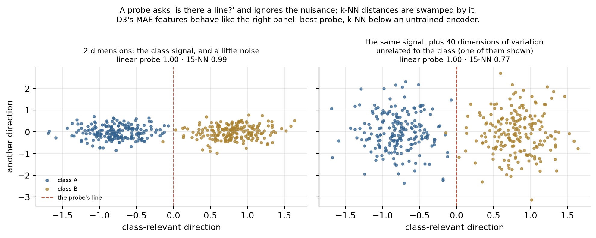

*Both panels contain the same class signal along the horizontal axis, and a
linear probe scores perfectly on both. On the right, 40 extra dimensions of
class-irrelevant variation dominate the distances, and k-NN falls to 0.77 even
though a line still separates the classes perfectly. This rung finds MAE's
features to be the right-hand kind.*

### The math

**A linear probe measures linear separability, and nothing else.** With $\phi$
frozen, fitting $\min_W \sum_i \ell(W\phi(x_i), y_i)$ is convex in $W$, so the
number it returns is a property of the representation rather than of the
optimizer that found it — which is exactly why it is the standard measure.

**k-NN measures geometry instead.** A cosine $k$-nearest-neighbour vote trains
nothing:

$$\hat{y}(x) = \operatorname{mode}\left\{y_{i} : i \in \operatorname{top-}k_j \frac{\phi(x)^\top\phi(x_j)}{\lVert\phi(x)\rVert\lVert\phi(x_j)\rVert}\right\}.$$

The two can disagree, and the disagreement is informative: a representation with
a high probe and a low k-NN score is linearly separable but poorly organized —
classes distinguishable by some projection, yet not clustered. Anything built on
nearest-neighbour retrieval will fail on such features even though the probe
looks healthy.

**Label efficiency is the actual claim.** Plot accuracy against the number of
labels $n$ per class. Supervised training must go through $n$; a frozen
representation only fits a linear head on $n$. Pretraining's promise is a
*leftward shift* of this curve, and its honest failure mode is that the curves
cross: with enough labels, learning the features for the task beats reusing
features learned for a different objective.

### What we measure, and why

- **Linear-probe accuracy vs labels per class** — the label-efficiency curve.
  Pretraining's claim is that its curve sits *above and to the left* of the
  baseline's: the same accuracy with fewer labels.
- **k-NN accuracy on the same features and labels** — a second reading that
  depends only on the geometry of the features, not on a trained classifier.
  Where it disagrees with the probe, the features are separable but not
  organised by similarity.
- **Identical labelled subsets for every encoder** (stratified, seeded) — not
  a metric but the condition that makes the columns comparable: every method
  sees the *same* 50 labelled images at 5 per class, not just the same number
  of images.

### What I built

Four encoders — untrained, SimCLR (D1's `pretrain`), MAE
(D2's), and the same architecture trained with labels — all built from the same
seed, all fed the same 8000 unlabelled images, all read on the same 2000 test
images. Labelled subsets are stratified (exactly $n$ per class) and drawn from
one seeded RNG per budget, so every method sees *identical* labels rather than
merely equal numbers of them. Features for the k-NN read are computed once per
encoder and cached, because otherwise this rung is sixteen forward passes over
the pool.

### Results

Linear probe accuracy, medians over seeds 0–2:

| labels/class | random | SimCLR | MAE | supervised* |
| --- | --- | --- | --- | --- |
| 5 | 0.158 | **0.250** | 0.232 | 0.577 |
| 25 | 0.186 | **0.273** | 0.265 | 0.607 |
| 100 | 0.235 | **0.322** | 0.317 | 0.606 |
| 400 | 0.271 | 0.350 | **0.368** | 0.608 |

k-NN accuracy on the same frozen features, same subsets:

| labels/class | random | SimCLR | MAE | supervised* |
| --- | --- | --- | --- | --- |
| 5 | 0.165 | **0.196** | 0.169 | 0.423 |
| 25 | 0.223 | **0.270** | 0.226 | 0.600 |
| 100 | 0.257 | **0.305** | 0.267 | 0.611 |
| 400 | **0.305** | 0.340 | 0.293 | 0.609 |

\* **the supervised column is not a fair comparison, and reading it as one is the
mistake this rung taught me** — see below.

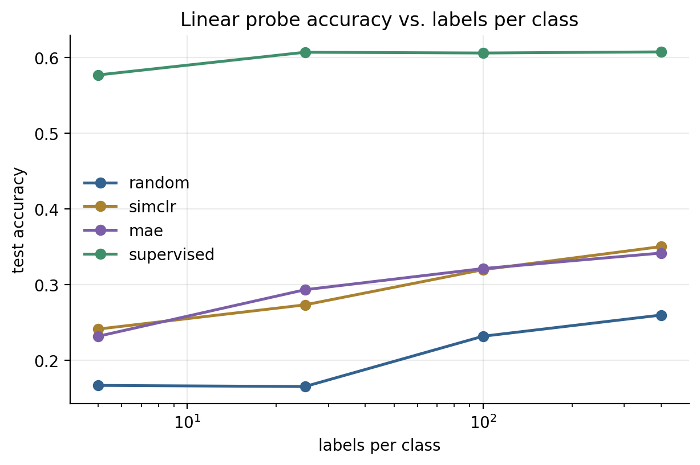
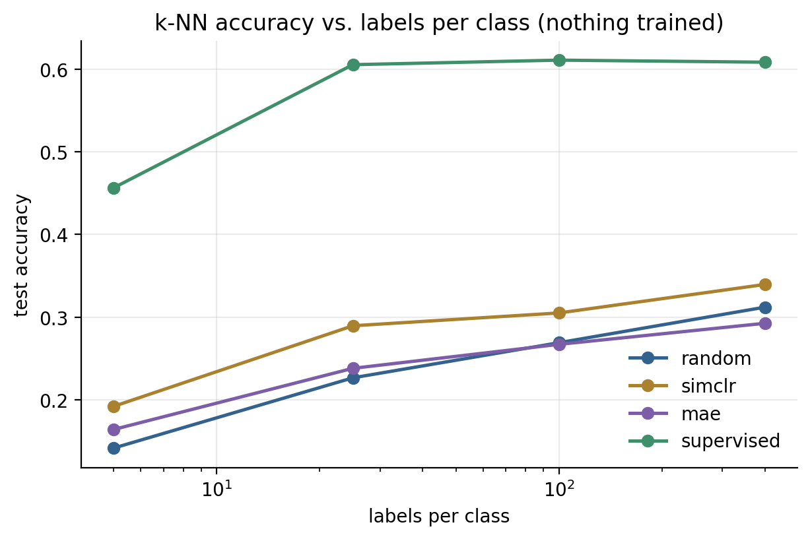
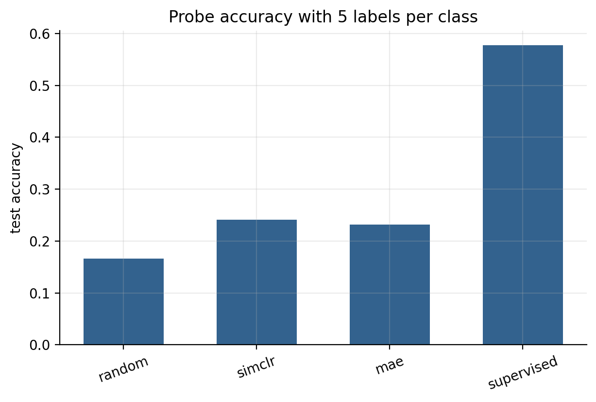

### What surprised me

Three things, in increasing order of how much they cost
me.

*The probe and the k-NN disagree, exactly where the objectives say they should.*
SimCLR's two readings track each other (0.350 probe, 0.340 k-NN at 400 labels).
MAE's diverge: it **wins the probe** at 400 labels — 0.368, the best
self-supervised number in the part — and simultaneously scores 0.293 on k-NN,
*below the untrained encoder's 0.305*. So MAE's features are linearly separable
without being metrically organized: a classifier can find the classes, nearest
neighbours cannot. This is not mysterious, it is the loss functions. NT-Xent
optimizes cosine similarity directly, so cosine k-NN is reading the very
quantity that was trained. MAE's loss is a pixel MSE that never once mentions
distances between images, so nothing shapes the metric and the probe is free to
use whatever directions it likes. Anything you would build on retrieval —
nearest-neighbour search, clustering, a memory bank — would work on the SimCLR
features and fail on the MAE features, while a probe-accuracy leaderboard would
tell you MAE was better.

*Both methods beat their own architecture, and by less than the architecture
beats nothing.* At 5 labels per class, SimCLR is +0.092 over the untrained
encoder and MAE +0.070 — real and consistent across seeds, and the gap narrows
as labels grow (the D1 and D2 curves converge toward the random one's slope).
That is the expected shape: pretraining is worth most where labels are scarcest.

*The supervised baseline I wrote does not measure what I built it to measure.*
It trains the encoder on the **full 5000-label pool** and then probes it with
$n$ labels. So its 0.577 at 5 labels per class is not "supervised learning with
50 labels" — it is an oracle that has already seen a hundred times the labels the
row claims, and the probe is only re-reading features that were fitted with
those labels. That is why the column is flat: 0.577 at $n=5$ against 0.608 at
$n=400$, a 3-point range where every other method moves by 10 to 12. Every
column in the table answers "how good are these frozen features at $n$ labels?"
except the last, which answers a different question. The comparison SSL is
actually sold on — pretrain on unlabelled data, then fine-tune on $n$ labels,
against training from scratch on those same $n$ labels — is **not in this table
at all**, and I only noticed because the flatness of the column looked wrong.
The derived `simclr_minus_supervised@min_labels = -0.328` is therefore a number
about my experimental design, not about SimCLR.

### Open threads

The obvious one is the baseline the last paragraph is missing:
train the same encoder from scratch on exactly the $n$ labelled images, per
budget, and re-plot. Then fine-tuning instead of freezing, which is how these
representations get used in practice and which C4 already showed is worth
another several points. And a pool much larger than the label set — 8000
unlabelled images against 5000 labelled ones is not the regime where
self-supervision is supposed to win, and the ratio is the whole argument.

### Further reading

[SimCLR](https://arxiv.org/abs/2002.05709) §B for the probe
protocol; [MAE](https://arxiv.org/abs/2111.06377) §4 on probe vs. fine-tune;
[MoCo](https://arxiv.org/abs/1911.05722) for the k-NN monitor this rung's second
table imitates.

---

## What part D settled

1. **The pretext loss is not the metric.** D2's reconstruction MSE rises by a
   factor of 2.5 across the mask sweep while probe accuracy moves by 0.7 points,
   and the arm with the *worst* reconstructions has the best features. Any
   comparison of self-supervised methods by their training losses is comparing
   how hard the tasks were.
2. **How you read a representation decides what you conclude about it.** MAE
   wins the linear probe at 400 labels and loses to an untrained network on
   k-NN with the same features. The two numbers are not redundant: one measures
   linear separability, the other metric structure, and the objective decides
   which you get. SimCLR optimizes a cosine similarity and scores well on both;
   MAE optimizes pixels and shapes no metric at all.
3. **The invariance is the hyperparameter.** Augmentation strength is usually
   discussed as a regularization knob, but in a contrastive objective the
   positive pair *defines* what the network is told to ignore. That is why the
   strength curve is non-monotonic — 0.316, 0.430, 0.339 — and why the failure
   at full strength is information destruction rather than underfitting.
4. **Two of the three summary metrics I wrote for this part were wrong, and both
   were wrong in the same way: they assumed a shape the data did not have.**
   `augmentation_gain` compared the endpoints of a curve that turned out to have
   its optimum in the middle, reporting +0.031 for a +0.119 effect. The
   supervised column of D3 assumed a comparison that its own code does not
   perform. Part B's `usable_lrs` failed the same way. The pattern is now clear
   enough to name: **a derived metric encodes a hypothesis about the result, and
   when the hypothesis is wrong the metric does not fail loudly — it returns a
   plausible number.** The arm-level measurements were right in all three cases;
   only the summaries built on top of them lied.
5. **Controls are cheap and they keep moving the answer.** The untrained encoder
   probes at 0.256 and the no-augmentation SimCLR arm at 0.316 — so at full
   augmentation strength, 72% of the apparent "SimCLR gain" is delivered by an
   arm that learns nothing about images. Every part of this ladder so far has had
   a control arm change the headline number; none of them cost more than a few
   lines.

6. **This part reproduced exactly, which part C did not.** The sweep was run
   twice, on two separately allocated T4 sessions, the second time only to pick
   up D1's corrected summary metrics. Every arm-level number came back
   identical — D2's ten metrics and D3's thirty-seven bit-for-bit, and D1's
   seven arms too; the only keys that moved were the three derived ones the fix
   redefined. So C2's instability was not a general fact about GPU
   non-determinism, as it was tempting to conclude: it was specific to an
   all-or-nothing metric sitting on its threshold. Nothing here is near a
   threshold, and nothing here moved.

**Cost of the part:** ~1,600 lines including tests, 15 test cases, and a
three-seed sweep in about 28 minutes on a T4 (D1 354s, D2 67s, D3 107s per
seed). D1 dominates because it trains six encoders from scratch.

---

*Figures regenerate with `uv run python tools/writeup_figures.py D`; the numbers
they are quoted against live in [`data/d-metrics.json`](data/d-metrics.json).
The [part README](../../parts/d_self_supervised/README.md) is the short version
of this document.*
