# Part E — Generative models

> **Status:** complete (E1–E5) · **Constraint:** MNIST subsets, short budgets; E4 gives all three families one identical budget
> **Numbers:** seeds 0–2, reference seed 0 · raw values in [`data/e-metrics.json`](data/e-metrics.json)
> **Reproduce:** `ladder run E1` … `E5` (needs `uv sync --extra torch`), or `uv run python tools/writeup_figures.py E`
> **Hardware:** E1–E4 swept on a Colab T4; E5 is arithmetic, and FLUX.1-schnell itself ran on a Kaggle T4 ([record](data/e-real-models.json))

Every model before this part was trained to be *right*: there was a label, and
the score counted how often the prediction matched it. A generative model is
trained to be *plausible*, and plausibility is not a quantity any single number
captures. So part E is really about measurement — the models are the easy part.

The three families make three different bargains. A **VAE** optimizes a bound on
the likelihood, so its loss means something, and pays for that with a latent
space it must keep close to a prior. A **GAN** optimizes nothing in particular:
two networks play a game and the loss is a scoreboard in it, which is why its
loss curve says almost nothing about sample quality. **Diffusion** replaces the
adversary with a fixed corruption process and a regression, buying stability at
a sampling cost measured in orders of magnitude. E4 puts all three on one
budget; E5 reads what the production descendants of E3 actually look like.

Scoring is shared in `src/mlladder/generative.py`: a small classifier trained on
the data provides a feature space, and a Fréchet distance between Gaussians
fitted in it provides the number. That is exactly FID's construction with a
different feature extractor, so it is called **fd** everywhere and is comparable
across these rungs and with nothing published. Mode collapse gets its own
metric, because a collapsed generator can post a respectable fd — its feature
mean and covariance are simply wrong in a way that averages out — so the samples
are classified and the histogram's normalized entropy reported alongside.

Notation: $\beta$ is the KL weight, $\bar\alpha_t$ the surviving signal at
diffusion step $t$, and fd is the Fréchet distance described above.

---

## E1 — The ELBO is two terms, and they disagree

**Question.** A VAE's loss sums a reconstruction and a KL. What does trading one
against the other actually do to the model?

### The idea

A **generative model** learns to produce new samples that look like its
training data: here, new handwritten digits.

A **variational autoencoder (VAE)** starts from an ordinary autoencoder, which
squeezes an image through a small **latent code** $z$ and reconstructs it. A
plain autoencoder's codes can be scattered anywhere, so picking a random code
and decoding it gives garbage. The VAE fixes this in two moves:

1. the encoder outputs a *distribution* over codes (a mean $\mu$ and a spread
   $\sigma$ per latent dimension) instead of a single point, and the decoder is
   trained on a *sample* from it;
2. a penalty (the **KL divergence**) pulls every such distribution towards a
   standard normal $\mathcal{N}(0, I)$.

After training, the codes fill the standard normal, so a new image is generated
by drawing $z \sim \mathcal{N}(0, I)$ and decoding it.

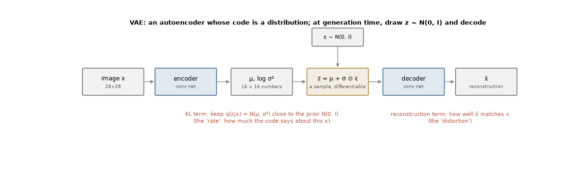

*The encoder produces $\mu$ and $\sigma$. The sample $z = \mu + \sigma\epsilon$ is
drawn in a way gradients can pass through (the reparameterization trick). The
loss balances reconstruction quality against the KL "rate", and $\beta$ sets
the exchange rate between them.*

### The math

**The bound.** The likelihood is intractable, so the VAE optimizes

$$\log p(x) \ge \mathbb{E}_{q(z \mid x)}\left[\log p(x \mid z)\right] - D_{KL}\!\left(q(z \mid x) \,\|\, p(z)\right),$$

a reconstruction term minus a KL term. Read them as **rate and distortion**: the
KL is how many nats the code carries about this particular $x$, the
reconstruction is what is lost. $\beta$ sets the exchange rate, and each end has
a failure mode — too little KL and the aggregate posterior drifts from the prior
so sampling from $\mathcal{N}(0, I)$ produces nonsense, too much and the latent
carries nothing.

**The KL is closed form** because both distributions are Gaussian:

$$D_{KL} = -\tfrac{1}{2}\sum_j \left(1 + \log\sigma_j^2 - \mu_j^2 - \sigma_j^2\right),$$

which is most of why that prior is chosen. Left unreduced over $j$ it also
detects **posterior collapse**: a dimension whose KL is ~0 is one the encoder has
abandoned to the prior.

**The reparameterization trick** is what makes any of it trainable. Sampling
$z \sim q(z \mid x)$ has no gradient with respect to $\mu$ and $\sigma$, because
the randomness sits between them and the loss. Writing $z = \mu + \sigma\epsilon$
with $\epsilon \sim \mathcal{N}(0, I)$ makes the sample a *deterministic*
function of the parameters plus parameter-free noise, and the gradient flows.

### What we measure, and why

- **Reconstruction** (negative log-likelihood of the image given its code,
  summed over pixels) — how much is lost passing through the latent. Lower is
  sharper.
- **KL, or rate** (in nats) — how much information the code carries about each
  particular image. The trade-off between these two *is* the $\beta$ dial.
- **Active units** — latent dimensions whose KL is meaningfully above zero. A
  dimension with KL ≈ 0 carries nothing: the encoder has abandoned it
  (**posterior collapse**). The loss cannot show this, so it is counted.
- **fd (Fréchet distance) of generated samples** — how close the *generated*
  digits are to real ones, in a classifier's feature space (defined in the
  part introduction, and see E4). Reconstruction scores the autoencoder, fd
  scores the generator. They are different questions.

### What I built

A convolutional VAE with a 16-dimensional latent, swept over
$\beta$. The reconstruction is summed over pixels and the KL over latent
dimensions — a test pins this, because averaging one and summing the other
silently rescales $\beta$ by the pixel count, which is the most common way this
loss is got wrong.

### Results

*Setup: 12k MNIST, 12 epochs; medians over seeds 0–2.*

| $\beta$ | reconstruction | KL (rate) | active units | fd(samples) |
| --- | --- | --- | --- | --- |
| 0.25 | **76.7** | 37.0 | 16/16 | 5.09 |
| 1.0 | 84.7 | 23.4 | 16/16 | **4.44** |
| 4.0 | 117.6 | 9.8 | 16/16 | 6.4 |
| 16.0 | 184.7 | 1.1 | **6/16** | 19.31 |

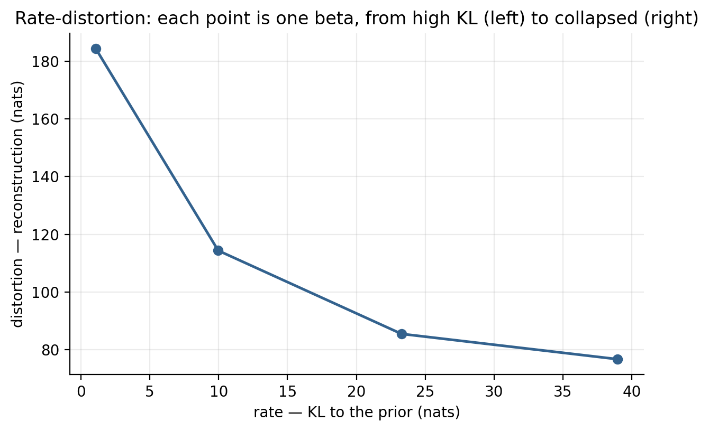
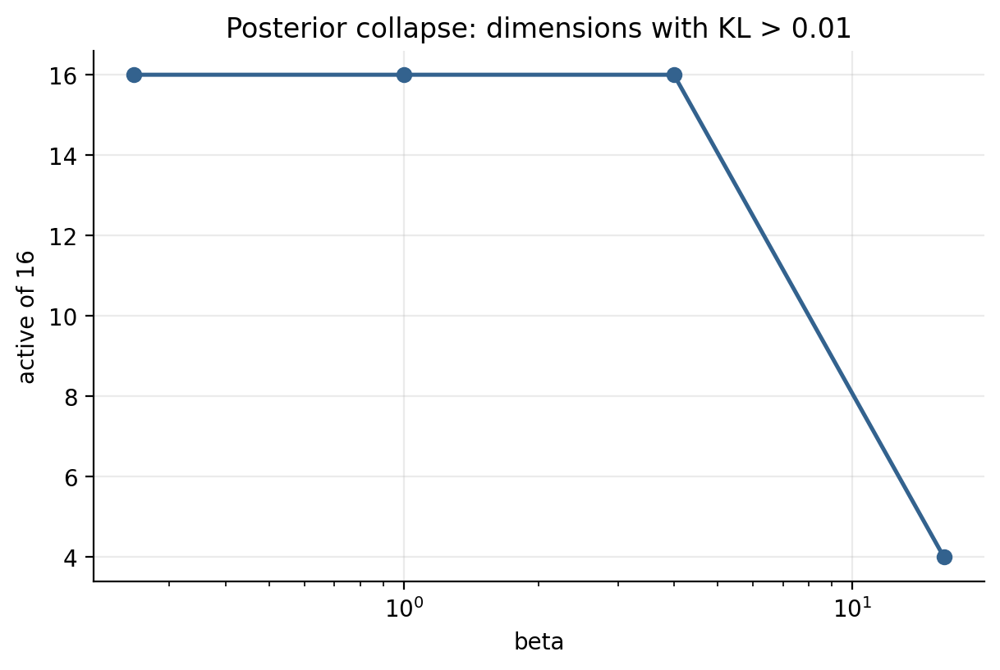
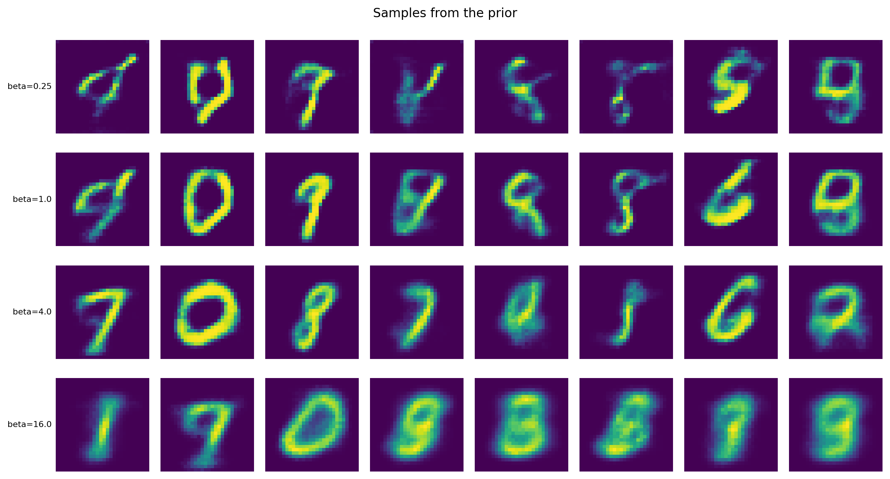

### What surprised me

Not the trade-off — that is the theory working — but how
*cleanly* the collapse arrives. At $\beta = 16$ the encoder has abandoned 10 of
its 16 dimensions (range 9–12 across seeds), the rate has fallen to 1.1 nats,
and sample quality is more than four times worse. The training loss went down
the whole time. "The loss is decreasing" is fully compatible with the model
having quietly stopped using its latent space, which is the entire reason active
units are counted rather than assumed.

What I expected and did not get: a disagreement between the ELBO and sample
quality. `best/agree` is 1.0 on every seed — both pick $\beta = 1$. At this
budget the bound and the proxy point the same way, and I have recorded that
rather than the more interesting story I was looking for.

### Open threads

A free-bits or KL-warmup schedule, which is the standard fix
for collapse and would show whether the abandoned dimensions can be recovered.
A larger latent, where collapse should arrive earlier. And a discrete latent
(VQ-VAE), which sidesteps the rate-distortion dial entirely.

### Further reading

[Auto-Encoding Variational Bayes](https://arxiv.org/abs/1312.6114);
[beta-VAE](https://openreview.net/forum?id=Sy2fzU9gl);
Alemi et al., *Fixing a Broken ELBO*, on rate-distortion as the right frame.

---

## E2 — The objective in the theorem, and the one everybody uses

**Question.** The GAN paper proves its result for a minimax objective that
practitioners immediately replaced. Does the replacement matter, and how would
you see it?

### The idea

A **generative adversarial network (GAN)** trains two networks against each
other. The **generator** $G$ turns random noise into an image. The
**discriminator** $D$ looks at an image and outputs the probability that it is
real. $D$ is trained to catch fakes, and $G$ is trained to fool $D$. If both
improve, $G$'s images become indistinguishable from real ones.

There is no reconstruction and no likelihood. $G$ never sees a real image
directly; everything it learns arrives through $D$'s gradient. That makes GANs
sharp (no averaging, so no blur) and notoriously unstable. The losses are moves
in a game, not measures of quality, so a falling loss curve means little.

The rung compares two versions of the generator's objective that have the same
theoretical optimum but behave very differently early in training.

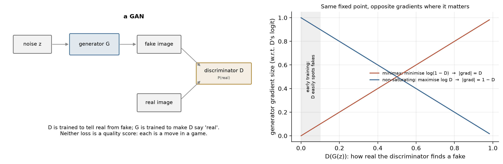

*Right: gradient size for the generator as a function of how convincing its
fake is to $D$. Early in training $D$ easily rejects fakes, the grey band on the
left. There the original minimax loss gives almost no gradient, exactly when the
generator most needs one, while the non-saturating loss gives a large one.*

### The math

**The game.** The discriminator maximizes $\log D(x) + \log(1 - D(G(z)))$; at the
optimum for a fixed generator it recovers the density ratio, and the generator's
objective becomes the Jensen-Shannon divergence. That is the theorem.

**The problem with it.** The generator is asked to *minimize* $\log(1 - D(G(z)))$.
Early in training $D(G(z)) \approx 0$, and

$$\frac{\partial}{\partial s}\log(1 - \sigma(s)) = -\sigma(s) \to 0 \quad \text{as } s \to -\infty,$$

so the gradient vanishes exactly when the generator is worst and most needs one.
The **non-saturating** form instead maximizes $\log D(G(z))$, whose gradient is
$1 - \sigma(s) \to 1$ in that same limit. Identical fixed point, opposite
behaviour where it matters. Both are implemented and tested here against that
limit directly.

### What we measure, and why

- **fd** — sample quality in a classifier's feature space. Lower is better.
  Scored *during* training too, because GAN losses do not track quality.
- **Coverage** — the fraction of the ten digit classes that appear among
  generated samples, per a pretrained classifier.
- **Mode entropy** — normalised entropy of the predicted-class histogram: 1
  when all ten digits appear equally often, 0 when the generator produces one
  digit only (**mode collapse**, the characteristic GAN failure). It is reported
  separately because a collapsed generator can still post a respectable fd.

### What I built

A DCGAN at the paper's structural rules — strided convolutions,
batch norm everywhere except the generator's output and discriminator's input,
Adam at $\beta_1 = 0.5$ — with both generator objectives as arms, quality scored
*during* training as well as at the end, and mode coverage measured by
classifying the samples.

### Results

*Setup: 12k MNIST, 14 epochs; medians over seeds 0–2.*

| arm | fd | coverage | mode entropy |
| --- | --- | --- | --- |
| non-saturating | **1.84** [1.73, 2.00] | 1.00 | 0.878 |
| minimax | 2.02 [1.81, 2.09] | 1.00 | 0.870 |

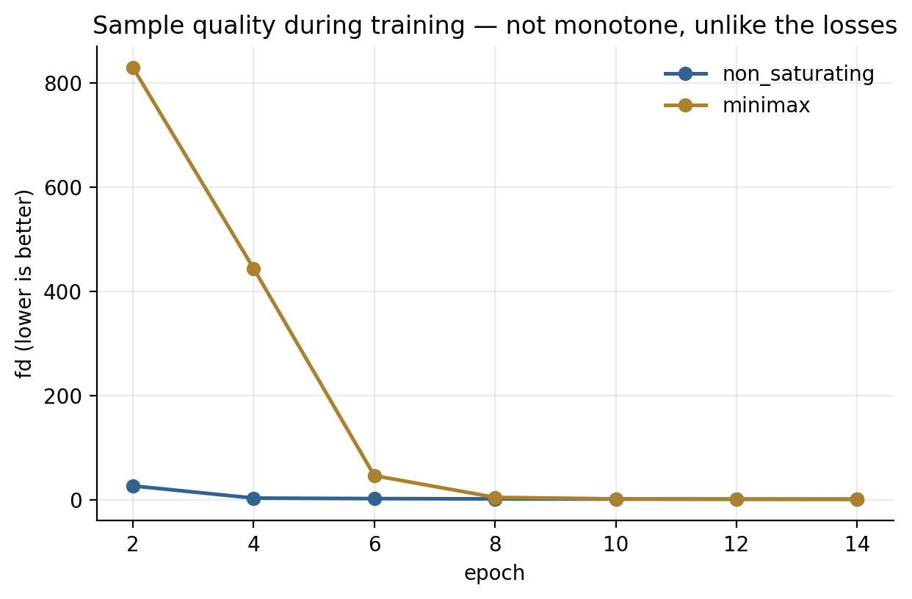
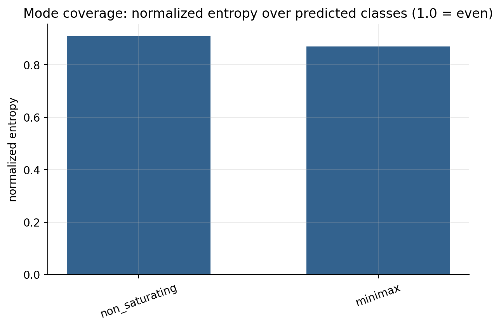
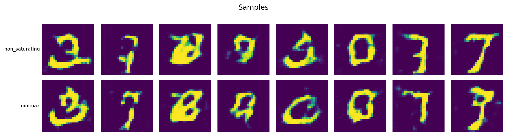

### What surprised me, and a claim I have to withdraw

On a single CPU run at seed 0, the minimax arm **collapsed completely**: fd
590.83, all ten thousand samples classified as one digit, mode entropy exactly
0, and a generator loss pinned at $-0.000$ from epoch 4 — the saturation the
derivative predicts, arriving exactly on cue. I reported that as the rung's
headline: a 320× difference from choosing the objective the theorem states.

It does not replicate. The three-seed GPU sweep gives minimax fd 2.02 against
non-saturating's 1.84 — a real but modest +0.098 — with full mode coverage on
every seed. **Seed 0 on the GPU scores 1.81 where seed 0 on the CPU scored
590.83.** Same code, same seed, same objective; the difference is the device.

That is a more interesting result than the one I withdrew, and a worse one for
anybody reporting GAN numbers. The saturating objective does not reliably fail —
it sits close enough to a failure boundary that floating-point differences
between two devices decide whether it trains at all. Part C found the same
phenomenon in C2 and I concluded there that it was specific to a threshold
metric near its threshold; here it is the *model* near a threshold, and the
consequence is total rather than third-decimal.

The honest summary: the non-saturating form is better by about 0.1 fd on
average, and is dramatically more robust in a way a three-seed sweep on one
device still understates.

### Open threads

Repeating the sweep on both devices to quantify how often
minimax collapses rather than noting that it can. WGAN-GP, whose entire premise
is that the JS divergence is the wrong distance when the supports barely
overlap. And a discriminator-to-generator update ratio sweep.

### Further reading

[Generative Adversarial Networks](https://arxiv.org/abs/1406.2661);
[DCGAN](https://arxiv.org/abs/1511.06434);
[Wasserstein GAN](https://arxiv.org/abs/1701.07875).

---

## E3 — A fixed corruption process, and the dial it leaves you holding

**Question.** Diffusion removes the adversary and the bound. What does it charge
for that, and where is the charge set?

### The idea

A **diffusion model** learns to generate by learning to *denoise*. Take a
training image and add a little Gaussian noise, then a little more, over
hundreds of steps, until nothing but noise is left. This **forward process** is
fixed and needs no learning. Then train a network to reverse one step at a
time: given a noisy image and how noisy it is, predict the noise that was
added.

To generate, start from pure noise and apply the learned denoiser step by step
until an image emerges. The training objective is a plain regression (predict
the noise, squared error), so there is no adversary to balance and no bound to
tune, which is why diffusion trains stably. The price is paid at sampling time:
one network evaluation per step.

The **noise schedule** decides how quickly signal is destroyed across the
steps, and it is the main design choice left.

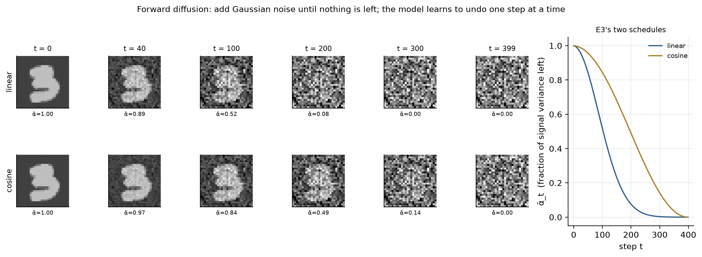

*A real MNIST digit noised by the rung's own schedules. The linear schedule
has destroyed almost all the signal by step 200 ($\bar\alpha = 0.08$) and
spends the rest of its steps on near-pure noise. The cosine schedule keeps
signal longer and spreads the destruction more evenly. The denoiser (a small
U-Net) learns to undo these steps.*

### The math

**The forward process** destroys an image with a fixed, *unlearned* Markov chain

$$q(x_t \mid x_{t-1}) = \mathcal{N}\!\left(x_t; \sqrt{1 - \beta_t}\, x_{t-1},\, \beta_t I\right),$$

and because Gaussians compose, $t$ steps of it collapse into one:

$$q(x_t \mid x_0) = \mathcal{N}\!\left(x_t; \sqrt{\bar\alpha_t}\, x_0,\, (1 - \bar\alpha_t) I\right), \qquad \bar\alpha_t = \prod_{s \le t} (1 - \beta_s).$$

That closed form is the reason training is cheap: a step draws one random $t$ and
jumps straight there, never simulating the chain.

**The objective.** The variational bound on $\log p(x)$ decomposes into per-step
KLs between $q(x_{t-1} \mid x_t, x_0)$ and the model's reverse step. Both are
Gaussian with known variances, so each KL is a squared difference of means, and
reparameterizing the mean in terms of the noise reduces the whole bound (up to
weights DDPM drops) to

$$\mathcal{L} = \mathbb{E}_{t, x_0, \epsilon}\left[\left\|\epsilon - \epsilon_\theta\!\left(\sqrt{\bar\alpha_t}x_0 + \sqrt{1 - \bar\alpha_t}\,\epsilon,\ t\right)\right\|^2\right].$$

A regression onto noise. No bound to be loose, no adversary to out-run — which is
the stability diffusion is famous for.

**The schedule** is the design surface that survives. $\bar\alpha_t$ determines
the signal-to-noise ratio at every step, and therefore how the difficulty of the
denoising task is distributed over $t$. The linear schedule reaches near-total
destruction early and then spends most of its steps on nearly-pure noise, where
there is little left to learn; the cosine schedule sets
$\bar\alpha_t \propto \cos^2\!\left(\frac{t/T + s}{1 + s}\cdot\frac{\pi}{2}\right)$
so signal survives longer.

### What we measure, and why

- **fd against the number of sampling steps** (10 to 400) — the quality/speed
  trade-off, which is diffusion's defining cost. The model is trained once, with
  400 steps, and sampled with fewer by skipping.
- **Sampling seconds** — the other axis of that trade-off, measured directly.
- **The "knee"** — the fewest steps within 10% of full-step quality. It
  summarises the curve as one number: how much speed you can buy cheaply.
- **Linear vs cosine**, over three seeds — whether the published improvement
  holds at this scale (it does not).

### What I built

A 245k-parameter U-Net with a sinusoidal timestep embedding,
$T = 400$ training steps, both schedules as arms, and sampling swept over
$\{10, 25, 50, 100, 400\}$ steps with quality and wall-clock recorded at each.

**A bug the tests caught before the results did.** DDPM's $\beta \in [10^{-4},
0.02]$ is specified *for $T = 1000$*. Used unscaled at $T = 400$ it leaves
$\bar\alpha_T = 0.017$ — the forward process never reaches $\mathcal{N}(0, I)$,
while the sampler starts from one. The training loss is completely blind to this;
it shows up only as bad samples, and it would have turned the schedule comparison
into a measurement of my own mistake. A test asserting $\bar\alpha_T < 0.01$ for
every schedule failed, and the range is now scaled by $1000/T$.

### Results

*Setup: 12k MNIST, 16 epochs, 500 samples; medians over seeds 0–2.*

| sampling steps | linear fd | cosine fd | seconds |
| --- | --- | --- | --- |
| 10 | **2.95** | 24.32 [8.97, 153.0] | 0.44 |
| 25 | 1.79 | 10.84 | 1.11 |
| 50 | **1.40** | 7.51 | 2.23 |
| 100 | 1.62 | 3.56 | 4.41 |
| 400 | 1.56 [1.42, 2.23] | 2.27 [1.25, 2.50] | 17.0 |

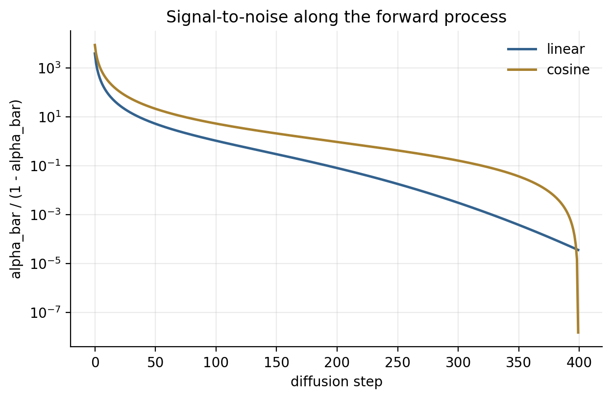
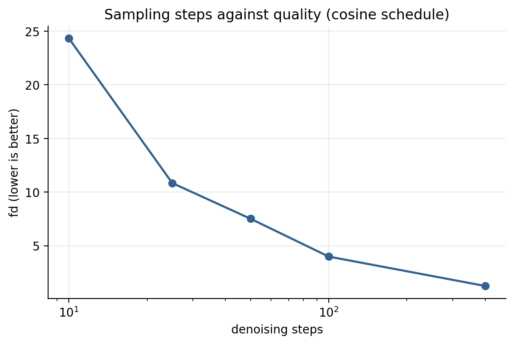
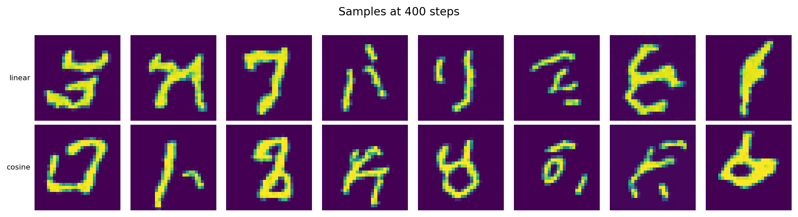

### What surprised me

Two things, and the second retracts a claim.

*The knee is a property of the schedule, not of diffusion.* On the cosine
schedule, quality is still improving at 400 steps — `steps/knee` is 400, meaning
no cheaper setting lands within 10% of the full-step score, and 10 steps costs
+23.07 fd for a 38× speedup. On the *linear* schedule the same model is within
10% of its full-step quality at **50 steps**, and at 50 steps it is actually
better than at 400 (1.40 against 1.56). Reporting "diffusion needs hundreds of
steps" from the cosine row alone would have been a statement about one schedule
dressed up as a statement about the method.

*Cosine does not beat linear here.* I expected it to — it is the standard
improvement, and at $T = 400$ with a cosine $\bar\alpha$ the low-SNR steps really
are less wasted. The measurement says otherwise: `cosine_gain/fd` has a median of
**−0.036** with a seed range of [−1.075, +0.308], straddling zero, and at every
truncated step count linear wins outright. The honest reading is that cosine's
advantage is a large-$T$, large-model result and this rung is neither; the
schedule that keeps more signal alive also leaves more of the denoising work to
the last few steps, which is exactly what makes it fragile under truncation. Both
schedules cover all ten digits on every seed, so this is a fidelity difference,
not a collapse.

### Open threads

DDIM's deterministic sampler, which is the actual answer to the
step count and would separate "few steps" from "few steps with this sampler". A
$T = 1000$ run to test the large-$T$ explanation for cosine directly. And $v$- or
velocity-prediction, which is what E5's production descendants use.

### Further reading

[Denoising Diffusion Probabilistic Models](https://arxiv.org/abs/2006.11239);
[Improved DDPM](https://arxiv.org/abs/2102.09672) for the cosine schedule;
[DDIM](https://arxiv.org/abs/2010.02502).

---

## E4 — One budget, three families, and a column that turned out to be a trap

**Question.** "Which generative model is best" has no answer until the column is
named. So: name four columns, give all three families identical data and an
identical budget, and see how many different models win.

### The idea

E1–E3 each built one family. E4 trains all three (VAE, GAN, diffusion) on the
**same data, for the same number of epochs**, and scores them on the same
scorecard. The point is that "which generative model is best?" has no answer
until you say best *at what*: sample quality, covering every kind of digit,
originality, training cost and sampling cost can each crown a different winner.

The models are imported from their own rungs, not rewritten, so any
difference comes from the family and the budget, not from reimplementation.

Scoring generative models is hard, because there is no label to compare with.
The standard trick, used throughout this part, is to embed real and generated
images with a classifier trained on the real data, fit a Gaussian to each cloud
of feature vectors, and measure the distance between the two Gaussians (the
**Fréchet distance**, which is how FID is built). It has a blind spot, which is
why it never appears alone.

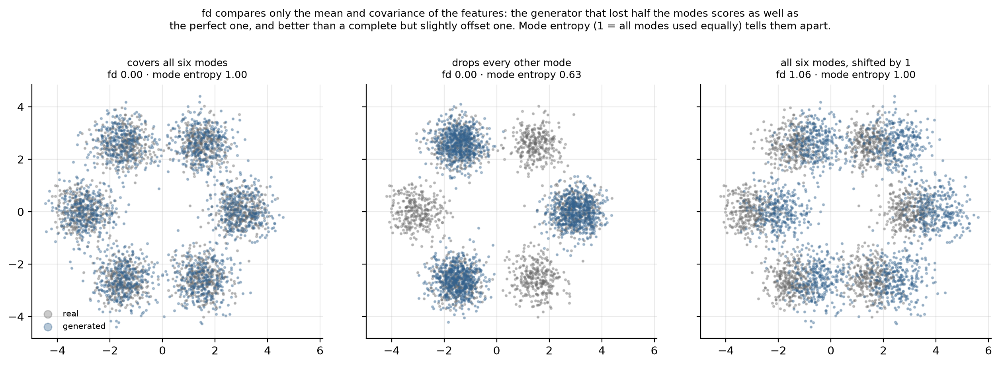

*Three generators against the same six-mode "real" distribution (grey). One
that keeps only every other mode has exactly the same mean and covariance as the
real data, so its Fréchet distance is 0.00, as good as perfect. A complete
generator shifted by one unit scores worse. Mode entropy exposes the first
(0.63 instead of 1.00), which is why E4 reports both.*

### The math

There is no new objective here — the point is that the three losses *cannot be
compared*. E1 minimizes negative nats, E2 minimizes an adversarial scoreboard
whose optimum is $\log 4$ regardless of sample quality, E3 minimizes a
denoising MSE against noise. Three different units, three different fixed
points, no ordering between them. Every comparison therefore has to happen in a
space none of them was trained in:

$$d^2_F = \|\mu_r - \mu_g\|^2 + \operatorname{tr}\!\left(\Sigma_r + \Sigma_g - 2(\Sigma_r\Sigma_g)^{1/2}\right),$$

the Fréchet distance between Gaussians fitted to a shared classifier's features —
FID's construction with a local feature extractor. That statistic has a known
weakness: it is a function of the first two moments only, so a generator that
drops modes can compensate with a wider covariance. Hence the second column,
normalized entropy over the classifier's predictions, and the third, mean
distance to the nearest training image — because a model that memorized the data
wins fd and coverage dishonestly.

**The floor.** A Fréchet distance has no absolute scale, so a held-out sample of
real data is scored against the real reference too. That row is what makes any
other row readable.

### What we measure, and why

- **fd** — distributional quality, as above. The **real-data row** (held-out
  real images scored against the reference) gives the floor any generator could
  hope to reach. Without it, fd has no scale.
- **Coverage and mode entropy** — are all ten digits generated, and in
  balanced amounts? This catches what fd misses.
- **Nearest-neighbour distance** — mean distance from each generated image to
  its closest *training* image. Too small means the model memorised its
  training set, which would win the other columns dishonestly.
- **Training seconds and seconds per 1000 samples** — the costs, which differ
  across families by three orders of magnitude.
- **Budget sensitivity** — the same diffusion model scored at 14 and 16
  epochs, added after the first results looked wrong. It measures whether an
  equal-budget comparison is comparing families or comparing how far each got.

### What I built

All three models are imported from their own rungs, not
reimplemented, trained on the same 12k MNIST images for 14 epochs, and scored on
quality, coverage, novelty, training seconds and sampling seconds. Plus one
control, which turned out to matter more than the scorecard.

### Results

*Setup: medians over seeds 0–2.*

| | fd | coverage | mode entropy | nn distance | train | sample 1k |
| --- | --- | --- | --- | --- | --- | --- |
| real data | **0.094** | — | — | 4.60 | — | — |
| GAN | **1.76** | 1.00 | **0.898** | 6.28 | 7.9s | 0.0073s |
| VAE | 3.79 | 1.00 | 0.790 | 5.24 | **5.0s** | **0.0038s** |
| diffusion | 25.32 [10.3, 27.6] | 0.70 | 0.324 | 7.23 | 41.4s | 8.58s |

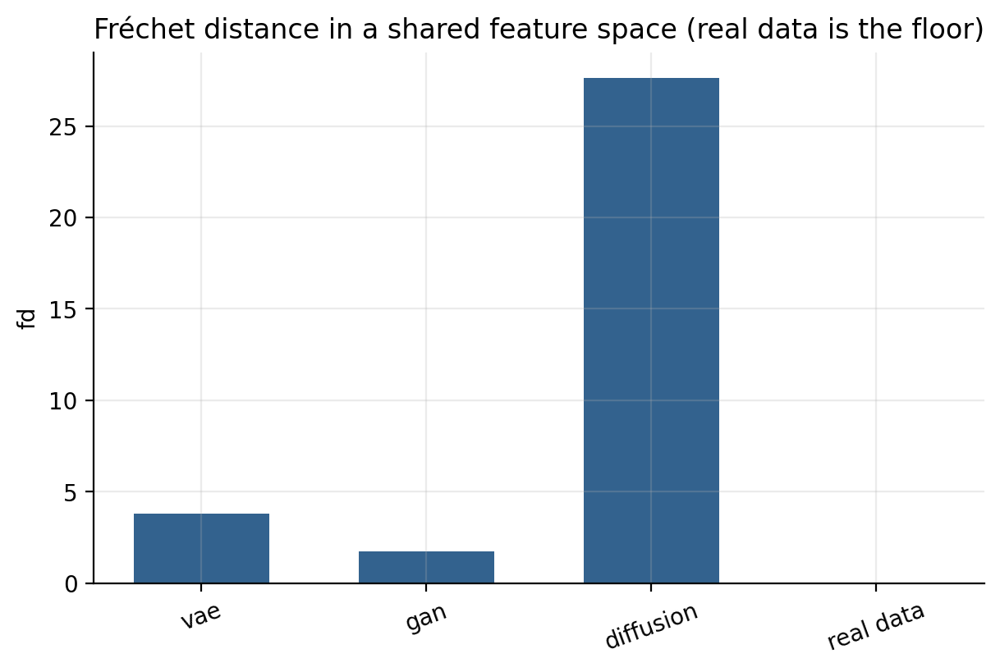
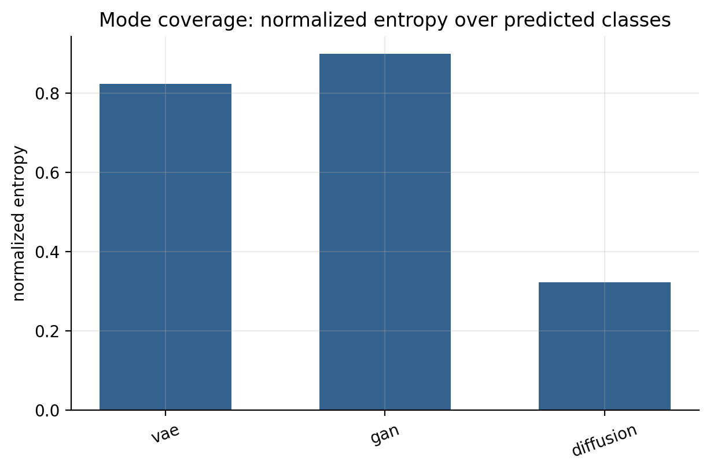
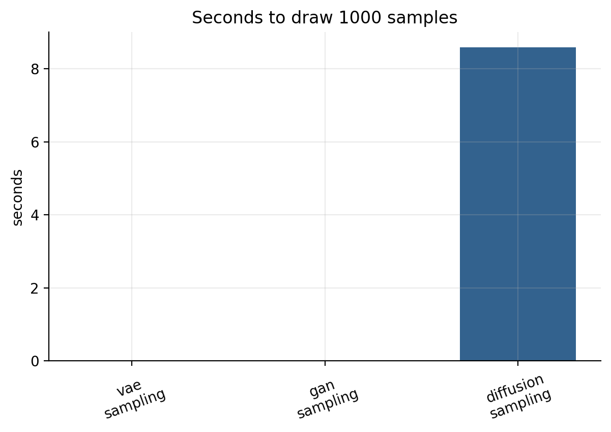
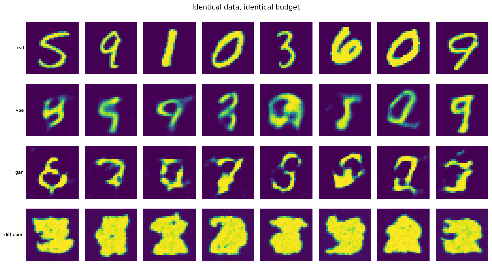

The cost column is the part that generalizes beyond this budget: diffusion's
sampling costs **1,171× the GAN's** for a thousand images, because it runs its
network once per denoising step and the GAN runs it once.

### What surprised me, and what I had to go and check

I expected four distinct winners — one per column — as the cleanest possible
demonstration that the question needs a column name. I got **two**:
`winner/distinct_axes = 2.0` on every seed. The GAN takes quality and coverage,
the VAE takes both speeds, and diffusion wins nothing. That is a worse result for
my framing and a fine result for the reader, so it stands.

But diffusion losing *everything* did not sit right, because E3 had scored the
same architecture on the same data at fd 2.27. A 10× discrepancy between two
rungs of mine is not a finding, it is a bug until proven otherwise. The candidate
explanations were the three things E4 does differently: 14 epochs instead of 16,
100 sampling steps instead of 400, and 1000 samples scored instead of 500. So I
gridded all three on one T4, and then promoted the answer into the rung itself as
a control:

| | fd @ 14 epochs | fd @ 16 epochs |
| --- | --- | --- |
| 100 sampling steps | 28.20 | 3.33 |
| 400 sampling steps | 4.95 | 1.17 |

Sample count changed nothing (27.59 at n=500 against 28.20 at n=1000). **Two more
epochs — 14% more budget — is worth 8.5×.** The swept version of that control is
now part of E4: `budget_sensitivity/fd_ratio` has a median of **6.40** across
seeds [3.79, 8.22], and mode coverage goes from 0.324 to 0.697 entropy over the
same two epochs.

And the number that makes it a finding rather than a footnote: over those same
two epochs the **training MSE moves 1.6%** — 0.0472 to 0.0465,
`budget_sensitivity/mse_ratio = 1.016` [1.009, 1.036]. An 8× change in sample
quality is invisible in the loss that produced it.

So the scorecard's honest caption is not "diffusion loses on every axis" but
**"an equal-budget comparison measures convergence, not just family"** — and
diffusion is the arm sitting on a cliff at this budget. I have left the 14-epoch
row as the headline, because equalizing the budget is what the rung set out to do
and quietly giving one arm more would be worse, but the control is now reported
beside it and the claim is scoped to the budget.

### Open threads

The obvious one: sweep the budget itself and report each
family's curve rather than one point on it, which is the only construction that
would survive this objection. Wall-clock-equal rather than epoch-equal budgets,
which would favour the VAE further. And a precision/recall decomposition of fd,
which separates "blurry" from "missing modes" in a way a single Fréchet number
cannot.

### Further reading

[GANs Trained by a Two Time-Scale Update Rule](https://arxiv.org/abs/1706.08500) (FID);
[Assessing Generative Models via Precision and Recall](https://arxiv.org/abs/1806.00035);
[Pros and Cons of GAN Evaluation Measures](https://arxiv.org/abs/1802.03446).

---

## E5 — What E3 becomes in production, priced part by part

**Question.** Every text-to-image model shipped since 2022 is E3 with three
things changed. What does each change cost, and what does it buy?

### The idea

Modern text-to-image systems such as Stable Diffusion and FLUX are E3's
diffusion model with three parts upgraded:

1. **where** diffusion happens — in the compressed latent space of a trained
   autoencoder (E1's idea put to work) instead of on raw pixels, which cuts the
   number of positions the denoiser processes by 64×;
2. **what does the denoising** — a U-Net with text injected by cross-attention
   (Stable Diffusion), or a transformer that runs joint attention over image and
   text tokens together (FLUX's **MMDiT**);
3. **what it predicts** — noise (E3, SD) or a *velocity* pointing along a
   straight path from noise to image (**flow matching**, FLUX), which is why
   FLUX-schnell needs only 4 sampling steps.

This rung trains nothing. It reads the published configurations and prices
each change in positions, attention cost and parameters. Then, in the section
after the results, FLUX is actually run.

The architecture figure below (under What I built) shows the three designs
side by side.

### The math

E3 has three components, and the production lineage replaced them one at a time.

**Where the diffusion happens.** E3 denoises pixels, so its cost scales with
resolution directly. Latent diffusion runs the same chain in the latent space of
a trained autoencoder at an $f{=}8$ downsample, so the positions the denoiser
touches fall by $f^2$:

$$N_{\text{latent}} = \frac{HW}{f^2}, \qquad \frac{N_{\text{pixel}}}{N_{\text{latent}}} = f^2 = 64.$$

A transformer denoiser patchifies on top of that, at $p = 2$, for another $p^2$:
one FLUX token per $16 \times 16$ pixels. Since attention is quadratic in
positions, a $64\times$ reduction in $N$ is a $4096\times$ reduction in attention
work — which is the entire reason E1's VAE is a component of the pipeline rather
than a competing family.

**How the text gets in.** Stable Diffusion's U-Net takes the prompt through
cross-attention: image queries against text keys and values, one direction, cost
$N_{\text{img}} \cdot N_{\text{txt}}$. MMDiT concatenates the two streams and runs
*joint* attention over the union, cost $(N_{\text{img}} + N_{\text{txt}})^2$. The
ratio is

$$\frac{(N_{\text{img}} + N_{\text{txt}})^2}{N_{\text{img}} N_{\text{txt}}},$$

which at 1024px with a 512-token prompt is $10.1\times$. What it buys is that the
text representation is updated by the image, not only the reverse.

**What the network predicts.** E3 regresses the noise a hand-designed schedule
added. Flow matching instead learns a velocity field along a straight path
between noise and data, which is why its samplers need single-digit step counts
where E3's cosine arm was still improving at 400.

### What we measure, and why

- **Positions the denoiser processes at 1024 px** — the cost driver, since
  attention is quadratic in it.
- **Attention cost ratios** — pixel vs latent, and cross-attention vs joint
  attention: what each design change multiplies the dominant cost by.
- **Parameter counts**, computed from configs and checked against published
  figures, with the error of each check reported (7.7% for FLUX, 64% for the
  U-Net estimate). The size of the error says which counts can be trusted.

### What I built

Parameter and position accounting for both architectures, read
from their published configs and cross-checked against the implementations in
the accompanying candle fork (`candle-transformers/src/models/{stable_diffusion,
flux}`); both modules are present, and the rung records that rather than assuming
it. The MMDiT count reuses `archspec.Transformer`, the same block accounting C5
and H6 use for decoders.

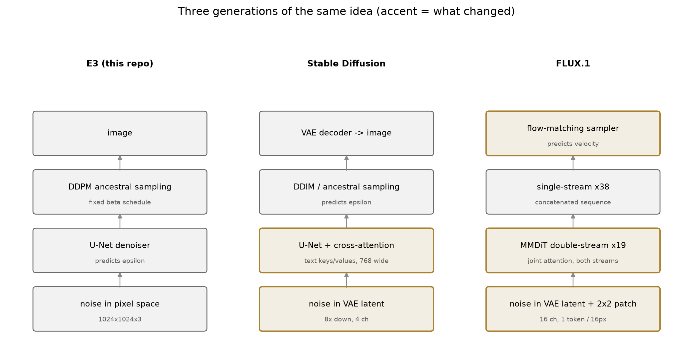

### Results

| | E3 (pixels) | SD-1.5 U-Net | FLUX.1 MMDiT |
| --- | --- | --- | --- |
| positions at 1024px | 1,048,576 | 16,384 | 4,096 |
| conditioning | — | cross-attention, 768-wide | joint, 4096-wide (T5-XXL) |
| parameters | 245k | ~308M (estimate) | 12.93B |
| prediction target | $\epsilon$ | $\epsilon$ | velocity |

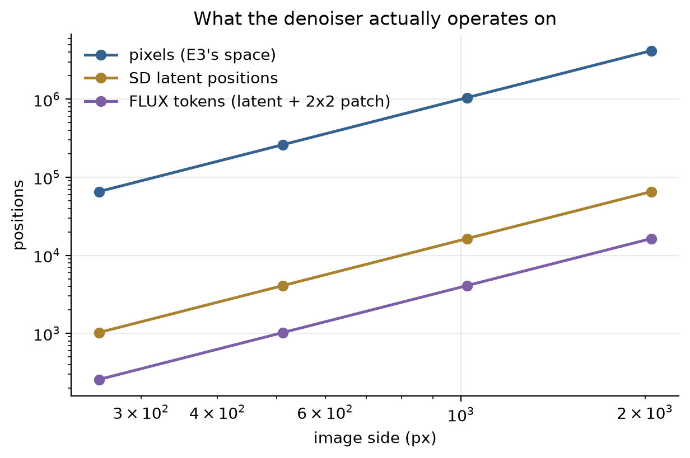
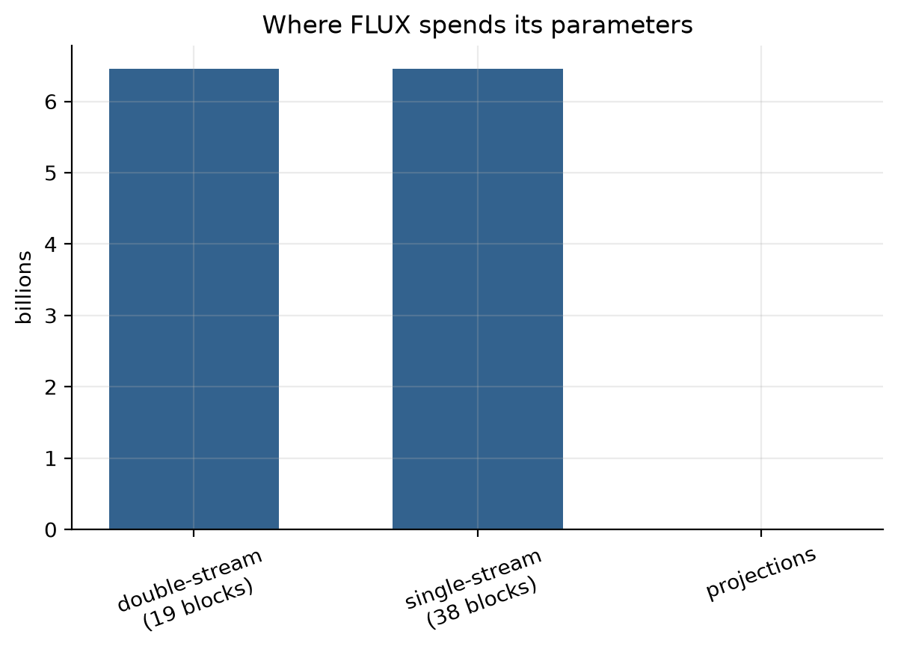
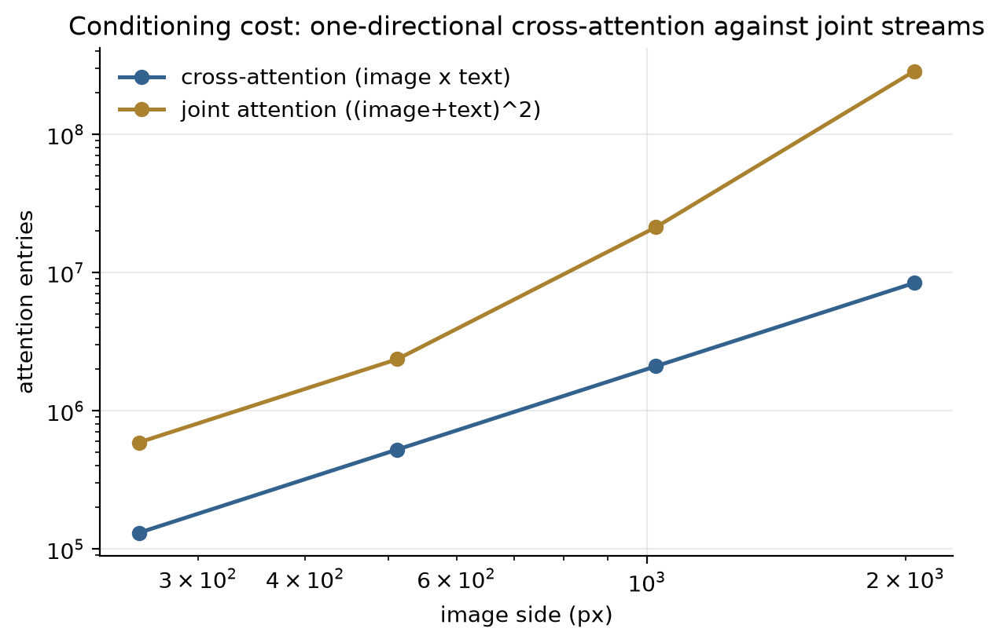

FLUX spends its depth asymmetrically: 19 double-stream blocks carry two complete
transformer blocks each (separate weights per modality, shared attention), 38
single-stream blocks carry one over the concatenated sequence — and the two
halves come out at **6.456B each**, 49.95% single-stream. Twice the blocks for
the same parameters, exactly as the "two towers vs one" structure predicts.

### What surprised me

Not the numbers — the *asymmetry in how far I can trust
them*. The MMDiT total lands 7.7% under FLUX's published ~12B, close enough that
the arithmetic is a real count of a uniform stack. The U-Net estimate lands at
308M against a published ~860M, **64% low**, because it counts convolutions and
attention and misses time embeddings, shortcut convolutions and the up-blocks'
extra skip channels. Both errors are reported, and the consequence is stated
rather than buried: `params/flux_over_sd = 41.9` is computed against my own
under-count, so the defensible version of that claim is FLUX ≈ 15× SD's U-Net
using the published figure. A regular stack can be counted from a config; an
architecture with hand-placed special cases cannot, and that is a fact about
architectures, not about my arithmetic.

The other number worth sitting with: E3's pixel-space denoiser at 1024px would
attend over 1,048,576 positions against FLUX's 4,096 — **65,536× the attention
work**. Latent diffusion is not an optimization on top of E3; it is what makes
the family exist at that resolution.

### FLUX, actually run

The E5 accounting above is read from a config. FLUX.1-schnell was also run, on
a Kaggle T4 (raw record in
[`data/e-real-models.json`](data/e-real-models.json)).

| | |
| --- | --- |
| route | diffusers `FluxPipeline`, ungated mirror `unsloth/FLUX.1-schnell` |
| how 12B fit on a 15 GB card | transformer **and** the T5-XXL text encoder quantized to 4-bit NF4 on load, fp16 compute, model-level CPU offload |
| peak VRAM | **6.53 GB** (the fp16 weights alone would be ~24 GB) |
| load | 381 s |
| generate, 512×512, 4 steps, no guidance | **19.8 s** |

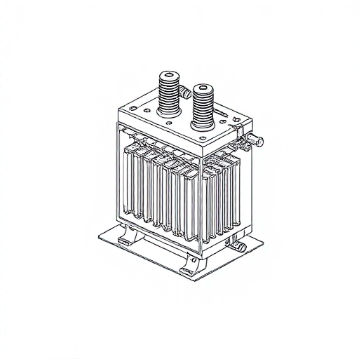

*The prompt was "a cross-section diagram of a transformer block, technical
illustration, clean white background". FLUX drew an electrical transformer:
radiator fins, bushings, isometric line art. That is the dominant sense of the
phrase in its training data, and a fair reading of an ambiguous prompt, not a
failure. It is also a four-step sample, which is what flow matching's straight
paths buy (E3's DDPM was still improving at 400 steps).*

**The candle route did not produce an image, and the reasons are worth
keeping.** Three attempts through the accompanying candle fork failed:

- the hard-coded repo is gated, fixed by pointing at an ungated mirror;
- the example picks bf16 on any CUDA device, and the fork's kernels, built with
  `CUDA_COMPUTE_CAP=75`, contain no bf16 symbols, so the T4 dies with
  `CUDA_ERROR_NOT_FOUND`. An earlier version of this record called that "bf16
  needs sm_80". It does not. It is a build-time absence, and PyTorch runs bf16 on
  the same card, only slowly, because the T4 has no bf16 tensor cores. Measured on
  a 4096² matmul: **fp16 25.7 TFLOP/s, fp32 4.3, bf16 2.4**;
- the binding constraint was session length: a from-scratch build plus ~56 GB
  of downloads (44 GB of which is T5-XXL shipped in float32) against Colab
  sessions of about 50 minutes.

The first Kaggle attempt used *sequential* CPU offload and was killed while
loading T5's shards, because offload still materialises every component in host
RAM. Quantizing on load is what made the run fit, the same lesson as the
decoders in [part C](c-sequence-attention.md#the-decoders-actually-run).

### Open threads

FLUX has now run (above), but through diffusers rather than
the candle fork, so the fork's FLUX path is still unexercised on this card; an
f16 T5 mirror would cut the download roughly in half and probably bring it
inside one session. Checking the parameter count against the *loaded* weights
is also still open, and needs care: part C found that `numel` on a 4-bit
checkpoint under-counts by exactly 2×. The VAE's own
parameters and its reconstruction floor, which upper-bounds everything downstream.
And SD3's MMDiT, which is the missing rung between the two columns.

### Further reading

[High-Resolution Image Synthesis with Latent Diffusion Models](https://arxiv.org/abs/2112.10752);
[Scaling Rectified Flow Transformers (SD3 / MMDiT)](https://arxiv.org/abs/2403.03206);
[Flow Matching for Generative Modeling](https://arxiv.org/abs/2210.02747).

---

## What part E settled

1. **Every one of these families has a loss that cannot see what you care
   about, and each fails differently.** The VAE's ELBO falls while the encoder
   abandons 10 of its 16 latent dimensions. The GAN's loss is a scoreboard in a
   game whose optimum is $\log 4$ whatever the samples look like. The diffusion
   MSE moves 1.6% while sample quality moves 8×. Three different mechanisms, one
   consequence: **in generative modelling the training curve is not a progress
   bar**, and every rung here needed a separate, external scorer to know
   anything at all.
2. **The metric had to be built before the models could be compared, and it has
   a known blind spot that must be covered explicitly.** A Fréchet distance is a
   function of two moments, so mode collapse can hide inside a respectable score;
   classifying the samples and reporting the histogram's entropy is not
   decoration. Neither is scoring real held-out data against itself — fd 0.094 is
   what makes fd 1.76 readable.
3. **The device decided whether a model trained at all.** E2's minimax arm
   collapsed to fd 590.83 on the CPU at seed 0 and scores 1.81 on the GPU at the
   same seed. I had published the collapse as the rung's headline result. The
   correction is the more useful finding: the saturating objective does not
   reliably fail, it sits close enough to a failure boundary that floating-point
   differences decide the outcome — which is exactly why it was abandoned.
4. **An equal-budget comparison measures convergence as much as family.** E4's
   diffusion arm loses every column at 14 epochs and is 6.4× better at 16, with
   the training loss flat across the difference. The scorecard is still the right
   construction; what changed is that it now carries the control that scopes it,
   because "all three had the same budget" is only a fair statement if all three
   are near the flat part of their curve, and one of them was not.
5. **The improvements the literature made are large-scale results, and a small
   rung should expect not to reproduce them.** Cosine schedules did not beat
   linear here (`cosine_gain/fd` median −0.036, range [−1.08, +0.31]), and the
   step-count "knee" turned out to be a property of the schedule rather than of
   diffusion — 400 steps on cosine, 50 on linear. Neither result contradicts the
   papers; both contradict quoting the papers' conclusions at $T = 400$ on a
   245k-parameter U-Net.
6. **The production lineage is three independent changes to E3, and their prices
   are very different.** Latent diffusion is a $64\times$ reduction in positions
   and a $65{,}536\times$ reduction in attention work at 1024px — a change of
   feasibility, not of degree. Joint attention costs $10.1\times$ the
   cross-attention it replaces and buys bidirectional conditioning. Flow matching
   changes what is predicted and is why production samplers need single-digit
   steps where E3's cosine arm was still improving at 400.
7. **A uniform stack can be counted from its config; an architecture with
   hand-placed special cases cannot.** The MMDiT arithmetic lands 7.7% under
   FLUX's published size; the same style of accounting applied to SD's U-Net
   lands 64% low. Both errors are reported, and the derived ratio built on the
   bad one (`params/flux_over_sd = 41.9`) is stated with its correction (≈15×
   against the published figure) rather than quoted as a result.

**Cost of the part:** ~2,600 lines including tests, 39 test cases, and a
three-seed sweep in about 17 minutes on a T4 (E1 23s, E2 36s, E3 163s, E4 98s +
50s for the convergence control, E5 2s per seed). E3 dominates because it trains
two schedules and samples each at five step counts; E5 is arithmetic.

---

*Figures regenerate with `uv run python tools/writeup_figures.py E`; the numbers
they are quoted against live in [`data/e-metrics.json`](data/e-metrics.json).
The [part README](../../parts/e_generative/README.md) is the short version of
this document.*
