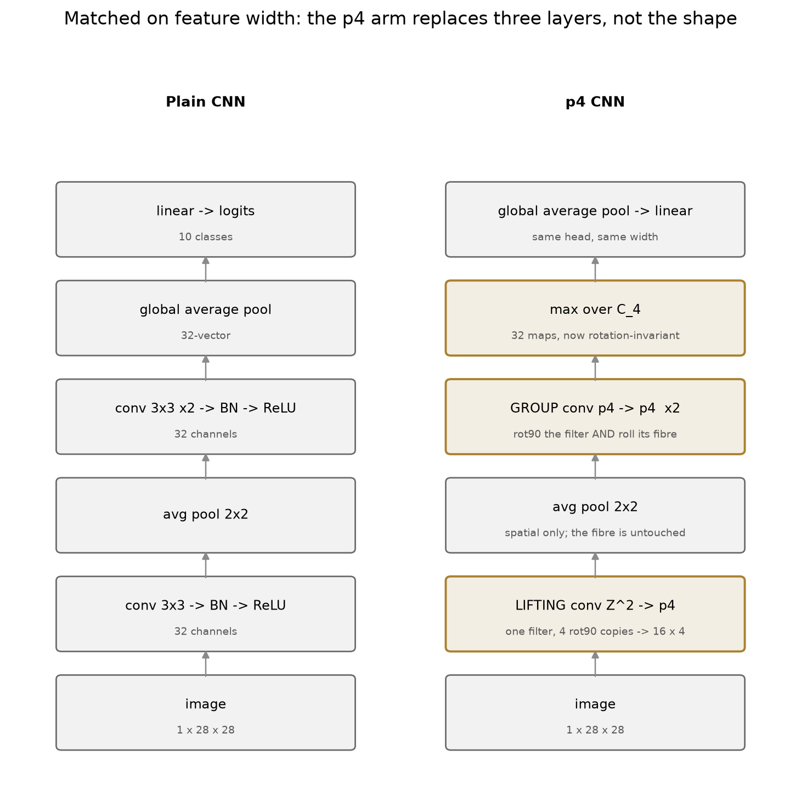
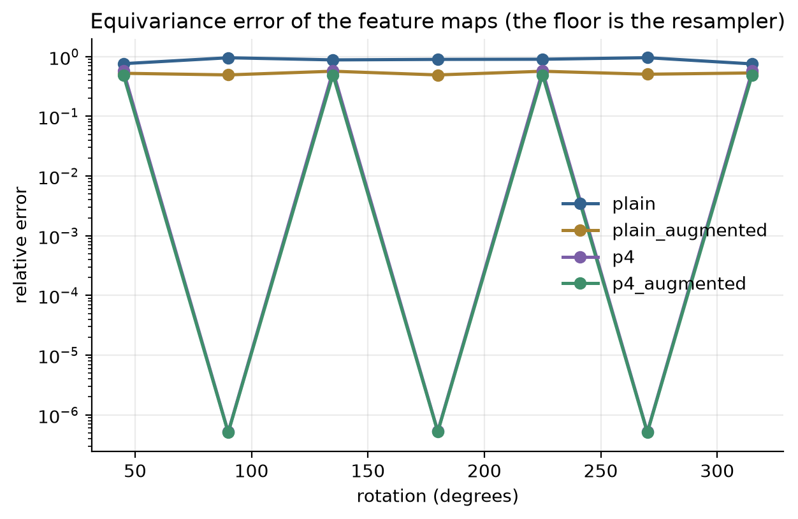
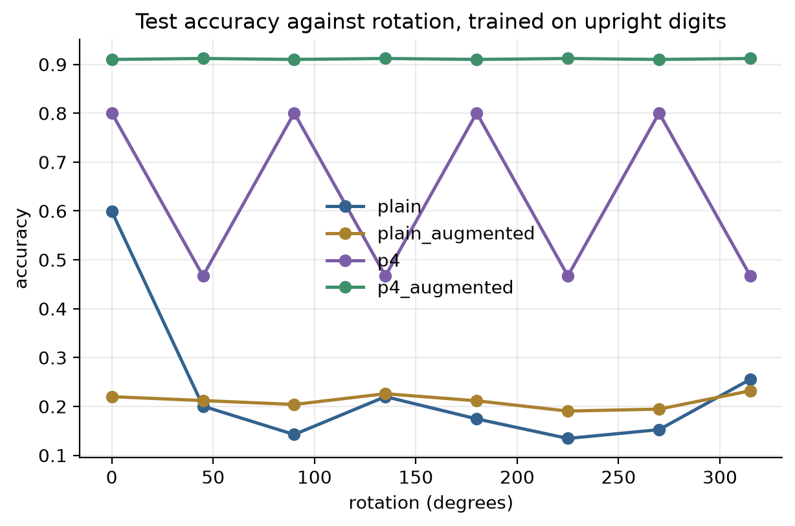
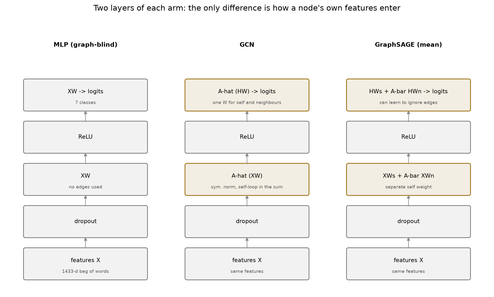
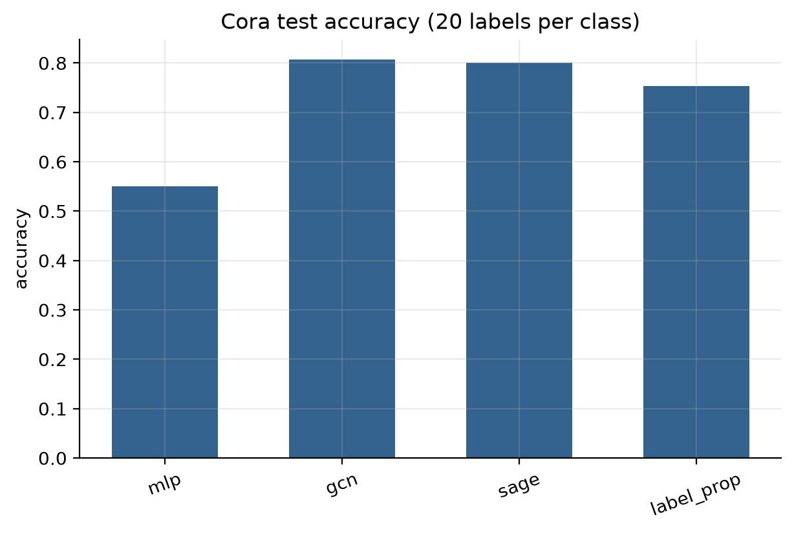
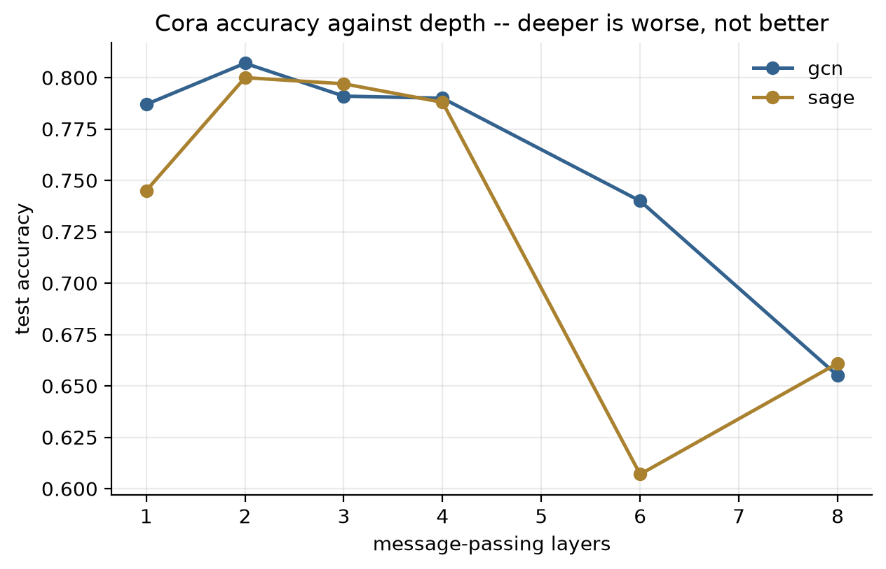
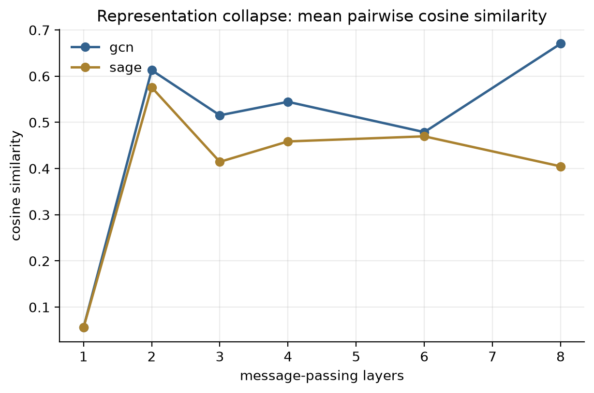
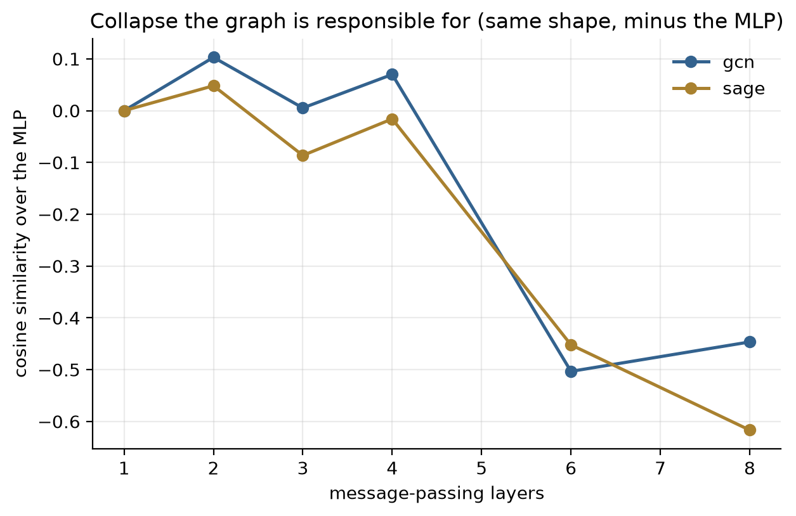
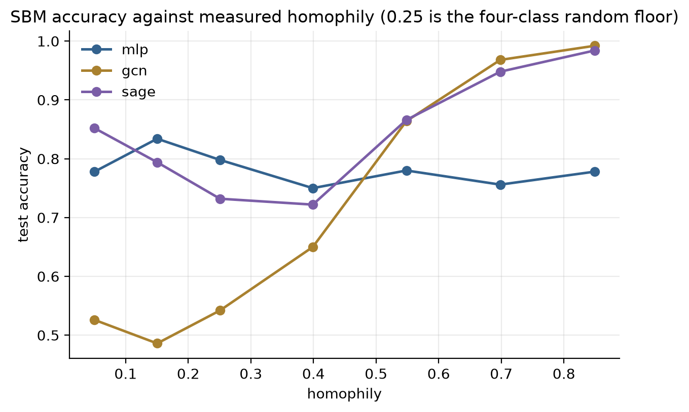
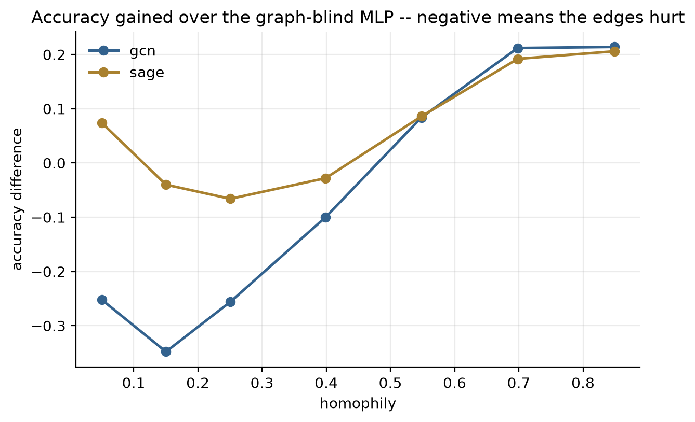

# Part F — Geometric & equivariant nets

> **Status:** complete (F1–F2) · **Constraint:** MNIST subsets and Cora; CPU-only, so widths and budgets are small and stated per rung
> **Numbers:** seeds 0–2, reference seed 0 · raw values in [`data/f-metrics.json`](data/f-metrics.json)
> **Reproduce:** `ladder run F1`, `ladder run F2` (needs `uv sync --extra torch`), or `uv run python tools/writeup_figures.py F`
> **Hardware:** both rungs swept on CPU (4 cores); no GPU was available and none is needed at these sizes

*ties directly to your algebraic topology / equivariant cohomology background*

Every network in parts B and H was already equivariant to a group, and nobody
said so: convolution commutes with translation, which is exactly why a feature
learned in one corner of an image is available in the other corner without being
relearned. Weight sharing *is* the symmetry constraint, written as an
implementation detail.

Part F takes that observation seriously in two directions. **F1** asks what
happens when the group is enlarged — from translations to translations plus
quarter turns — and finds that the answer is not "better accuracy" but something
sharper and easier to check: a guarantee that holds to floating point, on inputs
the network never saw, and stops dead at the edge of the group. **F2** goes the
other way, to a symmetry so large it leaves almost nothing behind: relabel a
graph's nodes and it is the same graph, so a layer must treat each neighbourhood
as a set. Nearly every graph network in use is what survives that constraint.

The two rungs share a shape. In both, the architecture is not really a design
choice — it is whatever is left once the symmetry is imposed — and in both, the
interesting question is not *whether the constraint holds* (it does, by
construction, and the tests check it) but **what it buys, and where it stops**.
F1's guarantee stops at 45°. F2's stops when the neighbours stop being
informative, and that point can be derived before it is measured.

A note on what is *not* here. There is no `escnn`, no PyTorch Geometric: both
rungs build their layers from `torch.nn.Linear` and `rot90` so that the
constraint is visible in the code rather than imported. That costs performance
and buys the thing this ladder is for.

---

## F1 — Rotation-equivariant CNN on a rotated-MNIST task, compared against a standard CNN

**Question.** Rotation augmentation and rotation equivariance both aim at the
same property. Is the difference between them worth parameters — and what,
exactly, is the difference?

### The math

**Equivariance, and why convolution already has it.** A map $\Phi$ is
equivariant to a group $G$ acting on its input and output when

$$\Phi(g \cdot x) = g \cdot \Phi(x) \quad \text{for all } g \in G,$$

and *invariant* when the action on the output is trivial. Cross-correlation with
a filter $\psi$,

$$[f \star \psi](x) = \sum_{y \in \mathbb{Z}^2} f(y)\,\psi(y - x),$$

satisfies this for $G = \mathbb{Z}^2$ acting by translation, which is the entire
argument for using it. Nothing in that argument is special to translations.

**The group $p4$.** Let $r$ denote a quarter turn, so $C_4 = \{e, r, r^2, r^3\}$,
and let $p4 = \mathbb{Z}^2 \rtimes C_4$ — translations and rotations, composed as

$$(r_1, x_1)(r_2, x_2) = (r_1 r_2,\; x_1 + r_1 x_2).$$

The semidirect product is the content: rotating then translating is not
translating then rotating, and every formula below inherits that.

**Lifting: $\mathbb{Z}^2 \to p4$.** The input image lives on $\mathbb{Z}^2$ but
the feature map must live on $p4$, so the first layer correlates against every
rotated copy of the filter:

$$[f \star \psi](r, x) = \sum_{y \in \mathbb{Z}^2} f(y)\,\psi\!\left(r^{-1}(y - x)\right).$$

In code this is one convolution with a filter bank of four `rot90` copies of the
same weights — one filter, four outputs, so the *parameters* do not grow at all
while the feature maps quadruple.

**Group convolution: $p4 \to p4$.** Once both sides live on the group the
general definition applies,

$$[f \star \psi](g) = \sum_{h \in p4} f(h)\,\psi\!\left(g^{-1}h\right),$$

and writing $g = (r, x)$, $h = (s, y)$ makes it concrete:

$$g^{-1}h = \left(r^{-1}s,\; r^{-1}(y - x)\right).$$

Two things happen at once. The spatial part $r^{-1}(y-x)$ rotates the filter in
the plane — the `rot90` again — and the orientation part $r^{-1}s$ **cyclically
shifts the filter's orientation axis**, which in code is a `torch.roll`.

**The roll is the whole layer.** Drop it and the spatial rotation still looks
right, so the layer still appears to do something rotational, but the four
orientation channels have become four ordinary independent channels and the
group structure is gone. The test
[`test_the_orientation_roll_is_load_bearing`](../../tests/test_part_f.py) makes
that a number rather than an argument: the same layer measures **2.2 \times 10^{-7}**
equivariance error with the roll and **0.80** without it. Six orders of magnitude, from
one line.

**Invariance, on demand.** Equivariance is a property of a *feature map*, and a
classifier needs a vector. Max-pooling over the orientation fibre,

$$F(x) = \max_{s \in C_4} f(s, \cdot),$$

turns $p4$-equivariance into $C_4$-invariance exactly, because the rotation
permutes the terms of a max. That step is where the guarantee becomes usable —
and, as the results below show, it is also where it becomes easy to measure the
wrong thing.

**What this predicts, before any training.** For $g \in C_4$ the error should be
zero to floating point on *any* input, trained or not, in-distribution or not.
For $45°$ there is no guarantee at all, because $45° \notin C_4$ — and the
measured error there should be no better than a plain CNN's. The cost is
parameters: the group-convolution layers gain a factor of $|C_4|$ on their input
axis, so the network is roughly $1.5\times$ the plain one at equal feature width.

### What I built

Four arms at matched feature width: a plain CNN, the same CNN
trained with continuous rotation augmentation, a $p4$ CNN, and a $p4$ CNN with
augmentation. All four train on **upright** MNIST; the test set is rotated at
evaluation. The angles $\{0, 90, 180, 270\}$ are the group and
$\{45, 135, 225, 315\}$ are deliberately off it. Rotation uses `affine_grid` +
`grid_sample` rather than `rot90`, because the off-group angles need it — which
puts a bilinear resampling error into every number and sets the floor.

### Results

Medians over seeds 0–2, with the seed range where it
matters. `equiv` is the feature-map equivariance error defined above; *on-group*
averages $\{0, 90, 180, 270\}$ and *off-group* averages $\{45, 135, 225, 315\}$.

| arm | params | upright | on-group acc | on-group equiv | off-group acc | off-group equiv |
| --- | --- | --- | --- | --- | --- | --- |
| plain | 19,338 | 0.599 | 0.274 | 0.722 | 0.203 | 0.844 |
| plain + augmentation | 19,338 | 0.537 | 0.535 | 0.373 | 0.571 | 0.541 |
| **p4** | 28,314 | 0.801 | **0.801** | **3.93e-07** | 0.389 | 0.574 |
| p4 + augmentation | 28,314 | 0.714 | 0.714 | **3.82e-07** | **0.752** | 0.464 |

Three readings.

**The guarantee is real and it is not approximate.** On the group, $p4$ measures
$3.9\times10^{-7}$ against augmentation's $0.373$ — a factor of
$9.2\times10^{5}$ (`exactness/p4_over_augmented`, range $8.8$–$9.5\times10^{5}$)
— and augmentation *saw those rotations during training* while $p4$ never did.
The residual is the bilinear resampler, not the network. Equally: $p4$'s
on-group accuracy equals its upright accuracy at every seed, to four digits
(0.8005 and 0.8005 at seed 0). Not "close to"; the same number, because it is
the same function.

**The edge of the group is a cliff.** At 45° the $p4$ arm scores 0.389, against
0.801 on the group, and its equivariance error there (0.574) is no better than
what plain augmentation achieves (0.541). $C_4$ says nothing about $45°$ and the
measurement agrees exactly that far and no further.

**The two mechanisms are complements, not substitutes.** The only arm that holds
up off the group is $p4$ *with* augmentation, at 0.752 — better off-group than
on. The group buys exactness where it applies; augmentation covers what is left.
The cost of the group is $1.46\times$ the parameters
(`parameters/p4_over_plain`), spent on the orientation axis of the group
convolutions.

### What surprised me

**Augmentation did not merely fail to match equivariance — it
destabilized training.** `plain_augmented`'s upright accuracy ranges 0.22 to
0.676 across three seeds, and at seed 0 it was *worse than the unaugmented plain
CNN at every single angle*. At 19k parameters, asking one filter bank to cover
every orientation is a real capacity cost, and it is paid out of the upright
performance that the benchmark started from. The $p4$ arm has that capacity by
construction and pays 46% more parameters for it instead.

**Both measurement traps produced a wrong answer before they were caught.**

The first was the probe. Measuring invariance on iid uniform noise gave an
*untrained* plain CNN an error of 0.005 — apparently near-perfect rotation
invariance in a network with no reason to have any. The cause is that iid noise
is statistically rotation-symmetric, so a network ending in a global average
sees the same distribution either way. The probe was doing the talking. The
tests now use structured asymmetric probes, and the rung itself probes with real
digits, which have the same asymmetry for the same reason.

The second was the metric. Global average pooling is *itself* rotation-invariant
— it cannot distinguish a permutation of spatial positions — so measuring the
pooled vector flatters everything. An untrained plain CNN scores 0.019 pooled
against 0.372 on its feature maps, twenty times better for no architectural
reason. The headline metric is therefore feature-map equivariance, and the
pooled number is kept and reported as `pooling_flattery` so the size of the
confound stays visible: 1.6× for the plain CNN and 3.0× for $p4$ once trained
and measured on digits.

Neither of these is a bug in the model. Both are bugs in the measurement that
would have been invisible in the results, which is the reason they are written
down here rather than quietly fixed.

### Open threads

The $p4$ construction generalizes to $p4m$ (adding
reflections) and, through steerable filters, to the continuous $SO(2)$ — which
is the version that would actually close the off-group gap rather than
documenting it. That is what `escnn` implements, and comparing this hand-rolled
$p4$ against it is the obvious next rung.

### Further reading

Cohen & Welling, *Group Equivariant Convolutional Networks* (2016);
Bronstein et al., *Geometric Deep Learning* (2021) for the blueprint this rung
is one instance of.

---

## F2 — GCN and GraphSAGE on a node-classification benchmark

**Question.** Message passing assumes a node's neighbours say something about its
label. Where does that assumption stop paying — and can the crossover be derived
rather than discovered?

### The math

**The symmetry.** A graph has no canonical node order, so the only admissible
layers are those satisfying

$$\Phi(PX,\; PAP^{\top}) = P\,\Phi(X, A)$$

for every permutation matrix $P$. Any layer built as "aggregate a neighbourhood
with a permutation-invariant function, then apply a shared transform" satisfies
it, and essentially every graph network in use has that shape.
[`test_message_passing_is_permutation_equivariant`](../../tests/test_part_f.py)
checks it for both arms to float32.

**Where the GCN layer comes from.** Start from a spectral filter on the graph
Laplacian $L = I - D^{-1/2}AD^{-1/2} = U\Lambda U^{\top}$:

$$g_\theta \star x = U\,g_\theta(\Lambda)\,U^{\top}x .$$

That costs an eigendecomposition, so approximate $g_\theta$ by a Chebyshev
polynomial and truncate at first order. With $\lambda_{\max} \approx 2$,

$$g_\theta \star x \approx \theta_0 x + \theta_1 (L - I)x = \theta_0 x - \theta_1 D^{-1/2}AD^{-1/2}x,$$

and constraining $\theta = \theta_0 = -\theta_1$ leaves

$$g_\theta \star x \approx \theta\left(I + D^{-1/2}AD^{-1/2}\right)x .$$

The operator in brackets has eigenvalues in $[0, 2]$, so stacking it amplifies;
Kipf and Welling's *renormalization trick* replaces it with

$$\hat{A} = \tilde{D}^{-1/2}\tilde{A}\tilde{D}^{-1/2},\qquad \tilde{A} = A + I,$$

which is the single line of linear algebra the whole architecture rests on. The
self-loop is not cosmetic: without it a node's own features never reach its
representation and a one-layer GCN cannot express the identity.

**Why depth behaves differently here than in a CNN.** $\hat{A}$ is an averaging
operator with spectral radius 1, and its top eigenvector is explicit:

$$\hat{A}\,\tilde{D}^{1/2}\mathbf{1} = \tilde{D}^{-1/2}\tilde{A}\mathbf{1} = \tilde{D}^{-1/2}\tilde{d} = \tilde{D}^{1/2}\mathbf{1},$$

eigenvalue exactly 1. So $\hat{A}^k$ converges to a projector onto the span of
those vectors, one per connected component, and every node's representation
collapses toward the same direction within its component. A deep GCN is a
diffusion that has run too long. This is **oversmoothing**, and it is a
statement about $\hat{A}$ alone — no training required, which is how
[`test_repeated_diffusion_collapses_the_representations`](../../tests/test_part_f.py)
can check it with zero parameters.

**GraphSAGE's one extra degree of freedom.** The mean aggregator variant is

$$H^{(\ell+1)} = \sigma\!\left(H^{(\ell)}W^{(\ell)}_{\text{self}} + \bar{A}H^{(\ell)}W^{(\ell)}_{\text{neigh}}\right),\qquad \bar{A} = D^{-1}A,$$

with no self-loop inside $\bar{A}$. Twice the parameters per layer, spent
entirely on being able to weigh "me" against "my neighbourhood" — and in
particular on being able to set $W_{\text{neigh}} = 0$. That makes the
graph-blind MLP a *special case* of GraphSAGE and not of the GCN, which
[`test_graphsage_contains_the_graph_blind_model_and_the_gcn_does_not`](../../tests/test_part_f.py)
checks by zeroing the neighbour weights and asserting the two models agree
exactly.

**Deriving the crossover.** Take balanced classes with centroids $\mu_c$ summing
to zero and features $x_i = \mu_{c_i} + \varepsilon_i$ with independent noise. On
a graph with homophily $h$, the mean over $d$ neighbours of a node in class $c$
has expectation

$$h\,\mu_c + (1 - h)\,\frac{-\mu_c}{C - 1} = \underbrace{\frac{hC - 1}{C - 1}}_{s(h)}\,\mu_c .$$

Three readings of $s(h)$, all testable. It is **zero at $h = 1/C$** — the random
floor, where edges carry nothing. It is **negative below** it, where the
neighbourhood carries the class signal *inverted*, which a learned weight can
flip back and a fixed averaging cannot. And averaging $d$ independent noise
terms shrinks the noise by $\sqrt{d}$, so the aggregate's signal-to-noise
relative to a node's own features is $\sqrt{d}\,|s(h)|$. Setting that to 1:

$$h^{*} = \frac{1}{C}\left(1 + \frac{C - 1}{\sqrt{d}}\right).$$

For the four-class SBM at mean degree 8 this is $h^{*} = 0.515$. It is the
crossover for a model using *only* the aggregate; both graph arms also see the
node itself, so both should cross **lower** than $h^{*}$, and GraphSAGE — which
can weigh the two — lower still. The sweep is a test of that ordering.

**Label propagation, for scale.** Seed a one-hot on each labelled node and
iterate $Y^{(t+1)} = \alpha\hat{A}Y^{(t)} + (1-\alpha)Y^{(0)}$. No features, no
parameters, no training: the graph's own answer to the task, and the number that
says how much of a GNN benchmark is the graph rather than the network.

### What I built

Three arms on identical features — a graph-blind MLP, a GCN,
and GraphSAGE — plus label propagation as a parameter-free control. Cora with
the standard Planetoid protocol (20 labels per class, 1000 test nodes) carries
the real-data half; an SBM with a calibrated homophily dial carries the
controlled half. A depth sweep on Cora measures accuracy *and* mean pairwise
cosine similarity of the final representations, because the second distinguishes
oversmoothing from the other stories a falling accuracy curve is consistent
with.

Two implementation notes worth the space. The adjacency is **dense on purpose**:
Cora's operator is 0.18% non-zero, which sounds like an obvious case for
`torch.sparse`, but measured on this CPU the sparse multiply takes 46.8 ms
against dense BLAS's 31.1 ms. At 2,708 nodes the dense path is one cache-resident
call; the sparsity argument is real but does not start here. And the depth sweep
gets a **larger epoch budget than the headline runs**, for a reason given under
*What surprised me*.

### Results

Medians over seeds 0–2.

**Cora**, 2,708 nodes, 5,278 undirected edges, 7 classes, homophily 0.810 against
a random floor of 0.143, mean degree 3.9, 140 labelled nodes:

| arm | test accuracy | range |
| --- | --- | --- |
| MLP (graph-blind) | 0.550 | 0.501 – 0.565 |
| **GCN** | **0.807** | 0.777 – 0.807 |
| GraphSAGE | 0.790 | 0.765 – 0.800 |
| label propagation — *no features, no parameters* | 0.716 | 0.683 – 0.754 |

The GCN sits within 0.008 of Kipf & Welling's published 0.815. It beats the
features-only model by **+0.257**, and it beats the graph's own untrained answer
by **+0.091**. Those two numbers are the rung's first result: on this benchmark
the graph is worth a great deal and the *network* is worth rather little. At
homophily 0.81 against a derived crossover of 0.577, Cora is comfortably on the
side where message passing should pay, and it does.

GCN and GraphSAGE are indistinguishable here (0.807 vs 0.790, overlapping
ranges), which is what a homophilous graph predicts: there is nothing for the
separate self-weight to buy when the neighbours agree with you.

**Homophily.** The sweep runs from deep heterophily to strong homophily on a
four-class SBM at mean degree 8, with weak node features so the edges are what
is being measured:

| | predicted | measured (median) | range |
| --- | --- | --- | --- |
| aggregate only | **0.515** | — | — |
| GCN | *below 0.515* | **0.494** | 0.480 – 0.507 |
| GraphSAGE | *lower still* | **0.139** | 0.115 – 0.157 |

The derivation got the number and the ordering. And at the heterophilous end,
$h = 0.05$:

| arm | accuracy | vs the graph-blind MLP |
| --- | --- | --- |
| MLP | 0.778 | — |
| GCN | 0.526 | **−0.252** |
| GraphSAGE | 0.852 | **+0.074** |

**Depth.** Every arm peaks at two layers and every arm degrades after that —
including the one with no edges:

| layers | MLP acc | GCN acc | SAGE acc | MLP cos | GCN cos | SAGE cos |
| --- | --- | --- | --- | --- | --- | --- |
| 1 | 0.544 | 0.761 | 0.737 | *0.056* | *0.056* | *0.056* |
| 2 | **0.556** | **0.807** | 0.786 | 0.528 | 0.626 | 0.525 |
| 3 | 0.495 | 0.795 | **0.790** | 0.497 | 0.502 | 0.489 |
| 4 | 0.413 | 0.790 | 0.756 | 0.483 | 0.478 | 0.436 |
| 6 | 0.387 | 0.731 | 0.740 | 0.599 | 0.449 | 0.452 |
| 8 | 0.304 | 0.645 | 0.690 | **1.000** | 0.580 | 0.426 |

*(The one-layer column is italicised because a one-layer model is a single
linear map with no hidden representation — that 0.056 is Cora's bag of words,
recorded as `depth/input_features_smoothness`, not any model's.)*

That table does not say what it was expected to say, and the next section is
about why.

### What surprised me

**The oversmoothing story did not reproduce, and the control is
what killed it.** The arm whose representations collapse is the **graph-blind
MLP** — mean pairwise cosine similarity 1.000 at eight layers, accuracy 0.304 —
and it is also the arm that loses the most accuracy to depth
(`deepest_drop` 0.256, against the GCN's 0.162 and GraphSAGE's 0.101). The graph
models go the other way: the GCN's representations become *less* collinear as it
deepens (`smoothness_rise` −0.027) and GraphSAGE's more so (−0.088).

So at this width I cannot attribute the depth degradation to message passing.
Everything the accuracy curve shows is reproduced, and reproduced *harder*, by a
model with no edges at all — which makes it a deep-narrow-ReLU-network story
(sixteen units, dropout 0.5, no residual connections), not a diffusion story.
Reporting the GCN's falling curve as oversmoothing, without that control, would
have been reporting the control's pathology under the graph's name.

None of which makes the theory wrong. $\hat{A}^k$ really does converge to a
projector, and this rung demonstrates it cleanly — in the *parameter-free* test,
where 64 rounds of $\hat{A}$ drive cosine similarity to 1.000 on a connected
graph and to 0.988 on a two-component one, the shortfall being exactly the
second eigenvalue-1 eigenvector. The gap between that and the trained sweep is
the finding: at eight layers and width 16 the effect exists and is swamped. What
would separate them is width and residual connections, and neither is here.

**The GCN's learned advantage over an untrained diffusion is +0.091.** Label
propagation uses no features and fits no parameters, and it reaches 0.716 on
Cora against the GCN's 0.807. The benchmark's headline number is mostly a
statement about how homophilous citation networks are.

**GraphSAGE reads heterophily as signal.** At $h = 0.05$ the neighbours are
actively anti-correlated with a node's label, the GCN loses 0.252 against the
graph-blind baseline, and GraphSAGE *gains* 0.074 — a 0.324 spread between two
architectures that differ by one weight matrix. That is $s(h) = (hC-1)/(C-1)$
being negative rather than zero: there is real information in the inverted
signal, and reaching it needs only the freedom to learn a negative neighbour
weight, which a GCN's single shared $W$ cannot express.

**The budget guard was worth building and is still firing.** At 300 epochs three
to four of twelve depth arms were still improving when the budget ended. At 600
it is 4 of 18 — better, not solved. The deepest arms in the table above are
therefore a mixture of depth and budget, and the honest version of "deeper is
worse" here is "deeper is worse *and* slower to train, and this sweep does not
fully separate them".

### Open threads

The heterophilous regime is where current work lives — GAT's
learned attention, GPR-GNN's learned polynomial of $\hat{A}$, and the
"just concatenate the hops" baselines that often beat both. The SBM dial built
here is the right harness for that comparison and none of it is run yet.
Separately, PubMed is skipped because the dense adjacency would be 1.5 GB; the
sparse rewrite that unlocks it is the same one the measurement above says is not
worth it at Cora's size, which is a nice illustration that "the right data
structure" is a function of $n$.

### Further reading

Kipf & Welling, *Semi-Supervised Classification with Graph
Convolutional Networks* (2017); Hamilton, Ying & Leskovec, *Inductive
Representation Learning on Large Graphs* (2017); Li, Han & Wu, *Deeper Insights
into Graph Convolutional Networks* (2018) for the oversmoothing analysis.

---

## What part F settled

1. **An equivariant network gives a guarantee, not an improvement, and the
   guarantee has a hard edge.** On $C_4$ the $p4$ CNN's feature maps measure
   $3.9\times10^{-7}$ against rotation augmentation's $0.373$ — a factor of
   $9.2\times10^{5}$ — on inputs it never saw, while augmentation *trained* on
   those rotations. One step off the group, at 45°, its error is 0.574 and
   augmentation's is 0.541: indistinguishable. The symmetry you impose is
   exactly the symmetry you get.
2. **Equivariance and augmentation are complements.** $p4$ alone scores 0.801
   on the group and 0.389 off it; $p4$ *with* augmentation is the only arm that
   holds up off the group, at 0.752. And augmentation on its own was not free —
   it destabilized the small plain CNN badly enough (upright accuracy ranging
   0.22 to 0.676 across three seeds) that at seed 0 it lost to the unaugmented
   baseline at every angle.
3. **On Cora, the graph is worth +0.257 and the network is worth +0.091.** A
   GCN scores 0.807 against a graph-blind MLP's 0.550 — and against label
   propagation's 0.716, which uses no features and fits no parameters. Without
   that second control the benchmark reads as a result about graph networks
   rather than about how homophilous citation networks are.
4. **The crossover was derivable.** The neighbour mean scales class signal by
   $s(h) = (hC-1)/(C-1)$ and noise by $1/\sqrt{d}$, giving
   $h^{*} = \frac{1}{C}(1 + \frac{C-1}{\sqrt d}) = 0.515$ for the four-class SBM
   at mean degree 8. Measured: GCN 0.494, GraphSAGE 0.139 — below the
   prediction, and in the predicted order, because both arms also see the node
   itself and only one of them can weigh it separately.
5. **Heterophily is signal, not noise, for an architecture that can flip the
   sign.** At $h = 0.05$ the GCN loses 0.252 to a graph-blind MLP and GraphSAGE
   *gains* 0.074 — a 0.324 spread between two models that differ by one weight
   matrix. That is $s(h) < 0$ being readable rather than merely uninformative.
6. **The oversmoothing result did not reproduce, and saying so is the result.**
   The arm whose representations collapse is the graph-blind MLP (cosine
   similarity 1.000 at eight layers, accuracy 0.304); it also loses the most
   accuracy to depth (0.256 against the GCN's 0.162 and GraphSAGE's 0.101), and
   the GCN's representations get *less* collinear as it deepens (−0.027). At
   width 16 with dropout 0.5 and no residuals, everything the GCN's depth curve
   shows is reproduced harder by a model with no edges, so the curve is evidence
   about deep narrow networks and not about message passing. The theory is
   untouched — the parameter-free test drives $\hat{A}^{64}$ to cosine
   similarity 1.000 on a connected graph — but the effect is swamped at this
   scale, and the version of this rung without the MLP control would have
   reported the control's pathology under the graph's name.
7. **Five things were wrong before the results were, and none of them would have
   shown up in the results.** A probe (iid noise is rotation-symmetric, so an
   untrained CNN scored 0.005 "invariance"); a metric (global average pooling is
   itself rotation-invariant, flattering every network by 1.6–3.0×); a second
   metric (ReLU puts every embedding in the non-negative orthant, so a cosine
   similarity of 0.71 means "ReLU", not "collapsed" — the graph-blind MLP
   out-scored the GCN); a generator (cross-class edges drawn by rejecting
   same-class pairs discard a $1/C$ share of them, so a homophily dial set to
   0.25 delivered 0.31 — and that dial is the sweep's x-axis); and a budget
   (three to four of twelve depth arms were still improving when 300 epochs ran
   out, which would have made undertraining look like depth). Each was found by
   adding a control that could only embarrass the result, which is the only
   method here that has consistently worked.

**Cost of the part:** ~1,940 lines including tests, 19 test cases, and a
three-seed sweep in about 62 minutes on four CPU cores (F1 ~153 s per seed, F2
~1,094 s per seed). No GPU was available for this part and none is needed:
Cora's dense adjacency is a 29 MB tensor and the whole homophily sweep is
1,200-node graphs.

---

*Figures regenerate with `uv run python tools/writeup_figures.py F`; the numbers
they are quoted against live in [`data/f-metrics.json`](data/f-metrics.json).
The [part README](../../parts/f_geometric/README.md) is the short version of
this document.*
