# Part G — Scaling & systems

> **Status:** complete (G1–G3) · **Constraint:** a 1.1M-character corpus and a 4-core CPU, which is the binding limit on G1 and is stated wherever it bends a result
> **Numbers:** seeds 0–2, reference seed 0 · raw values in [`data/g-metrics.json`](data/g-metrics.json); G2's GPU arms in [`data/g-gpu.json`](data/g-gpu.json)
> **Reproduce:** `ladder run G1`, `G2`, `G3` (needs `uv sync --extra torch`; G3 needs a Rust toolchain), or `uv run python tools/writeup_figures.py G`
> **Hardware:** G1 and G3 on 4 CPU cores; G2's throughput and memory arms on a Kaggle Tesla T4 (sm_75), because no GPU was available locally and Colab refused a T4 all session

*bridges into ignite-catalog*

Every part before this one asked whether a model works. This one asks what it
costs, and the three rungs are three different answers to "what does *cost*
even mean here".

**G1** treats cost as the independent variable: fix a compute budget, and the
question is how to spend it between parameters and data. **G2** treats it as
throughput and memory on a specific card, where the answer turns out to depend
on the silicon more than on the code. **G3** treats it as *comprehension* cost —
porting one forward pass to another framework, and finding out which of the
decisions you thought you had made were actually made for you.

There is a thread running through all three, and it is not about performance. It
is that **every number in this part is a property of a configuration, not of an
algorithm**. "AMP is 2.5× faster" is true at width 512 and false at width 64.
"bf16 needs sm_80" is true of tensor cores and false of the dtype. "Deeper is
worse" was, in part F, mostly a statement about a graph-blind control. The rungs
here are built so that the configuration is visible in the metric, because the
alternative — quoting the headline and dropping the conditions — is how most of
these numbers get repeated.

---

## G1 — Fit your own scaling-law curve

**Question.** Loss falls as models and datasets grow. Does it fall in a shape
that can be fitted and extrapolated — and what has to be held still for the fit
to mean anything?

### The math

**The shape.** Empirically, loss against any one of parameters, data or compute
follows a power law with a floor:

$$L(x) = E + \frac{A}{x^{\alpha}} .$$

$E$ is the irreducible loss — the entropy of the data that no model of this
family can remove — and $\alpha$ is how fast the reducible part shrinks. The
reason this shape matters is that it **extrapolates**: fitted on models you can
afford, it predicts the loss of one you cannot, which is the only defensible
reason to commit to a training run before seeing it work.

**Where $6ND$ comes from, and what it drops.** Take one pre-LN block of width
$d$ over a sequence of length $L$, counting a multiply-accumulate as 2 FLOPs:

| term | FLOPs per sequence |
| --- | --- |
| QKV projection | $6Ld^2$ |
| $QK^\top$ | $2L^2d$ |
| $AV$ | $2L^2d$ |
| output projection | $2Ld^2$ |
| MLP (4× expansion) | $16Ld^2$ |

The $d^2$ terms sum to $24Ld^2 = 2L\cdot 12d^2$, and $12d^2$ is exactly the
block's parameter count. **That identity is the whole derivation of "$2N$ per
token"** — and it shows immediately that the rule covers only those terms. What
is left is $4L^2d$ per block, or $4Ld$ per token. Taking backward as twice
forward,

$$C \approx \underbrace{6ND}_{\text{the rule}} + \underbrace{12\,n_{\text{layer}} L d\, D}_{\text{dropped}} .$$

The dropped term is $\propto L/d$ relative to the kept one, so it vanishes for
wide models on short contexts and does not vanish here. At this rung's shape it
is ****14.3%** of forward FLOPs**.

**What must be held still.** Three things, each of which is a way to accidentally
measure something else:

1. *The schedule*, matched to each run's own budget. A shared schedule stops the
   short runs mid-decay at a high learning rate, and the resulting $L(D)$ curve
   is a picture of the schedule.
2. *The data*, seen once. Beyond one epoch a bigger model can memorize rather
   than generalize, which bends $L(N)$ for a reason that has nothing to do with
   scaling.
3. *What counts as $N$.* The convention is non-embedding parameters, and the
   argument is a scaling one: the body grows as $d^2$ while every embedding
   table grows as $d$. The positional table is the easy one to forget — 7.4% of
   the smallest model here — and since its share shrinks as the model widens, it
   inflates exactly the points that set the exponent.

**The compute-optimal question.** At a fixed budget $C$, sweeping $N$ traces an
IsoFLOP curve whose minimum is the best split between model size and tokens.
Chinchilla found $N^{*} \propto C^{0.5}$ and $D^{*} \propto C^{0.5}$ — roughly
20 tokens per parameter. The two exponents sum to 1 exactly when FLOPs per token
are proportional to $N$; the attention term above breaks that, so the sum is a
measurement rather than an identity.

### What I built

The char transformer from rung C3, swept three ways: five
widths at a fixed 1M-token budget, four token budgets at a fixed width, and
three IsoFLOP contours over six widths. A fourth arm tests Kaplan's claim that
loss depends on parameter *count* and barely on their arrangement, by comparing
$96\times2$ against $48\times8$ — the same $12d^2n_{\text{layer}}$, four times
the depth at half the width. The power-law fit is written out rather than
imported, profiling over the floor $E$ on a grid because for a fixed $E$ the
problem is an ordinary log-log regression.

### Results

Medians over seeds 0–2.

**$L(N)$** at a fixed 1M-token budget, and **$L(D)$** at width 64:

| width | non-embedding $N$ | loss | | tokens | epochs | loss |
| --- | --- | --- | --- | --- | --- | --- |
| 32 | 25,472 | 2.435 | | 124,928 | 0.12 | 2.703 |
| 48 | 56,640 | 2.347 | | 249,856 | 0.25 | 2.553 |
| 64 | 100,096 | 2.255 | | 499,712 | 0.50 | 2.420 |
| 96 | 223,872 | 2.095 | | 999,424 | 1.00 | 2.255 |
| 128 | 396,800 | 2.004 | | | | |

$$L(N) = E + \frac{A}{N^{0.074}} \quad (R^2 = 0.978), \qquad
L(D) = E + \frac{B}{D^{0.084}} \quad (R^2 = 0.995).$$

Both fit well and **neither pins its floor.** The argmin lands at $E = 0$ in
both cases, but floors anywhere from 0 to **0.71** (for $N$) and 0 to **0.76**
(for $D$) fit essentially as well, each bringing its own exponent — 0.074 to
0.110, and 0.084 to 0.117. Over one decade of $x$ these are the honest error
bars, and they are wider than the difference between many published exponents.

**The compute accounting.** At width 64 with a 64-token context, attention is
**14.3%** of forward FLOPs, so $6ND$ undercounts the real cost by **20.9%**
(`flops/compute_over_rule` 1.209, identical on every seed because it is
arithmetic).

**IsoFLOP.**

| $C$ | best width | $N^{*}$ | $D^{*}$ | tokens/param | bracketed? |
| --- | --- | --- | --- | --- | --- |
| $3\times10^{11}$ | 16 | 6,592 | 4.43M | 672 | no — at the grid edge |
| $9\times10^{11}$ | 24 | 14,496 | 6.97M | 481 | yes |
| $2.7\times10^{12}$ | 64 | 100,096 | 3.79M | 37.8 | yes |

$N^{*} \propto C^{1.238}$ and $D^{*} \propto C^{-0.072}$, against Chinchilla's
0.5 and 0.5. **That is not a measurement of the Chinchilla exponent and the rung
says so** (`isoflop/exponent_is_trustworthy` = 0): only two of three contours
bracket their own minimum, and $D^{*}$ is flat because the corpus has run out —
the largest contour point repeats the training split **39.7 times**.

**Shape.** $96\times2$ (223,872 parameters) scores **2.095**; $48\times8$
(226,272, 1.1% more) scores **2.221**. A gap of **0.126** at matched $N$, which
is `shape/gap_in_law_terms` **1.18** — larger than one step of the width sweep
that spans a 15× parameter range.

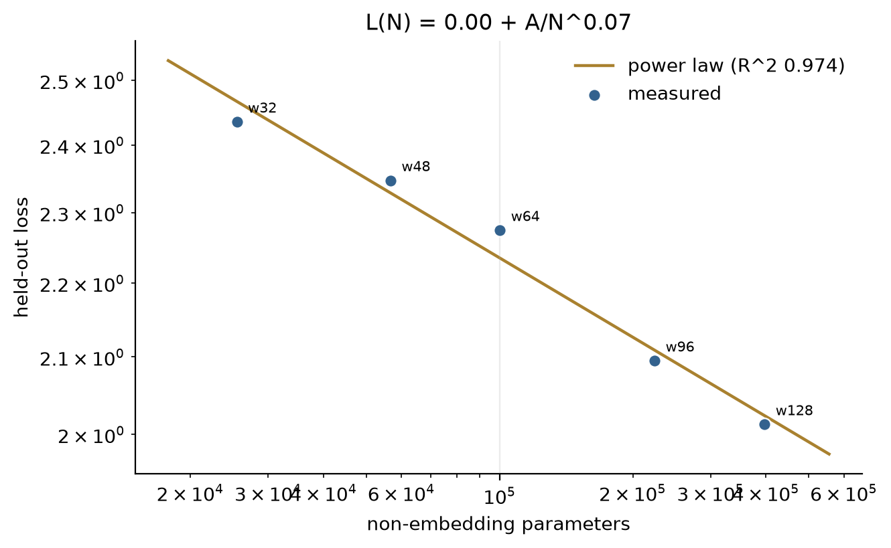
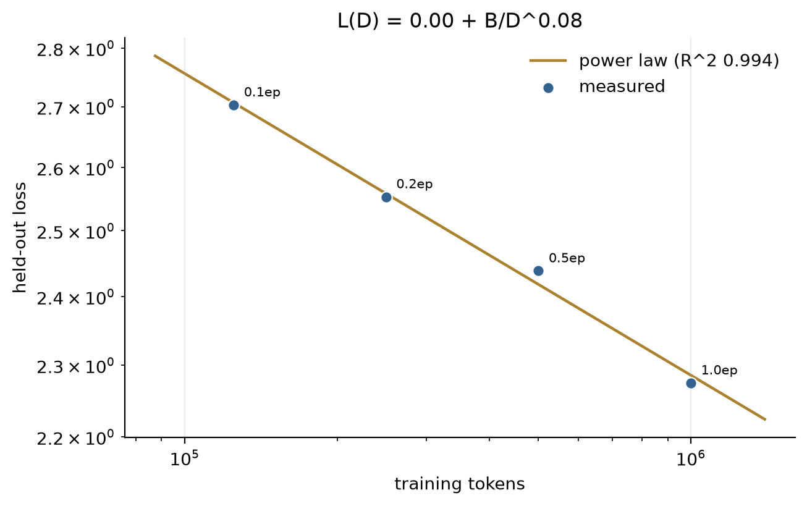
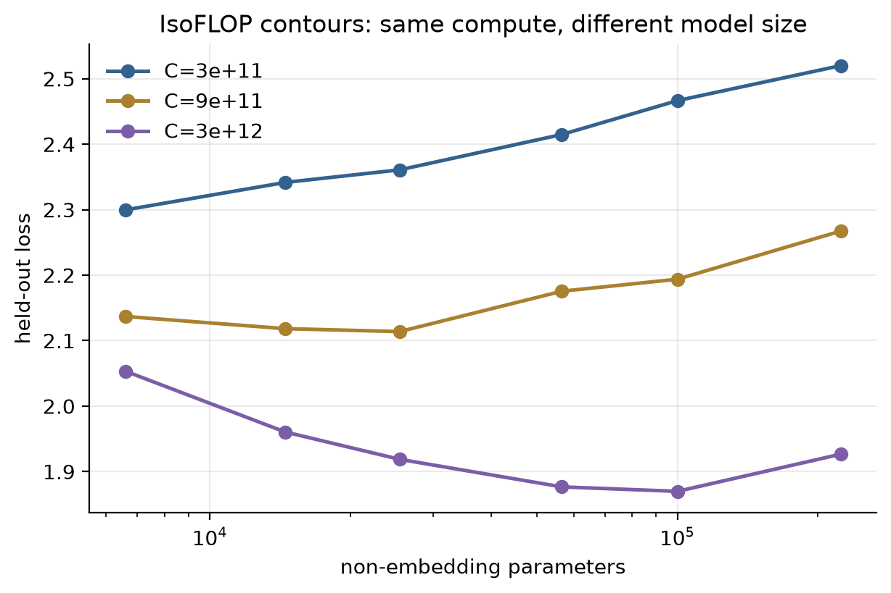
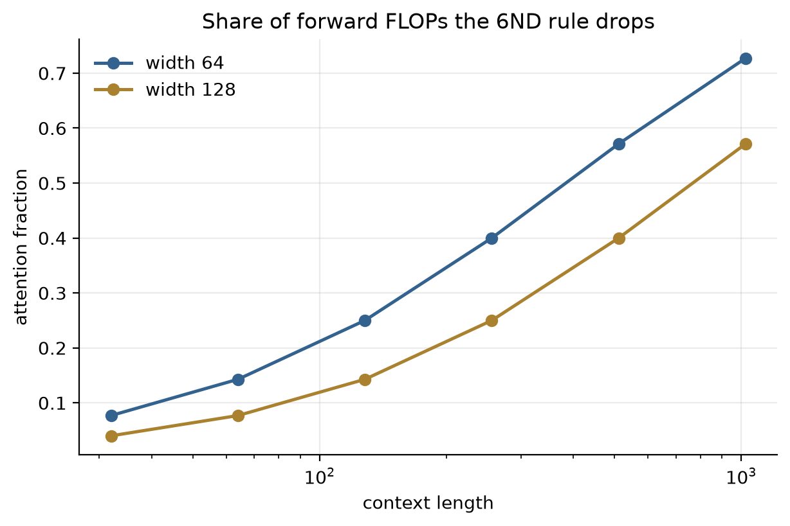
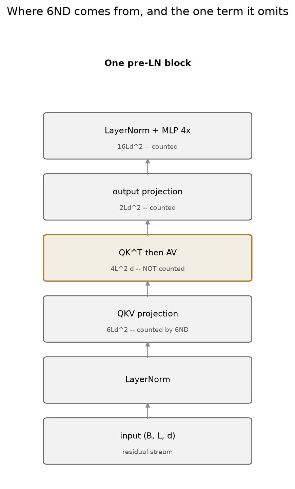

### What surprised me

**"Only $N$ matters" failed, and failed by more than the
axis it was competing with.** Rearranging 224k parameters from two wide layers
into eight narrow ones costs 0.126 of loss — more than the average gap between
adjacent points of a width sweep covering 25k to 397k parameters. Kaplan's claim
holds within a band of aspect ratios and $48\times8$ is outside it; at width 48
the model is deep and thin enough that depth stops being free. Part F's depth
sweep found the same thing from the other side, where a deep narrow MLP was the
arm that collapsed.

**The floor is the parameter everyone quotes and the one the data does not
support.** The fitted $E$ is 0 in both laws and the residual barely moves across
floors up to 0.71 — so a paper reporting a confident irreducible loss from a
one-decade sweep is reporting the argmin of a nearly flat objective. Writing the
fit out instead of importing one is what made this visible: `curve_fit` returns
three numbers and a covariance nobody reads, while a grid over $E$ shows the
flatness directly. The exponent inherits the same width: quoting $\alpha = 0.074$
without saying it could be 0.110 would be quoting a choice.

**The compute-optimal sweep measured the corpus, not the frontier.** $D^{*}$
came out essentially constant — $C^{-0.072}$ — with every extra FLOP going into
parameters. That is what running out of data looks like: at 1M unique tokens the
optimum sits at 4 epochs and cannot move right, so the frontier bends into the
$N$ axis. The guard that made this legible was cheap — flag whether each
contour's minimum is interior — and without it I would have reported
$N^{*} \propto C^{1.24}$ as a finding rather than as a symptom.

**And the smallest thing on the list mattered most.** Excluding the positional
table from $N$ moves the smallest model by 7.4% and the largest by 0.5%. That is
a systematic tilt applied precisely to the points that set the slope — the kind
of error that does not look like an error, because every individual number stays
plausible.

### Open threads

Every limitation here is the corpus. A scaling law wants at
least two decades of $x$ and data it never has to repeat; 1.1M characters gives
about one decade and runs out. The obvious next step is a tokenized corpus large
enough that $D^{*}$ is free to move, at which point the Chinchilla exponent
becomes measurable rather than merely bounded.

### Further reading

Kaplan et al., *Scaling Laws for Neural Language Models* (2020);
Hoffmann et al., *Training Compute-Optimal Large Language Models* (2022).

---

## G2 — Mixed-precision + gradient-accumulation training, profiled

**Question.** Two things everybody turns on. What do they actually buy, what do
they cost, and how would you know if one of them had silently broken your run?

### The math

**Two 16-bit formats, and the entire difference is the exponent field.**

$$\text{fp32}: 1+8+23, \qquad \text{fp16}: 1+5+10, \qquad \text{bf16}: 1+8+7 .$$

fp16 keeps mantissa bits and loses range: its smallest normal is
$6.1\times10^{-5}$, and gradients live below it, so they flush to zero.
**bf16 has fp32's exponent field exactly** — same smallest normal,
$1.18\times10^{-38}$ — and pays 8× coarser resolution for it. That is why
`GradScaler` exists for one format and not the other: scaling the loss by a
large constant moves gradients back into fp16's representable range, and the
scaler's job is to find the largest constant that does not overflow, backing off
whenever it does.

Gradients are exactly the wrong thing to store in the format that traded range
for precision — which is the one-sentence argument for bf16, and the reason
Ampere added it.

**Gradient accumulation is a statement about the loss, not the gradients.** For
micro-batches $B_1,\dots,B_k$ partitioning an effective batch $B$,

$$\nabla L_B = \frac{1}{|B|}\sum_{i \in B}\nabla \ell_i = \frac{1}{k}\sum_{j=1}^{k}\nabla L_{B_j},$$

since each $L_{B_j}$ is already a mean over its own micro-batch. The $1/k$ is
not optional. Omit it and the summed gradient is $k$ times the large-batch one,
so the run trains at $k$ times the configured learning rate — a bug that
produces plausible-looking divergence rather than an error.

### What I built

Five arms on a 384-wide, 4-layer transformer: fp32, fp16 with
a scaler, bf16, fp16 *without* a scaler, and a sweep of accumulation counts at a
fixed effective batch. Throughput is measured after a warmup with an explicit
device synchronize, because CUDA's asynchrony otherwise makes the loop measure
how fast Python can enqueue work. A separate sweep varies model width, because
AMP's speedup comes from tensor cores and therefore from matrix shapes.

### Results

On a Kaggle Tesla T4 (sm_75), single run, seed 0 —
[`data/g-gpu.json`](data/g-gpu.json). The CPU sweep in
[`data/g-metrics.json`](data/g-metrics.json) covers only the arms that need no
GPU, and says so.

| arm | throughput | peak memory | final loss |
| --- | --- | --- | --- |
| fp32 | 66.6k tok/s | 578.2 MB | 2.5450 |
| **fp16** | **168.9k (2.54×)** | 441.4 MB (0.76×) | 2.5450 |
| bf16 | **51.2k (0.77×)** | 442.6 MB | 2.5450 |

**AMP's speedup against width**, which is the claim the headline hides:

| width | 64 | 128 | 256 | 512 |
| --- | --- | --- | --- | --- |
| fp16 / fp32 | 1.25× | 1.53× | 2.31× | **2.99×** |

**Gradient accumulation** at a fixed effective batch of 32:

| accumulation | micro-batch | throughput | peak memory |
| --- | --- | --- | --- |
| 1× | 32 | 166.9k tok/s | 441.4 MB |
| 2× | 16 | 151.9k | 314.2 MB |
| 4× | 8 | 89.3k | 231.4 MB |
| 8× | 4 | 45.6k | **184.7 MB** |

8× buys **2.39× less peak memory for 3.66× the time**, with a loss gap of
**$5\times10^{-7}$** against the single-step run — the same optimization, fed differently.
And summing micro-batch gradients instead of averaging them gives a norm exactly
**4.00×** larger at 4× accumulation, reproduced on CPU and GPU alike.

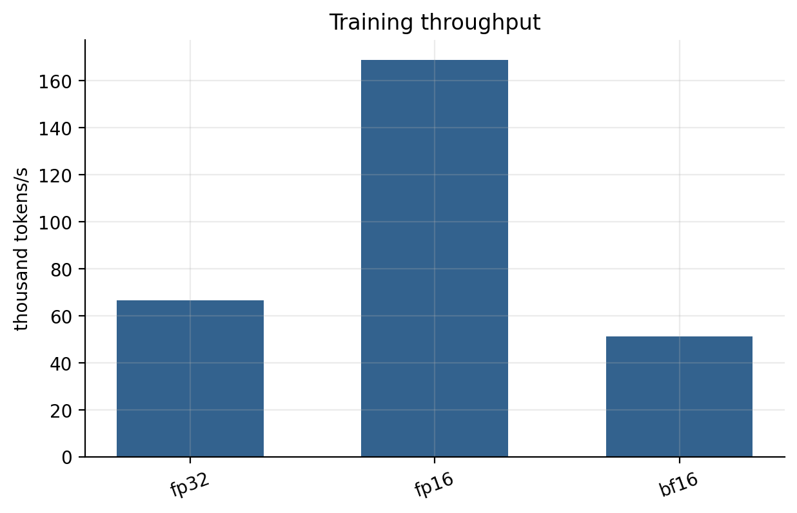
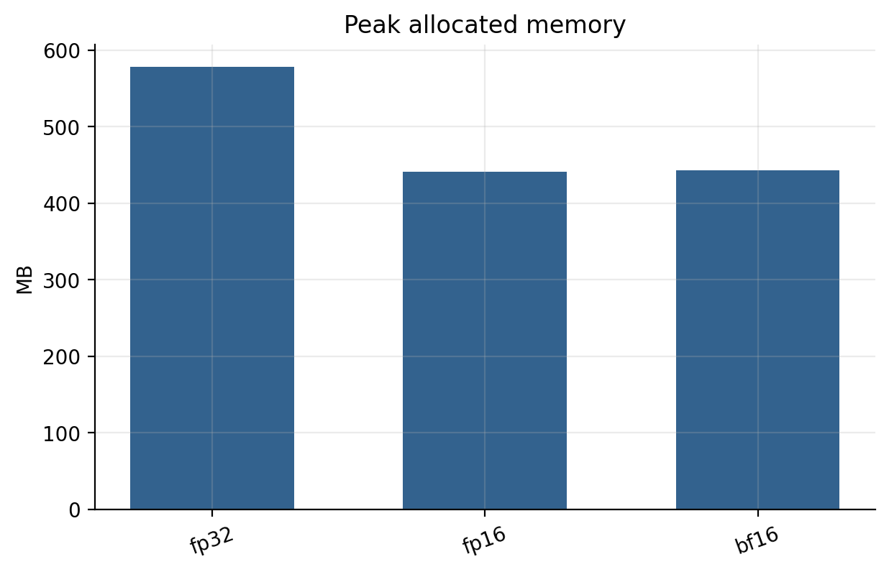
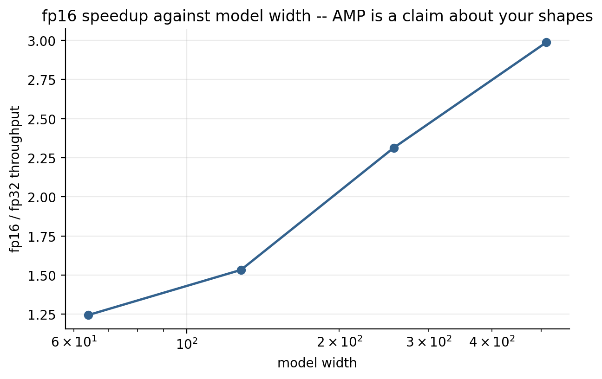
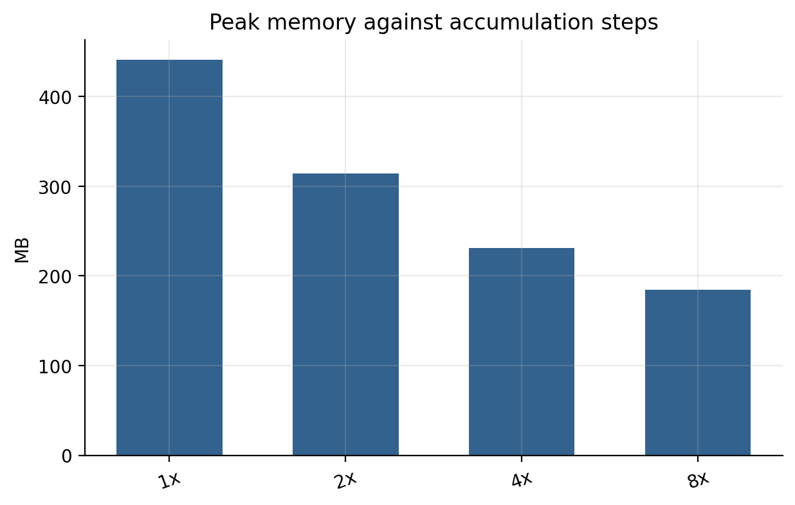
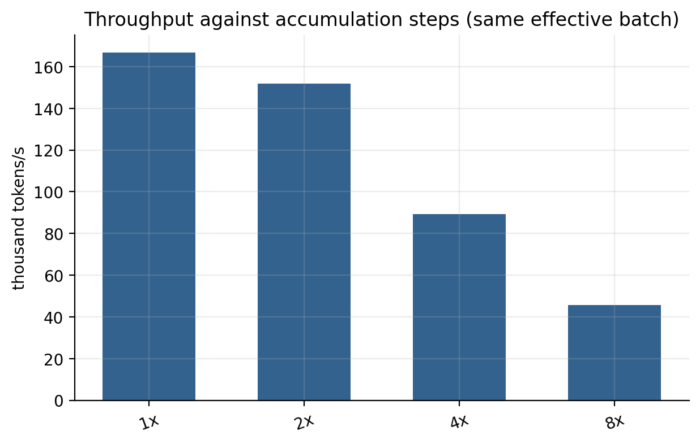

### What surprised me

**bf16 ran, and ran slower than the format it replaces.**
I had written that bf16 "needs sm_80, so on a Turing T4 there is no bf16 path at
all, and the arm is skipped". Wrong: `torch.cuda.is_bf16_supported()` returns
`True` on a T4, the arm runs fine, and it lands at **0.77× fp32**. A raw
4096-square matmul on the same card, measured twice on separate sessions, says
why:

| dtype | TFLOP/s | |
| --- | --- | --- |
| fp32 | 3.83 / 4.34 | |
| fp16 | **23.07 / 25.67** | tensor cores |
| bf16 | **2.07 / 2.42** | emulated |

bf16 is **11× slower than fp16 and slower than fp32 itself** here. "Supported"
and "accelerated" are different questions and only throughput answers the
second, so the rung now records `precision/bf16/accelerated` rather than
trusting the capability flag. The same confusion is worth separating from the
candle result recorded in part E: *that* failure —
`DriverError(CUDA_ERROR_NOT_FOUND, "named symbol not found")` — is a **build**
with no bf16 symbol, compiled under `CUDA_COMPUTE_CAP=75`. A missing kernel and
a slow kernel are different problems with the same cause sitting behind them.

**The scaler did nothing, and that is the result.** fp16 without a `GradScaler`
produced **0 non-finite steps** and a final loss of 2.5476 against 2.5450 with
one. The underflow mechanism is real and the arithmetic is right; it simply does
not bite on a 384-wide model over 40 steps. Reporting the scaler as having saved
the run would have been repeating the textbook instead of the measurement.

**AMP's speedup is 1.25× or 2.99× depending on a number nobody quotes with it.**
At width 64 the matrices are too small to keep tensor cores busy and the
overhead of casting eats most of the gain. "Mixed precision gives ~2×" is true
of the shapes people benchmark and false of half the models in this repo.

**Accumulation's loss gap is $5\times10^{-7}$, which is the point.** It is supposed to be
a pure memory-for-time trade with the optimization untouched, and at that gap it
demonstrably is. The metric worth having is the one that could have caught the
$1/k$ bug, and it does: 4.00× exactly, on both devices.

### Open threads

Everything here is one card. The bf16 result would invert on
an A100 and the accumulation trade would shift with activation checkpointing,
which is the other half of the memory story and is not implemented. The obvious
next measurement is `torch.compile`, which changes the shape-dependence of the
AMP result by fusing away the small-kernel overhead that dominates at width 64.

### Further reading

Micikevicius et al., *Mixed Precision Training* (2018); the PyTorch
AMP examples in this part's lab reference.

---

## G3 — Rust/Candle port of one transformer-block forward pass

**Question.** Does writing a forward pass in another framework teach you
anything the original did not — and can "the port is correct" be made into a
number?

### The math

There is no new mathematics in a port, which is the point: the function is
fixed and the only question is whether two implementations compute it. That
makes the measurable quantity a distance between implementations,

$$\varepsilon_{\text{rel}} = \frac{\lVert F_{\text{torch}}(x) - F_{\text{candle}}(x)\rVert}{\lVert F_{\text{torch}}(x)\rVert},$$

and the useful thing about it is that its *scale* diagnoses the cause. Around
$10^{-7}$ in float32 is accumulation order — the same arithmetic in a different
sequence. Around $10^{-5}$ to $10^{-3}$ is a different function: an
approximation swapped for an exact form, a wrong epsilon, a mask applied in the
wrong place. Several orders larger is a shape or orientation error.

The one function with two definitions in this block is GELU:

$$\text{exact: } x\,\Phi(x), \qquad
\text{tanh: } \tfrac{x}{2}\left(1 + \tanh\left[\sqrt{\tfrac{2}{\pi}}\left(x + 0.044715x^3\right)\right]\right).$$

PyTorch's `nn.GELU()` is the first; Candle's `gelu()` is the second and
`gelu_erf()` is the first. They agree to about $10^{-3}$ on ordinary
activations — far above float32 noise, far below anything that looks like a bug.

### What I built

The pre-LN block from C3, rewritten against Candle 0.11 in
`rust/crates/ignite-port`, with a driver that exports the weights to `.npz`,
runs both sides and diffs them at batch 1 and batch 4. Both GELU variants are
run, so the cost of the wrong choice is a measurement rather than a warning.

### Results

Medians over seeds 0–2.

| | relative error | max \|diff\| |
| --- | --- | --- |
| exact GELU, batch 1 | **$8.4\times10^{-8}$** | $4.8\times10^{-7}$ |
| exact GELU, batch 4 | **$8.2\times10^{-8}$** | $4.8\times10^{-7}$ |
| tanh GELU, batch 1 | $3.6\times10^{-5}$ | $1.4\times10^{-4}$ |
| tanh GELU, batch 4 | $3.9\times10^{-5}$ | $1.4\times10^{-4}$ |

With the matching GELU the port agrees to **float32 round-off**. With Candle's
default it is **470× worse** — from swapping one function, with nothing raised
and nothing crashed.

**Speed, on an idle machine and a loaded one:**

| torch threads | idle | 4 competing processes |
| --- | --- | --- |
| 1 | 0.465 ms | 0.959 ms |
| 2 | 0.429 ms | 0.936 ms |
| 4 | 0.480 ms | **90.6 ms** |
| **spread** | **1.14×** | **94.6×** |

Contention costs the four-thread pool **191×** (range 160–222) and the single
thread **2.06×**.

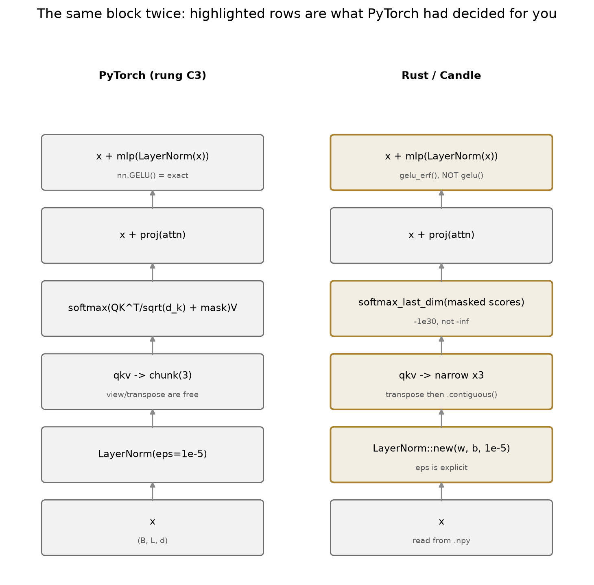
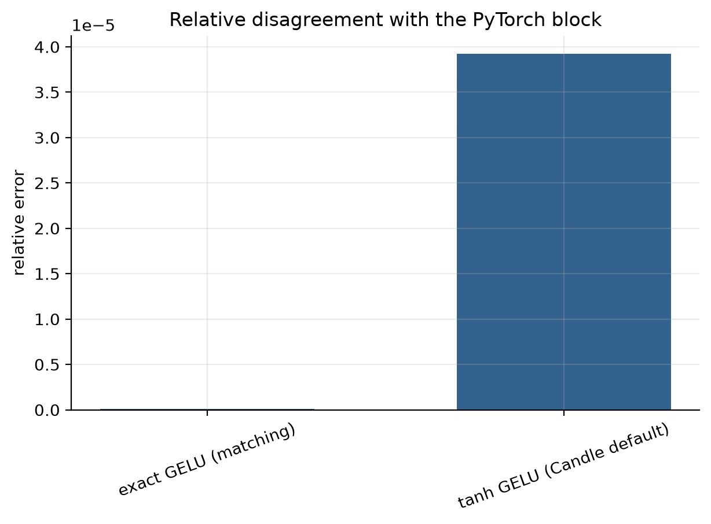
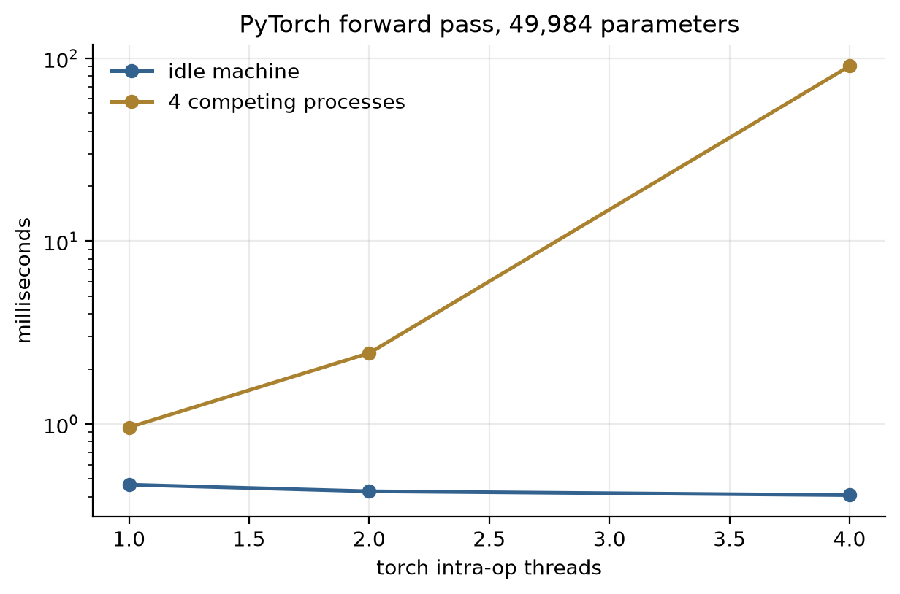

### What surprised me

**The port was right the first time, which was not the
plan.** It compiled and matched to $10^{-7}$ on the first run, and the value of
the exercise turned out to be in the three lines where Candle refuses to decide
for you: `LayerNorm::new(w, b, 1e-5)` makes the epsilon explicit, `transpose`
returns a strided view so `matmul` needs an explicit `.contiguous()`, and
`gelu()` is not `gelu_erf()`. The last of those is the one with no safety net —
it is a different function, not a different precision, and the only thing that
catches it is a diff against a reference.

The contiguity one is why the rung tests at batch 4. It does not fail at batch
1, and batch 1 is the only shape a single-sequence demo ever runs. Earlier in
this same session that exact bug was found in two places in the candle fork's
vision path, both of which the executor never hit because it runs at batch 1.

**This rung's speed section measured the wrong thing twice.** The first version
compared PyTorch against the ported binary and made Rust look 10× faster; it was
timing process startup and an `.npz` parse. The second fixed that, measured
PyTorch at 1/2/4 threads, found 84 ms at four threads and reported *192×, from a
setting* — but that run shared a 4-core box with this part's own sweep. On an
idle machine the spread is **1.14×**.

What survives is better than either mistake: the cost is not the thread pool, it
is the **interaction** between a spin-waiting pool and a machine that has no
cores to give. Single-threaded, contention costs 2.06×; at four threads it costs
191×. So `torch.set_num_threads(1)` is worth nothing on an idle box and is the
difference between 0.96 ms and 91 ms on a busy one. The rung now creates the
contention itself, so the number is a measurement rather than an accident of
what else was running — which is the general lesson, and one this part had to
learn twice.

### Open threads

One block is not a model: the port has no KV cache, no
sampling loop and no quantization, which is where the [[ignite-catalog]]
executors actually live. Porting the *decode* path is the rung after this one,
and the interesting number there is tokens per second rather than a relative
error.

### Further reading

the Candle source for `candle-nn`'s `LayerNorm` and `ops::softmax`;
Hendrycks & Gimpel, *Gaussian Error Linear Units* (2016) for the two forms.

---

## What part G settled

1. **$6ND$ is a rule of thumb with a named error term, and the term is 20.9%
   here.** The $d^2$ terms of a block are exactly $2L$ times its parameter
   count, which is where the rule comes from and also why it covers nothing
   else. What it drops is $4Ld$ per token — 14.3% of forward FLOPs at width 64
   on a 64-token context, growing with $L/d$. Fine for GPT-3-shaped models,
   not fine for these, and either way it is a derivation rather than a constant.
2. **A power law fitted over one decade does not pin its floor, and the floor is
   the number people quote.** Both fits here land at $E = 0$ with $R^2 > 0.97$,
   and floors up to 0.71 and 0.76 fit essentially as well, carrying exponents
   from 0.074 to 0.110 and 0.084 to 0.117. The honest report is the band.
3. **"Loss depends on $N$, not on shape" is false outside a band of aspect
   ratios.** At matched parameter count, $48\times8$ loses to $96\times2$ by
   0.126 — more than one step of a width sweep spanning 15× in $N$.
4. **The compute-optimal frontier measured the corpus.** $D^{*} \propto
   C^{-0.072}$, flat, because 1M unique tokens runs out at ~4 epochs and every
   further FLOP goes into parameters. Two of three contours bracket their
   minimum; the rung reports that rather than the exponent, because an exponent
   fitted through edge-pinned points is a measurement of the grid.
5. **"Supported" and "accelerated" are different questions.** bf16 runs on a T4
   — `is_bf16_supported()` says `True` — at 0.77× fp32 in training and 2.1–2.4
   TFLOP/s against fp16's 23–26 on a raw matmul. Only throughput separates
   them. Separately, the candle fork's
   `DriverError(CUDA_ERROR_NOT_FOUND)` on the same card is a *third* thing: a
   build compiled for sm_75 with no bf16 symbol at all. One card, three
   different answers to "does bf16 work", and the correct one depends on which
   layer you ask.
6. **Every headline in this part is conditional on a number the headline omits.**
   AMP is 1.25× at width 64 and 2.99× at 512. Accumulation is free (loss gap
   $5\times10^{-7}$) and costs 3.66× the time. `set_num_threads(1)` is worth
   nothing idle and 191× under contention. The pattern is the part's actual
   content: these are properties of configurations, and quoting them without
   the configuration is how they turn into folklore.
7. **A port is a comprehension test with a pass mark.** $8\times10^{-8}$
   relative says the two implementations compute the same function;
   $4\times10^{-5}$ says one of them computes a different one. The scale
   diagnoses the cause, which is why the number is worth more than a passing
   test — and why swapping `gelu_erf` for `gelu`, which raises nothing, is
   caught in one line.
8. **I measured the harness instead of the code twice in one rung.** First
   comparing a whole Rust process against an in-process PyTorch call, then
   reporting a 192× thread spread that was contention with this part's own
   sweep. Both produced plausible numbers, both were reported before being
   checked, and both were caught by re-running under changed conditions. That
   is now nine occasions in this repo where a number that looked like a result
   was an artifact of how it was computed — and the only method that has
   reliably caught them is adding the control that could embarrass it.

**Cost of the part:** ~1,750 lines including tests, 12 test cases, and a
three-seed CPU sweep in about 44 minutes (G1 ~838 s per seed, G2 and G3 seconds
each), plus a Kaggle T4 kernel for G2's GPU arms. G1 dominates because its
IsoFLOP contours train 18 models per seed.

---

*Figures regenerate with `uv run python tools/writeup_figures.py G`; the numbers
they are quoted against live in [`data/g-metrics.json`](data/g-metrics.json) and,
for the GPU arms, [`data/g-gpu.json`](data/g-gpu.json). The [part
README](../../parts/g_scaling_systems/README.md) is the short version of this
document.*
