# Part H — Computer vision & OCR

> **Status:** complete (H1–H6, plus the real-model runs) · **Constraint:** synthetic data with exact ground truth, rendered offline; small budgets
> **Numbers:** seeds 0–2, reference seed 0 · raw values in [`data/h-metrics.json`](data/h-metrics.json)
> **Reproduce:** `ladder run H1` … `H6` (needs `uv sync --extra torch --extra ocr`), or `uv run python tools/writeup_figures.py H`
> **Hardware:** H1–H5 swept on a Colab T4; H6 is arithmetic and runs anywhere

Every part before this one was handed its metric. Accuracy needs no argument —
the prediction equals the label or it does not — and even part D's probes were
scored by counting correct answers. Detection has no such luxury. A model emits
a variable number of boxes, each with a score and a class, and *nothing* says
which prediction corresponds to which object. The metric has to be built, and
building it involves choices that change the answer.

So part H is about **interfaces**: between a prediction and the thing it is
supposed to be a prediction *of*, and between one stage of a pipeline and the
next. H1 constructs a metric from nothing. H2 discovers that averaging over the
wrong pixels hides the effect it is looking for. H3 and H4 find that the
interface between an image and a string can be drawn two ways with opposite
failure modes. H5 measures a real two-stage pipeline and finds **99.98% of its
error living in the interface between the stages**. H6 prices what it costs to
delete that interface entirely, which is what the field actually did.

The data is rendered rather than downloaded, in `src/mlladder/synth.py`.
Attributing a pipeline's error to a stage needs ground truth that is exactly
right — which box, which character, which pixel — and real OCR corpora come
with annotation noise that is itself a research topic. The fonts come from
matplotlib's bundled TTFs rather than the system's, because otherwise every
number here would be a property of the machine that produced it. That
reproducibility is verified, not assumed: the rendered pixels are byte-identical
across matplotlib 3.10/3.11 and Pillow 11.3/12.3, checked by hashing the output
on two machines and now guarded by a test.

Notation: boxes are $(x_1, y_1, x_2, y_2)$ in pixels, $\mathrm{IoU}$ is
intersection over union, CER and WER are edit distances normalized by reference
characters and words, and $T$ is a sequence length in image columns or tokens.

---

## H1 — Detection, and the metric as a construction

**Question.** Detection's score depends on three choices that have nothing to do
with the detector: what overlap counts as a match, how duplicates are removed,
and how a precision-recall curve becomes one number. How much do those choices
move the answer?

### The math

**IoU** is the whole foundation, and it is one ratio:

$$\mathrm{IoU}(A, B) = \frac{|A \cap B|}{|A \cup B|} = \frac{|A \cap B|}{|A| + |B| - |A \cap B|}.$$

The intersection of two axis-aligned boxes is a box — the coordinate-wise max
of the near corners and min of the far ones — which is why this is cheap enough
to evaluate on every prediction-truth pair.

**Non-max suppression** is three lines and one assumption: that two boxes
overlapping by more than $\tau_{\text{nms}}$ describe the same object. Sort by
score, keep the best, discard everything it overlaps, repeat. The assumption is
false whenever two real objects overlap that much, which is why the threshold is
a dial rather than a constant.

**Average precision** walks the predictions in descending score order. A
prediction is a true positive if it clears $\tau_{\text{iou}}$ against a truth in
the same image *that nothing better has already claimed* — the claiming rule is
what makes a duplicate cost something, and therefore what makes NMS worth
running at all. Each prefix gives a $(r, p)$ point, and AP is the area under the
monotone envelope:

$$\mathrm{AP} = \sum_k (r_k - r_{k-1}) \max_{\tilde{r} \ge r_k} p(\tilde{r}).$$

Taking the running maximum of precision from the right is the "interpolated"
part. It matters more than it looks: a duplicate that lands *after* full recall
has been reached costs nothing at all under the envelope, so NMS only pays where
duplicates outrank genuine detections elsewhere.

**mAP** averages AP over classes — over the classes that are *present*. Scoring
an absent class 0 rather than skipping it is a silent way to make a detector
look bad on a dataset that never showed it that class.

### What I built

A YOLO-style detector with one prediction per cell of an 8×8
grid on 64×64 scenes: objectness, a box, and a class distribution per cell. The
box is parameterised relative to its cell — centre as a sigmoid offset inside
it, size as a log-ratio of the image — because predicting absolute coordinates
asks every cell to learn where it is, while offsets let one shared convolution
work everywhere. Ground-truth boxes are assigned to the cell holding their
centre, which caps recall when two centres share a cell; that happens to 0.17%
of objects here and is reported rather than left implicit.

### Results

*Setup: 3000 train / 600 test scenes, 12 epochs; medians over seeds 0–2.*

| NMS threshold | boxes/image | mAP@0.5 | mAP@0.75 |
| --- | --- | --- | --- |
| none | 4.30 | 0.847 | 0.652 |
| 0.1 | 1.91 | 0.923 | 0.634 |
| 0.3 | 1.99 | 0.953 | 0.649 |
| 0.5 | 2.20 | **0.955** | 0.650 |
| 0.7 | 3.38 | 0.908 | **0.672** |
| 0.9 | 4.30 | 0.847 | 0.652 |

Ground truth averages 2.0 objects per image, which NMS at 0.3 reproduces almost
exactly (1.99). `best/nms_threshold` is 0.5 on every seed.

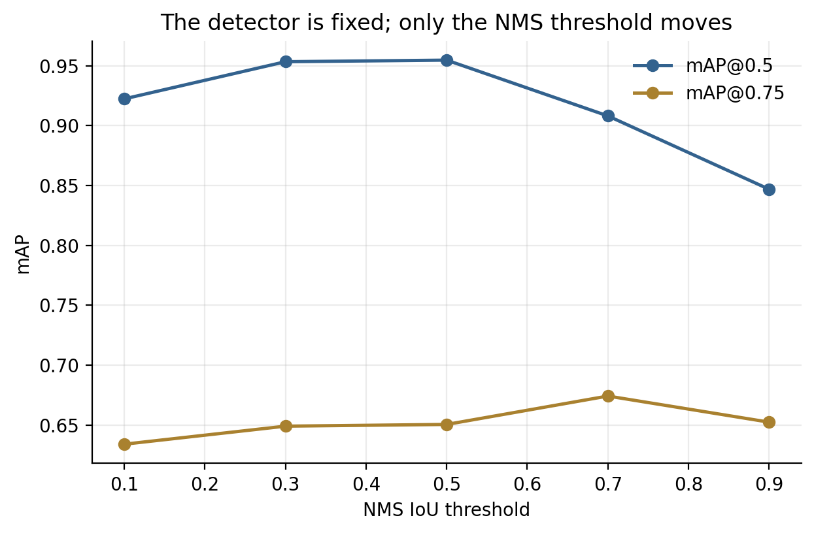
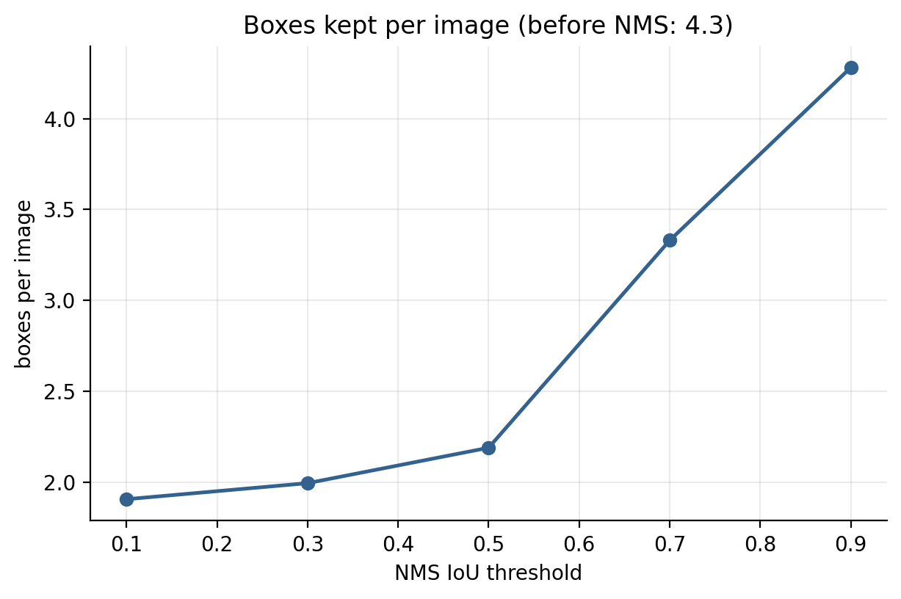
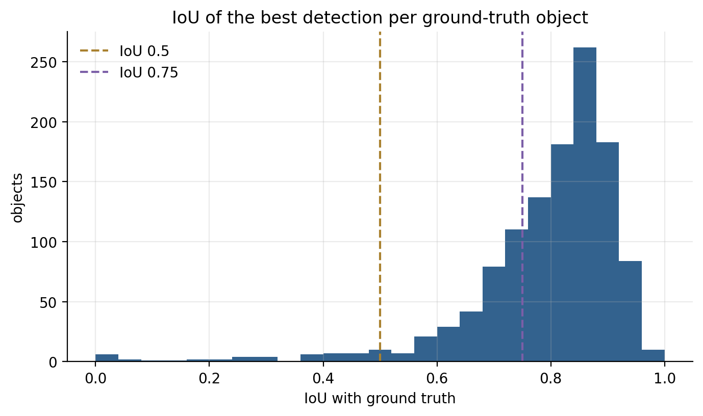
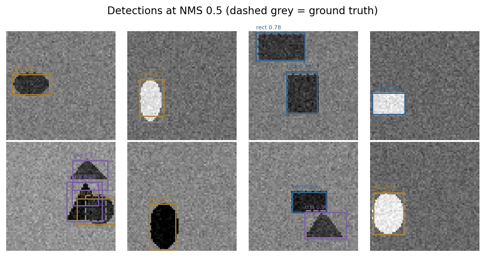

### What surprised me

The two IoU thresholds disagree about what the NMS dial
is *for*. Across the sweep, mAP@0.5 moves by **0.109** and mAP@0.75 by only
**0.032** — and at 0.75 the best threshold is 0.7, not 0.5. At the strict
threshold, duplicate removal stops mattering because localization has become the
binding constraint, and a knob that looks important at one threshold is nearly
inert at the other.

The localization penalty itself is the largest number in the rung: **0.955 at
IoU 0.5 against 0.650 at 0.75**, a drop of 0.316 on *unchanged predictions*. I
chased that rather than accept it, and the chase is most of what I learned here.
It is not a grid bug — the predicted centre is unbiased to 0.1 px, and feeding
the encoder's own targets through the decoder round-trips to IoU > 0.99, which
is now a test. It is not shape fill either: my hypothesis was that a triangle,
filling half its box, would localize worst, but the width bias is identical
across rectangle, ellipse and triangle (−1.46, −1.44, −1.49 px). And it is not
Jensen's inequality from the log-size parameterisation, which accounts for only
~0.6 px of it. The residual is biased in log space itself (−0.067), where the
*variance* (std 0.11, an 11% relative size error) dominates the bias anyway.
That variance is what caps matched IoU at 0.792 mean, with 97% of objects above
0.5 but only 11% above 0.9.

Per class at the strict threshold the ordering is ellipse 0.698 > rectangle
0.629 > triangle 0.579, which my fill hypothesis gets exactly half right: the
triangle is worst, but a rectangle *is* its box and still loses to an ellipse.
I do not have an explanation I believe, and one sentence of honest ignorance
beats a plausible story.

### Open threads

Anchors with aspect priors, which is the standard answer to a
size regression this noisy. Focal loss for the 30:1 negative imbalance. And
DETR's set prediction, which removes NMS from the problem entirely rather than
tuning it — the same move H6 makes one level up.

### Further reading

[YOLO](https://arxiv.org/abs/1506.02640);
[Faster R-CNN](https://arxiv.org/abs/1506.01497);
[Focal Loss](https://arxiv.org/abs/1708.02002);
[DETR](https://arxiv.org/abs/2005.12872).

---

## H2 — Segmentation, and averaging over the wrong pixels

**Question.** Skip connections are supposed to restore the fine detail that
pooling destroys. How much are they worth, and where?

### The math

**The U-Net's claim** is architectural. An encoder that pools discards high
frequencies; upsampling cannot invent them back. A skip connection concatenates
the pre-pool features into the decoder, giving the signal a route around the
bottleneck. It is B4's residual argument in a second setting — the same idea one
level up from a block.

**Dice against cross-entropy** is a question about weighting. Cross-entropy
averages over pixels, so a class owning 3% of the image contributes 3% of the
gradient. Soft Dice normalizes per class:

$$\mathcal{L}_{\text{Dice}} = 1 - \frac{1}{C}\sum_c \frac{2\sum_i p_{ic} y_{ic} + \epsilon}{\sum_i p_{ic} + \sum_i y_{ic} + \epsilon}$$

Each class contributes one term regardless of its pixel count. The hard Dice
score uses an argmax and has zero gradient; replacing the indicator with the
softmax probability $p_{ic}$ is what makes it trainable. Since the *metric* (IoU
per class) is itself area-normalized, the two objectives genuinely disagree
about what "good" means on a background that owns 86% of the pixels.

**IoU from the confusion matrix** is the diagonal over the row plus column minus
the double-counted diagonal, and Dice and IoU are monotone in each other,
$D = 2I/(1+I)$ — which the tests use to check one against the other.

### What I built

A two-level U-Net on the same scenes H1 detects in. The
no-skip arm keeps its entire decoder and loses only the concatenated channels,
so the comparison is not confounded by capacity: 66,292 parameters against
59,812. Plus a boundary band — pixels within 2px of a label change, computed
without scipy by disagreeing with a shifted copy and dilating — covering 11.7%
of pixels.

### Results

(2000 train / 500 test, 10 epochs; medians over seeds 0–2). Pixel
shares: background 0.856, rectangle 0.063, ellipse 0.048, triangle 0.032.

| arm | foreground mIoU | boundary mIoU |
| --- | --- | --- |
| skips + cross-entropy | 0.9495 | 0.9237 |
| no skips + cross-entropy | 0.9378 | 0.8921 |
| skips + Dice | **0.9573** | **0.9325** |
| skips + CE + Dice | 0.9572 | 0.9327 |

| | whole image | boundary band |
| --- | --- | --- |
| **skip gain** | +0.0129 | **+0.0299** |

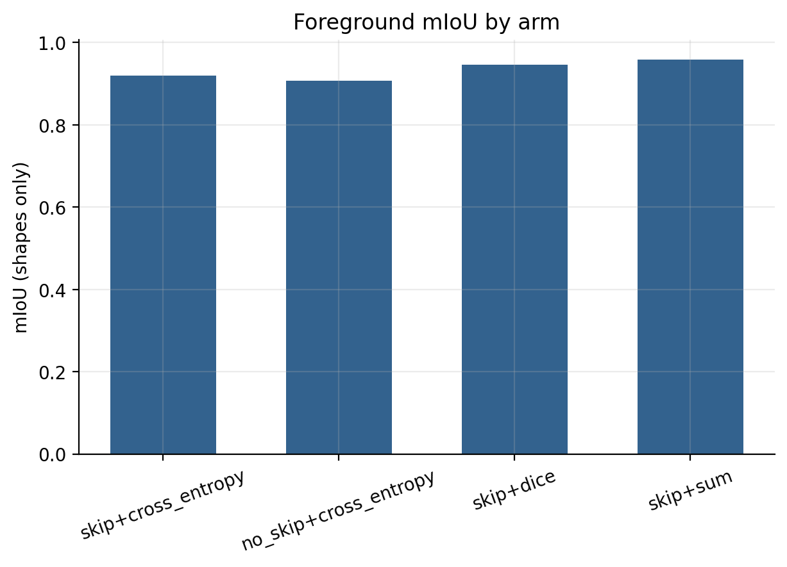
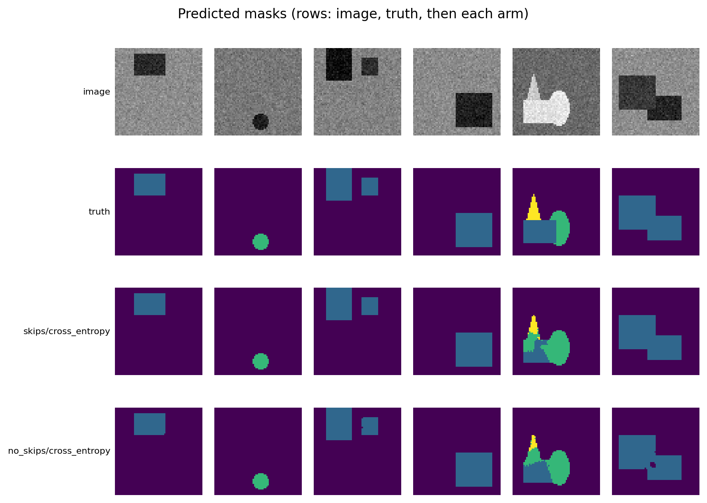

### What surprised me

The first pass made the ablation look boring: +0.013
foreground mIoU for skips, everything above 0.94, a ceiling rather than a
result. Then I scored the mechanism instead of the average. The argument for
skip connections is about high frequencies — edges — and whole-image mIoU is
dominated by object interiors, where a roughly-right blob already scores well.
Restricting the *same predictions* to a 2px band around each true boundary gives
**+0.030 against +0.013, 2.3× larger**, on all three seeds. The effect was
always there; the metric was averaging the place skips act together with the
place they don't.

**And a claim that did not survive the sweep.** On a single seed I recorded that
Dice beats cross-entropy, which looked like the textbook class-imbalance story
holding. Across three seeds `best/loss_is_dice` is [0, 1] — Dice wins twice and
loses once — over a loss spread of 0.012. Dice and CE+Dice are statistically
indistinguishable here (0.9573 against 0.9572). I had reported the single-seed
version as a finding before the sweep, and it was noise.

### Open threads

A deeper U-Net, where more pooling should widen the skip gap.
Thin structures rather than solid shapes, which is the regime the boundary
result predicts skips matter most in. And boundary-weighted losses, which
optimize directly for the band this rung had to invent to see the effect.

### Further reading

[U-Net](https://arxiv.org/abs/1505.04597);
[Mask R-CNN](https://arxiv.org/abs/1703.06870);
[Segment Anything](https://arxiv.org/abs/2304.02643).

---

## H3 — CTC, and what "held out" actually held out

**Question.** Reading text off an image has no alignment: a 128-pixel line holds
an unknown number of characters at unknown positions. How much does removing
that requirement cost, and where does the remaining error live?

### The math

**CTC marginalizes the alignment away.** The network predicts a distribution
over the alphabet plus a *blank* at every image column, and the loss sums the
probability of every column labelling that collapses to the target:

$$p(y \mid x) = \sum_{\pi \in \mathcal{B}^{-1}(y)} \prod_t p(\pi_t \mid x),$$

where $\mathcal{B}$ deletes blanks and merges repeats. The blank is what makes
repeated characters expressible at all — "AA" needs a blank between the two A's,
or it collapses to "A" — and the sum is computed by a forward-backward recursion
rather than enumerated.

**Greedy decoding is not the most likely string.** It takes the most likely
*alignment* and collapses it, and those differ whenever one string's probability
is spread over several alignments. Prefix beam search fixes that by scoring
strings, which requires tracking two numbers per prefix — the probability it
ends in a blank and the probability it ends in its final symbol — because which
applies decides whether the next repeated character extends the prefix or merges
into it. A test pins the case where they disagree: with two columns each
splitting mass 0.55/0.45 between blank and 'A', greedy returns `""` and the beam
returns `"A"`.

**CER is an edit distance**, not a per-position mismatch, because a model that
drops one character would otherwise score as if everything after it were wrong
too. It is pooled over the corpus rather than averaged per line, and it is not
bounded by 1 — a hallucinating model can insert more than the reference holds.

### What I built

A CRNN: convolutions pooling height to 1 while pooling width
only twice, so a 32×128 image becomes 32 columns, then a two-layer BiLSTM and a
per-column head. The width ratio carries a hard constraint — CTC cannot emit
more characters than it has columns, and needs a spare column between repeats —
so the rung checks it and exits loudly rather than discovering it as a silent
`inf`.

### Results

*Setup: 6000 train lines, 12 epochs; medians over seeds 0–2.*

| split | greedy CER | beam-15 CER | WER |
| --- | --- | --- | --- |
| seen fonts | 0.0000 | 0.0000 | 0.0033 |
| held-out fonts | 0.1636 | 0.1621 | 0.4900 |

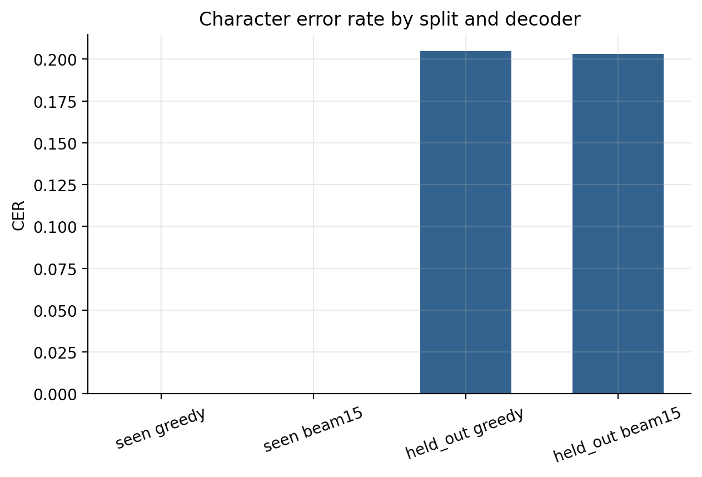
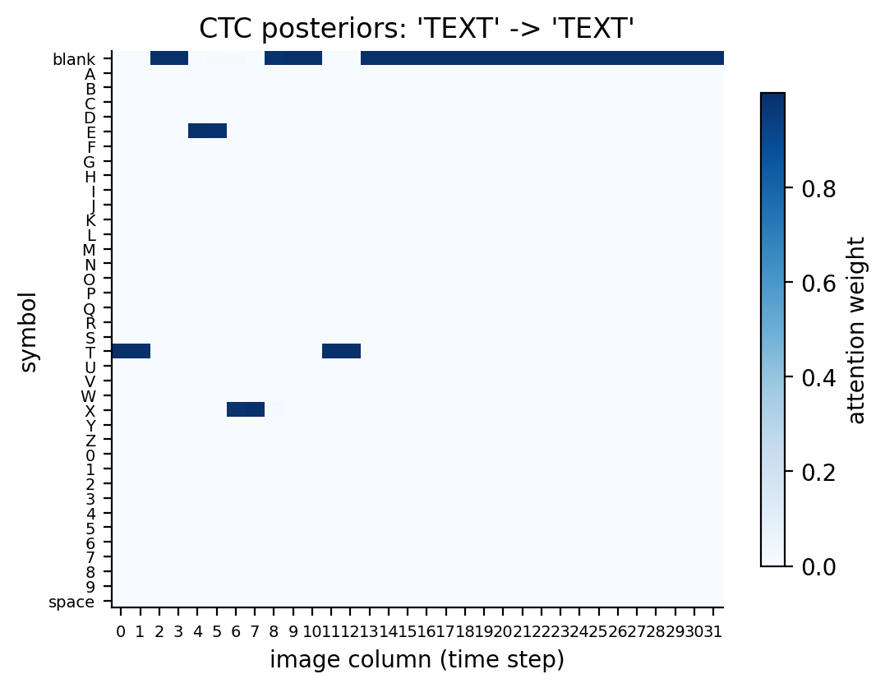
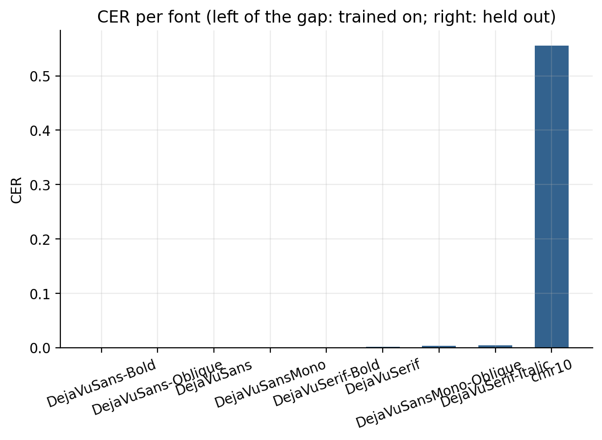

### What surprised me

Beam search buys **nothing**: 0.0000 CER at median
against greedy, while held-out fonts cost 0.164. The textbook decoder upgrade,
implemented properly with separate blank and symbol mass, is worth zero here,
and the entire error budget is generalization. Decoding was never the
bottleneck.

**And the part-H finding I am least comfortable with.** Breaking the held-out
error down per font:

| held-out font | CER |
| --- | --- |
| DejaVuSansMono-Oblique | 0.0038 |
| DejaVuSerif-Italic | 0.0052 |
| **cmr10 (Computer Modern)** | **0.4666** |

The "font gap" is one typeface. Two of my three held-out faces are read at
0.4–0.5% CER — essentially perfectly — because they are *DejaVu family members*
whose siblings (DejaVuSansMono, DejaVuSerif) are in the training set. Only
Computer Modern, a genuinely different design, is hard, and it carries the
entire aggregate gap on its own.

So the honest statement is not "the model fails on unseen fonts" but "the model
generalizes across weight and slant within a family and fails on an unfamiliar
letterform" — which is a different and more useful claim. My held-out split was
badly designed: I picked three faces for variety without checking whether they
were near-duplicates of training faces, and the aggregate number hid that until
the per-font breakdown went in. Every statement I made about this gap before the
breakdown existed was an average over two easy cases and one hard one.

### Open threads

A held-out set chosen by typeface family rather than by file,
which is what would make the gap measure what I claimed. Font augmentation
during training. And synthetic degradation — blur, skew, JPEG — which is where
real OCR error comes from and which this data has none of.

### Further reading

[CTC](https://www.cs.toronto.edu/~graves/icml_2006.pdf);
[CRNN](https://arxiv.org/abs/1507.05717);
[What Is Wrong With Scene Text Recognition Model Comparisons?](https://arxiv.org/abs/1904.01906).

---

## H4 — Two ways to draw the image-to-string interface

**Question.** CTC assumes the output is monotonic in the input and conditionally
independent given the columns. An attention decoder assumes neither and gains a
language model over its own output. What does each assumption buy and cost?

### The math

**The independence assumption** is the real difference, and it is visible in
the factorization each model assumes:

$$p_{\text{CTC}}(\pi \mid x) = \prod_t p(\pi_t \mid x)
\qquad\text{against}\qquad
p_{\text{AR}}(y \mid x) = \prod_t p(y_t \mid y_{<t}, x).$$

CTC's columns are conditionally independent given the image, so it cannot
condition on what it already wrote — it cannot spell. The autoregressive
product carries $y_{<t}$, which is an implicit language model over the label
distribution, obtained for free and never asked for.

**The monotonicity assumption** is the other. CTC's collapse is order-preserving
by construction, so alignment is never something the model can get wrong. An
attention decoder chooses where to look at every step and must *learn* both the
alignment and when to stop — and an emitted EOS is a decision, not a structural
consequence.

**Attention** is C2's, pointed at image columns rather than source tokens:
$\alpha = \mathrm{softmax}(h_t^\top H / \sqrt{d})$ with context $\sum_i
\alpha_i H_i$, plus input feeding so the decoder knows where it just looked.

### What I built

Three arms on byte-identical data. CTC is H3's CRNN, imported
rather than reimplemented. The attention arm uses the *same* convolutional
encoder and the *same* dot-product attention, so the comparison isolates the
decoder. TrOCR is zero-shot, never trained here.

The experiment that matters is length: both arms train on one and two words and
are tested on three. Critically there is a **two-words-on-the-wider-canvas
control**, because at a fixed 128px a third word also shrinks the glyphs — and
without separating those, a resolution failure reads as a length failure.

### Results

*Setup: medians over seeds 0–2; 0.4M / 0.9M / 62M parameters.*

| | CTC | attention | TrOCR |
| --- | --- | --- | --- |
| seen CER | 0.0002 | 0.0000 | 0.0111 |
| held-out CER | **0.1756** | 0.1956 | **0.0101** |
| held-out WER | 0.4094 | **0.2596** | 0.0259 |
| held-out exact | 0.6125 | **0.7013** | — |
| font gap | 0.175 | 0.196 | **−0.001** |
| **length gap** | **0.0003** | 0.2202 | — |
| **width gap (control)** | **−0.0002** | 0.1393 | — |

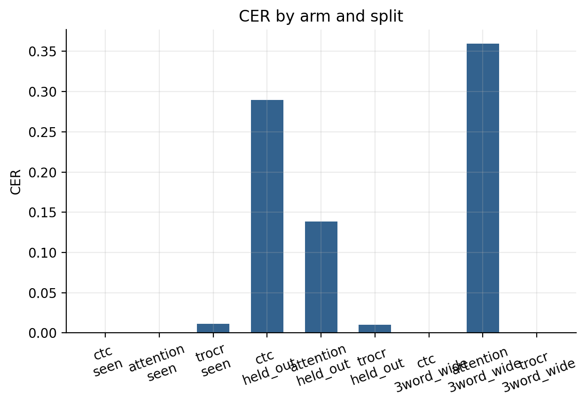
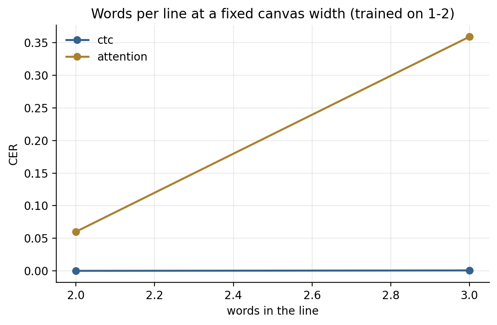
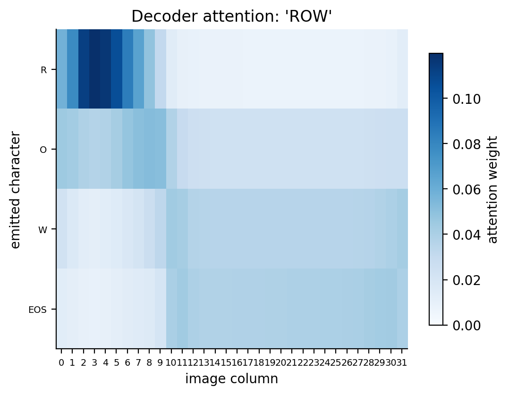

### What surprised me

Three things.

*CER and WER disagree about which decoder is better, on the same run.* CTC wins
on CER (0.176 vs 0.196); attention wins decisively on WER (0.260 vs 0.409) and
exact match (0.701 vs 0.613). The CER→WER ratio is 2.5 for CTC and 1.3 for
attention: the autoregressive decoder's implicit language model **concentrates**
errors into fewer words, while CTC scatters independent character errors across
many. Report CER and you ship CTC; report exact match and you ship attention.
Nothing about the models differs between those two sentences.

*The control did most of the work.* The attention decoder's length gap is +0.220
— but **+0.139 of it is the wider canvas alone**, before a third word is
involved. Only +0.081 is the unseen length. Had I run this without the control I
would have written "attention fails to generalize to unseen length, +0.22 CER"
and been 63% wrong about the cause. CTC meanwhile is *exactly* invariant to
both: length gap +0.0003, width gap −0.0002. Its length bias at three words is
−5.44 characters, i.e. it truncates, and it never gets a three-word line fully
right.

*TrOCR's font gap is negative.* −0.001: it reads the held-out faces marginally
*better* than the trained-on ones. Combined with H3's per-font breakdown, this
settles the question — Computer Modern is not intrinsically hard, it was
unfamiliar to a model trained on six faces. A model trained on real printed text
has never heard of the problem.

### Open threads

Beam search or a language model on the attention arm, which is
where its implicit LM could be made explicit. Scheduled sampling for the
exposure bias behind the truncation. And the obvious missing arm: fine-tuning
TrOCR on this data rather than only reading it zero-shot.

### Further reading

[TrOCR](https://arxiv.org/abs/2109.10282);
[Attention Is All You Need](https://arxiv.org/abs/1706.03762);
[Baek et al.](https://arxiv.org/abs/1904.01906) on comparing recognizers honestly.

---

## H5 — The pipeline, and where its error actually lives

**Question.** Detect then recognize is how every classical OCR system works, and
it introduces a failure neither stage can exhibit alone: the second consumes the
first's mistakes. Whose fault is the error?

### The math

**A single end-to-end number cannot answer that**, so the same recognizer is
measured three ways: on ground-truth crops (detection assumed perfect), on
detected crops (the pipeline as deployed), and on ground-truth crops with each
box edge jittered by a known amount (detection error simulated, detector removed
from the loop). The third turns the gap between the first two from an
observation into an explanation.

**The jitter is per edge, not a shift.** A uniform translation moves the crop but
keeps the text framed inside it; independent edges change the *framing* —
clipping a first letter, admitting a neighbour's descender — which is the
failure a real detector produces.

**The end-to-end metric is page-level CER** over lines joined in reading order:

$$\mathrm{CER}_{\text{page}} = \frac{\sum_p d\!\left(\bigoplus_{i \in \sigma(p)} \hat{y}_i,\; \bigoplus_{i \in \sigma^\star(p)} y_i\right)}{\sum_p \left| \bigoplus_{i \in \sigma^\star(p)} y_i \right|},$$

with $\oplus$ concatenation and $\sigma$ the reading order induced by the
predicted boxes. Writing it this way makes the choice explicit: because the
prediction is a concatenation over *detected* lines and the reference over
*true* ones, a missed line becomes a run of deletions, a spurious one a run of
insertions, and a wrong $\sigma$ costs the edit distance between two orderings.
A per-line average would score only the lines that were found — exactly the
population a broken detector biases.

### What I built

H1's detector — its grid arithmetic generalized from square
scenes to 160×256 pages, so H5 inherits H1's round-trip test rather than growing
a private copy — feeding H3's CRNN, trained on ground-truth crops. Training the
recognizer on clean crops and testing it on detected ones is the point: that
distribution shift *is* the detector's error. Plus a second recognizer trained
with ±4px jittered copies, because a diagnosis implies a remedy and the remedy
should be measured.

### Results

*Setup: 2500 train / 500 test pages, medians over seeds 0–2.*

detector: recall 0.854 [0.611, 0.929] · mAP@0.5 0.730 [0.359, 0.807] · matched
IoU 0.671 [0.523, 0.731] · 1.18 spurious boxes per page

| | clean recognizer | + crop augmentation |
| --- | --- | --- |
| arm 1 — ground-truth crops | 0.0001 | 0.0000 |
| arm 2 — full pipeline | **0.5121** | **0.3670** |
| matched lines only | 0.3640 | 0.1868 |
| tolerance (5% CER) | ±0.33 px | **±7.78 px** |

| **detection's share of page error** | **0.9998** [0.9996, 1.0000] |
| --- | --- |

Jitter curves (line CER at 0/2/4/8/16 px) — clean: 0.0001, 0.305, 0.505, 0.709,
0.863. Augmented: 0.0000, 0.0001, 0.0003, 0.053, 0.427.

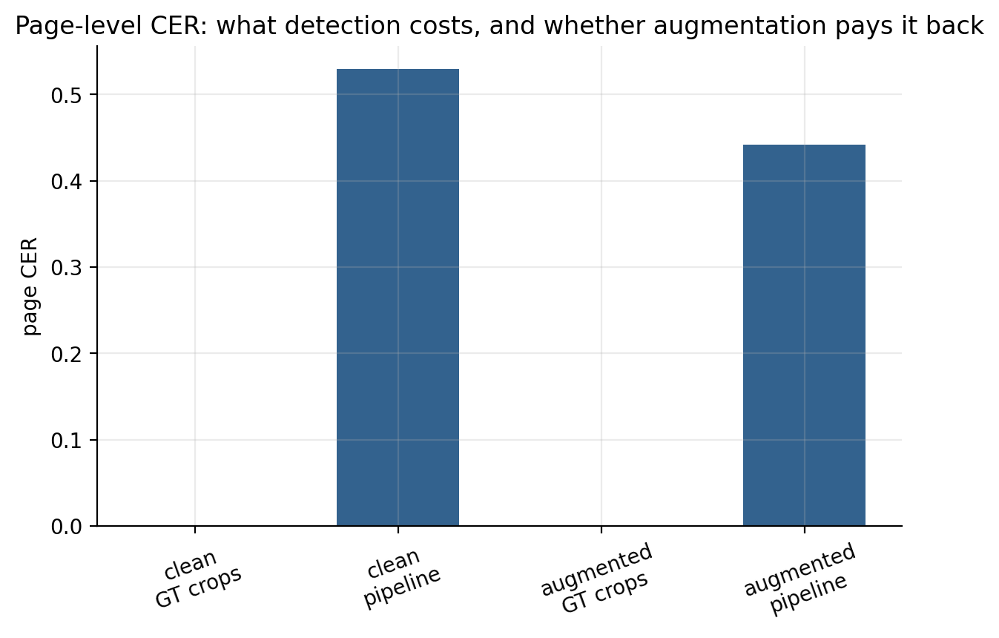
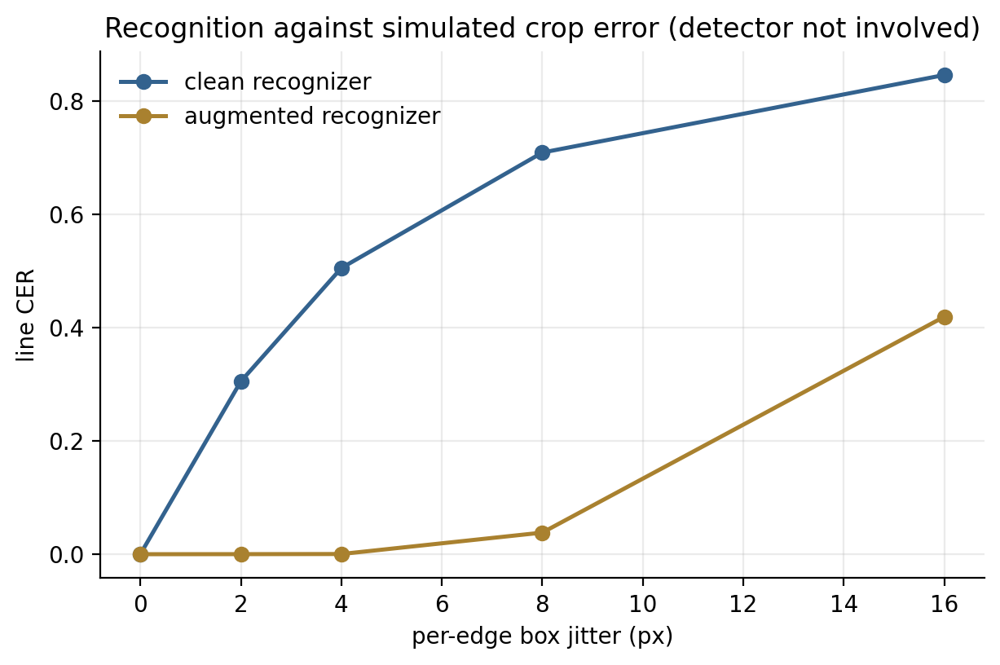
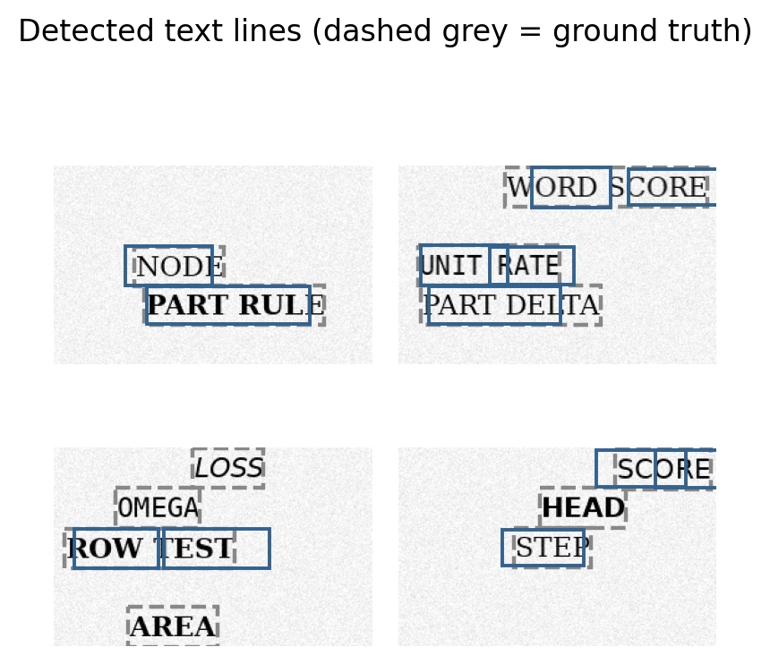

### What surprised me

**Detection is 99.98% of the error on every seed.** The
recognizer on ground-truth crops is essentially perfect (0.0001 page CER) and
the entire 0.512 appears the moment it is handed real boxes. A pipeline's
quality is its weakest interface, not its weakest model.

Arm 3 says why, and the number is brutal: interpolated, the clean recognizer
crosses 5% CER at **0.33 pixels** of per-edge crop error. It was trained only on
exact crops, has never seen a misframed line, and is brittle to a degree that
makes the detector's 0.671 matched IoU fatal rather than merely mediocre.

**The remedy worked, and mostly did not help.** Training on jittered crops made
the recognizer **24× more tolerant** (±0.33 → ±7.78 px) at *negative* cost on
clean crops, and halved error on lines the detector found (0.364 → 0.187). And
the pipeline still sits at 0.367. Augmentation fixes framing; it cannot read a
line that was never cropped. With recall at 0.854, the deletions from missed
lines dominate everything crop quality controls. I had framed brittleness as
*the* explanation for the pipeline gap — it is real, dramatic, and worth about a
sixth of the total.

**A single-seed number I reported and had to withdraw.** The first H5 run gave
recall 0.611 and mAP 0.359, and I described the detector's weakness using those.
Across three seeds they are [0.611, 0.929] and [0.359, 0.807]: I had quoted the
*worst* seed as typical. The attribution conclusion is unaffected — 99.98% on
all three — but the magnitude of the detector's failure is a range, not a point.

### Open threads

Anchors with aspect priors: text lines are 54–189px wide and
32px tall, extreme ratios sharing one log-size regression, on a 20×32 grid that
is 99.6% negative cells. Recall is the term that matters, so a lower score
threshold and a recall-oriented detector would move the pipeline more than any
recognizer change. And joint training through the crop, which is the last thing
you can do before giving up on stages entirely.

### Further reading

[EAST](https://arxiv.org/abs/1704.03155);
[CRAFT](https://arxiv.org/abs/1904.01941);
[PP-OCR](https://arxiv.org/abs/2009.09941) on what a practical pipeline contains.

---

## H6 — Deleting the interface

**Question.** H5 measured that the stage boundary holds 99.98% of the error. A
vision-language OCR model removes the boundary rather than improving either
stage. What does that cost?

### The math

**There is no box, so there is no box error.** A page becomes visual tokens and
the transcript is decoded autoregressively from them; detection, NMS, cropping
and reading order all cease to exist as separately-failing components. The
architectural question is what replaces them.

**Token count is the cost driver**, because attention is quadratic:

$$\mathrm{FLOPs}_{\text{attn}} \approx 4 L H T^2 d_h, \qquad T = \frac{HW}{P^2 m^2}$$

for patch size $P$ and a spatial merge factor $m$. PaddleOCR-VL's 2×2 merge
concatenates neighbouring patches before the projector, dividing $T$ by four and
therefore attention by **sixteen** — the cheapest available lever on a quadratic.

**The KV cache** is $2 L H_{kv} d_h$ bytes per token per dtype byte, which is
where grouped-query attention pays: 16 query heads against 2 key/value heads
makes the cache 8× smaller at unchanged query capacity.

**Mixture-of-experts decouples parameters held from parameters run.** With $E$
routed experts of width $d_{\text{moe}}$ and top-$k$ routing plus $s$ shared
experts, a layer holds $(E + s)$ experts' worth and runs $(k + s)$.

### What I built

An accounting rung, not a benchmark. PaddleOCR-VL's
architecture is **parsed out of candle's `config.rs` at run time** rather than
quoted, so a fork that moves is detected instead of silently misdescribed; the
17 parsed defaults independently match the published `config.json`. The
parameter formulas are validated against a model the rung can actually load and
count — TrOCR, predicted 60.8M against measured 61.6M, **1.3% off** — so the
budgets below are a checked calculation rather than an assertion.

**Results:**

| component | parameters |
| --- | --- |
| PaddleOCR-VL vision (NaViT, 27 layers, 1152 wide) | 411.4M |
| PaddleOCR-VL projector (2×2 merge + MLP) | 26.0M |
| PaddleOCR-VL text (ERNIE-4.5, 18 layers, GQA 16:2) | 466.7M |
| **PaddleOCR-VL total** | **904.0M** (45.5% vision) |
| Unlimited-OCR SAM-ViT-B tower | 85.0M |
| Unlimited-OCR CLIP-L tower | 302.3M |
| Unlimited-OCR text (MoE, 64+2 experts, top-6) | **2.93B held / 740M active** |

| page | patches | tokens after 2×2 merge | attention |
| --- | --- | --- | --- |
| 384px | 784 | 196 | 4.8 GFLOP |
| 1024px | 5,476 | 1,369 | 233.2 GFLOP |
| A4 at 300dpi | 44,678 | 11,214 | — |

KV cache 18.0 KiB/token, 8× less than multi-head would need.

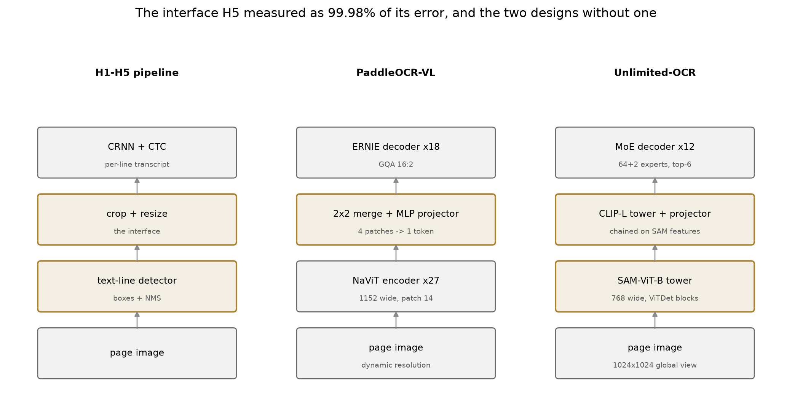
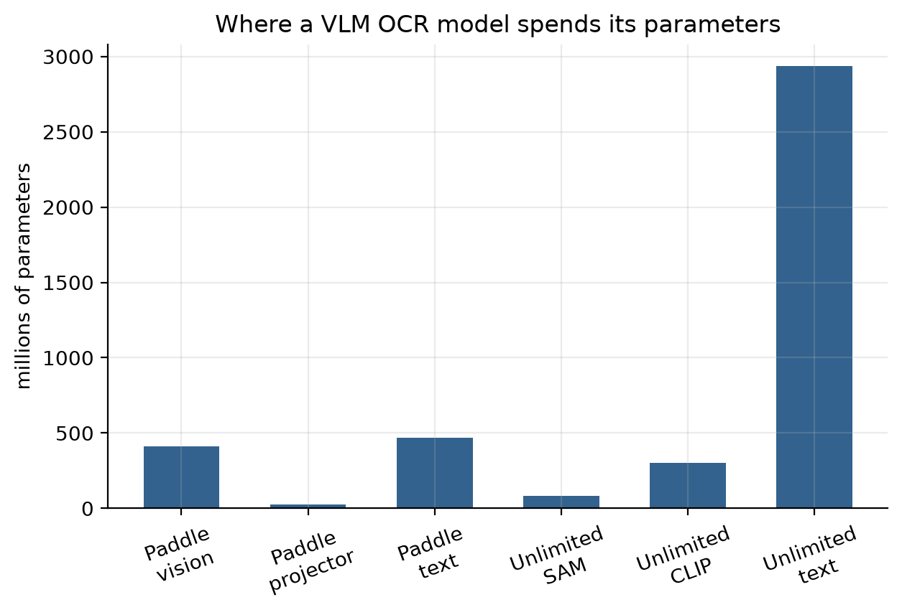
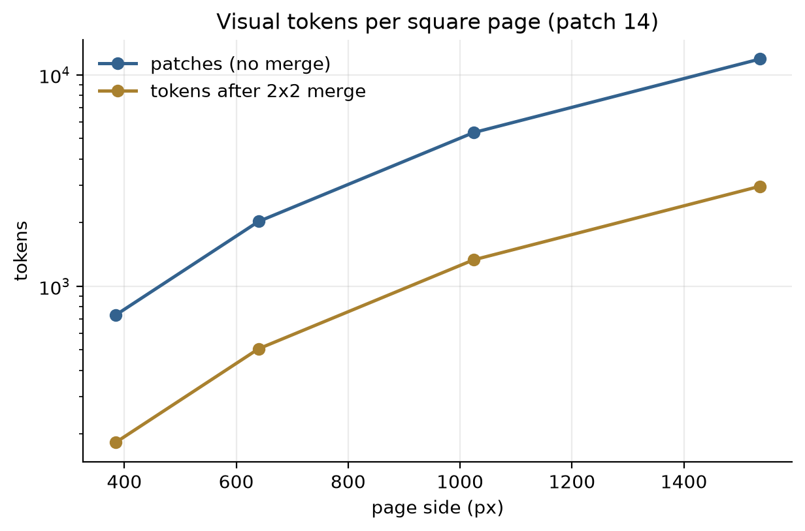
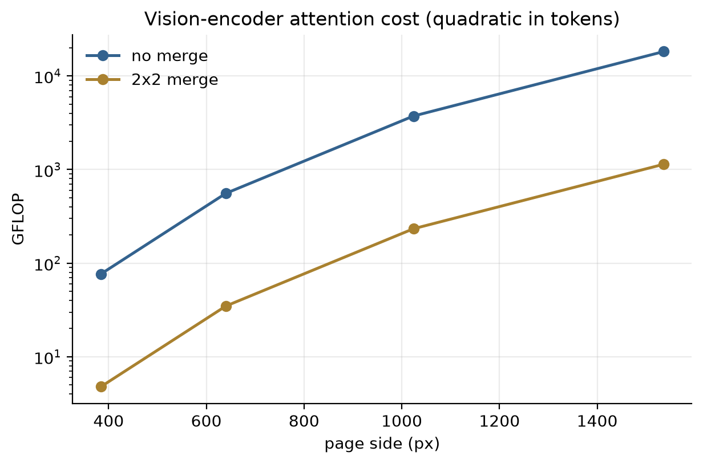

### What surprised me

The vision tower is **45.5%** of PaddleOCR-VL — nearly as
large as the language model it feeds. I had assumed the encoder would be a thin
front-end on a big decoder, the way TrOCR's DeiT-small is. For document
understanding the reading *is* the hard part, and the parameter split says so.

The exchange rate against H5 is **1,853×** — 904M parameters against 488k — for
a model that also handles 109 languages, tables and formulas, so the comparison
is not clean. But the structural point survives it: every component H5 measured
as its error source is absent from that 904M, not improved within it.

And an error I made worth recording. I first counted Unlimited-OCR's text tower
as a dense stack, which understated it by 4× and erased the distinction MoE
exists to create. I had also *guessed* its `intermediate_size` at 6848 because
candle's config carries no defaults for it — the guess happened to be right,
which is worse than being wrong, because it would have shipped ungrounded and
looked correct. Both are now read from the published config with provenance
recorded beside them.

### Open threads

Actually running PaddleOCR-VL on H5's pages, which would turn
this accounting into the head-to-head the rung deliberately does not attempt.
Measuring the vision tower's activation memory, which at 11,214 tokens for an A4
scan is likely the real deployment constraint rather than parameters. And
DeepSeek-OCR's compression claims, which is the lineage Unlimited-OCR comes from.

### Further reading

[PaddleOCR-VL](https://arxiv.org/abs/2510.14528);
[NaViT](https://arxiv.org/abs/2307.06304);
[Donut](https://arxiv.org/abs/2111.15664);
[GQA](https://arxiv.org/abs/2305.13245).

---

## The models, actually run

Everything above H6 is a model I trained; H6 itself is arithmetic over two
published configs. Both of those are ways of being wrong that the rung cannot
detect on its own — so the models H6 prices were downloaded and run on H5's own
test pages, against H5's own ground truth, scored with H3's own CER.

The pages are written by `tools/real_models/write_pages.py`, which replays the
same rng stream `h5_document_pipeline` uses: 2500 train pages drawn first, so
page *k* here is page *k* of H5's test split. Each page is saved twice — at its
native 256x160 and upscaled 4x with Lanczos. **Upscaling adds no information**,
so the ground truth is untouched; it exists only to remove the excuse that the
page is smaller than the model's patch grid, and it turns out to be the variable
that matters.

### Results

*Setup: 10 pages, 26 lines; raw values in [`data/h-real-models.json`](data/h-real-models.json).*

| model | params | page | CER | WER | s/page |
| --- | --- | --- | --- | --- | --- |
| H5's pipeline (clean arm) | 0.49M | native | 0.512 | — | — |
| H5's pipeline (augmented arm) | 0.49M | native | 0.367 | — | — |
| H5's recognizer on gold crops | 0.42M | crops | 0.0001 | — | — |
| PaddleOCR-VL (T4, fp16) | 0.96B | 4x | **0.000** | **0.000** | 3.33 |
| PaddleOCR-VL (T4, fp16) | 0.96B | native | 0.039 | 0.032 | 0.83 |
| PaddleOCR-VL (CPU, fp32) | 0.96B | 4x | **0.000** | **0.000** | 96.2 |
| Unlimited-OCR (T4, bf16) | 3.34B | 4x | **0.000** | **0.000** | 7.18 |
| Unlimited-OCR (T4, bf16) | 3.34B | native | 0.317 | 0.320 | 3.10 |

Both models transcribe every line of every page **exactly** at 4x. H5's pipeline,
trained on this exact distribution, reads the same pages at 0.512 CER — and the
gap is not a recognition gap, because H5's own recognizer reads gold crops at
0.0001. It is the interface, which is what H5 concluded when it attributed
99.98% of the pipeline's error to detection, and what H6 argued was worth
deleting. Here is that argument as a measurement rather than an argument:
deleting the interface costs **2,000x the parameters** — 0.96B against 0.49M —
and takes the page CER from 0.512 to 0.000.

### What surprised me

*Resolution is the whole story for the smaller model, and a cliff for the larger
one.* PaddleOCR-VL degrades gracefully — 0.000 to 0.039 CER as the page shrinks
4x. Unlimited-OCR, three and a half times the size, goes from 0.000 to 0.317,
and the failure mode is not misreading: on several native-resolution pages it
returns **an empty transcript** rather than a wrong one. Its refusal is better
calibrated than its reading, which is a design choice I would not have predicted
from either config, and a reminder that "bigger model" and "more robust" are
different claims.

*Unlimited-OCR does detection and recognition in one token stream.* It emits
`<|det|>text [687, 48, 984, 163]<|/det|>SCORE` — a grounded box immediately
before the line's text. H5's interface is not *gone* in this model; it has been
moved inside the sequence, where the two stages share gradients instead of
passing crops. That is a sharper statement of H6's point than H6 makes.

*Cheap hardware is the difference between the two OCR models, not quality.*
PaddleOCR-VL reads these pages perfectly on four CPU cores — 96 s/page, but
perfectly, and it is 29x faster on a T4 (3.33 s/page). Unlimited-OCR needs the
GPU. On this evidence the 0.96B model is strictly the better deployment for this
document class.

**A correction to H6, which is why this was worth doing.** H6's `page_tokens`
floored the patch grid. A NaViT-style encoder *pads* a page to whole patches
rather than cropping the remainder, so the count is a ceiling:

$$\text{tokens} = \left\lceil \frac{H}{p \cdot m} \right\rceil \cdot \left\lceil \frac{W}{p \cdot m} \right\rceil.$$

For the 1024x640 page that is 23 x 37 = **851**, which is exactly what
PaddleOCR-VL's processor emitted. The shipped formula said 821. The old answer is
now pinned in a test so it cannot come back.

The second half of the check failed and stayed failed, which is the more useful
half. At native size the geometry says 60 tokens; the processor emitted **198**,
3.3x more, because it will not shrink a page below a floor. That is a
preprocessing policy, not something derivable from the model config, so it is
recorded as a measured constant (`MEASURED_TOKEN_FLOOR`) rather than folded into
the formula as though it had been derived. **A small page does not cost little.**

**The decoders** got the same treatment, and it belongs with C5 rather than
here: DeepSeek-V2-Lite, Gemma-4 and both Qwen 27Bs are in
[part C's writeup](c-sequence-attention.md#the-decoders-actually-run) with
[`data/c-real-models.json`](data/c-real-models.json).

**What did not run, and why.** `Qwen3.8-Flash-Next` is 360GB of weights and is
out of reach here at any quantization. Everything else asked for did run, and is
reported with part C.

### The same model through candle, and what two implementations agreeing buys

Everything above ran under transformers. The accompanying candle fork
implements PaddleOCR-VL directly, so the same weights were run through it on the
same T4, on the same pages, scored by the same function:

| runtime | 4x CER | native CER | native WER | s/page (4x) |
| --- | --- | --- | --- | --- |
| transformers, fp16 | 0.0000 | 0.0392156862745098 | 0.03225806451612903 | 3.33 |
| candle fork, f16 | 0.0000 | 0.0392156862745098 | 0.03225806451612903 | 4.68 |

**Identical to sixteen digits**, and they fail on the same page for the same
reason: page 5's two lines are both `SIGMA`, and both runtimes emit one. So the
native-resolution error is not a misreading at all — it is a **repeated-line
collapse**, which I would not have diagnosed from one implementation, because
one implementation's quirk and a model's behaviour look the same from inside it.

candle also prints its own geometry: `1024x640 -> 1036x644 (46 x 74 patches)`.
That is 3,404 patches and **851 tokens** after the 2x2 merge — the corrected
ceiling above, confirmed by an implementation that has never seen my arithmetic.

**Building it.** `CUDA_COMPUTE_CAP=75 cargo build --release --features cuda
--example paddleocr-vl`: **18m 44s**, and **37 seconds** to add the `gemma4` and
`deepseekv2` examples afterwards. The cost is the first build, not the model —
I had guessed "30+ minutes" for the build and used that guess as a reason to
reach for transformers instead, which was wrong twice over: wrong about the
number, and wrong to let an unmeasured estimate decide the approach.

Two things had to be fixed to get there, both environmental rather than
architectural:

- `candle-kernels/src/compatibility.cuh` defines `__hmax_nan`/`__hmin_nan` under
  `#if __CUDA_ARCH__ < 800`, but **CUDA 12.8 already defines them for arch >=
  530**, so `nvcc` fails on `src/affine.cu` with a redefinition. Adding
  `&& CUDART_VERSION < 12000` to the guard fixes it.
- `--bf16` on an sm_75 card dies with `DriverError(CUDA_ERROR_NOT_FOUND, "named
  symbol not found")`, because candle's bf16 kernels need sm_80. Dropping the
  flag works — and the error names a missing symbol rather than the missing
  capability, which cost me a diagnosis.

**And one that is architectural.** `ignite-perf`'s `qwen3_5`, `gemma4` and
`unlimited_ocr` call `candle_nn::fused::static_decode`, which is behind
`#[cfg(feature = "cuda")]`, from call sites that are not — so a build *without*
`--features cuda` fails with 51 errors in `candle-transformers`. A CPU-only
build of those models is impossible on this branch; gating the call sites the
same way would fix it.

### Unlimited-OCR, and two bugs that only exist above a batch of one

The fork implements Unlimited-OCR but ships no example for it. The catalog's
`candle-ocr` executor does drive it, so this repo now carries that path with the
ignite SDK taken out — hub loading instead of the asset loader, the same
1024-square mean-gray pad, the same grid search, the same sliding-window n-gram
suppression, plain KV-cache decode instead of static R-SWA.

Getting it to run found two bugs, and they share a shape:

- `segment_anything/image_encoder.rs` adds its learned positional grid with
  `+`, which in candle requires equal shapes. The grid is `[1, h, w, c]` and a
  batch of crops is `[n, h, w, c]`, so the tiled path dies with
  `shape mismatch in add, lhs: [8, 40, 40, 768], rhs: [1, 40, 40, 768]`.
- With that fixed, `forward_crops` cats a transposed tensor and hands the
  result to a batched matmul, which rejects the strides.

**Neither exists at a batch of one**, which is exactly the path the executor
runs — its comment says so: *"V1 scope: single 1024x1024 global view."* Code that
is only ever called one way is only ever tested one way, and the untested way
was two lines from working.

### Results

*Setup: 10 pages, f16, T4.*

| preprocessing | image tokens | CER | WER | empty | s/page |
| --- | --- | --- | --- | --- | --- |
| global view only | 273 | **0.229** | 0.241 | 1/10 | 0.75 |
| tiled, 5x3 grid | 1,803 | 1.113 | 1.095 | 4/10 | 0.89 |
| transformers `infer()`, crop_mode | — | **0.000** | 0.000 | 0/10 | 7.18 |

Eight of ten pages are read exactly through the global view. The tiled path,
once unblocked, is **worse at 6.6x the image tokens** — so whatever bounds the
reference puts on its grid, this port does not have them, and a 1024x640 page
should not be asking for a 5x3 grid. That is a preprocessing gap, not a runtime
one, and PaddleOCR-VL is the control that proves the distinction: the same two
runtimes agree to sixteen digits when the preprocessing matches.

The decoder attempts through the fork are with
[part C](c-sequence-attention.md#the-decoders-actually-run).

**Reproduce:** `tools/real_models/` — the scripts, and a README explaining the
transformers version pin each checkpoint needs and why.

---

## What part H settled

1. **A pipeline's quality is its weakest interface, not its weakest model.** H5's
   recognizer is perfect on clean crops and the pipeline is at 0.512 page CER,
   with 99.98% of that attributable to detection on every seed. Improving the
   recognizer 24× in robustness — which crop augmentation genuinely did, for free
   — recovered a sixth of it. The rest is lines that were never found.
2. **Detection has no metric until you choose one, and the choice is worth more
   than most modelling decisions.** The same predictions score 0.955 or 0.650
   depending only on what overlap counts as correct, and the NMS dial that moves
   mAP@0.5 by 0.109 moves mAP@0.75 by 0.032. Reporting a single mAP without its
   threshold conveys almost nothing.
3. **Which decoder is "better" depends on which metric you report.** On identical
   held-out data CTC wins CER and the attention decoder wins WER and exact match,
   because an autoregressive decoder's implicit language model concentrates
   errors into fewer words while CTC scatters them. Both statements are true of
   the same run.
4. **Averaging hides mechanisms; score where the mechanism acts.** Skip
   connections looked worth +0.013 until the same predictions were scored on a
   2px boundary band, where they are worth +0.030. The effect was never absent —
   whole-image mIoU was averaging the place skips work together with the place
   they don't.
5. **Controls and breakdowns changed three conclusions that a headline number
   got wrong.** H4's canvas-width control showed 63% of an apparent
   length-generalization failure was resolution. H3's per-font breakdown showed
   the entire "held-out font gap" was one typeface, with the other two held-out
   faces read at 0.4% CER because they were family members of training faces.
   H1's localization investigation ruled out three plausible explanations and
   left me with an honest "I don't know" for the per-class ordering. In each
   case the aggregate was not wrong, it was uninformative in a way that looked
   informative.
6. **The single-seed habit keeps costing me.** H2's "Dice beats cross-entropy"
   and H5's "recall 0.611" were both reported before the sweep and both failed
   it — the first was noise over a 0.012 spread, the second was the worst of
   three seeds quoted as typical. Together with part B's `usable_lrs`, part D's
   `augmentation_gain` and H5's own degenerate tolerance metric, that is six
   occasions in this repo where a number that looked like a result was an
   artifact of how it was computed or how few times it was run. The arm-level
   measurements were right every time; only the summaries lied.
7. **The field's answer to H5 was to delete the interface, not fix it, and
   running the real models settles whether that works.** H6 prices the deletion
   at 904M parameters and 196 tokens per 384px page. PaddleOCR-VL (0.96B) and
   Unlimited-OCR (3.34B) then read H5's own test pages at **CER 0.000** where
   H5's pipeline reads them at 0.512 — 2,000x the parameters to remove the
   interface, and the error goes with it. Whether that trade is worth making is
   a deployment question; that it works is now measured rather than argued.
8. **Arithmetic over a config is a hypothesis, and this one was wrong.** H6's
   token count floored the patch grid where a NaViT encoder pads it; the
   corrected ceiling gives 851 tokens for a 1024x640 page, exactly what the
   processor emits. The second prediction stayed wrong and is more useful for
   it: a 256x160 page is 60 tokens of geometry and 198 in fact, because the
   processor will not shrink a page below a floor. Being able to run the model
   is what separated the bug from the policy, and neither was visible from the
   config alone.

**Cost of the part:** ~3,600 lines including tests, 78 test cases, and a
three-seed sweep in about 24 minutes on a T4 (H1 14s, H2 42s, H3 116s, H4 114s,
H5 194s, H6 1s per seed). H5 dominates because it trains a detector and two
recognizers; H6 is arithmetic.

---

*Figures regenerate with `uv run python tools/writeup_figures.py H`; the numbers
they are quoted against live in [`data/h-metrics.json`](data/h-metrics.json).
The [part README](../../parts/h_computer_vision/README.md) is the short version
of this document.*
