# Part I — Speech — recognition & synthesis

> **Status:** complete (I1–I4) · **Constraint:** 8 kHz spoken digits from six speakers; four cores and no GPU, so widths and budgets are small and stated per rung
> **Numbers:** seeds 0–2, reference seed 0 · raw values in [`data/i-metrics.json`](data/i-metrics.json); the candle-fork run in [`data/i-real-models.json`](data/i-real-models.json)
> **Reproduce:** `ladder run I1` … `I4` (needs `uv sync --extra torch --extra speech`), or `uv run python tools/writeup_figures.py I`
> **Hardware:** all four rungs on 4 CPU cores; the Whisper-through-candle comparison on a Kaggle Tesla T4

*the third modality; reuses C's sequence models and H's CTC on a signal that is continuous in time*

Parts B through H worked on grids and sequences of symbols. Speech is neither: it
is a pressure wave, and every decision about how to turn it into something a
network can read happens *before* the network exists. That makes the front end
the subject rather than the plumbing, which is why I1 comes first and the other
three rungs all use its output unchanged.

The four rungs are four different ways of asking **what a metric on speech is
actually measuring**, because in this part more than any other the obvious
number keeps being about something else:

- **I1** — two implementations of the same front end differ by $10^{-6}$ on
  three stages and by $3.5\times10^{-2}$ on the fourth, and the cause is a
  convention nobody writes down.
- **I2** — the recogniser's error rate depends more on a normalisation choice I
  argued for in prose and got backwards than on anything architectural, and the
  *split* is worth 5× on its own.
- **I3** — synthesis has no objective score, so the rung reports three, and they
  disagree about the vocoder by two orders of magnitude.
- **I4** — accuracy and latency are the same quantity seen from two ends, and
  the exchange rate is measurable.

A note on the corpus. The Free Spoken Digit Dataset is 3,000 recordings of the
digits 0–9 by six speakers at 8 kHz. It is small enough to run on a laptop and
too small for any result here to transfer as a number. What transfers is the
*shape*: the leak a shuffled split creates, the direction the normalisation
choice moves, the fact that a vocoder can cost everything on one metric and
nothing on another.

---

## I1 — Audio front end from scratch

**Question.** The STFT/mel/MFCC stack is four decisions copied from the 1980s.
What is each one doing, and would you notice if you got one wrong?

### The math

**Framing is a trade with a fixed exchange rate.** A window of $N$ samples at
rate $f_s$ gives frequency bins $f_s/N$ apart, so two tones closer than about
that cannot be told apart; the same window smears an instantaneous event across
$N$ samples. Sharpening either blurs the other, and the product is bounded
below — the discrete cousin of the Gabor limit, and the reason a "better window"
does not exist.

**The mel scale is a claim about ears, not signals.** Nothing in the physics
distinguishes 500 Hz from 3 kHz; the claim is that human frequency
discrimination is roughly logarithmic above ~700 Hz, encoded as

$$m = 2595\log_{10}\!\left(1 + \frac{f}{700}\right)$$

with triangular filters evenly spaced in $m$. Two conventions are in use —
this one (HTK) and Slaney's, which is linear below 1 kHz — and they put every
filter edge in a different place, so "the mel scale" is not a well-defined
phrase without saying which.

**The log makes the source separable, and the DCT decorrelates.** Speech is
a glottal source filtered by a vocal tract, which is multiplication in the
spectrum and therefore addition after a log — the entire cepstral idea. The DCT
then exists for a specific and now-obsolete reason: adjacent mel filters overlap
by construction, so their outputs are strongly correlated, and a
diagonal-covariance Gaussian model could not cope with that. It is an
orthonormal DCT-II, so truncating to 13 coefficients is a projection whose
residual can be measured rather than an arbitrary crop.

### What I built

Framing, windowing, the power spectrum, the mel warping, the
filterbank, the log and the DCT, in numpy. Not the FFT — that is a
numerical-methods exercise, not a speech one. Each stage is diffed against
torchaudio *separately*, so a disagreement lands on the stage that caused it
instead of on the end of the pipeline.

### Results

Medians over seeds 0–2 (the front end is deterministic; only the
clip sample varies).

| stage | relative error vs torchaudio |
| --- | --- |
| filterbank | $2.5\times10^{-6}$ |
| power spectrogram | $1.8\times10^{-7}$ |
| mel spectrogram | $1.1\times10^{-6}$ |
| **MFCC** | $1.3\times10^{-6}$ |
| MFCC *with a clamped log instead of an offset* | **$3.5\times10^{-2}$** |

The time–frequency trade, measured rather than asserted:

| window | resolves | click smeared over | product |
| --- | --- | --- | --- |
| 4 ms | 640 Hz | 3 ms | 1920 |
| 8 ms | 320 Hz | 6 ms | 1920 |
| 16 ms | 160 Hz | 12 ms | 1920 |
| 32 ms | 80 Hz | 24 ms | 1920 |
| 64 ms | 40 Hz | 48 ms | 1920 |
| 128 ms | 20 Hz | 96 ms | 1920 |

Constant to **1.00×** across a 32× change in window length.

The mel warping puts **28 of 40** filters below 2 kHz — the lower half of the
band — with centre spacing growing from 37.5 Hz to 187.5 Hz, a factor of **5.0**.
The DCT drops mean off-diagonal correlation from **0.695 to 0.177**, a factor of
**4.0**, and keeping 13 of 40 coefficients loses **10.9%** of the log-mel energy.

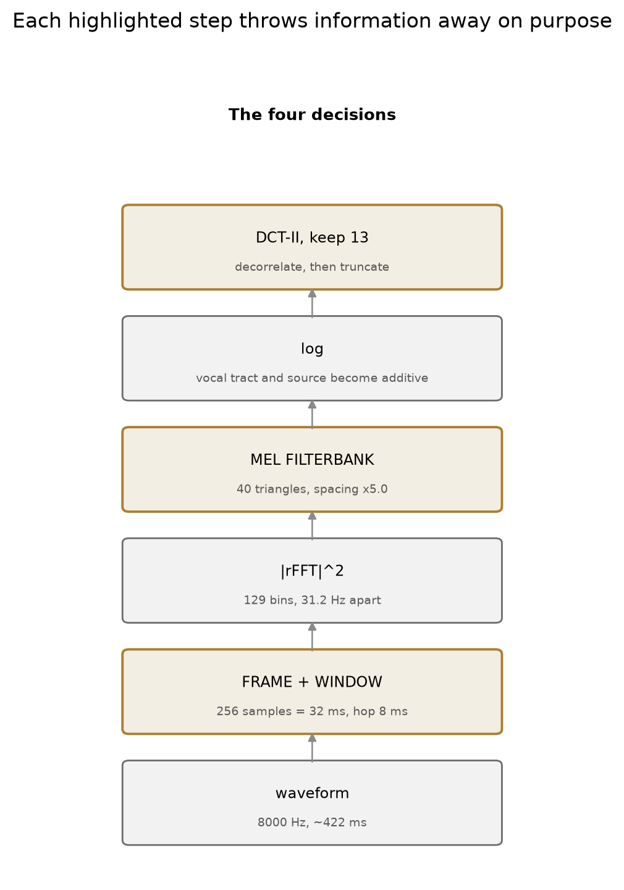
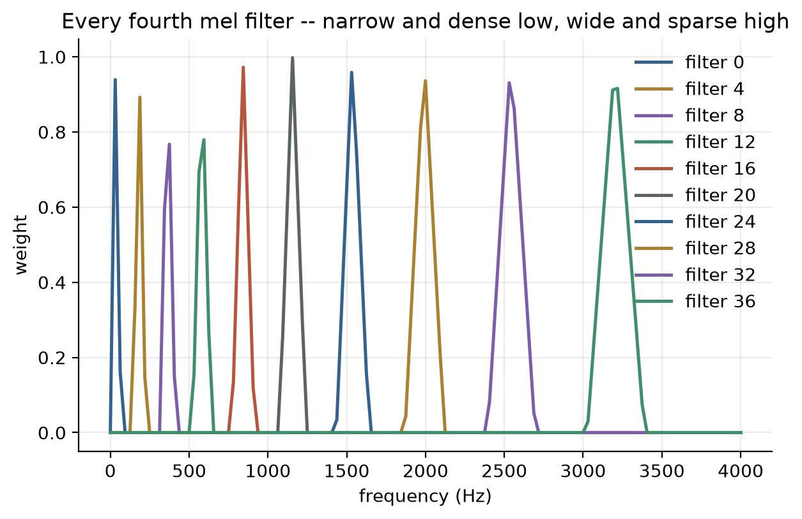
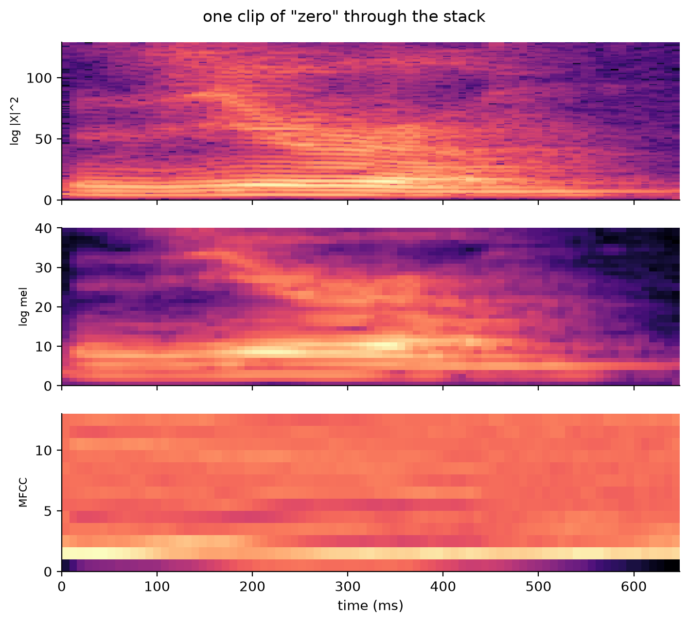
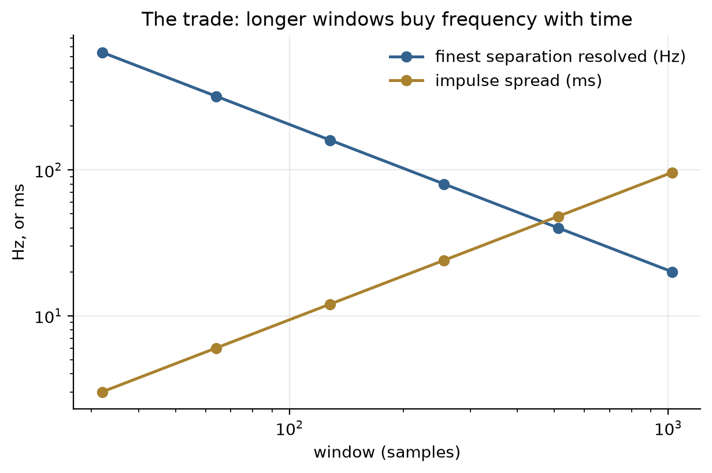
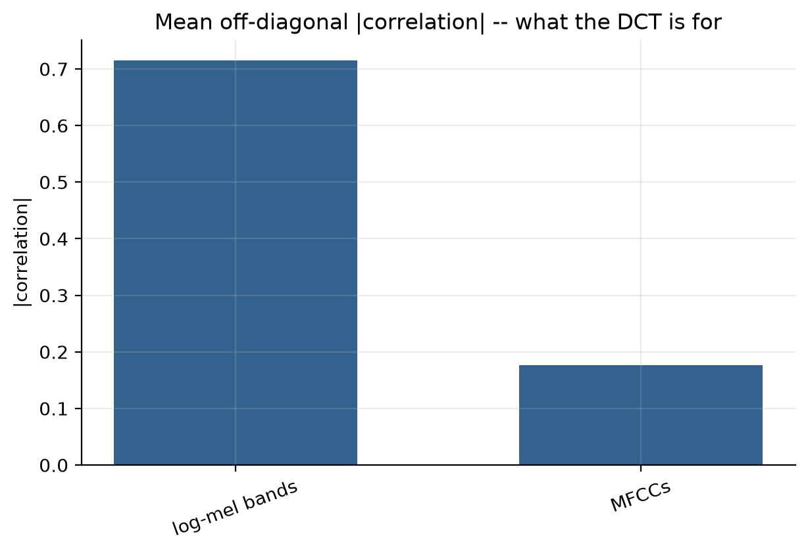

### What surprised me

**The MFCCs disagreed by four orders of magnitude more
than every other stage, and the cause is a line nobody documents.** $\log 0$ is
undefined, so every implementation picks a guard, and there are two:
torchaudio's is an **offset**, $\log(x + 10^{-6})$; the obvious reading is a
**clamp**, $\log(\max(x, 10^{-10}))$. They are not interchangeable. The quietest
mel energy in this corpus is $9.5\times10^{-9}$ — *below* torchaudio's offset —
so the offset is not guarding anything, it is shifting every quiet frame, and
choosing wrong costs **27,490×** the agreement. Three stages matching to
$10^{-6}$ is what made the fourth legible; a single end-to-end diff would have
shown one number and no way to locate it.

**The product came out exactly 1920 Hz·ms at every window length**, not
approximately. I expected a trend with noise and got an identity, because the
two quantities I measured are both counted in units of the same window. That is
a good outcome for a claim that is usually stated as a vague trade-off.

### Open threads

The Slaney mel convention is not implemented, so "which mel"
is documented rather than measured. And the filterbank here is fixed; learned
filterbanks (SincNet, LEAF) are the obvious comparison and would test whether
1980s perceptual modelling still earns its place.

### Further reading

Davis & Mermelstein (1980) for MFCCs; Gabor (1946) for the limit
the window sweep traces out.

---

## I2 — CTC speech recognition, and Whisper on the same audio

**Question.** H3's CTC recogniser worked on image columns. Does it transfer to
audio frames unchanged — and what does a pretrained model's error rate tell you
that a small model's does not?

### The math

**CTC does not know what a frame is.** It needs a monotonic alignment between
$T$ inputs and $U \le T$ outputs, and marginalises over every alignment that
collapses to the target:

$$p(y \mid x) = \sum_{\pi \in \mathcal{B}^{-1}(y)} \prod_{t=1}^{T} p(\pi_t \mid x_t).$$

Nothing in that sum cares whether $x_t$ is a column of pixels or 8 ms of audio,
which is why the loss, both decoders and the error metrics came across from H3
with no change beyond an alphabet argument.

**What does not transfer is the split.** The thing a speech model most easily
memorises is a *voice*. Each speaker here records every digit fifty times, so a
shuffled split puts forty-nine examples of one person saying "seven" in training
and asks about the fiftieth — measuring recall of a voice, not recognition of a
word. The rung trains the identical model both ways so the size of that is on
the record.

**Cepstral mean normalisation.** Write a log-mel frame as a sum of a speaker
term, a channel term and the phonetic variation over time. The first two are
approximately constant across an utterance, so subtracting the utterance's own
mean removes them and leaves the third. That is the argument, and it is old;
the rung makes it an arm because I wrote the opposite into the code first.

### What I built

A conv-over-frequency + BiGRU CRNN trained with CTC on 800
clips from four speakers, validated on a fifth and tested on a sixth. Greedy and
beam decoding from H3. Whisper-tiny on the same test clips, resampled 8→16 kHz.
Two normalisation arms, and a shuffled-split control.

### Results

Medians over seeds 0–2.

| arm | val CER | test CER |
| --- | --- | --- |
| global normalisation | 0.843 | 0.660 |
| **per-utterance CMN** | **0.220** | **0.315** |

Unanimous across seeds (`normalization/best_is_utterance` = 1 on all three),
worth **0.291 CER** at the median and 0.179–0.500 across the range.

| split | CER | |
| --- | --- | --- |
| speaker held out | 0.315 | what the rung reports |
| clips shuffled | **0.063** | what a careless split would report |

**5.0×**, range 4.3–6.0, with only the split changed.

Against the pretrained baseline, on the same 40 clips:

| | CER | WER | exact |
| --- | --- | --- | --- |
| whisper-tiny | 0.757 | 0.450 | 0.550 |
| this rung's CTC model | **0.121** | **0.325** | **0.675** |

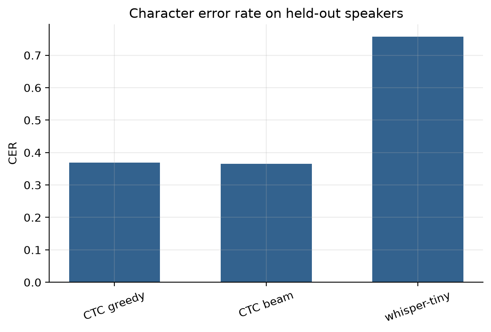
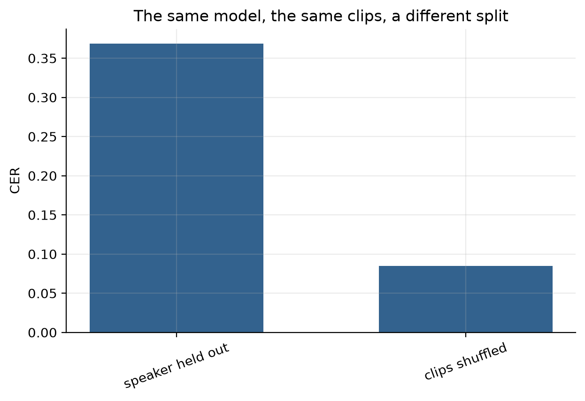
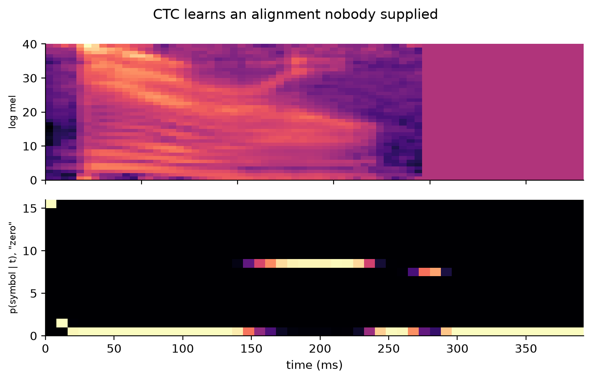
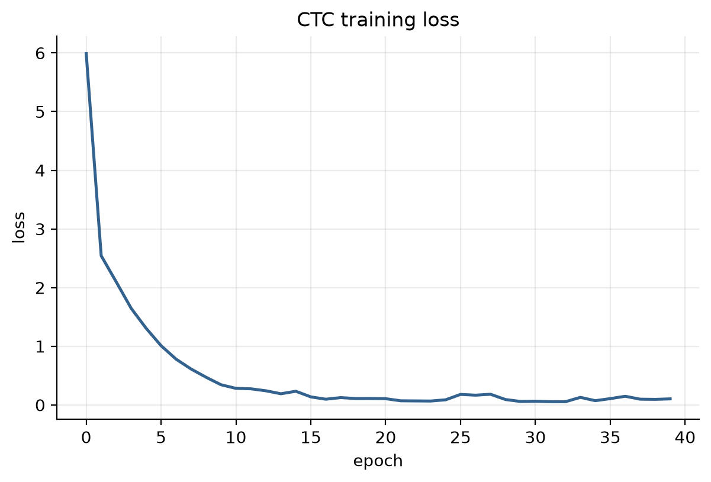

### What surprised me

**I argued myself into the wrong default and the loss
curve caught it.** The rung normalised by corpus statistics, with this in the
docstring: per-utterance normalisation "would quietly remove exactly the speaker
differences this rung is trying to measure generalisation across". That is
backwards — the rung is not trying to *measure* speaker differences, it is
trying to generalise across them, and removing the speaker's average spectrum is
the standard way. The symptom was unmissable once I looked: training loss
**0.002** with validation CER **0.90**. The model fit four voices perfectly and
read a fifth no better than silence. Making it an arm was worth 0.291 CER, more
than any architectural choice in the rung.

**A 39M-parameter pretrained model lost to a 900k-parameter one trained on 800
clips**, and the reason is domain rather than capability. Whisper expects 16 kHz
wideband conversational speech; it is being handed 8 kHz band-limited isolated
digits, upsampled, with no context for its language model to use. Its errors are
*whole-word substitutions* — "three" heard as "Please." — which is why its CER
(0.757) is far worse than its exact match (0.550) suggests. That is part H4's
finding arriving from the other direction: an autoregressive decoder concentrates
error into fewer, larger units and CTC scatters it.

**A null result I built the apparatus for and will report as one.** Expecting
"two"→"too", I wrote a homophone fold. It explains **0%** of Whisper's errors on
this speaker, on every seed. The hypothesis was reasonable and the measurement
says no.

**And a scoring bug of my own that mattered elsewhere.** Whisper sometimes writes
a spoken digit as a numeral — "1.", "3" — and the rung stripped non-alphabetic
characters before scoring, turning correct answers into empty strings. In *this*
rung the fix changed nothing, because multilingual whisper-tiny spells digits as
words. In the candle comparison below, which uses `tiny.en`, the same fix moved
the score from 0.25 to 0.75. Same bug, one place it mattered and one place it
did not, and no way to know which without checking both.

### Open threads

Four training speakers is very few for speaker independence,
and the gap between 0.063 shuffled and 0.315 held-out is mostly that. SpecAugment
and speed perturbation are the cheap next controls.

### Further reading

Graves et al. (2006) for CTC; Radford et al. (2022) for Whisper.

---

## I3 — Text-to-speech, evaluated without listening

**Question.** Synthesis is scored by human listening tests. What can you
honestly conclude from a synthesiser you cannot hear?

### The math

**Griffin-Lim is phase retrieval by alternating projection.** An STFT magnitude
has discarded the phase, and phase is most of what a waveform is. Starting from
random phase, project alternately onto "has the right magnitude" and "is the
STFT of some real signal":

$$x_{k+1} = \operatorname{ISTFT}\!\left(|S| \cdot \frac{\operatorname{STFT}(x_k)}{|\operatorname{STFT}(x_k)|}\right).$$

Both sets are non-convex, so this converges to a fixed point that need not be
the global one. On a *pure tone* — one consistent phase assignment, the easiest
possible case — the tests measure it falling from 0.21 error at 16 iterations to
0.05 at 256 and then stopping. It does not get there.

**The metrics, and what each is blind to.** Mel distance is what the model
optimises, so it says whether training worked and nothing about whether the
output is good — a blurry average of the training set scores well. An ASR round
trip asks the one question with an objective answer, *is the intended word
recoverable*, and is blind to everything ASR is invariant to, which is most of
what makes speech sound human. A duration and speaker-envelope check catches the
failure the first two miss: collapsing every voice into one.

### What I built

An embedding-plus-GRU acoustic model mapping a digit to a
fixed 48-frame mel, Griffin-Lim as the vocoder, and three metrics each with the
controls that make them readable — a constant-spectrogram baseline above and the
spread between two real recordings below, plus a clean→vocoded→synthesised chain
run on one voice.

### Results

Medians over seeds 0–2.

| mel distance | |
| --- | --- |
| acoustic model | **0.636** |
| a constant spectrogram (must beat) | 1.504 |
| two real recordings of the same digit (noise floor) | 1.673 |
| vocoder on real audio | 2.761 |
| whole pipeline | 3.955 |

The ASR round trip, one voice through three stages:

| | CER | step cost |
| --- | --- | --- |
| clean audio | **0.000** | — |
| through the vocoder | 0.050 | **+0.025** |
| synthesised | 0.500 | **+0.400** |
| *(judge on a held-out human voice)* | 0.236 | — |

Duration error **26 ms** against a 331 ms reference (8.0%). Speaker match:
**0 of 3 seeds** — the synthesised voice is consistently closest to a speaker
the model never trained on, margin −0.90.

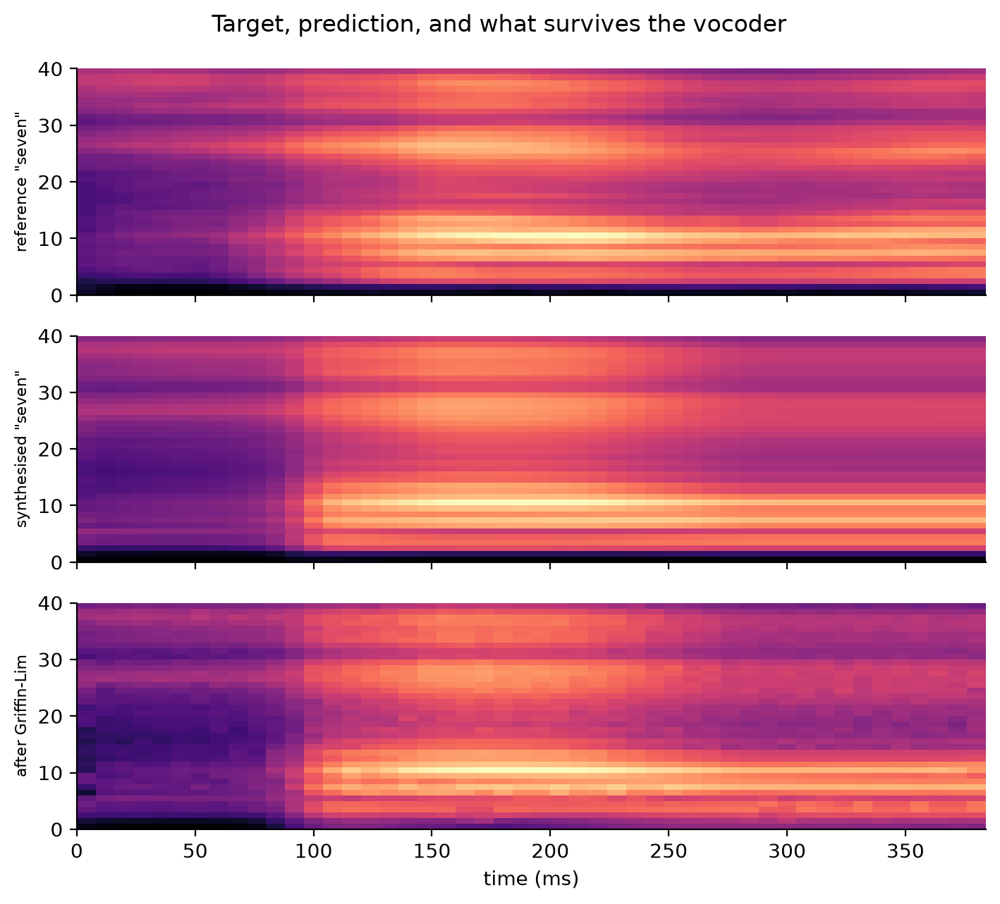
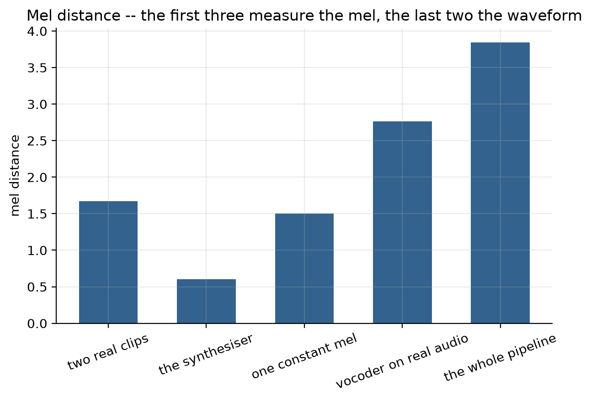
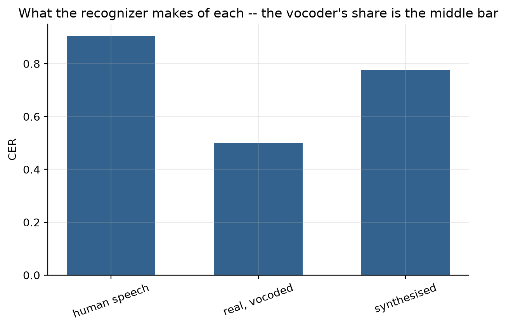
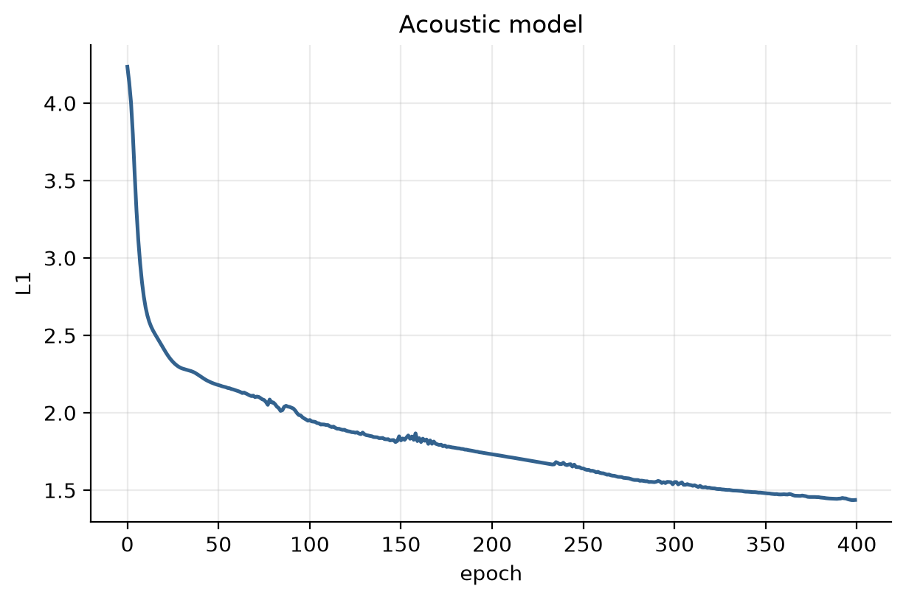

### What surprised me

**The vocoder costs everything on one metric and almost
nothing on the other.** Griffin-Lim costs **2.761 mel distance** — four times the
acoustic model's own 0.636 — and **0.025 CER**. It destroys a great deal of
spectral detail and almost none of the intelligibility. I had written into the
rung that it "puts a ceiling on quality that everything downstream inherits";
that is true of one metric and nearly false of the other, and 0.400 of the
synthesised audio's 0.500 error is the acoustic model's, not the vocoder's.

**That number was only trustworthy after the judge was fixed.** The first
version built the round-trip recogniser with an `Experiment` carrying no
normalisation key, so it silently used the global arm I2 had just measured as
costing 0.29 — and read *clean human speech* at 0.905 CER. It reported the
vocoder's cost as exactly 0.000, which looked like a clean result and was a judge
unable to tell anything apart. A round-trip metric is worth exactly what the
recogniser behind it is worth, and there is no way to see that from the metric.

**I also compared the wrong things twice.** The vocoder "ceiling" was quoted
against the acoustic model's mel distance, putting a waveform round-trip beside a
spectrogram prediction — which is how a synthesiser appeared to score *below* its
own floor. And the vocoded control was compared against a held-out speaker's
number when the vocoded audio comes from the training voice. Both are now like
for like.

**The speaker check fails, reproducibly.** At 400 epochs on 200 clips from one
voice, the synthesised envelope is closer to a speaker the model never saw. Mel
distance says the model learned the words; the speaker metric says it did not
learn the voice, and only having the third metric makes that visible.

### Open threads

A neural vocoder (HiFi-GAN) would separate "Griffin-Lim is
lossy" from "the acoustic model is blurry" properly, and duration prediction —
fixed at 48 frames here — is the obvious next piece. No listening test was run
and nothing here should be read as a claim about naturalness.

### Further reading

Griffin & Lim (1984); Shen et al. (2018) for the two-stage split.

---

## I4 — Streaming and latency

**Question.** Every number in I2 used the whole utterance. What does answering
*while* someone speaks cost?

### The math

The whole rung is one inequality. Write $R(t)$ for the set of input frames the
output at frame $t$ is allowed to depend on. The three designs differ only in
that set:

$$R_{\text{bidir}}(t) = \{1..T\}, \qquad
R_{\text{chunk}}(t) = \left\{1..\min\!\left(T,\ \left\lceil \tfrac{t}{C} \right\rceil C + L\right)\right\}, \qquad
R_{\text{causal}}(t) = \{1..t\},$$

and the algorithmic latency is how long you must wait for $\max R(t)$ to arrive:
$T\!\cdot\!H$ for the first, $(C + L)H$ for the second, $H$ for the third, with
$H$ the hop. Accuracy and latency are not two quantities to balance — they are
the same choice of $R$, read from two ends.

I2's recogniser is **bidirectional**: the representation of frame $t$ depends on
every frame after it. Free at evaluation time, impossible in a stream. Three
responses, and the rung measures all three:

1. **Chunk it anyway** — run the bidirectional model on independent windows of
   $C$ frames. Wrong at every boundary, and the error measures how much future
   context the model was using.
2. **Buy it back with lookahead** — emit frame $t$ only after $L$ more frames
   arrive. Latency is $L$ frames; the question is the exchange rate.
3. **Train a causal model** — one that never reads backwards, pays a fixed cost
   and has no lookahead latency at all.

Algorithmic latency and wall-clock are reported separately, because the first is
a property of the architecture and reproduces anywhere while the second is a
property of this CPU today.

### What I built

I2's recogniser, chunked at 4–32 frames with 0–16 frames of
lookahead, against a unidirectional model of the same shape trained the same way.

### Results

Medians over seeds 0–2. Full utterance: **0.429 CER**.

| design | CER | latency |
| --- | --- | --- |
| full utterance, bidirectional | 0.429 | 392 ms |
| chunked 8 frames, no lookahead | 0.721 | 64 ms |
| chunked 32 frames, no lookahead | 0.572 | 256 ms |
| **causal model** | **0.673** | **8 ms** |

Lookahead buys accuracy back at a measurable rate:

| lookahead | 0 | 2 | 4 | 8 | 16 frames |
| --- | --- | --- | --- | --- | --- |
| CER | 0.721 | 0.672 | 0.639 | 0.619 | **0.579** |

**0.148 CER recovered for 128 ms**, or 0.0115 CER per 10 ms, with 0.127 still
separating it from the full-utterance model. Chunking costs **4.9× the compute**
for the same audio, because each window re-reads the utterance from its start.

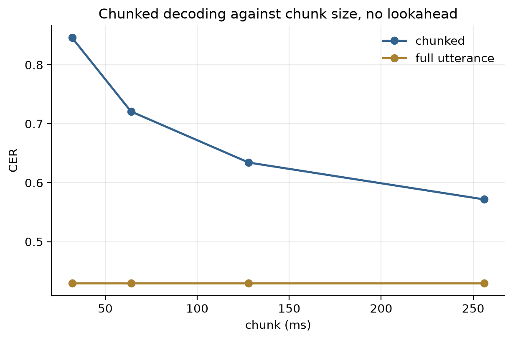
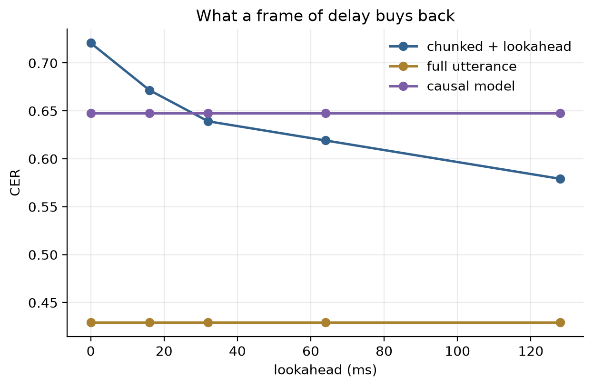
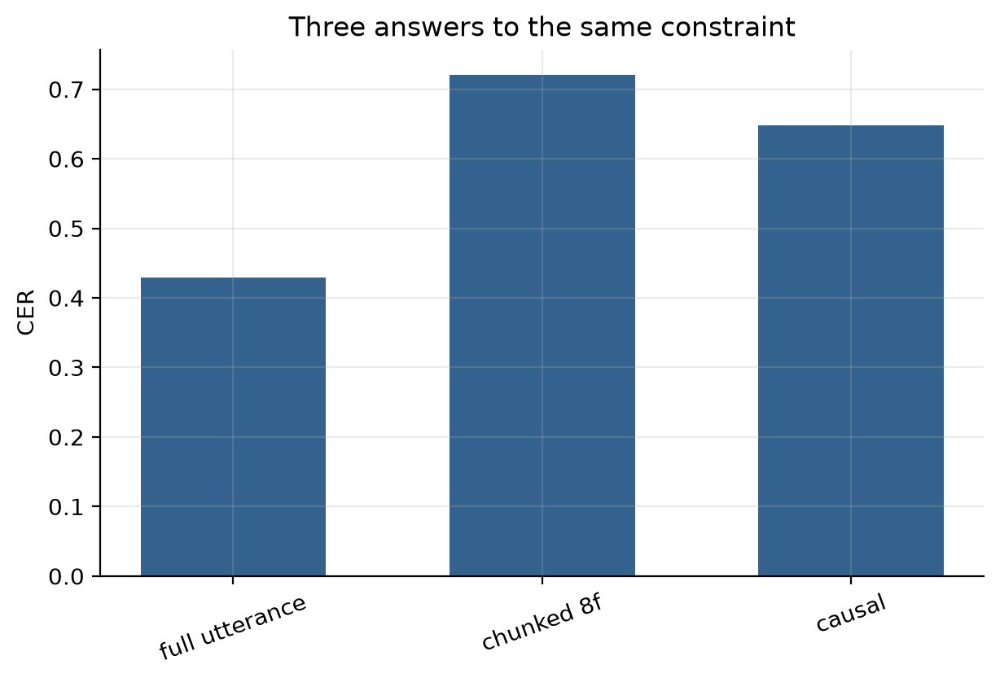

### What surprised me

**Designing for the constraint beat retrofitting it, by
more than the parameter count explains.** The causal model at 0.673 beats the
chunked bidirectional model at 0.721 while having *zero* lookahead latency — it
is as good as roughly four frames of delay, for free. The bidirectional model
learned to use future context and then had it taken away; the causal one never
depended on it.

**The causal model is 1.22× the parameters, not matched**, which I claimed in the
docstring before measuring. Doubling the hidden size of a unidirectional GRU does
not equal a bidirectional one of half the width: the recurrent matrix is
$(2h)^2$ against two of $h^2$. The direction is at least conservative — the
causal arm is the *larger* one, so the accuracy it gives up is a cost of
causality rather than of capacity — but "matched" was wrong and is now reported
as a ratio.

**Streaming costs compute, not just accuracy.** 4.9× for the same audio, because
this implementation re-reads from the start on every chunk. A production system
carries the recurrent state forward instead; that this one does not is the
honest limitation, and it is why the wall-clock number is kept separate from the
algorithmic latency that does transfer.

### Open threads

Truncating left context as well as right would make this a
real streaming model rather than an upper bound on one, and carrying the GRU
state across chunks would remove the 4.9×. Neither is implemented.

### Further reading

the torchaudio streaming tutorials in this part's lab reference.

---

## What part I settled

1. **Three stages agreeing to $10^{-6}$ is what makes the fourth's
   $3.5\times10^{-2}$ readable.** The MFCC disagreement was a log guard —
   offset versus clamp — and the quietest mel energy in the corpus sits *below*
   torchaudio's offset, so it is not guarding, it is shifting. Worth 27,490× the
   agreement, and invisible to an end-to-end diff.
2. **The time–frequency trade is an identity, not a tendency.** 1920 Hz·ms at
   every window length from 4 ms to 128 ms, constant to 1.00×.
3. **A shuffled split is worth 5× on this corpus.** 0.063 CER against 0.315,
   same model, same clips, only the split changed. In speech the thing a model
   memorises is a voice.
4. **I argued my way into the wrong normalisation and a loss curve caught it.**
   Training loss 0.002 with validation CER 0.90 is a model that fit four voices
   and read a fifth as noise. Per-utterance CMN was worth 0.291 CER — more than
   any architectural choice here — and I had written a paragraph explaining why
   it would be wrong.
5. **A metric can cost everything on one axis and nothing on another.**
   Griffin-Lim: 2.761 mel distance, 0.025 CER. Any single-number summary of this
   vocoder is a choice of which fact to report.
6. **A round-trip metric is worth exactly what its judge is worth, and the
   metric cannot tell you that.** The broken judge read clean human speech at
   0.905 and reported the vocoder's cost as a tidy 0.000. The fixed one reads it
   at 0.000 and reports 0.025.
7. **Designing for a constraint beat retrofitting it.** A causal model with zero
   lookahead latency (0.673) beats chunking a bidirectional one (0.721), which is
   worth about four frames of delay for free.
8. **Running the real model found three defects the config could not.** The
   candle fork's whisper *example* returns an empty transcription for all 40
   isolated digits while transformers reads the same files at 0.75 — established
   as real by a control showing the same binary transcribing the example's own
   long samples correctly. Getting that far also required fixing a
   `candle-transformers` that will not build without CUDA (contradicting the
   catalog's own `whisper-cpu.yaml`) and a `candle-examples` that declares
   symphonia 0.6 while using the 0.5 API.

   **The scope of that first finding is the example, not the production path.**
   ignite-catalog's `candle-transcription` executor shares the model and none of
   the decode: it has its own `Decoder`, no `apply_timestamp_rules` at all — the
   function this record names as the lead — no temperature-fallback loop, and a
   `no_timestamps_token`. So the empty transcriptions most likely do *not*
   transfer to it, and the executor is untested. Saying "the fork's whisper"
   without that qualification, as an earlier version of this section did, points
   the finding at code it was never run against. Details in
   [`data/i-real-models.json`](data/i-real-models.json).
9. **Five of my own mistakes in this part were metrics, not models.** A scoring
   rule that counted `"1."` as silence; a judge that could not hear; a ceiling
   compared against the wrong quantity; a control drawn from the wrong speaker; a
   parameter count claimed as matched without being checked. The arm-level
   measurements were right every time. That is the tenth such occasion in this
   repo, and the only method that has ever caught them is adding the control that
   could embarrass the result.

**Cost of the part:** ~2,400 lines including tests, 19 test cases, and a
three-seed sweep in about 72 minutes on four CPU cores (I1 2 s, I2 ~1,280 s,
I3 ~416 s, I4 ~1,107 s per seed), plus a Kaggle T4 kernel for the candle
comparison. I2 dominates because it trains three models per seed: both
normalisation arms and the shuffled-split control.

---

*Figures regenerate with `uv run python tools/writeup_figures.py I`; the numbers
they are quoted against live in [`data/i-metrics.json`](data/i-metrics.json).
The [part README](../../parts/i_speech/README.md) is the short version of this
document.*
